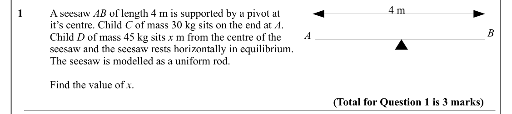
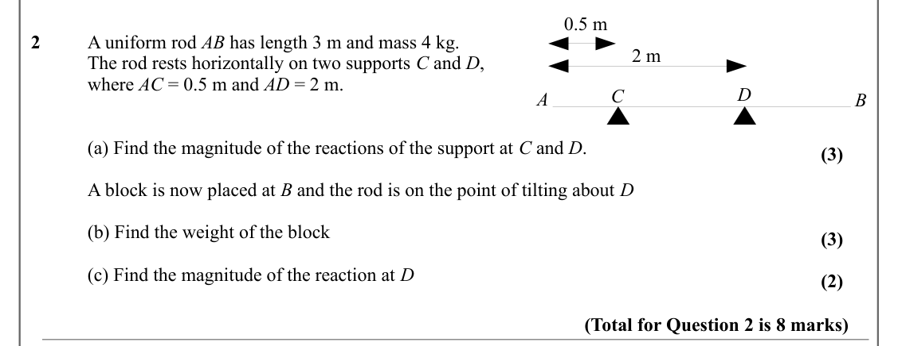
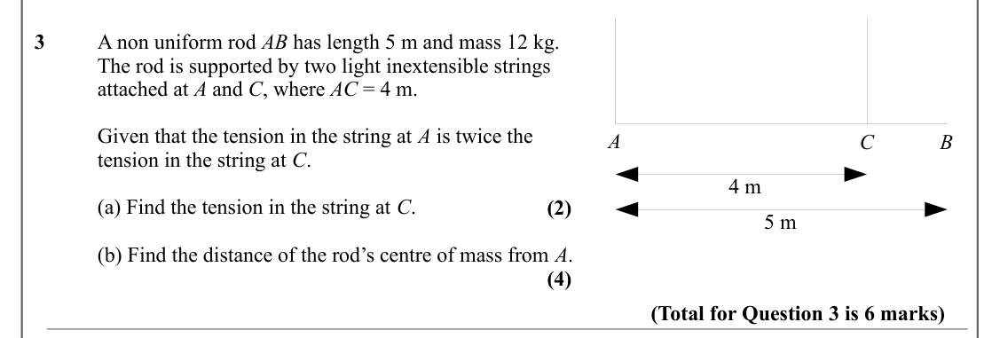
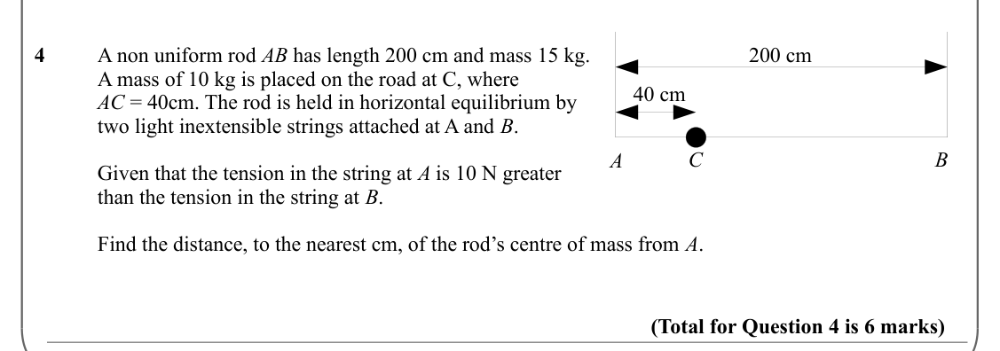

# Moments — Question Set (A-Level Maths · Edexcel · Year 2 Mechanics)

Chapter question set · `a-level-mechanics-1-moments` · 4 questions · segmented by printed total lines

## Q1 (3 marks)

Text (lossy): 4 m / 1  / A seesaw AB of length 4 m is supported by a pivot at / it’s centre. Child C of mass 30 kg sits on the end at A.  / B / A / Child D of mass 45 kg sits x m from the centre of the  / seesaw and the seesaw rests horizontally in equilibrium.  / The seesaw is modelled as a uniform rod.  / Find the value of x. / (Total for Question 1 is 3 marks)

## Q2 (8 marks · parts a, b, c)

Text (lossy): 0.5 m / 2  / A uniform rod AB has length 3 m and mass 4 kg. / 2 m / The rod rests horizontally on two supports C and D,  / where AC = 0.5 m and AD = 2 m. / D / C / A / B / (a) Find the magnitude of the reactions of the support at C and D.  / (3) / A block is now placed at B and the rod is on the point of tilting about D / (b) Find the weight of the block / (3) / (c) Find the magnitude of the react

## Q3 (6 marks · parts a, b)

Text (lossy): 3  / A non uniform rod AB has length 5 m and mass 12 kg. / The rod is supported by two light inextensible strings  / attached at A and C, where AC = 4 m.  / Given that the tension in the string at A is twice the / A / C / B / tension in the string at C.  / 4 m / (a) Find the tension in the string at C.  / (2) / 5 m / (b) Find the distance of the rod’s centre of mass from A.  / (4) / (Total for Que

## Q4 (6 marks)

Text (lossy): 4  / A non uniform rod AB has length 200 cm and mass 15 kg. / 200 cm / A mass of 10 kg is placed on the road at C, where  / 40 cm / AC = 40cm. The rod is held in horizontal equilibrium by / two light inextensible strings attached at A and B.  / C / B / A / Given that the tension in the string at A is 10 N greater  / than the tension in the string at B. / Find the distance, to the nearest cm, of th

