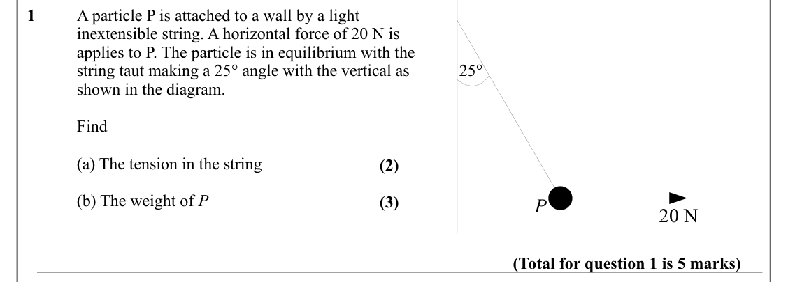
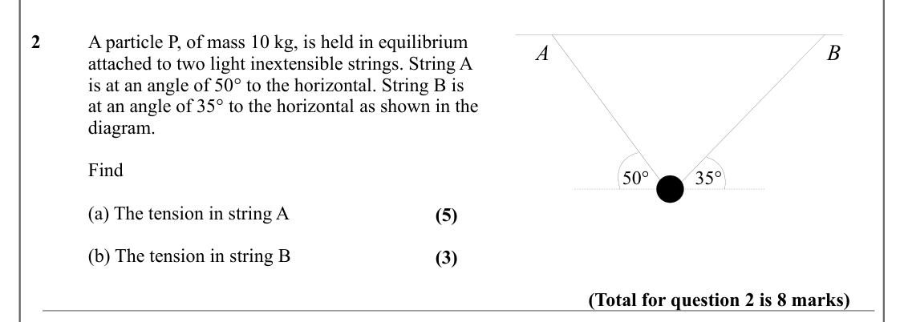
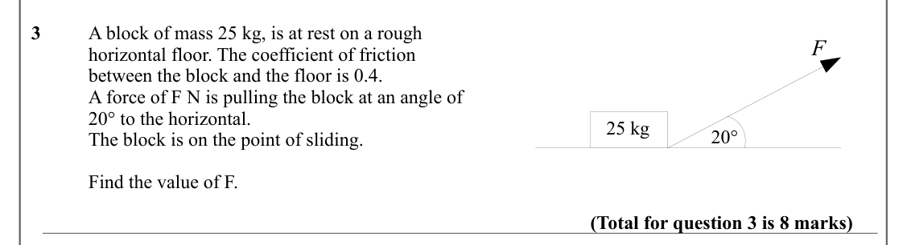
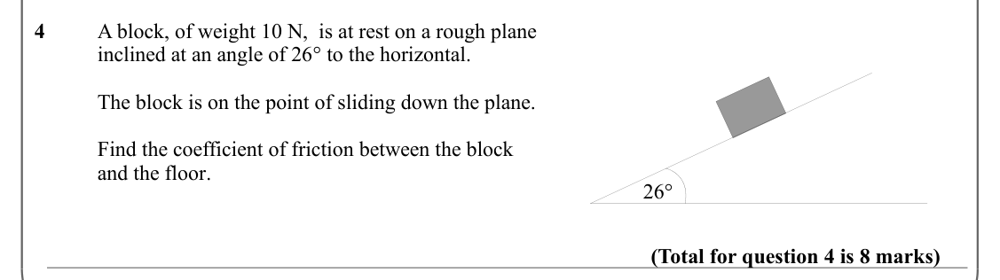
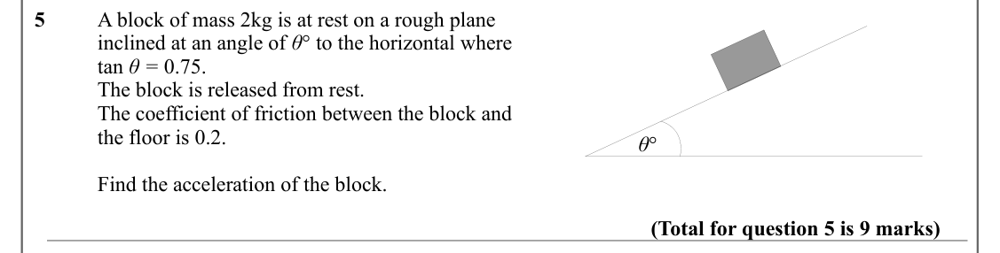
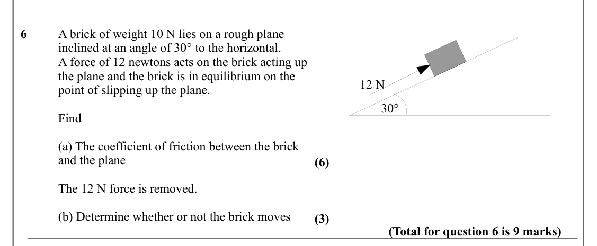
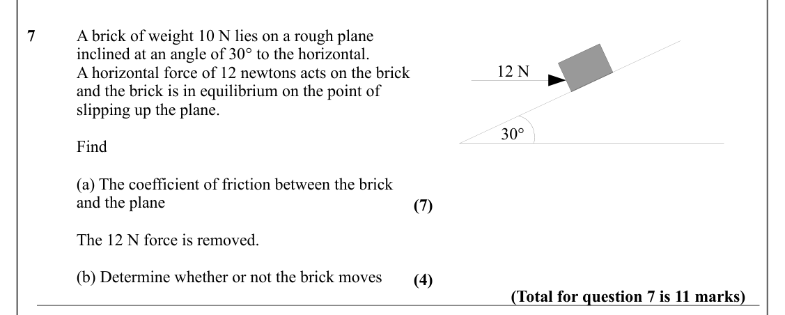
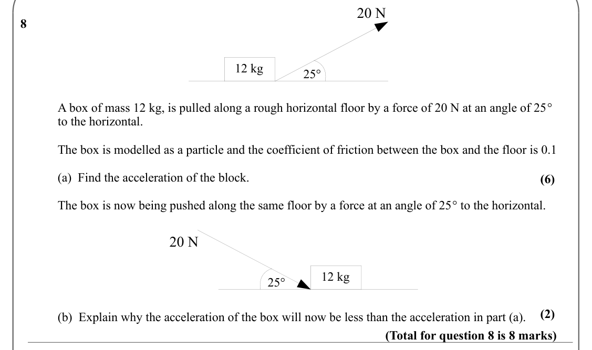
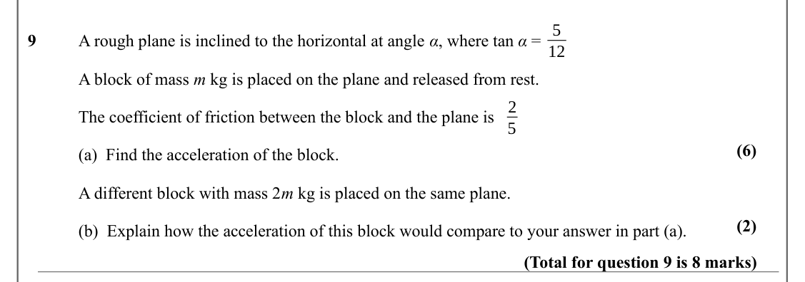
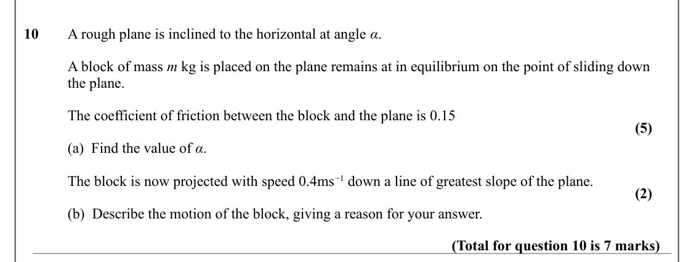

# Forces and Friction — Question Set (A-Level Maths · Edexcel · Year 2 Mechanics)

Chapter question set · `a-level-mechanics-2-forces-and-friction` · 10 questions · segmented by printed total lines

## Q1 (5 marks · parts a, b)

Text (lossy): 1  / A particle P is attached to a wall by a light  / inextensible string. A horizontal force of 20 N is  / applies to P. The particle is in equilibrium with the  / 25° / string taut making a 25° angle with the vertical as  / shown in the diagram.  / Find / (a) The tension in the string / (2) / (b) The weight of P / (3) / P / 20 N  / (Total for question 1 is 5 marks)

## Q2 (8 marks · parts a, b)

Text (lossy): 2  / A particle P, of mass 10 kg, is held in equilibrium  / A / B / attached to two light inextensible strings. String A  / is at an angle of 50° to the horizontal. String B is  / at an angle of 35° to the horizontal as shown in the  / diagram.  / Find / 50° / 35° / (a) The tension in string A / (5) / (b) The tension in string B / (3) / (Total for question 2 is 8 marks)

## Q3 (8 marks)

Text (lossy): 3  / A block of mass 25 kg, is at rest on a rough  / F / horizontal floor. The coefficient of friction  / between the block and the floor is 0.4.  / A force of F N is pulling the block at an angle of  / 20° to the horizontal.  / 25 kg / 20° / The block is on the point of sliding.  / Find the value of F.  / (Total for question 3 is 8 marks)

## Q4 (8 marks)

Text (lossy): 4  / A block, of weight 10 N,  is at rest on a rough plane  / inclined at an angle of 26° to the horizontal.  / The block is on the point of sliding down the plane.  / Find the coefficient of friction between the block / and the floor.  / 26° / (Total for question 4 is 8 marks)

## Q5 (9 marks)

Text (lossy): 5  / A block of mass 2kg is at rest on a rough plane / inclined at an angle of θ° to the horizontal where  / tan θ = 0.75.  / The block is released from rest.  / The coefficient of friction between the block and / the floor is 0.2.  / θ° / Find the acceleration of the block.  / (Total for question 5 is 9 marks)

## Q6 (9 marks · parts a, b)

Text (lossy): 6  / A brick of weight 10 N lies on a rough plane / inclined at an angle of 30° to the horizontal.  / A force of 12 newtons acts on the brick acting up  / the plane and the brick is in equilibrium on the  / 12 N / point of slipping up the plane.  / 30° / Find  / (a) The coefficient of friction between the brick  / and the plane / (6) / The 12 N force is removed.  / (b) Determine whether or not the

## Q7 (11 marks · parts a, b)

Text (lossy): 7  / A brick of weight 10 N lies on a rough plane / inclined at an angle of 30° to the horizontal.  / 12 N / A horizontal force of 12 newtons acts on the brick  / and the brick is in equilibrium on the point of / slipping up the plane.  / 30° / Find  / (a) The coefficient of friction between the brick  / and the plane / (7) / The 12 N force is removed.  / (b) Determine whether or not the brick mov

## Q8 (8 marks · parts a, b)

Text (lossy): 20 N / 8 / 12 kg / 25° / A box of mass 12 kg, is pulled along a rough horizontal floor by a force of 20 N at an angle of 25°  / to the horizontal.  / The box is modelled as a particle and the coefficient of friction between the box and the floor is 0.1 / (a)  Find the acceleration of the block. / (6) / The box is now being pushed along the same floor by a force at an angle of 25° to the horizontal

## Q9 (8 marks · parts a, b)

Text (lossy): 5 / 9  / A rough plane is inclined to the horizontal at angle α, where tan α =  / 12 / A block of mass m kg is placed on the plane and released from rest.   / 2 / The coefficient of friction between the block and the plane is  / 5 / (6) / (a)  Find the acceleration of the block.  / A different block with mass 2 m kg is placed on the same plane.  / (2) / (b)  Explain how the acceleration of this bl

## Q10 (7 marks · parts a, b)

Text (lossy): 10  / A rough plane is inclined to the horizontal at angle α. / A block of mass m kg is placed on the plane remains at in equilibrium on the point of sliding down  / the plane.  / The coefficient of friction between the block and the plane is 0.15  / (5) / (a)  Find the value of α. / The block is now projected with speed 0.4ms−1 down a line of greatest slope of the plane. / (2) / (b)  Describe the

