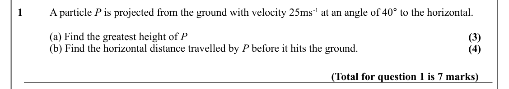
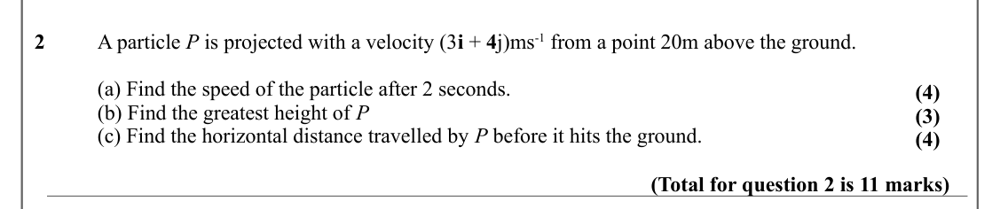
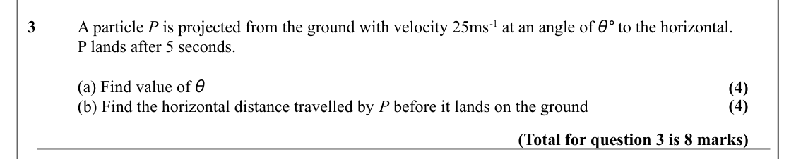
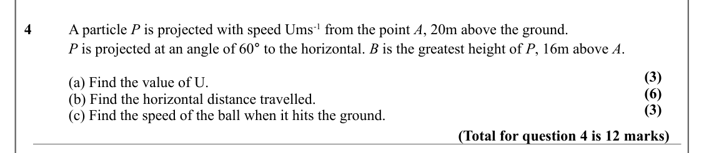
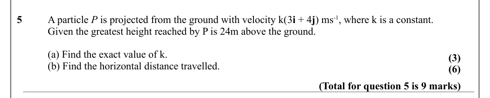
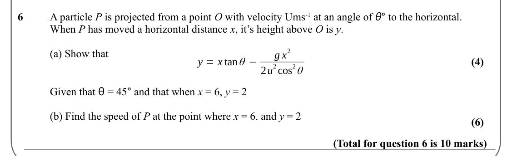
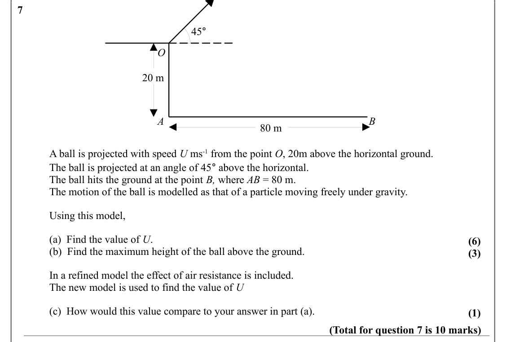
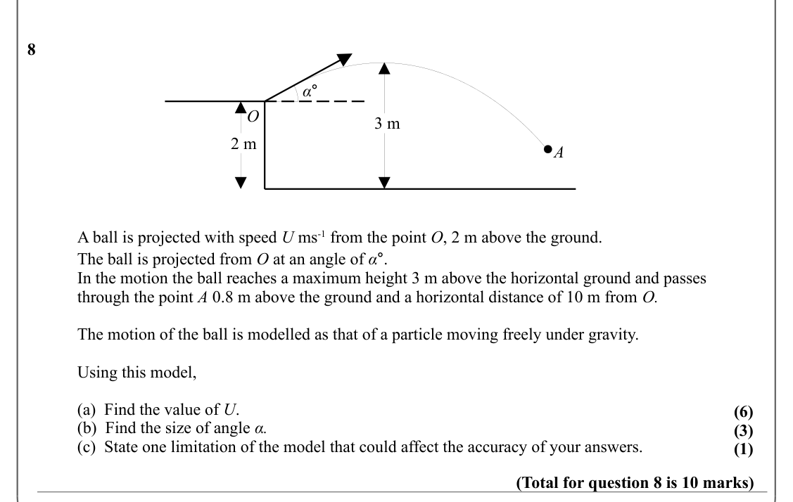
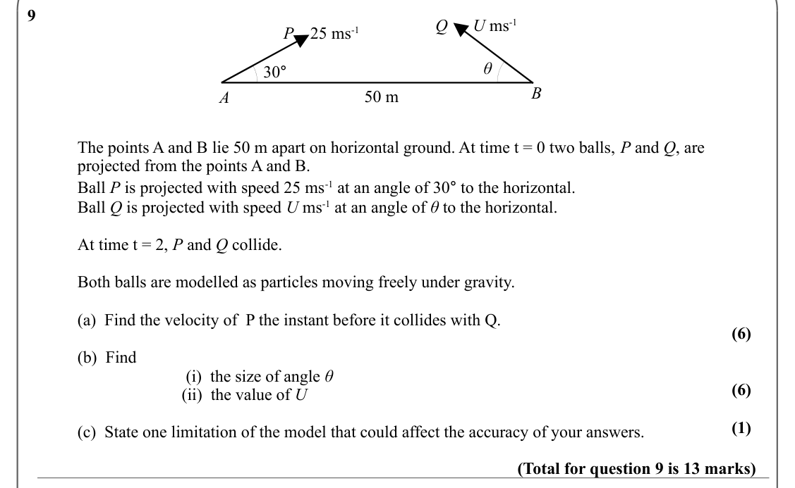

# Projectiles — Question Set (A-Level Maths · Edexcel · Year 2 Mechanics)

Chapter question set · `a-level-mechanics-3-projectiles` · 9 questions · segmented by printed total lines

## Q1 (7 marks · parts a, b)

Text (lossy): A particle P is projected from the ground with velocity 25ms-1 at an angle of 40° to the horizontal.  / 1 / (a) Find the greatest height of P / (3) / (b) Find the horizontal distance travelled by P before it hits the ground. / (4) / (Total for question 1 is 7 marks)

## Q2 (11 marks · parts a, b, c)

Text (lossy): 2 / A particle P is projected with a velocity (3 i + 4 j)ms-1 from a point 20m above the ground.  / (a) Find the speed of the particle after 2 seconds.  / (4) / (b) Find the greatest height of P / (3) / (c) Find the horizontal distance travelled by P before it hits the ground.   / (4) / (Total for question 2 is 11 marks)

## Q3 (8 marks · parts a, b)

Text (lossy): A particle P is projected from the ground with velocity 25ms-1 at an angle of θ° to the horizontal.  / 3 / P lands after 5 seconds.  / (a) Find value of θ / (4) / (4) / (b) Find the horizontal distance travelled by P before it lands on the ground  / (Total for question 3 is 8 marks)

## Q4 (12 marks · parts a, b, c)

Text (lossy): 4 / A particle P is projected with speed Ums-1 from the point A, 20m above the ground. / P is projected at an angle of 60° to the horizontal. B is the greatest height of P, 16m above A.  / (3) / (a) Find the value of U.  / (6) / (b) Find the horizontal distance travelled.  / (3) / (c) Find the speed of the ball when it hits the ground. / (Total for question 4 is 12 marks)

## Q5 (9 marks · parts a, b)

Text (lossy): 5 / A particle P is projected from the ground with velocity k(3 i + 4 j) ms-1, where k is a constant. / Given the greatest height reached by P is 24m above the ground.  / (a) Find the exact value of k.  / (3) / (b) Find the horizontal distance travelled.  / (6) / (Total for question 5 is 9 marks)

## Q6 (10 marks · parts a, b)

Text (lossy): A particle P is projected from a point O with velocity Ums-1 at an angle of θ° to the horizontal.  / 6 / When P has moved a horizontal distance x, it’s height above O is y.  / (a) Show that / 2 / g x / y = x tan θ − / (4) / 2 cos / 2 θ / 2 u / Given that θ = 45° and that when x = 6, y = 2 / (b) Find the speed of P at the point where x = 6. and y = 2  / (6) / (Total for question 6 is 10 marks)

## Q7 (10 marks · parts a, b, c)

Text (lossy): 7 / 45° / O / 20 m / A / B / 80 m / A ball is projected with speed U ms-1 from the point O, 20m above the horizontal ground. / The ball is projected at an angle of 45° above the horizontal.  / The ball hits the ground at the point B, where AB = 80 m.  / The motion of the ball is modelled as that of a particle moving freely under gravity. / Using this model, / (a)  Find the value of U.  / (6) / (b)

## Q8 (10 marks · parts a, b, c)

Text (lossy): 8 / α° / O / 3 m / 2 m / A / A ball is projected with speed U ms-1 from the point O, 2 m above the ground. / The ball is projected from O at an angle of α°. / In the motion the ball reaches a maximum height 3 m above the horizontal ground and passes  / through the point A 0.8 m above the ground and a horizontal distance of 10 m from O. / The motion of the ball is modelled as that of a particle mov

## Q9 (13 marks · parts a, b, c, i, ii)

Text (lossy): 9 / Q      U ms-1 / P    25 ms-1 / θ / 30° / B / 50 m / A / The points A and B lie 50 m apart on horizontal ground. At time t = 0 two balls, P and Q, are  / projected from the points A and B.  / Ball P is projected with speed 25 ms-1 at an angle of 30° to the horizontal.   / Ball Q is projected with speed U ms-1 at an angle of θ to the horizontal.   / At time t = 2, P and Q collide.  / Both balls 

