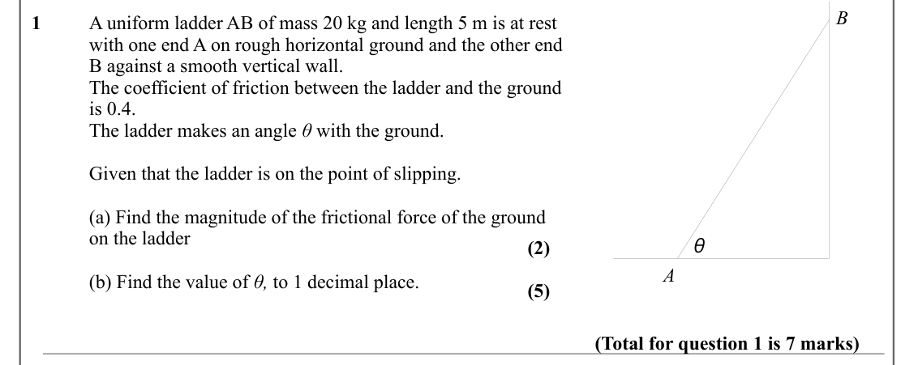
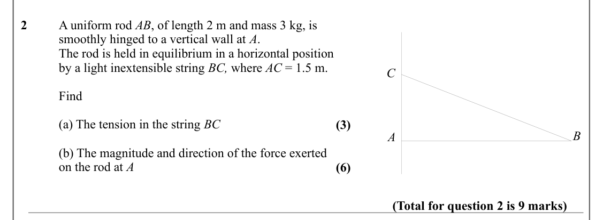
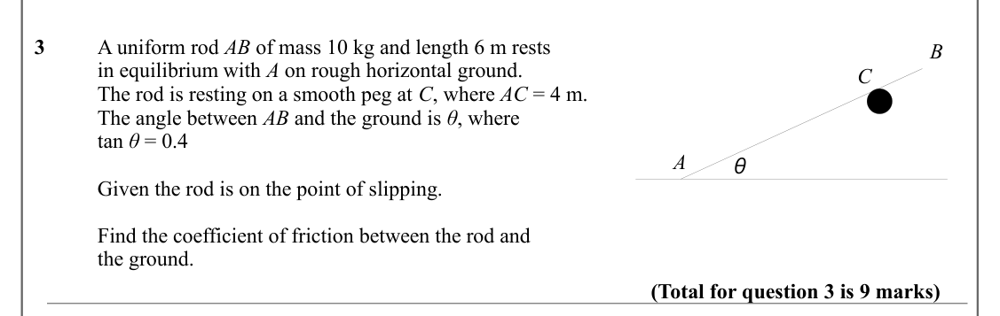
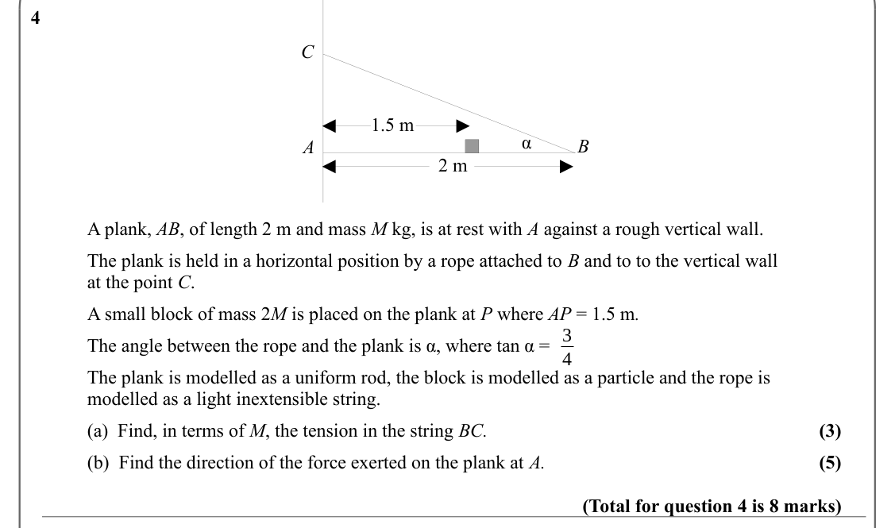
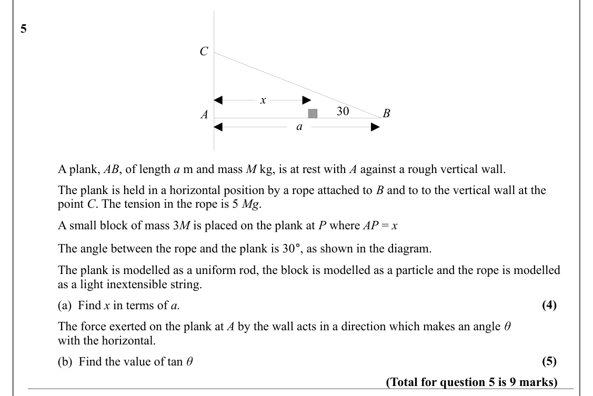
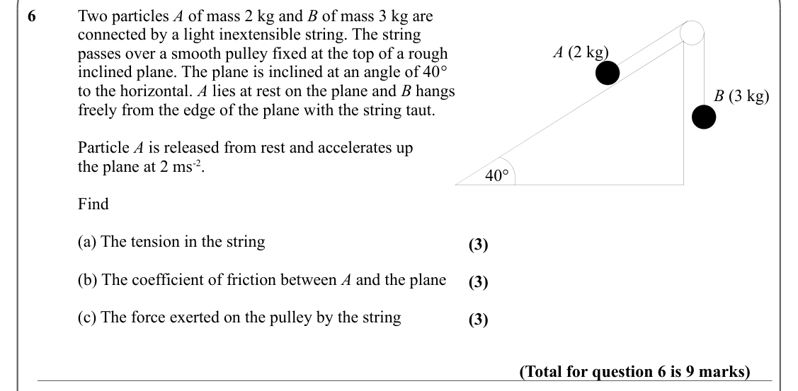
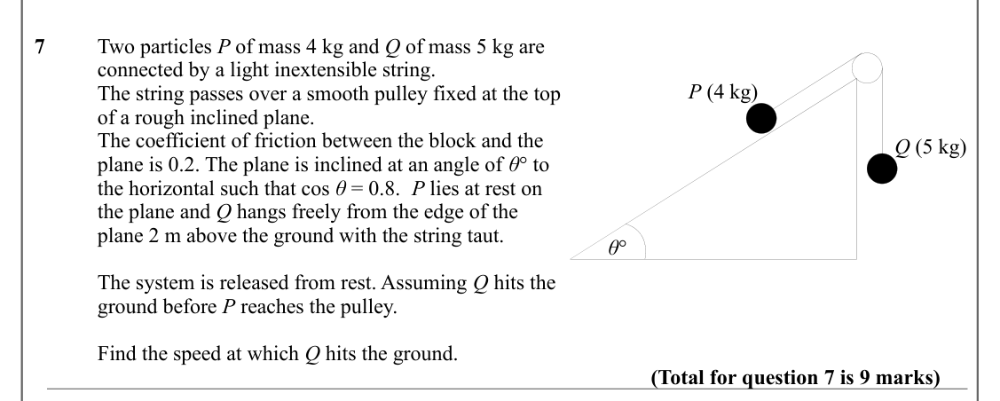
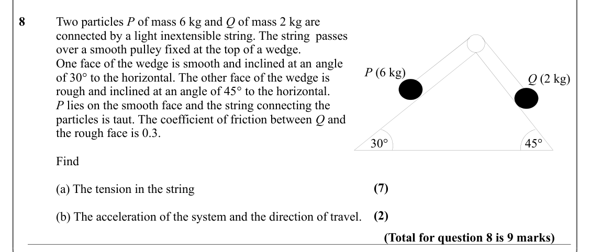
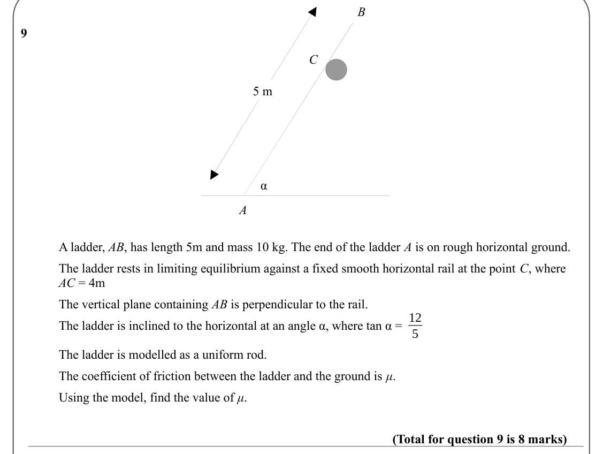
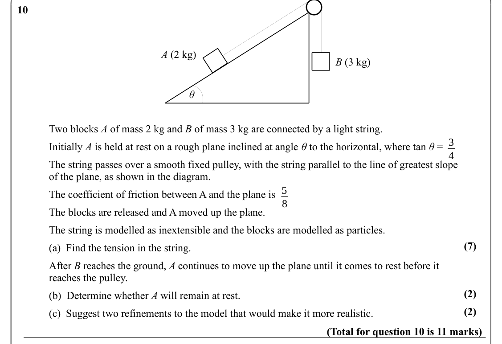

# Applications of Forces — Question Set (A-Level Maths · Edexcel · Year 2 Mechanics)

Chapter question set · `a-level-mechanics-4-applications-of-forces` · 10 questions · segmented by printed total lines

## Q1 (7 marks · parts a, b)

Text (lossy): B / 1  / A uniform ladder AB of mass 20 kg and length 5 m is at rest  / with one end A on rough horizontal ground and the other end / B against a smooth vertical wall.  / The coefficient of friction between the ladder and the ground  / is 0.4.  / The ladder makes an angle θ with the ground.  / Given that the ladder is on the point of slipping.  / (a) Find the magnitude of the frictional force of t

## Q2 (9 marks · parts a, b)

Text (lossy): 2  / A uniform rod AB, of length 2 m and mass 3 kg, is  / smoothly hinged to a vertical wall at A.  / The rod is held in equilibrium in a horizontal position  / by a light inextensible string BC, where AC = 1.5 m.  / C / Find / (a) The tension in the string BC / (3) / B / A / (b) The magnitude and direction of the force exerted  / on the rod at A / (6) / (Total for question 2 is 9 marks)

## Q3 (9 marks)

Text (lossy): 3  / A uniform rod AB of mass 10 kg and length 6 m rests  / B / in equilibrium with A on rough horizontal ground.  / C / The rod is resting on a smooth peg at C, where AC = 4 m.  / The angle between AB and the ground is θ, where  / tan θ = 0.4 / A / θ / Given the rod is on the point of slipping.  / Find the coefficient of friction between the rod and / the ground.  / (Total for question 3 is 9 mar

## Q4 (8 marks · parts a, b)

Text (lossy): 4  / C / 1.5 m / α / B / A / 2 m / A plank, AB, of length 2 m and mass M kg, is at rest with A against a rough vertical wall.  / The plank is held in a horizontal position by a rope attached to B and to to the vertical wall  / at the point C. / A small block of mass 2 M is placed on the plank at P where AP = 1.5 m.  / 3 / The angle between the rope and the plank is α, where tan α =  / 4 / The plan

## Q5 (9 marks · parts a, b)

Text (lossy): 5  / C / x  / 30 / B / A / a / A plank, AB, of length a m and mass M kg, is at rest with A against a rough vertical wall.  / The plank is held in a horizontal position by a rope attached to B and to to the vertical wall at the   / point C. The tension in the rope is 5 Mg.  / A small block of mass 3 M is placed on the plank at P where AP = x / The angle between the rope and the plank is 30°, as sho

## Q6 (9 marks · parts a, b, c)

Text (lossy): 6  / Two particles A of mass 2 kg and B of mass 3 kg are / connected by a light inextensible string. The string  / A (2 kg) / passes over a smooth pulley fixed at the top of a rough / inclined plane. The plane is inclined at an angle of 40°  / to the horizontal. A lies at rest on the plane and B hangs  / B (3 kg) / freely from the edge of the plane with the string taut. / Particle A is released fr

## Q7 (9 marks)

Text (lossy): 7  / Two particles P of mass 4 kg and Q of mass 5 kg are / connected by a light inextensible string.  / P (4 kg) / The string passes over a smooth pulley fixed at the top  / of a rough inclined plane.  / The coefficient of friction between the block and the  / Q (5 kg) / plane is 0.2. The plane is inclined at an angle of θ° to  / the horizontal such that cos θ = 0.8. P lies at rest on  / the plane

## Q8 (9 marks · parts a, b)

Text (lossy): 8  / Two particles P of mass 6 kg and Q of mass 2 kg are / connected by a light inextensible string. The string passes / over a smooth pulley fixed at the top of a wedge.  / One face of the wedge is smooth and inclined at an angle  / P (6 kg) / of 30° to the horizontal. The other face of the wedge is  / Q (2 kg) / rough and inclined at an angle of 45° to the horizontal. / P lies on the smooth face

## Q9 (8 marks)

Text (lossy): B / 9  / C / 5 m / α / A / A ladder, AB, has length 5m and mass 10 kg. The end of the ladder A is on rough horizontal ground.  / The ladder rests in limiting equilibrium against a fixed smooth horizontal rail at the point C, where  / AC = 4m / The vertical plane containing AB is perpendicular to the rail. / 12 / The ladder is inclined to the horizontal at an angle α, where tan α =  / 5 / The ladde

## Q10 (11 marks · parts a, b, c)

Text (lossy): 10  / A (2 kg) / B (3 kg) / θ / Two blocks A of mass 2 kg and B of mass 3 kg are connected by a light string.  / 3 / Initially A is held at rest on a rough plane inclined at angle θ to the horizontal, where tan θ = / 4 / The string passes over a smooth fixed pulley, with the string parallel to the line of greatest slope / of the plane, as shown in the diagram.  / 5 / The coefficient of friction be

