# Further Kinematics — Question Set (A-Level Maths · Edexcel · Year 2 Mechanics)

Chapter question set · `a-level-mechanics-5-further-kinematics` · 21 questions · segmented by printed total lines

## Q1 (5 marks)

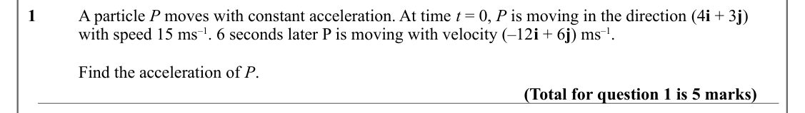

Text (lossy): 1    / A particle P moves with constant acceleration. At time t = 0, P is moving in the direction (4 i + 3 j)  / with speed 15 ms–1. 6 seconds later P is moving with velocity (–12 i + 6 j) ms–1. / Find the acceleration of P. / (Total for question 1 is 5 marks)

## Q2 (5 marks)

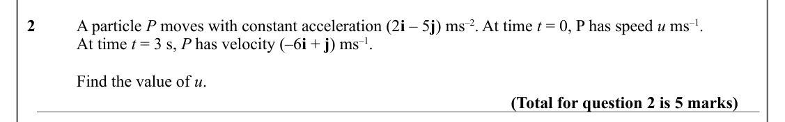

Text (lossy): 2    / A particle P moves with constant acceleration (2 i – 5 j) ms–2. At time t = 0, P has speed u ms–1. / At time t = 3 s, P has velocity (–6 i + j) ms–1. / Find the value of u. / (Total for question 2 is 5 marks)

## Q3 (7 marks · parts a, b)

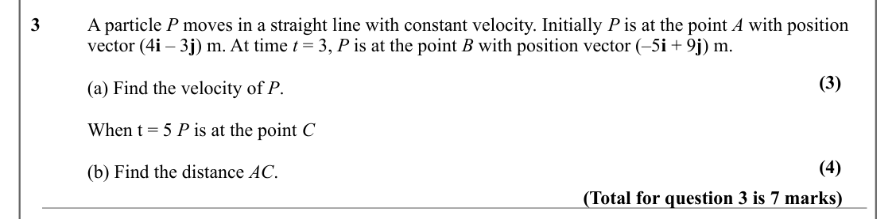

Text (lossy): 3    / A particle P moves in a straight line with constant velocity. Initially P is at the point A with position  / vector (4 i – 3 j) m. At time t = 3, P is at the point B with position vector (–5 i + 9 j) m. / (3) / (a) Find the velocity of P. / When t = 5 P is at the point C / (4) / (b) Find the distance AC. / (Total for question 3 is 7 marks)

## Q4 (6 marks · parts a, b)

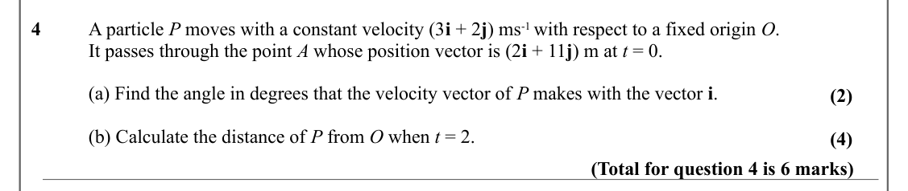

Text (lossy): 4    / A particle P moves with a constant velocity (3 i + 2 j) ms-1 with respect to a fixed origin O.  / It passes through the point A whose position vector is (2 i + 11 j) m at t = 0. / (a) Find the angle in degrees that the velocity vector of P makes with the vector i. / (2) / (b) Calculate the distance of P from O when t = 2.  / (4) / (Total for question 4 is 6 marks)

## Q5 (6 marks · parts a, b, c)

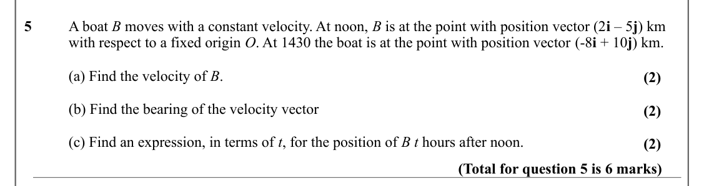

Text (lossy): 5    / A boat B moves with a constant velocity. At noon, B is at the point with position vector (2 i – 5 j) km  / with respect to a fixed origin O. At 1430 the boat is at the point with position vector (-8 i + 10 j) km. / (a) Find the velocity of B.  / (2) / (b) Find the bearing of the velocity vector / (2) / (c) Find an expression, in terms of t, for the position of B t hours after noon.  / (2) /

## Q6 (11 marks · parts a, b)

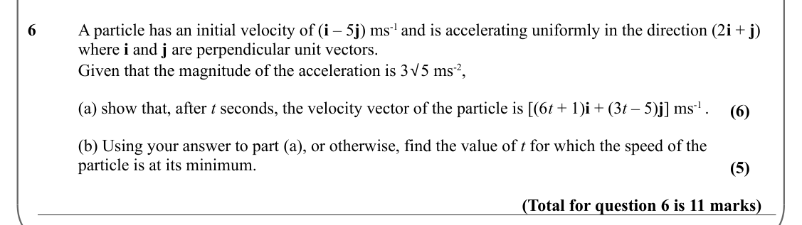

Text (lossy): 6 / A particle has an initial velocity of (i – 5 j) ms-1 and is accelerating uniformly in the direction (2 i + j)  / where i and j are perpendicular unit vectors. / Given that the magnitude of the acceleration is 3√5 ms-2, / (a) show that, after t seconds, the velocity vector of the particle is [(6 t + 1)i + (3 t – 5)j] ms-1 .  / (6) / (b) Using your answer to part (a), or otherwise, find the valu

## Q7 (10 marks · parts a, b, c)

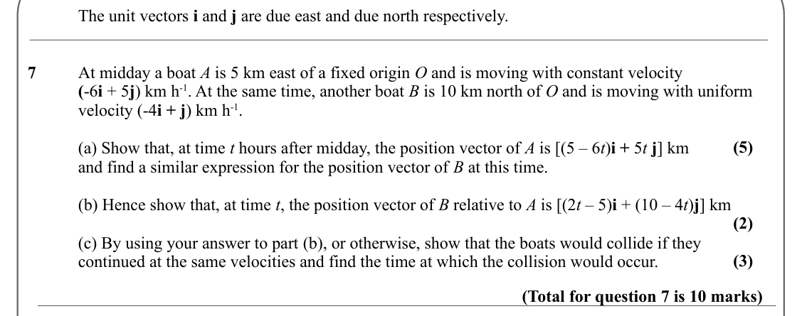

Text (lossy): The unit vectors i and j are due east and due north respectively. / 7 / At midday a boat A is 5 km east of a fixed origin O and is moving with constant velocity / (-6 i + 5 j) km h-1. At the same time, another boat B is 10 km north of O and is moving with uniform  / velocity (-4 i + j) km h-1. / (5) / (a) Show that, at time t hours after midday, the position vector of A is [(5 – 6 t)i + 5 t j] km 

## Q8 (13 marks · parts a, b, c)

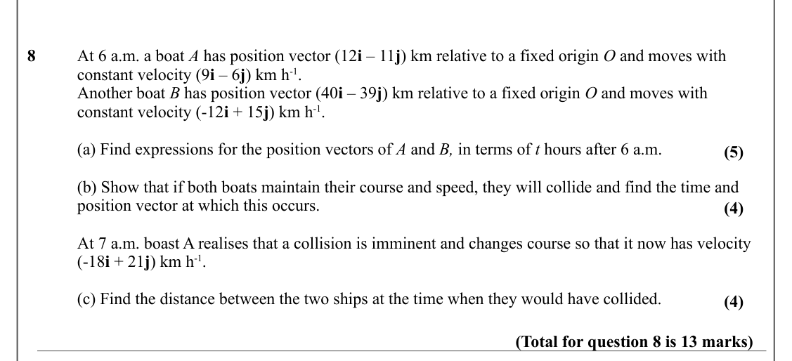

Text (lossy): 8 / At 6 a.m. a boat A has position vector (12 i – 11 j) km relative to a fixed origin O and moves with  / constant velocity (9 i – 6 j) km h-1. / Another boat B has position vector (40 i – 39 j) km relative to a fixed origin O and moves with  / constant velocity (-12 i + 15 j) km h-1.  / (a) Find expressions for the position vectors of A and B, in terms of t hours after 6 a.m. / (5) / (b) Show th

## Q9 (14 marks · parts a, b, c)

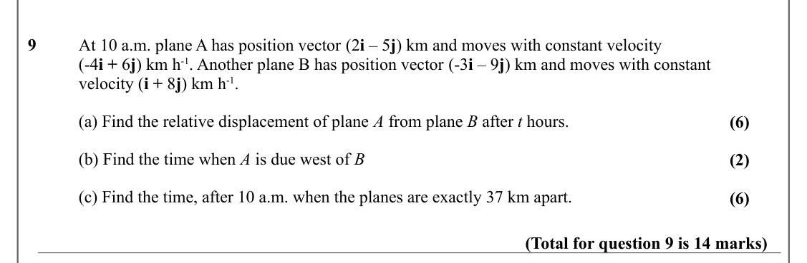

Text (lossy): 9 / At 10 a.m. plane A has position vector (2 i – 5 j) km and moves with constant velocity  / (-4 i + 6 j) km h-1. Another plane B has position vector (-3 i – 9 j) km and moves with constant  / velocity (i + 8 j) km h-1.  / (a) Find the relative displacement of plane A from plane B after t hours. / (6) / (b) Find the time when A is due west of B / (2) / (c) Find the time, after 10 a.m. when the pl

## Q10 (4 marks · parts a, b)

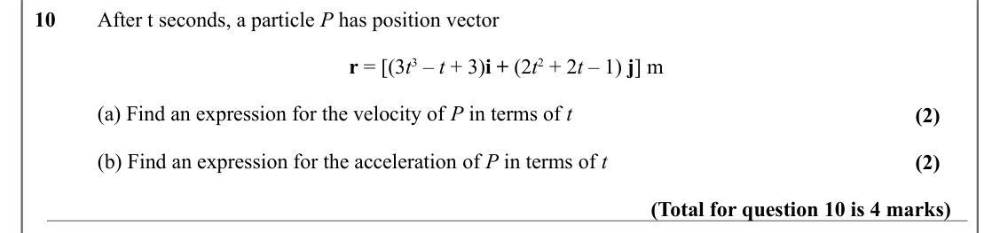

Text (lossy): 10 / After t seconds, a particle P has position vector / r = [(3 t 3 – t + 3)i + (2 t 2 + 2 t – 1) j] m / (a) Find an expression for the velocity of P in terms of t  / (2) / (b) Find an expression for the acceleration of P in terms of t  / (2) / (Total for question 10 is 4 marks)

## Q11 (5 marks · parts a, b)

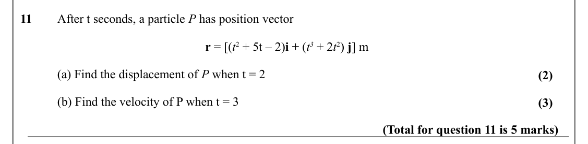

Text (lossy): 11 / After t seconds, a particle P has position vector / r = [(t 2 + 5t – 2)i + (t 3 + 2 t 2) j] m / (a) Find the displacement of P when t = 2 / (2) / (b) Find the velocity of P when t = 3  / (3) / (Total for question 11 is 5 marks)

## Q12 (8 marks · parts a, b)

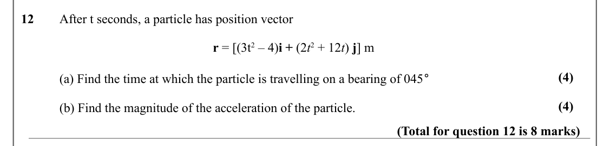

Text (lossy): 12 / After t seconds, a particle has position vector / r = [(3t 2 – 4)i + (2 t 2 + 12 t) j] m / (a) Find the time at which the particle is travelling on a bearing of 045° / (4) / (4) / (b) Find the magnitude of the acceleration of the particle. / (Total for question 12 is 8 marks)

## Q13 (8 marks · parts a, b)

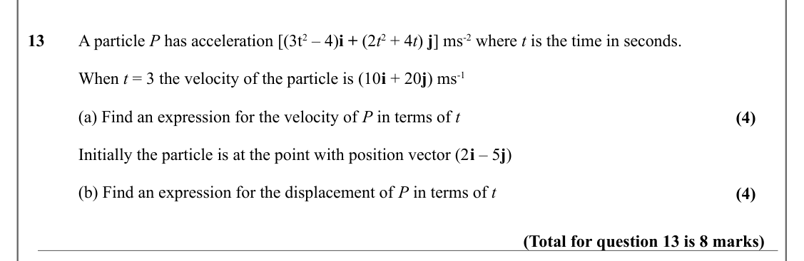

Text (lossy): 13 / A particle P has acceleration [(3t 2 – 4)i + (2 t 2 + 4 t) j] ms-2 where t is the time in seconds. / When t = 3 the velocity of the particle is (10 i + 20 j) ms-1  / (a) Find an expression for the velocity of P in terms of t  / (4) / Initially the particle is at the point with position vector (2 i – 5 j) / (b) Find an expression for the displacement of P in terms of t / (4) / (Total for quest

## Q14 (8 marks · parts a, b)

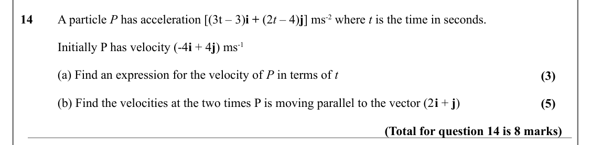

Text (lossy): 14 / A particle P has acceleration [(3t – 3)i + (2 t – 4)j] ms-2 where t is the time in seconds. / Initially P has velocity (-4 i + 4 j) ms-1  / (a) Find an expression for the velocity of P in terms of t  / (3) / (b) Find the velocities at the two times P is moving parallel to the vector (2 i + j) / (5) / (Total for question 14 is 8 marks)

## Q15 (6 marks)

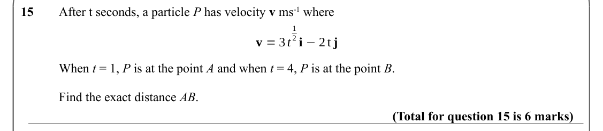

Text (lossy): 15 / After t seconds, a particle P has velocity v ms-1 where / 1 / 2 i −2 t j / v = 3 t / When t = 1, P is at the point A and when t = 4, P is at the point B. / Find the exact distance AB. / (Total for question 15 is 6 marks)

## Q16 (6 marks · parts a, b)

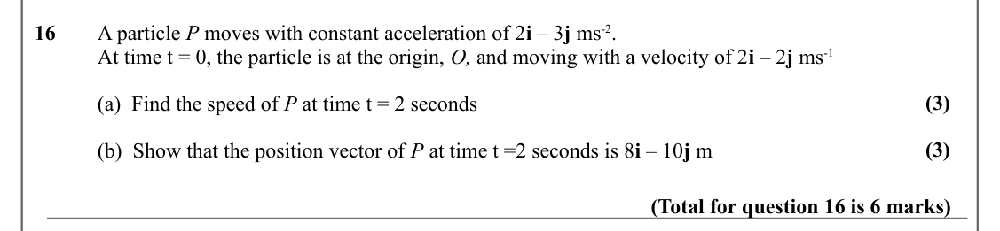

Text (lossy): 16 / A particle P moves with constant acceleration of 2 i – 3 j ms-2.  / At time t = 0, the particle is at the origin, O, and moving with a velocity of 2 i – 2 j ms-1 / (3) / (a)  Find the speed of P at time t = 2 seconds / (3) / (b)  Show that the position vector of P at time t =2 seconds is 8 i – 10 j m / (Total for question 16 is 6 marks)

## Q17 (6 marks · parts a, b)

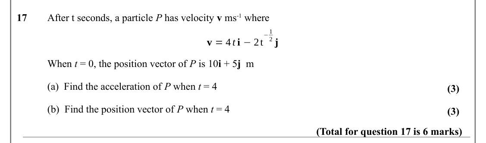

Text (lossy): 17 / After t seconds, a particle P has velocity v ms-1 where / −1 / 2 j / v = 4 t i −2t / When t = 0, the position vector of P is 10 i + 5 j  m / (a)  Find the acceleration of P when t = 4 / (3) / (b)  Find the position vector of P when t = 4 / (3) / (Total for question 17 is 6 marks)

## Q18 (8 marks · parts a, b)

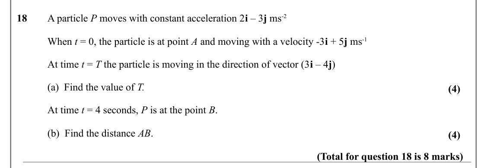

Text (lossy): 18 / A particle P moves with constant acceleration 2 i – 3 j ms-2 / When t = 0, the particle is at point A and moving with a velocity -3 i + 5 j ms-1 / At time t = T the particle is moving in the direction of vector (3 i – 4 j)  / (a)  Find the value of T. / (4) / At time t = 4 seconds, P is at the point B.  / (b)  Find the distance AB.  / (4) / (Total for question 18 is 8 marks)

## Q19 (8 marks · parts a, b, c)

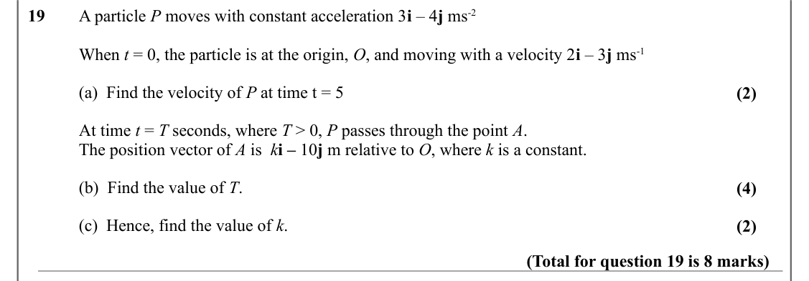

Text (lossy): 19 / A particle P moves with constant acceleration 3 i – 4 j ms-2 / When t = 0, the particle is at the origin, O, and moving with a velocity 2 i – 3 j ms-1 / (a)  Find the velocity of P at time t = 5 / (2) / At time t = T seconds, where T > 0, P passes through the point A. / The position vector of A is  k i – 10 j m relative to O, where k is a constant.  / (b)  Find the value of T. / (4) / (c)  He

## Q20 (6 marks · parts a, b)

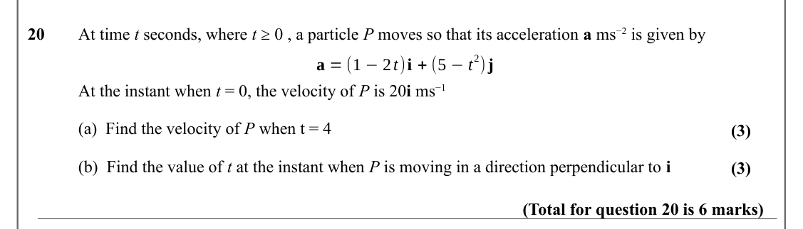

Text (lossy): 20 / At time t seconds, where t ≥ 0 , a particle P moves so that its acceleration a ms−2 is given by / 2)j / a = (1 −2 t)i + (5 −t / At the instant when t = 0, the velocity of P is 20 i ms−1 / (a)  Find the velocity of P when t = 4 / (3) / (b)  Find the value of t at the instant when P is moving in a direction perpendicular to i / (3) / (Total for question 20 is 6 marks)

## Q21 (5 marks)

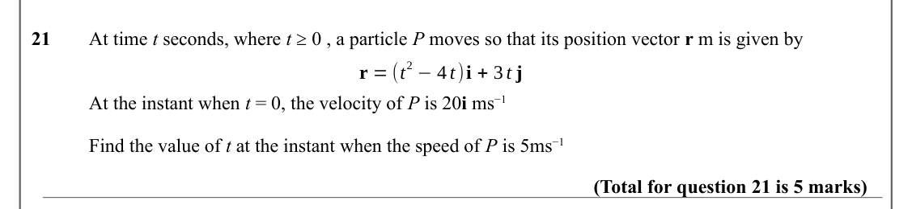

Text (lossy): 21 / At time t seconds, where t ≥ 0 , a particle P moves so that its position vector r m is given by / 2 −4 t)i + 3 t j / r = (t / At the instant when t = 0, the velocity of P is 20 i ms−1 / Find the value of t at the instant when the speed of P is 5ms−1 / (Total for question 21 is 5 marks)

