# Algebraic Methods — Question Set (A-Level Maths · Edexcel · Year 2 Pure Mathematics)

Chapter question set · `a-level-pure-mathematics-1-algebraic-methods` · 35 questions · segmented by printed total lines

## Q1 (6 marks)

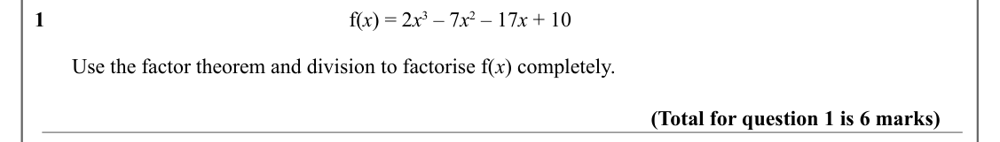

Text (lossy): 1      / f(x) = 2 x 3 – 7 x 2 – 17 x + 10 /        Use the factor theorem and division to factorise f(x) completely. / (Total for question 1 is 6 marks)

## Q2 (6 marks · parts a, b)

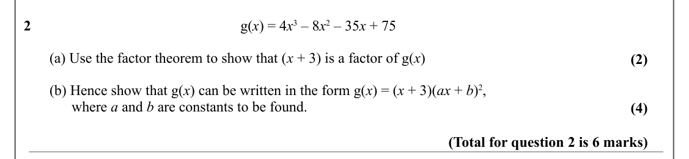

Text (lossy): 2      / g(x) = 4 x 3 – 8 x 2 – 35 x + 75 /        (a) Use the factor theorem to show that (x + 3) is a factor of g(x) / (2) /        (b) Hence show that g(x) can be written in the form g(x) = (x + 3)(ax + b)2, /              where a and b are constants to be found. / (4) / (Total for question 2 is 6 marks)

## Q3 (7 marks · parts a, b)

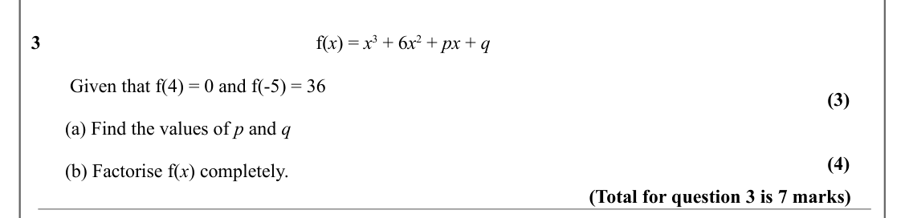

Text (lossy): 3      / f(x) = x 3 + 6 x 2 + px + q /         Given that f(4) = 0 and f(-5) = 36 / (3) /        (a) Find the values of p and q / (4) /        (b) Factorise f(x) completely. / (Total for question 3 is 7 marks)

## Q4 (7 marks · parts a, b)

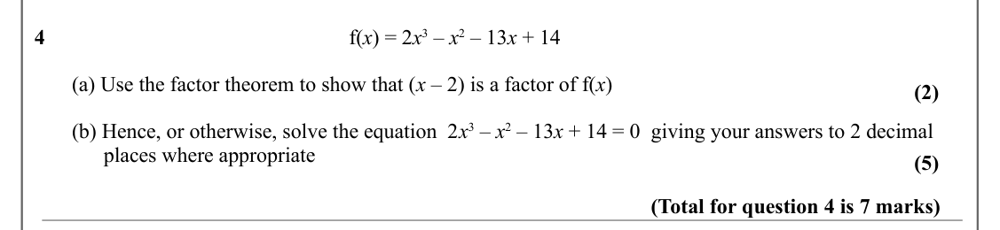

Text (lossy): 4      / f(x) = 2 x 3 – x 2 – 13 x + 14 /        (a) Use the factor theorem to show that (x – 2) is a factor of f(x) / (2) /        (b) Hence, or otherwise, solve the equation  2 x 3 – x 2 – 13 x + 14 = 0  giving your answers to 2 decimal       /              places where appropriate / (5) / (Total for question 4 is 7 marks)

## Q5 (6 marks · parts a, b)

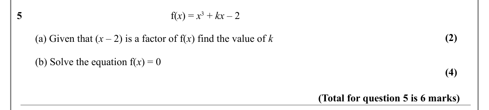

Text (lossy): 5      / f(x) = x 3 + kx – 2 / (2) /        (a) Given that (x – 2) is a factor of f(x) find the value of k /        (b) Solve the equation f(x) = 0 / (4) / (Total for question 5 is 6 marks)

## Q6 (7 marks · parts a, b)

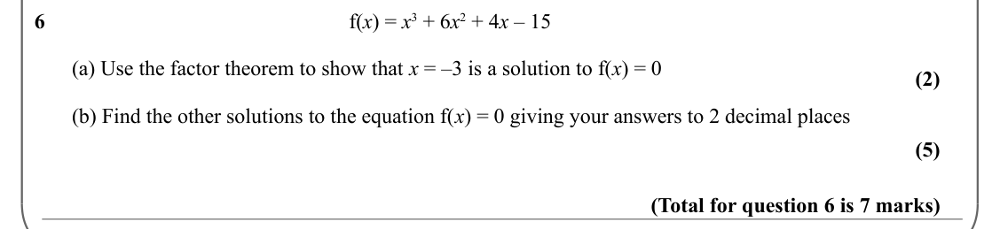

Text (lossy): 6      / f(x) = x 3 + 6 x 2 + 4 x – 15  /        (a) Use the factor theorem to show that x = –3 is a solution to f(x) = 0 / (2) /        (b) Find the other solutions to the equation f(x) = 0 giving your answers to 2 decimal places / (5) / (Total for question 6 is 7 marks)

## Q7 (3 marks)

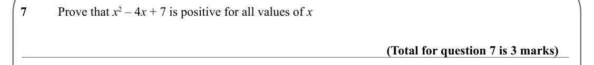

Text (lossy): 7 / Prove that x 2 – 4 x + 7 is positive for all values of x / (Total for question 7 is 3 marks)

## Q8 (2 marks)

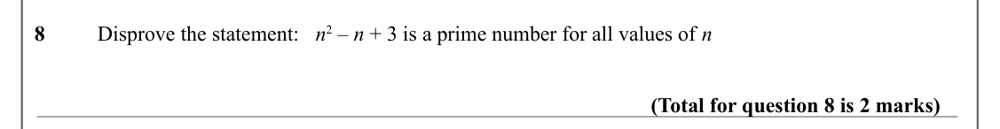

Text (lossy): 8 / Disprove the statement:   n 2 – n + 3 is a prime number for all values of n / (Total for question 8 is 2 marks)

## Q9 (3 marks)

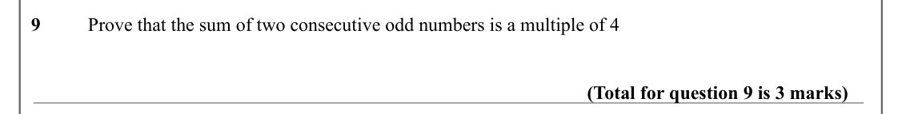

Text (lossy): 9 / Prove that the sum of two consecutive odd numbers is a multiple of 4 / (Total for question 9 is 3 marks)

## Q10 (3 marks)

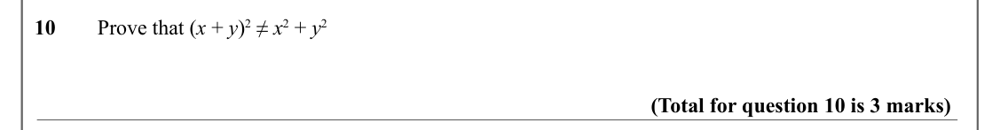

Text (lossy): 10 / Prove that (x + y)2 ≠ x 2 + y 2 / (Total for question 10 is 3 marks)

## Q11 (6 marks · parts a, b)

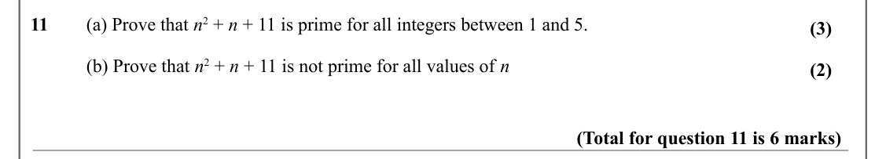

Text (lossy): 11 / (a) Prove that n 2 + n + 11 is prime for all integers between 1 and 5.  / (3) / (b) Prove that n 2 + n + 11 is not prime for all values of n / (2) / (Total for question 11 is 6 marks)

## Q12 (3 marks)

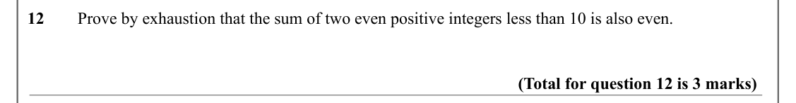

Text (lossy): 12 / Prove by exhaustion that the sum of two even positive integers less than 10 is also even.  / (Total for question 12 is 3 marks)

## Q13 (2 marks)

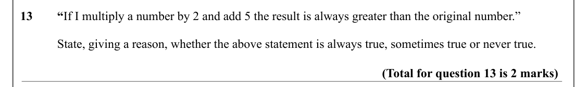

Text (lossy): 13 / “If I multiply a number by 2 and add 5 the result is always greater than the original number.” / State, giving a reason, whether the above statement is always true, sometimes true or never true.  / (Total for question 13 is 2 marks)

## Q14 (4 marks)

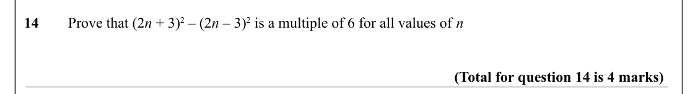

Text (lossy): 14 / Prove that (2 n + 3)2 – (2 n – 3)2 is a multiple of 6 for all values of n / (Total for question 14 is 4 marks)

## Q15 (4 marks)

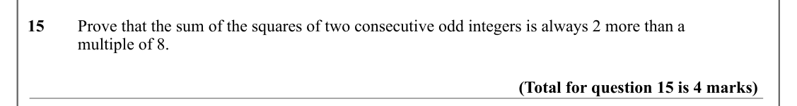

Text (lossy): 15 / Prove that the sum of the squares of two consecutive odd integers is always 2 more than a  / multiple of 8.  / (Total for question 15 is 4 marks)

## Q16 (4 marks)

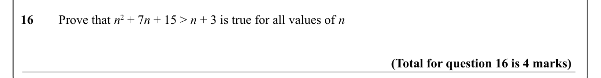

Text (lossy): 16 / Prove that n 2 + 7 n + 15 > n + 3 is true for all values of n / (Total for question 16 is 4 marks)

## Q17 (5 marks · parts a, b)

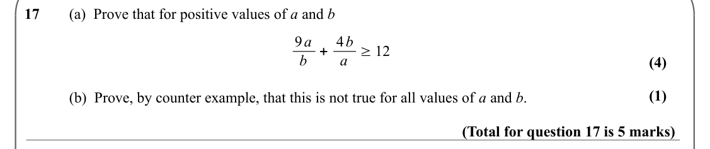

Text (lossy): 17 / (a)  Prove that for positive values of a and b / 9 a / + 4 b / ≥12 / b / a / (4) / (1) / (b)  Prove, by counter example, that this is not true for all values of a and b.  / (Total for question 17 is 5 marks)

## Q18 (5 marks · parts a, b)

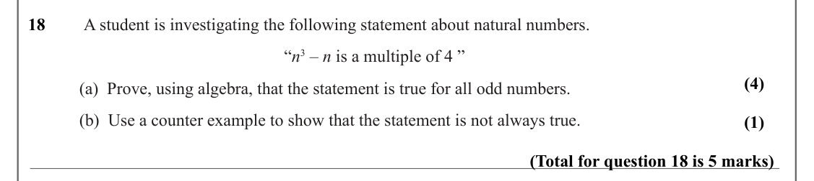

Text (lossy): 18 /  A student is investigating the following statement about natural numbers. / “n 3 – n is a multiple of 4 ” / (4) / (a)  Prove, using algebra, that the statement is true for all odd numbers. / (b)  Use a counter example to show that the statement is not always true. / (1) / (Total for question 18 is 5 marks)

## Q19 (5 marks)

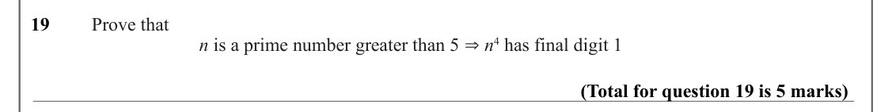

Text (lossy): 19 /  Prove that  / ⇒n 4 has final digit 1 / n is a prime number greater than 5   / (Total for question 19 is 5 marks)

## Q20 (1 marks)

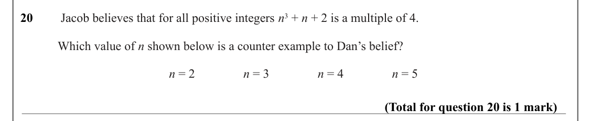

Text (lossy): 20 /  Jacob believes that for all positive integers n 3 + n + 2 is a multiple of 4. / Which value of n shown below is a counter example to Dan’s belief? / n = 2 / n = 3 / n = 4 / n = 5 / (Total for question 20 is 1 mark)

## Q21 (3 marks)

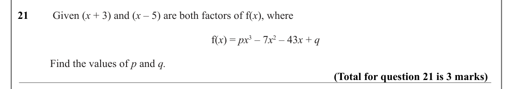

Text (lossy): 21 /  Given (x + 3) and (x – 5) are both factors of f(x), where / f(x) = px 3 – 7 x 2 – 43 x + q / Find the values of p and q.  / (Total for question 21 is 3 marks)

## Q22 (6 marks · parts a, b)

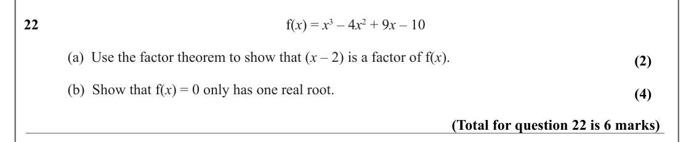

Text (lossy): 22 / f(x) = x 3 – 4 x 2 + 9 x – 10  / (a)  Use the factor theorem to show that (x – 2) is a factor of f(x). / (2) / (b)  Show that f(x) = 0 only has one real root.   / (4) / (Total for question 22 is 6 marks)

## Q23 (4 marks · parts a, b)

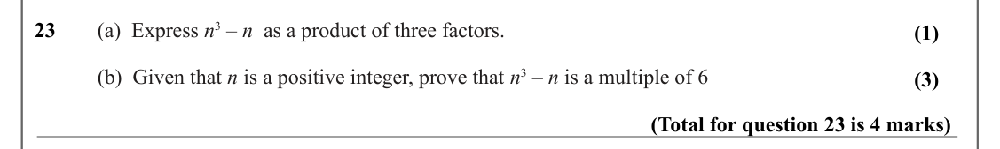

Text (lossy): 23 / (a)  Express n 3 – n  as a product of three factors. / (1) / (b)  Given that n is a positive integer, prove that n 3 – n is a multiple of 6 / (3) / (Total for question 23 is 4 marks)

## Q24 (5 marks · parts a, b)

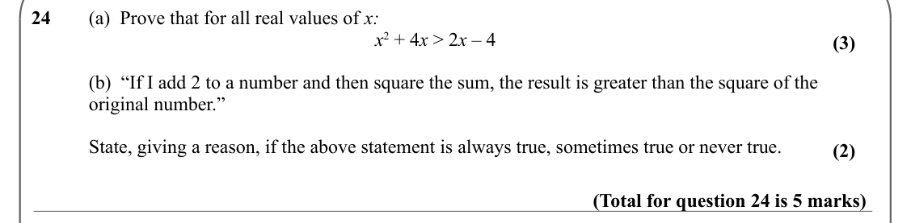

Text (lossy): 24 / (a)  Prove that for all real values of x: / x 2 + 4 x > 2 x – 4 / (3) / (b)  “If I add 2 to a number and then square the sum, the result is greater than the square of the  / original number.” / State, giving a reason, if the above statement is always true, sometimes true or never true.  / (2) / (Total for question 24 is 5 marks)

## Q25 (6 marks · parts a, b)

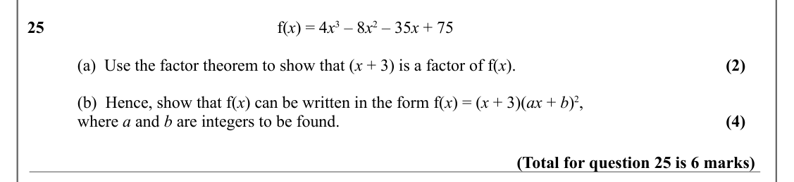

Text (lossy): 25 / f(x) = 4 x 3 – 8 x 2 – 35 x + 75 / (a)  Use the factor theorem to show that (x + 3) is a factor of f(x). / (2) / (b)  Hence, show that f(x) can be written in the form f(x) = (x + 3)(ax + b)2,  / where a and b are integers to be found.  / (4) / (Total for question 25 is 6 marks)

## Q26 (13 marks · parts a, b, c, d, e)

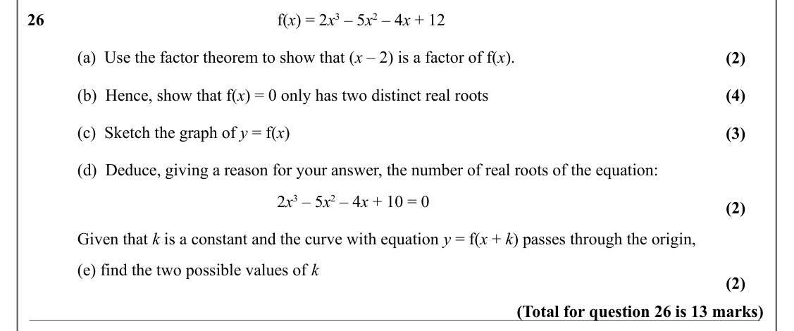

Text (lossy): 26 / f(x) = 2 x 3 – 5 x 2 – 4 x + 12 / (a)  Use the factor theorem to show that (x – 2) is a factor of f(x). / (2) / (b)  Hence, show that f(x) = 0 only has two distinct real roots / (4) / (c)  Sketch the graph of y = f(x) / (3) / (d)  Deduce, giving a reason for your answer, the number of real roots of the equation: / 2 x 3 – 5 x 2 – 4 x + 10 = 0 / (2) / Given that k is a constant and the curve w

## Q27 (4 marks)

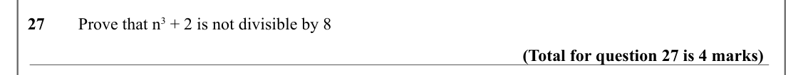

Text (lossy): 27 / Prove that n 3 + 2 is not divisible by 8 / (Total for question 27 is 4 marks)

## Q28 (4 marks)

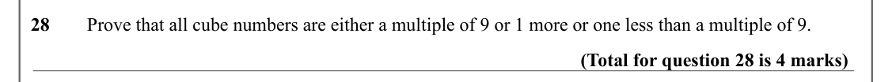

Text (lossy): 28 / Prove that all cube numbers are either a multiple of 9 or 1 more or one less than a multiple of 9.  / (Total for question 28 is 4 marks)

## Q29 (6 marks · parts a, b)

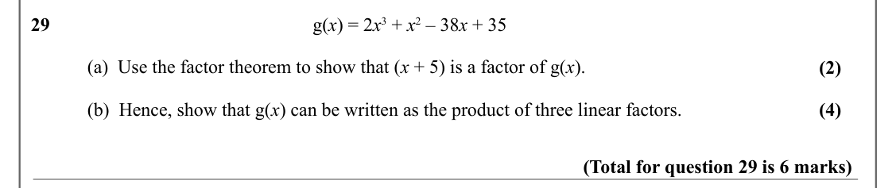

Text (lossy): 29 / g(x) = 2 x 3 + x 2 – 38 x + 35 / (a)  Use the factor theorem to show that (x + 5) is a factor of g(x). / (2) / (b)  Hence, show that g(x) can be written as the product of three linear factors.  / (4) / (Total for question 29 is 6 marks)

## Q30 (5 marks)

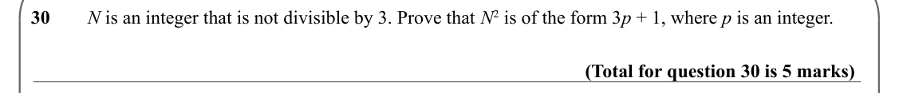

Text (lossy): 30 / N is an integer that is not divisible by 3. Prove that N 2 is of the form 3 p + 1, where p is an integer.  / (Total for question 30 is 5 marks)

## Q31 (5 marks · parts a, b)

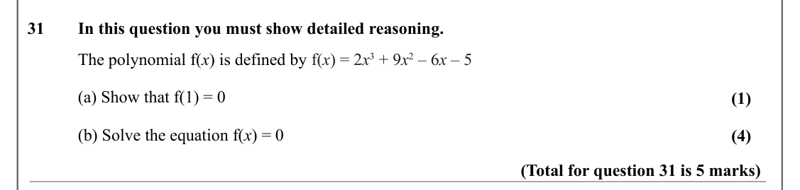

Text (lossy): 31 / In this question you must show detailed reasoning. / The polynomial f(x) is defined by f(x) = 2 x 3 + 9 x 2 – 6 x – 5  / (a) Show that f(1) = 0 / (1) / (b) Solve the equation f(x) = 0  / (4) / (Total for question 31 is 5 marks)

## Q32 (5 marks · parts a, b)

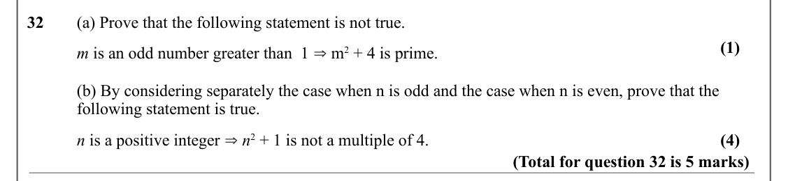

Text (lossy): 32 / (a) Prove that the following statement is not true. / (1) / m is an odd number greater than  1 ⇒ m 2 + 4 is prime. / (b) By considering separately the case when n is odd and the case when n is even, prove that the / following statement is true. / ⇒n 2 + 1 is not a multiple of 4. / n is a positive integer  / (4) / (Total for question 32 is 5 marks)

## Q33 (5 marks · parts a, b)

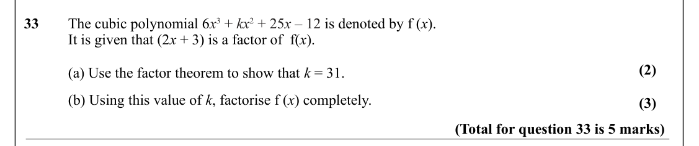

Text (lossy): 33 / The cubic polynomial 6 x 3 + kx 2 + 25 x – 12 is denoted by f (x).  / It is given that (2 x + 3) is a factor of  f(x). / (2) / (a) Use the factor theorem to show that k = 31. / (b) Using this value of k, factorise f (x) completely. / (3) / (Total for question 33 is 5 marks)

## Q34 (5 marks · parts a, b)

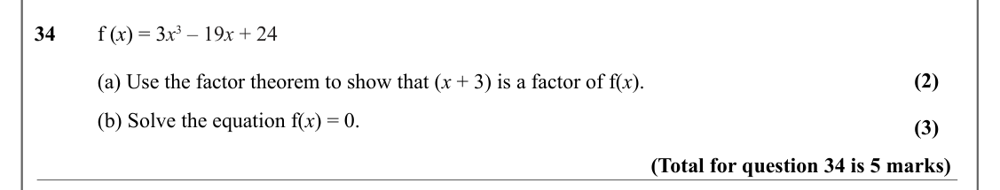

Text (lossy): 34 / f (x) = 3 x 3 – 19 x + 24 / (2) / (a) Use the factor theorem to show that (x + 3) is a factor of f(x). / (b) Solve the equation f(x) = 0. / (3) / (Total for question 34 is 5 marks)

## Q35 (4 marks · parts a, b)

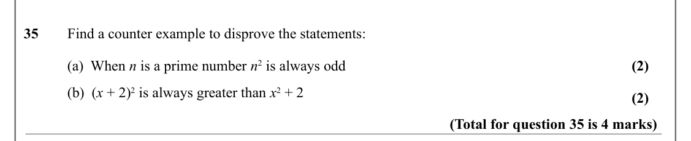

Text (lossy): 35 / Find a counter example to disprove the statements: / (2) / (a)  When n is a prime number n 2 is always odd / (b)  (x + 2)2 is always greater than x 2 + 2 / (2) / (Total for question 35 is 4 marks)

