# Numerical Methods — Question Set (A-Level Maths · Edexcel · Year 2 Pure Mathematics)

Chapter question set · `a-level-pure-mathematics-10-numerical-methods` · 19 questions · segmented by printed total lines

## Q1 (11 marks · parts a, b, c, d)

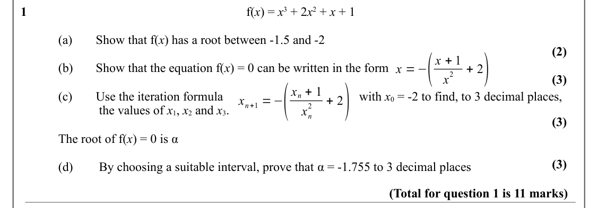

Text (lossy): 1 / f(x) = x 3 + 2 x 2 + x + 1 / (a)  / Show that f(x) has a root between -1.5 and -2 / (2) / x =−( / + 2) / x + 1 / (b) / Show that the equation f(x) = 0 can be written in the form / 2 / x / (3) / x n+1 =−( / + 2) / x n + 1 / (c)  / Use the iteration formula  / with x 0 = -2 to find, to 3 decimal places, / 2 /  the values of x 1, x 2 and x 3.  / x n / (3) / The root of f(x) = 0 is α / (3) / (d) /

## Q2 (9 marks · parts a, b, c)

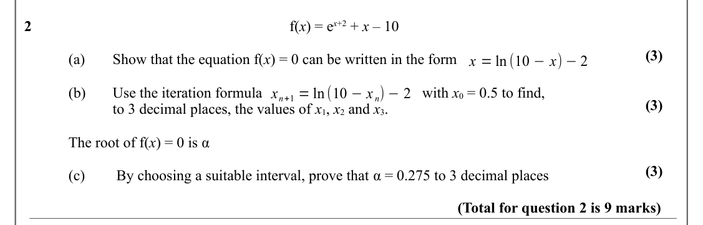

Text (lossy): 2 / f(x) = e x+2 + x – 10  / (3) / (a) / Show that the equation f(x) = 0 can be written in the form / x = ln (10 −x) −2 / (b)  / Use the iteration formula  / with x 0 = 0.5 to find,  / x n+1 = ln (10 −x n) −2 / (3) / to 3 decimal places, the values of x 1, x 2 and x 3.  / The root of f(x) = 0 is α / (3) / (c) /  By choosing a suitable interval, prove that α = 0.275 to 3 decimal places / (Total for

## Q3 (11 marks · parts a, b, c, d)

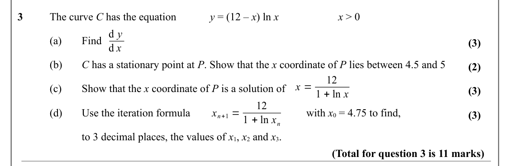

Text (lossy): 3 / The curve C has the equation   / y = (12 – x) ln x  / x > 0 / d y / (a) / Find  / (3) / d x / (b)  / C has a stationary point at P. Show that the x coordinate of P lies between 4.5 and 5 / (2) / 12 / x = / (c) / Show that the x coordinate of P is a solution of / (3) / 1 + ln x / 12 / x n+1 = / (d)  / Use the iteration formula  / with x 0 = 4.75 to find,  / (3) / 1 + ln x n / to 3 decimal place

## Q4 (5 marks · parts a, b)

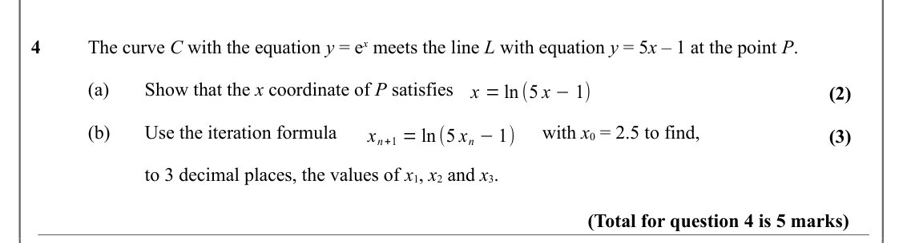

Text (lossy): 4 / The curve C with the equation y = e x meets the line L with equation y = 5 x – 1 at the point P.  / (a) / Show that the x coordinate of P satisfies  / x = ln (5 x −1) / (2) / (b)  / Use the iteration formula  / with x 0 = 2.5 to find,  / x n+1 = ln (5 x n −1) / (3) / to 3 decimal places, the values of x 1, x 2 and x 3.   / (Total for question 4 is 5 marks)

## Q5 (7 marks · parts a, b)

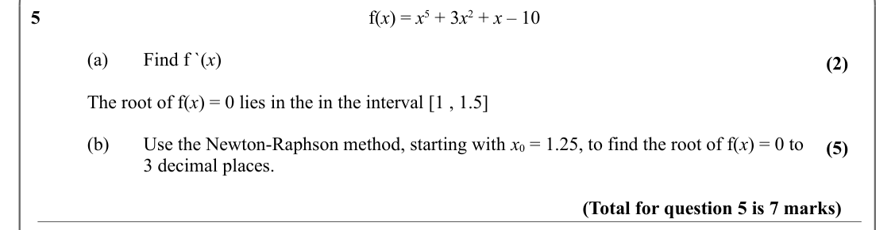

Text (lossy): 5 / f(x) = x 5 + 3 x 2 + x – 10  / (a)  / Find f `(x) / (2) / The root of f(x) = 0 lies in the in the interval [1 , 1.5] / (b) / Use the Newton-Raphson method, starting with x 0 = 1.25, to find the root of f(x) = 0 to  / (5) / 3 decimal places. / (Total for question 5 is 7 marks)

## Q6 (8 marks · parts a, b, c)

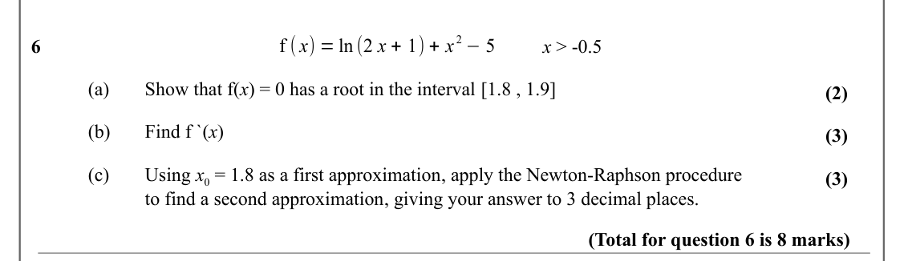

Text (lossy): f ( x) = ln (2 x + 1) + x 2 −5 / 6 / x > -0.5  / (a)  / Show that f(x) = 0 has a root in the interval [1.8 , 1.9] / (2) / (b) / Find f `(x) / (3) / (c) / Using x 0 = 1.8 as a first approximation, apply the Newton-Raphson procedure  / (3) / to find a second approximation, giving your answer to 3 decimal places. / (Total for question 6 is 8 marks)

## Q7 (8 marks · parts a, b, c)

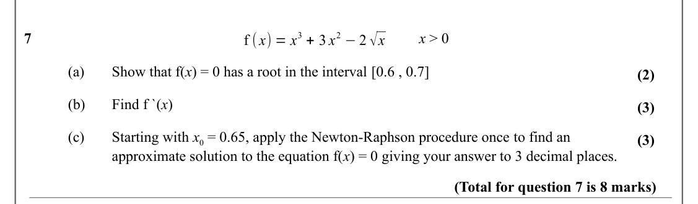

Text (lossy): f ( x) = x 3 + 3 x 2 −2 √x / 7 / x > 0 / (a)  / Show that f(x) = 0 has a root in the interval [0.6 , 0.7] / (2) / (b) / Find f `(x) / (3) / (c) / Starting with x 0 = 0.65, apply the Newton-Raphson procedure once to find an  / (3) / approximate solution to the equation f(x) = 0 giving your answer to 3 decimal places. / (Total for question 7 is 8 marks)

## Q8 (9 marks · parts a, b)

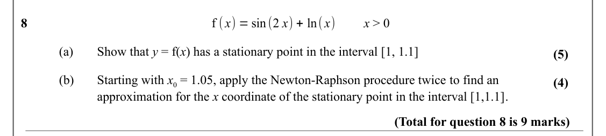

Text (lossy): f ( x) = sin(2 x) + ln( x) / 8 / x > 0 / (a)  / Show that y = f(x) has a stationary point in the interval [1, 1.1] / (5) / (b) / Starting with x 0 = 1.05, apply the Newton-Raphson procedure twice to find an  / (4) / approximation for the x coordinate of the stationary point in the interval [1,1.1]. / (Total for question 8 is 9 marks)

## Q9 (6 marks · parts a, b, c)

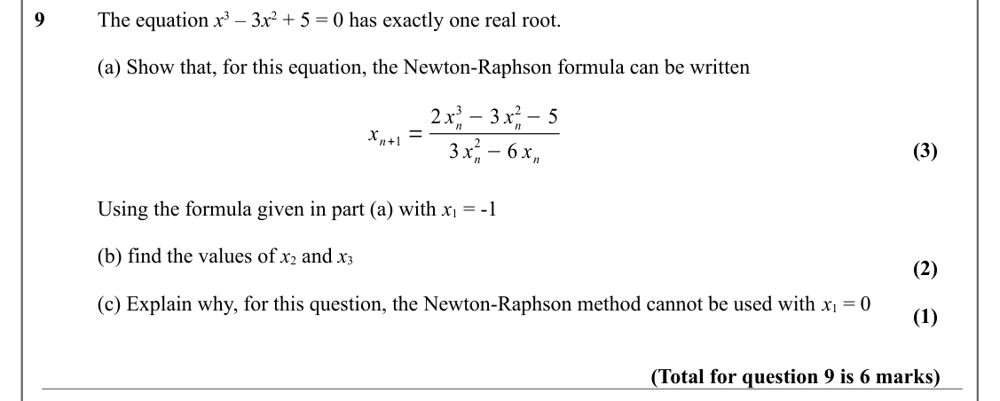

Text (lossy): 9 / The equation x 3 – 3 x 2 + 5 = 0 has exactly one real root. / (a) Show that, for this equation, the Newton-Raphson formula can be written / 3 −3 x n / 2 −5 / x n+1 = 2 x n / 2 −6 x n / (3) / 3 x n / Using the formula given in part (a) with x 1 = -1 / (b) find the values of x 2 and x 3 / (2) / (c) Explain why, for this question, the Newton-Raphson method cannot be used with x 1 = 0 / (1) / (Tot

## Q10 (8 marks · parts a, b, c, i, ii)

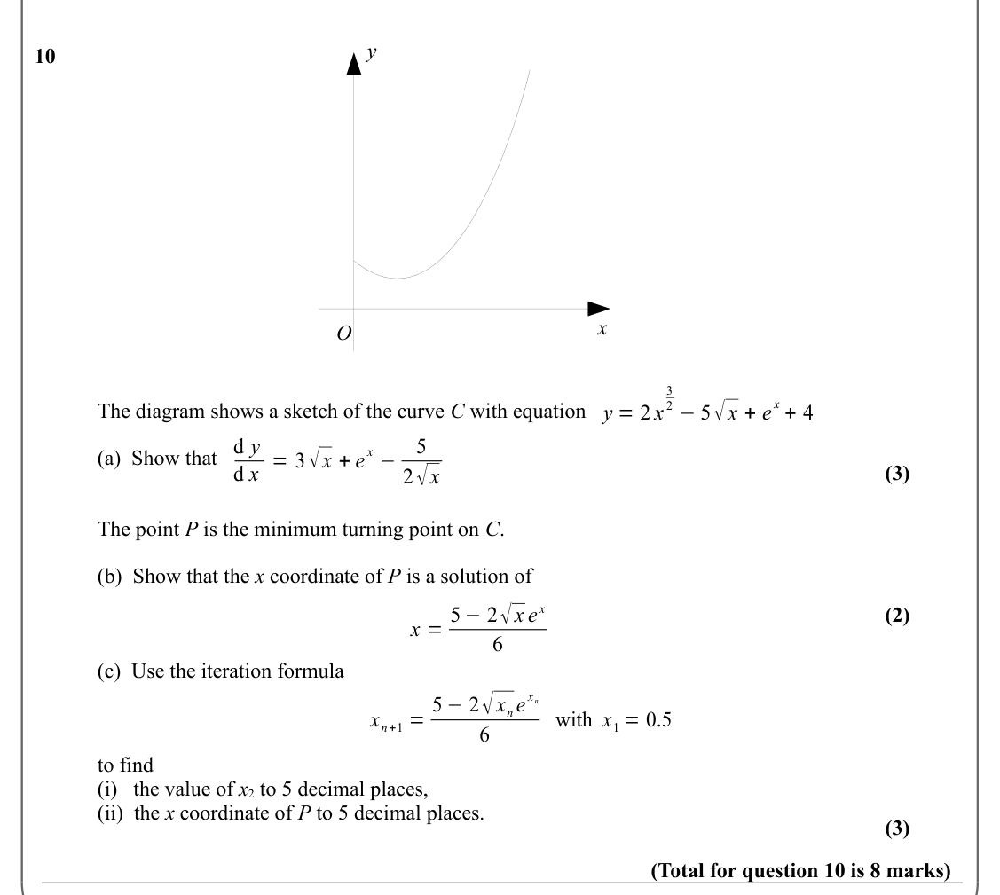

Text (lossy): y / 10 / x / O / 3 / x + 4 / 2 −5√x + e / The diagram shows a sketch of the curve C with equation  / y = 2 x / d y / 5 / x − / d x = 3√x + e / (a)  Show that  / 2√x / (3) / The point P is the minimum turning point on C. / (b)  Show that the x coordinate of P is a solution of  / x = 5 −2√x e x / (2) / 6 / (c)  Use the iteration formula   / x n+1 = 5 −2√x n e / x n / with x 1 = 0.5 / 6 / to find  / 

## Q11 (4 marks · parts a, b)

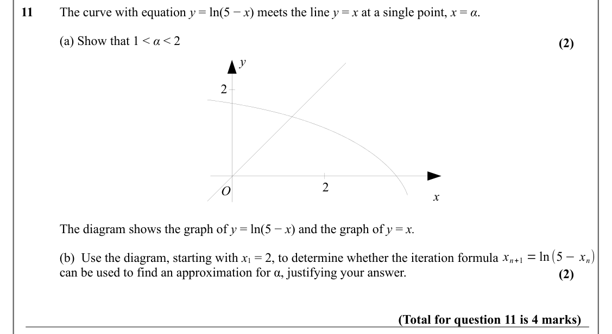

Text (lossy): 11 / The curve with equation y = ln(5 − x) meets the line y = x at a single point, x = α. / (a) Show that 1 < α < 2 / (2) / y / 2 / 2 / O / x / The diagram shows the graph of y = ln(5 − x) and the graph of y = x. / x n+1 = ln (5 −x n) / (b)  Use the diagram, starting with x 1 = 2, to determine whether the iteration formula   / can be used to find an approximation for α, justifying your answer. / (

## Q12 (2 marks)

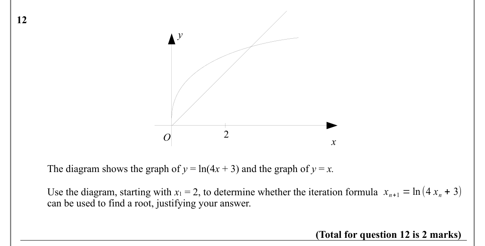

Text (lossy): 12 / y / 2 / O / x / The diagram shows the graph of y = ln(4 x + 3) and the graph of y = x. / x n+1 = ln (4 x n + 3) / Use the diagram, starting with x 1 = 2, to determine whether the iteration formula   / can be used to find a root, justifying your answer. / (Total for question 12 is 2 marks)

## Q13 (6 marks · parts a, b)

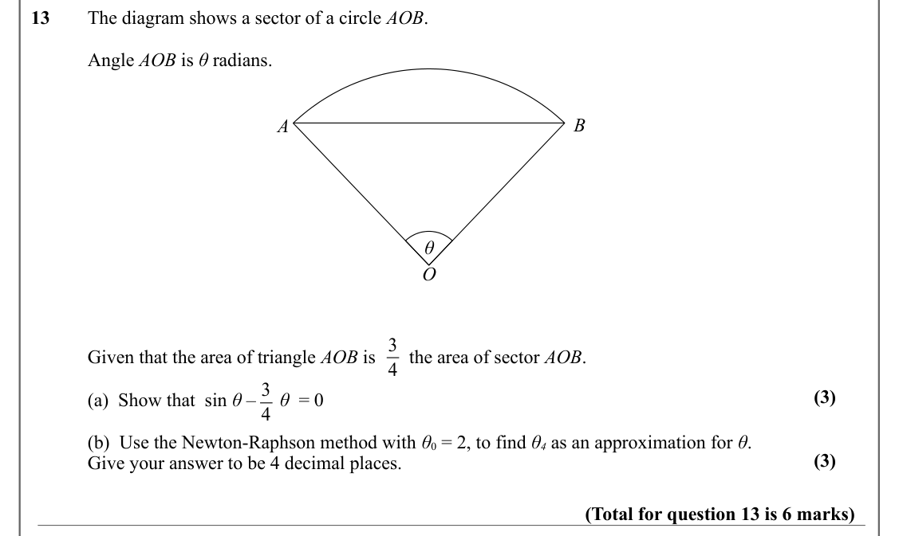

Text (lossy): 13 / The diagram shows a sector of a circle AOB. / Angle AOB is θ radians. / B / A / θ / O / 3 / Given that the area of triangle AOB is       the area of sector AOB.   / 4 / 3 / (3) / (a)  Show that  sin θ –     θ  = 0 / 4 / (b)  Use the Newton-Raphson method with θ 0 = 2, to find θ 4 as an approximation for θ. / (3) / Give your answer to be 4 decimal places.  / (Total for question 13 is 6 marks)

## Q14 (7 marks · parts a, b, c, d)

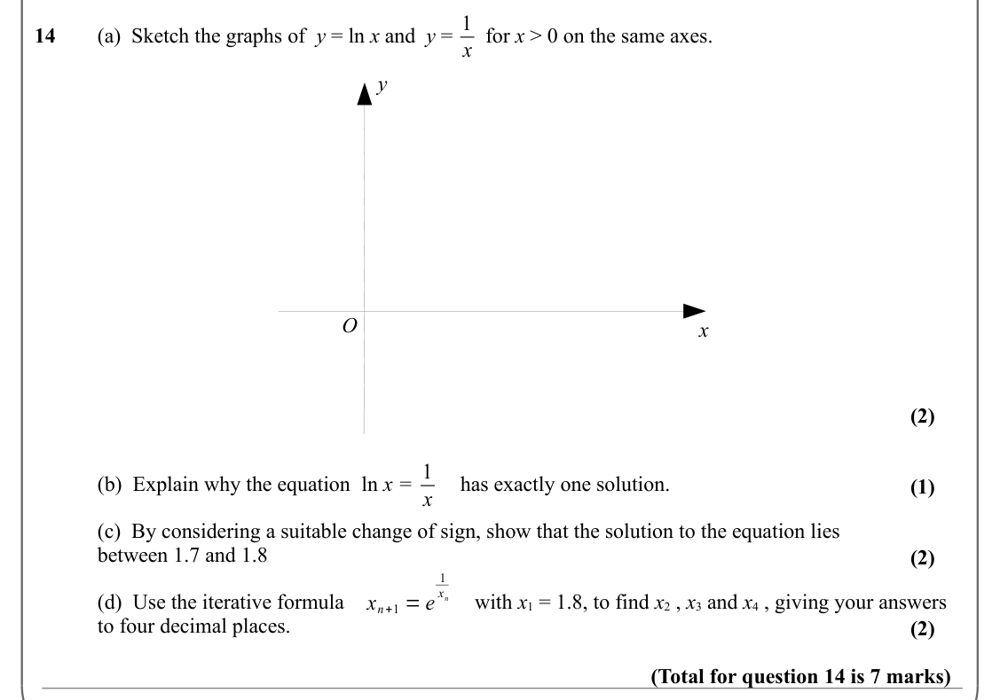

Text (lossy): 1 / 14 / (a)  Sketch the graphs of  y = ln x and  y =   for x > 0 on the same axes.  / x / y / O / x / (2) / 1 / (b)  Explain why the equation  ln x =         has exactly one solution.  / (1) / x / (c)  By considering a suitable change of sign, show that the solution to the equation lies / between 1.7 and 1.8 / (2) / 1 / x n / x n+1 = e / (d)  Use the iterative formula / with x 1 = 1.8, to find x 

## Q15 (6 marks · parts a, b, c)

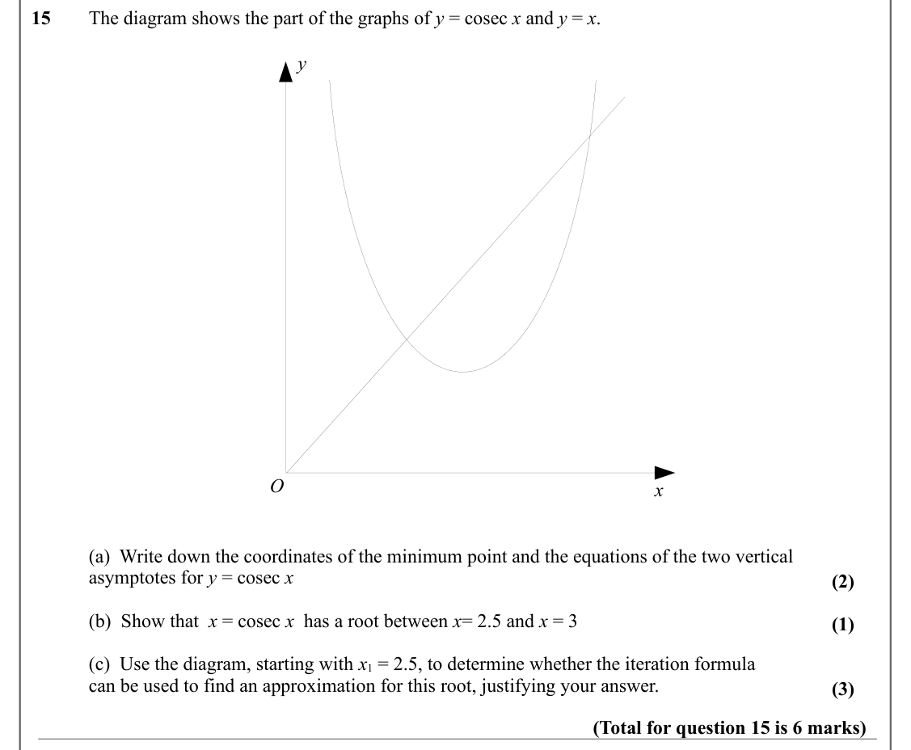

Text (lossy): 15 / The diagram shows the part of the graphs of y = cosec x and y = x. / y / O / x / (a)  Write down the coordinates of the minimum point and the equations of the two vertical  / asymptotes for y = cosec x / (2) / (b)  Show that  x = cosec x  has a root between x= 2.5 and x = 3  / (1) / (c)  Use the diagram, starting with x 1 = 2.5, to determine whether the iteration formula   / can be used to fi

## Q16 (8 marks · parts a, b)

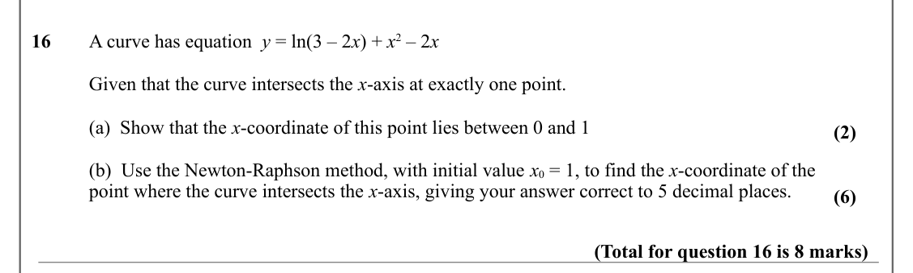

Text (lossy): 16 / A curve has equation  y = ln(3 – 2 x) + x 2 – 2 x  / Given that the curve intersects the x-axis at exactly one point. / (a)  Show that the x-coordinate of this point lies between 0 and 1  / (2) / (b)  Use the Newton-Raphson method, with initial value x 0 = 1, to find the x-coordinate of the / point where the curve intersects the x-axis, giving your answer correct to 5 decimal places. / (6) / 

## Q17 (7 marks · parts a, b)

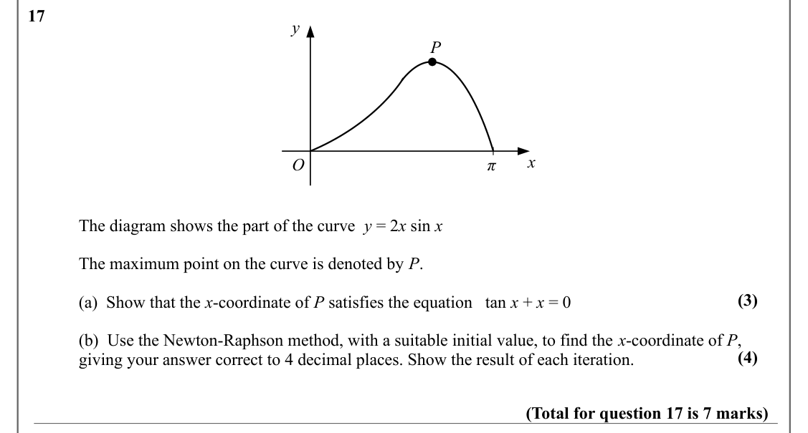

Text (lossy): 17 / y / P / x / O / π / The diagram shows the part of the curve  y = 2 x sin x   / The maximum point on the curve is denoted by P. / (3) / (a)  Show that the x-coordinate of P satisfies the equation   tan x + x = 0 / (b)  Use the Newton-Raphson method, with a suitable initial value, to find the x-coordinate of P,  / (4) / giving your answer correct to 4 decimal places. Show the result of each ite

## Q18 (9 marks · parts a, b, c, d)

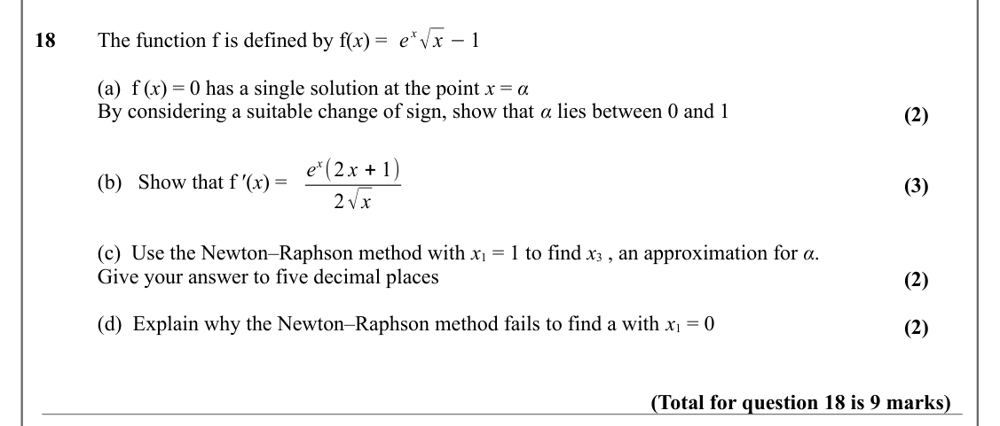

Text (lossy): e x√x −1 / 18 / The function f is defined by f(x) =  / (a)  f (x) = 0 has a single solution at the point x = α / By considering a suitable change of sign, show that α lies between 0 and 1 / (2) / e x(2 x + 1) / (b)   Show that f ′(x) = / (3) / 2√x / (c)  Use the Newton–Raphson method with x 1 = 1 to find x 3 , an approximation for α. / Give your answer to five decimal places / (2) / (d)  Explain w

## Q19 (9 marks · parts a, b, c, d, e)

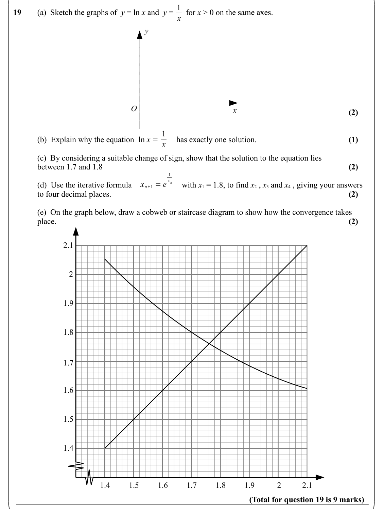

Text (lossy): 1 / 19 / (a)  Sketch the graphs of  y = ln x and  y =   for x > 0 on the same axes.  / x / y / O / x / (2) / 1 / (1) / (b)  Explain why the equation  ln x =         has exactly one solution.  / x / (c)  By considering a suitable change of sign, show that the solution to the equation lies / (2) / between 1.7 and 1.8 / 1 / x n / x n+1 = e / (d)  Use the iterative formula / with x 1 = 1.8, to find x 

