# Integration — Question Set (A-Level Maths · Edexcel · Year 2 Pure Mathematics)

Chapter question set · `a-level-pure-mathematics-11-integration` · 39 questions · segmented by printed total lines

## Q1 (4 marks)

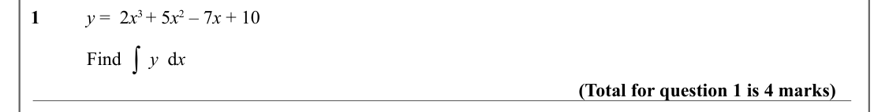

Text (lossy): 1 / y =  2 x 3 + 5 x 2 – 7 x + 10 / ∫ / Find      y  d x / (Total for question 1 is 4 marks)

## Q2 (4 marks)

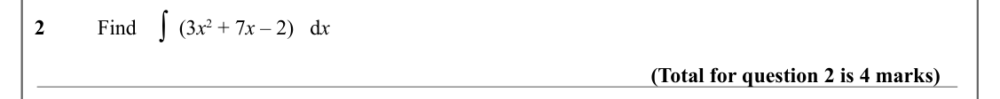

Text (lossy): ∫ / 2 / Find        (3 x 2 + 7 x – 2)   d x / (Total for question 2 is 4 marks)

## Q3 (4 marks)

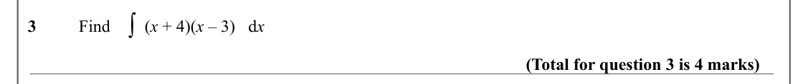

Text (lossy): ∫ / 3 / Find        (x + 4)(x – 3)   d x / (Total for question 3 is 4 marks)

## Q4 (5 marks)

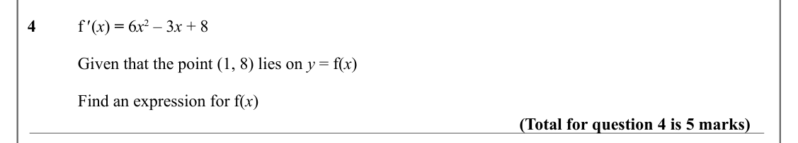

Text (lossy): 4 / f ' (x) = 6 x 2 – 3 x + 8    / Given that the point (1, 8) lies on y = f(x) / Find an expression for f(x) / (Total for question 4 is 5 marks)

## Q5 (4 marks)

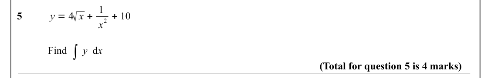

Text (lossy): y = 4 x + 1 / 2 + 10 / 5 / x / ∫ / Find      y  d x / (Total for question 5 is 4 marks)

## Q6 (5 marks)

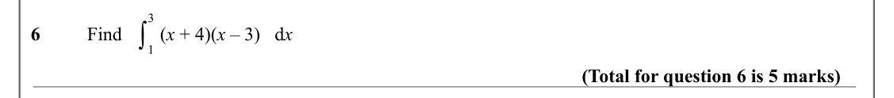

Text (lossy): 3 / ∫ / 6 / Find        (x + 4)(x – 3)   d x / 1 / (Total for question 6 is 5 marks)

## Q7 (5 marks)

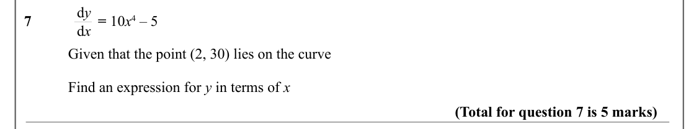

Text (lossy): d y / 7 /         = 10 x 4 – 5   / d x / Given that the point (2, 30) lies on the curve / Find an expression for y in terms of x / (Total for question 7 is 5 marks)

## Q8 (5 marks)

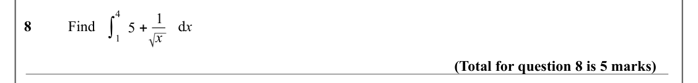

Text (lossy): 4 / 5 + 1 / ∫ / 8 / Find         /       d x / x / 1 / (Total for question 8 is 5 marks)

## Q9 (7 marks)

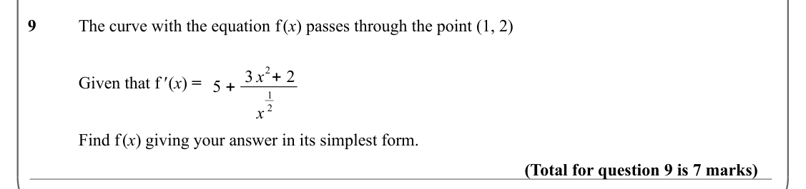

Text (lossy): 9 / The curve with the equation f (x) passes through the point (1, 2) / 2+ 2 / 5 + 3 x / Given that f ' (x) =  / 1 / 2 / x / Find f (x) giving your answer in its simplest form.  / (Total for question 9 is 7 marks)

## Q10 (8 marks · parts a, b)

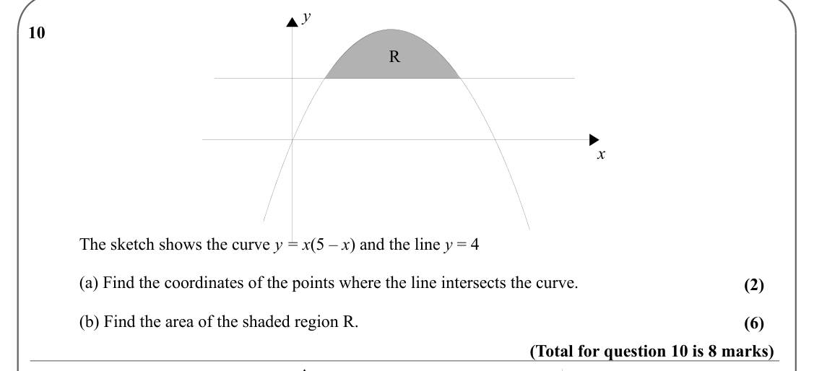

Text (lossy): y / 10 / R / x / The sketch shows the curve y = x(5 – x) and the line y = 4 / (a) Find the coordinates of the points where the line intersects the curve.  / (2) / (b) Find the area of the shaded region R.  / (6) / (Total for question 10 is 8 marks)

## Q11 (9 marks · parts a, b)

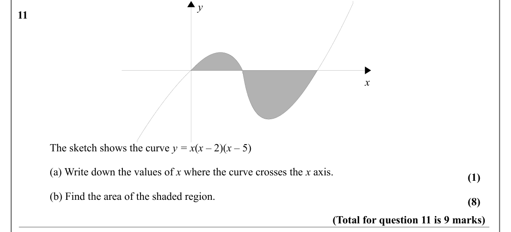

Text (lossy): y / 11 / x / The sketch shows the curve y = x(x – 2)(x – 5)   / (a) Write down the values of x where the curve crosses the x axis.  / (1) / (b) Find the area of the shaded region. / (8) / (Total for question 11 is 9 marks)

## Q12 (8 marks · parts a, b)

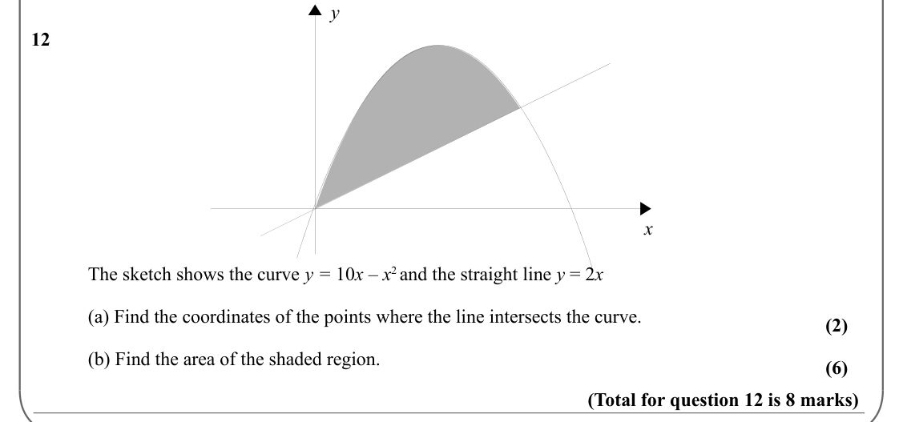

Text (lossy): y / 12 / x / The sketch shows the curve y = 10 x – x 2 and the straight line y = 2 x / (a) Find the coordinates of the points where the line intersects the curve.  / (2) / (b) Find the area of the shaded region.  / (6) / (Total for question 12 is 8 marks)

## Q13 (10 marks)

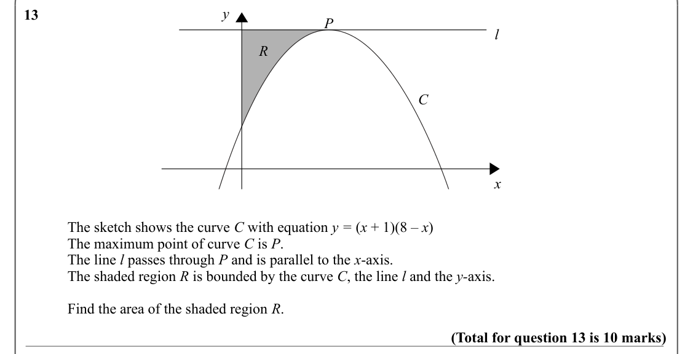

Text (lossy): y / 13 / P / l / R / C / x / The sketch shows the curve C with equation y = (x + 1)(8 – x) / The maximum point of curve C is P.  / The line l passes through P and is parallel to the x-axis. / The shaded region R is bounded by the curve C, the line l and the y-axis.  / Find the area of the shaded region R.  / (Total for question 13 is 10 marks)

## Q14 (3 marks)

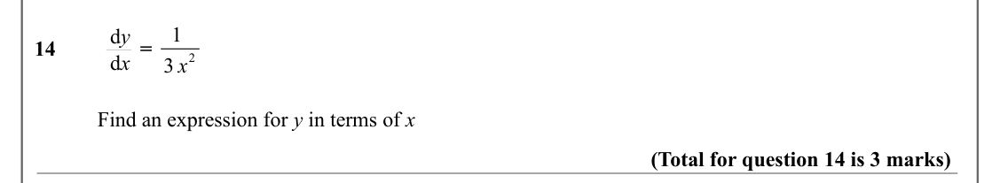

Text (lossy): 1 / d y / 14 /         =  / 2 / d x / 3 x / Find an expression for y in terms of x / (Total for question 14 is 3 marks)

## Q15 (4 marks)

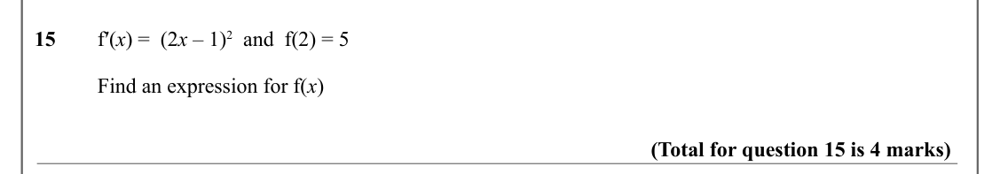

Text (lossy): 15 / f′(x) =  (2 x – 1)2  and  f(2) = 5 / Find an expression for f(x)                                                                                                                          / (Total for question 15 is 4 marks)

## Q16 (4 marks)

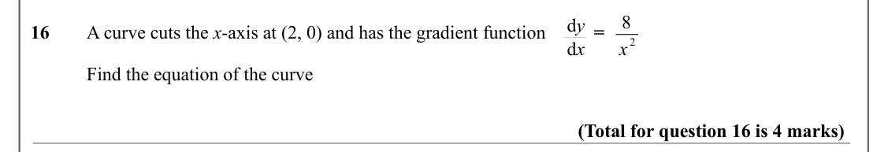

Text (lossy): 8 / d y / 16 / A curve cuts the x-axis at (2, 0) and has the gradient function /  =  / 2 / d x / x / Find the equation of the curve / (Total for question 16 is 4 marks)

## Q17 (5 marks)

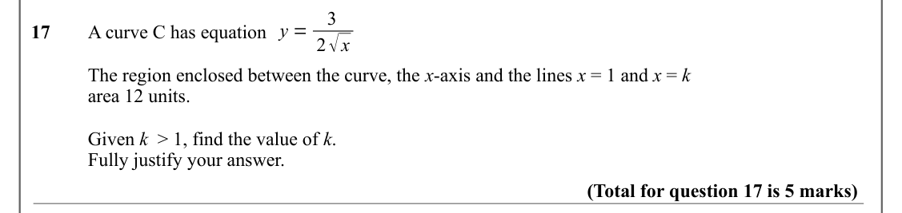

Text (lossy): 3 / y = / 17 / A curve C has equation  / 2√x / The region enclosed between the curve, the x-axis and the lines x = 1 and x = k / area 12 units.  / Given k  > 1, find the value of k.  / Fully justify your answer.  / (Total for question 17 is 5 marks)

## Q18 (3 marks)

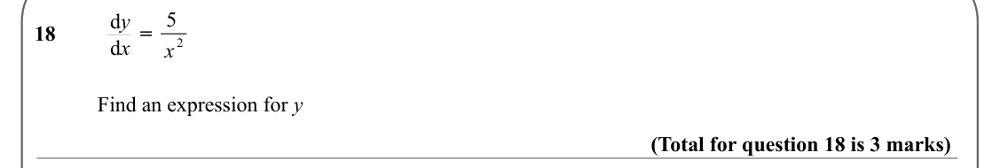

Text (lossy): 5 / d y / 18 /         =  / 2 / d x / x / Find an expression for y / (Total for question 18 is 3 marks)

## Q19 (8 marks · parts a, b)

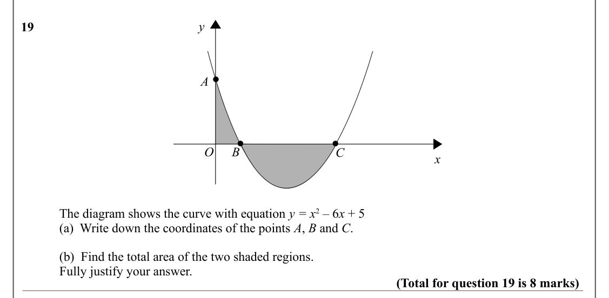

Text (lossy): y / 19 / A / x / O / B / C / x / The diagram shows the curve with equation y = x 2 – 6 x + 5  / (a)  Write down the coordinates of the points A, B and C.  / (b)  Find the total area of the two shaded regions.  / Fully justify your answer.  / (Total for question 19 is 8 marks)

## Q20 (5 marks)

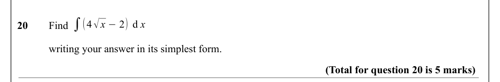

Text (lossy): ∫(4√x −2) d x / 20 / Find / writing your answer in its simplest form.  / (Total for question 20 is 5 marks)

## Q21 (9 marks)

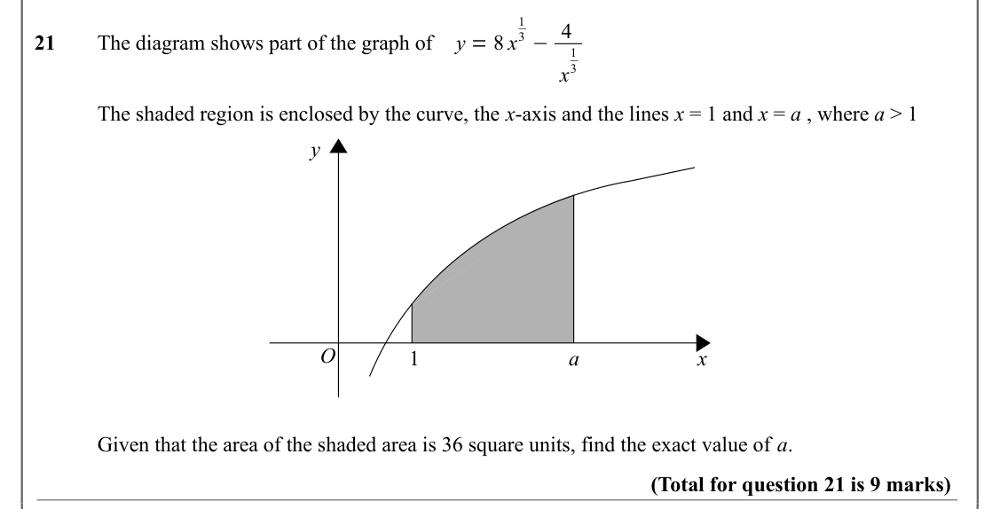

Text (lossy): 1 / 3 −4 / y = 8 x / 21 / The diagram shows part of the graph of / 1 / 3 / x / The shaded region is enclosed by the curve, the x-axis and the lines x = 1 and x = a , where a > 1 / y / O / 1 / a / x / Given that the area of the shaded area is 36 square units, find the exact value of a.  / (Total for question 21 is 9 marks)

## Q22 (4 marks)

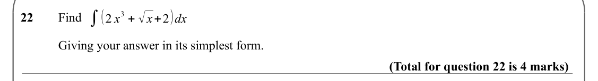

Text (lossy): 3 + √x+2)dx / ∫(2 x / 22 / Find  / Giving your answer in its simplest form.  / (Total for question 22 is 4 marks)

## Q23 (10 marks)

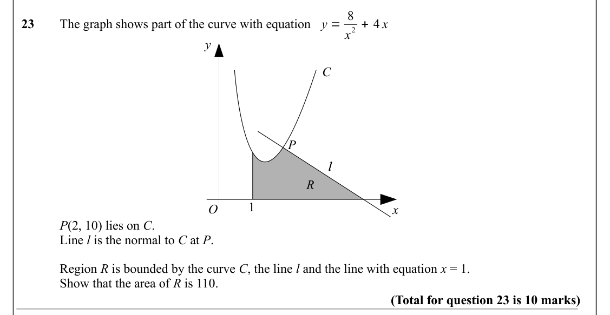

Text (lossy): y = 8 / 2 + 4 x / 23 / The graph shows part of the curve with equation / x / y / C / P / P / l / l / R / 1 / O / x / P(2, 10) lies on C.   / Line l is the normal to C at P.  / Region R is bounded by the curve C, the line l and the line with equation x = 1. / Show that the area of R is 110.   / (Total for question 23 is 10 marks)

## Q24 (6 marks · parts a, b)

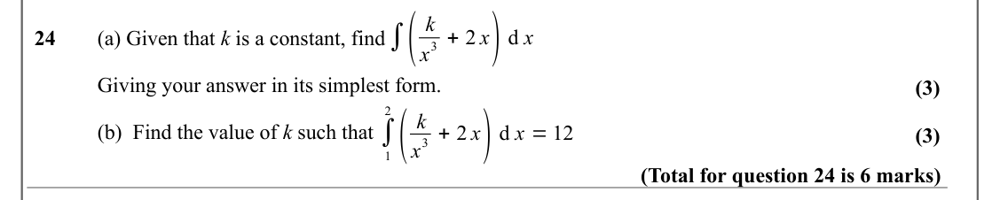

Text (lossy): ∫( / 3 + 2 x) d x / k / 24 / (a) Given that k is a constant, find  / x / Giving your answer in its simplest form.  / (3) / 2 / ( / 3 + 2 x) d x = 12 / k / ∫ / (b)  Find the value of k such that  / (3) / x / 1 / (Total for question 24 is 6 marks)

## Q25 (7 marks)

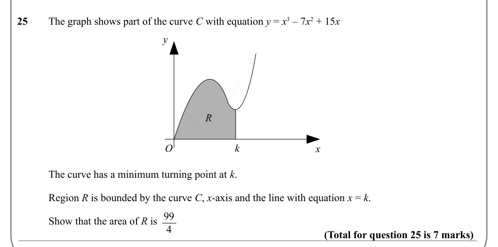

Text (lossy): 25 / The graph shows part of the curve C with equation y = x 3 – 7 x 2 + 15 x / y / R / k / O / x / The curve has a minimum turning point at k.  / Region R is bounded by the curve C, x-axis and the line with equation x = k. / Show that the area of R is   99 / 4 / (Total for question 25 is 7 marks)

## Q26 (8 marks · parts a, b)

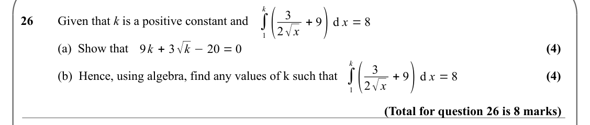

Text (lossy): k / ( / 2√x + 9) d x = 8 / 3 / ∫ / 26 / Given that k is a positive constant and  / 1 / 9 k + 3√k −20 = 0 / (a)  Show that  / (4) / k / ( / 2√x + 9) d x = 8 / 3 / ∫ / (b)  Hence, using algebra, find any values of k such that / (4) / 1 / (Total for question 26 is 8 marks)

## Q27 (10 marks · parts a, b, c)

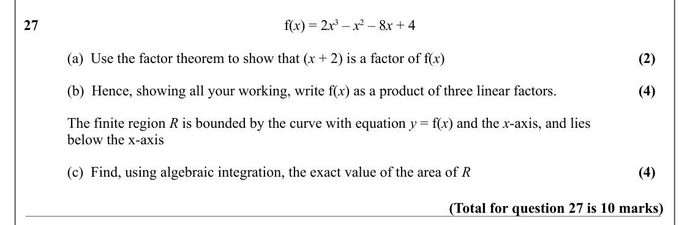

Text (lossy): 27 / f(x) = 2 x 3 – x 2 – 8 x + 4 / (a)  Use the factor theorem to show that (x + 2) is a factor of f(x) / (2) / (b)  Hence, showing all your working, write f(x) as a product of three linear factors. / (4) / The finite region R is bounded by the curve with equation y = f(x) and the x-axis, and lies  / below the x-axis / (c)  Find, using algebraic integration, the exact value of the area of R / (4)

## Q28 (4 marks)

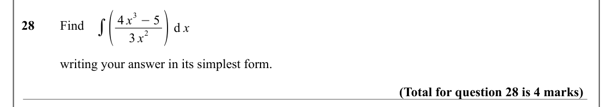

Text (lossy): 2 ) d x / 3 −5 / ∫( / 4 x / 28 / Find / 3 x / writing your answer in its simplest form.  / (Total for question 28 is 4 marks)

## Q29 (4 marks)

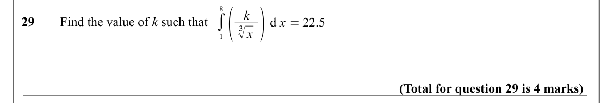

Text (lossy): 8 / ( / 3√x ) d x = 22.5 / k / ∫ / 29 / Find the value of k such that  / 1 / (Total for question 29 is 4 marks)

## Q30 (4 marks)

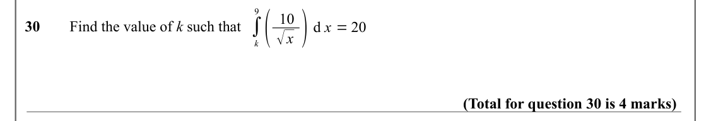

Text (lossy): 9 / ( / √x ) d x = 20 / 10 / ∫ / 30 / Find the value of k such that  / k / (Total for question 30 is 4 marks)

## Q31 (5 marks · parts a, b, c)

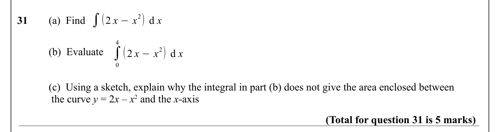

Text (lossy): ∫(2 x −x / 2) d x / 31 / (a)  Find  / 4 / ∫ / (2 x −x / 2) d x / (b)  Evaluate  / 0 / (c)  Using a sketch, explain why the integral in part (b) does not give the area enclosed between /  the curve y = 2 x – x 2 and the x-axis / (Total for question 31 is 5 marks)

## Q32 (8 marks)

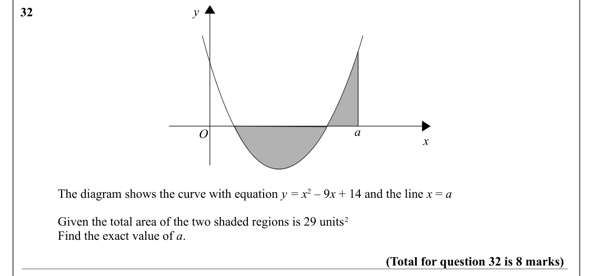

Text (lossy): y / 32 / x / a / O / x / The diagram shows the curve with equation y = x 2 – 9 x + 14 and the line x = a / Given the total area of the two shaded regions is 29 units 2 / Find the exact value of a.  / (Total for question 32 is 8 marks)

## Q33 (4 marks)

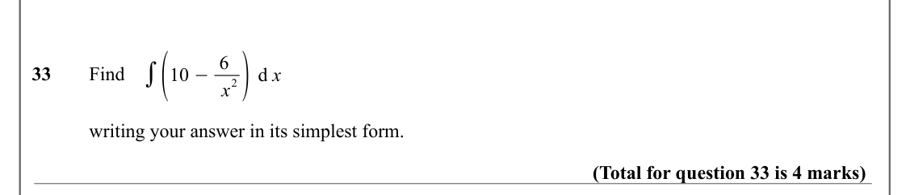

Text (lossy): ∫(10 −6 / 2) d x / 33 / Find / x / writing your answer in its simplest form.  / (Total for question 33 is 4 marks)

## Q34 (5 marks)

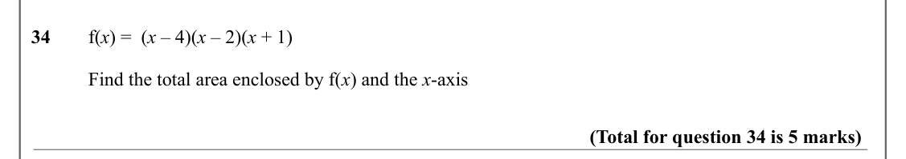

Text (lossy): 34 / f(x) =  (x – 4)(x – 2)(x + 1) / Find the total area enclosed by f(x) and the x-axis                                                                                      / (Total for question 34 is 5 marks)

## Q35 (8 marks)

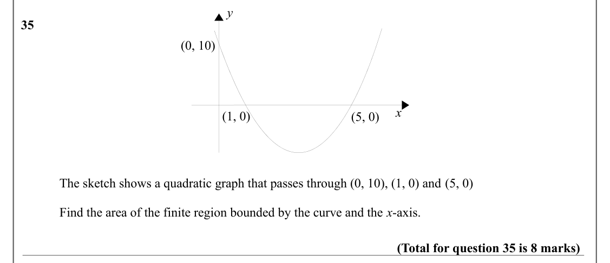

Text (lossy): y / 35 / (0, 10) / x / (1, 0) / (5, 0) / The sketch shows a quadratic graph that passes through (0, 10), (1, 0) and (5, 0) / Find the area of the finite region bounded by the curve and the x-axis. / (Total for question 35 is 8 marks)

## Q36 (4 marks)

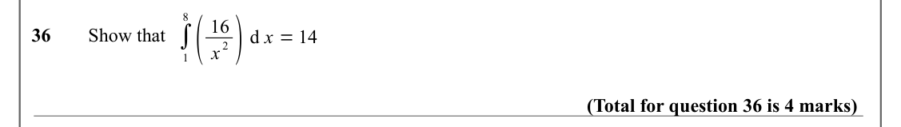

Text (lossy): 2 ) d x = 14 / 8 / ( / 16 / ∫ / 36 / Show that / x / 1 / (Total for question 36 is 4 marks)

## Q37 (4 marks)

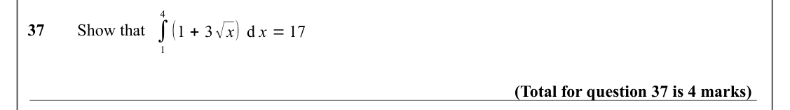

Text (lossy): 4 / ∫ / (1 + 3√x) d x = 17 / 37 / Show that / 1 / (Total for question 37 is 4 marks)

## Q38 (8 marks · parts a, b)

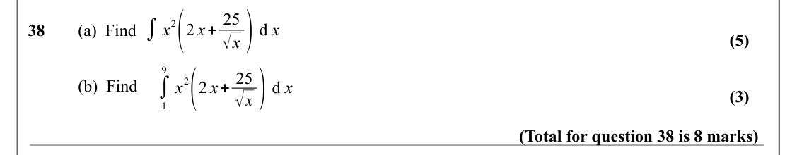

Text (lossy): 2(2 x+ 25 / √x ) d x / ∫x / 38 / (a)  Find / (5) / 9 / 2(2 x+ 25 / √x ) d x / ∫ / (b)  Find / x / (3) / 1 / (Total for question 38 is 8 marks)

## Q39 (6 marks)

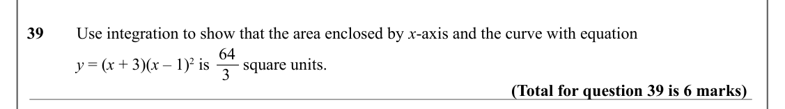

Text (lossy): 39 / Use integration to show that the area enclosed by x-axis and the curve with equation  / 64 / y = (x + 3)(x – 1)2 is        square units.  / 3 / (Total for question 39 is 6 marks)

