# Vectors — Question Set (A-Level Maths · Edexcel · Year 2 Pure Mathematics)

Chapter question set · `a-level-pure-mathematics-12-vectors` · 15 questions · segmented by printed total lines

## Q1 (4 marks · parts a, b)

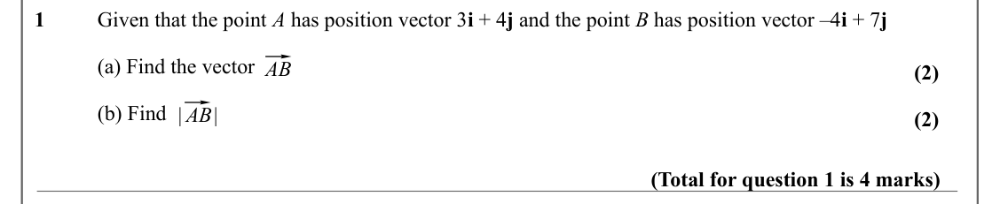

Text (lossy): 1 / Given that the point A has position vector 3 i + 4 j and the point B has position vector –4 i + 7 j / ⃗ / (a) Find the vector  / AB / (2) / |⃗ / (b) Find / AB| / (2) / (Total for question 1 is 4 marks)

## Q2 (2 marks)

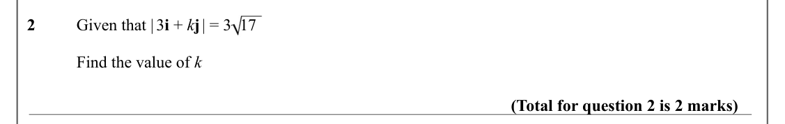

Text (lossy): 2 / Given that | 3 i + k j | = 3  17 / Find the value of k / (Total for question 2 is 2 marks)

## Q3 (4 marks · parts a, b)

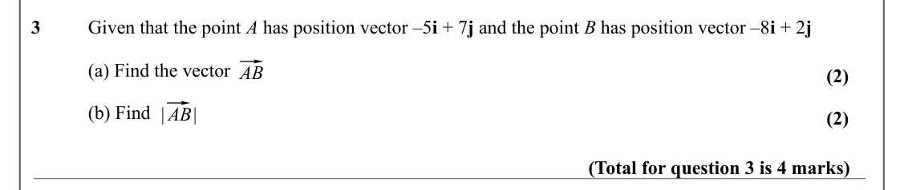

Text (lossy): 3 / Given that the point A has position vector –5 i + 7 j and the point B has position vector –8 i + 2 j / ⃗ / (a) Find the vector  / AB / (2) / |⃗ / (b) Find / AB| / (2) / (Total for question 3 is 4 marks)

## Q4 (2 marks)

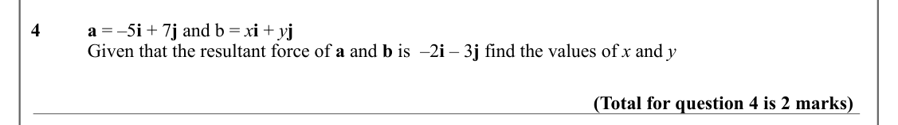

Text (lossy): 4 / a = –5 i + 7 j and b = x i + y j / Given that the resultant force of a and b is  –2 i – 3 j find the values of x and y / (Total for question 4 is 2 marks)

## Q5 (4 marks · parts a, b)

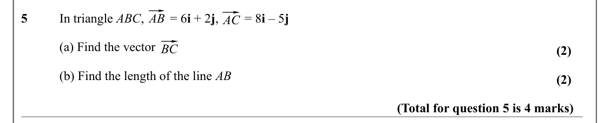

Text (lossy): ⃗ / ⃗ / 5 / In triangle ABC,        = 6 i + 2 j,        = 8 i – 5 j  / AB / AC / ⃗ / (a) Find the vector  / BC / (2) / (b) Find the length of the line AB / (2) / (Total for question 5 is 4 marks)

## Q6 (2 marks)

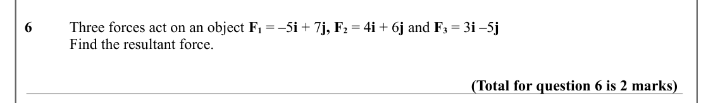

Text (lossy): 6 / Three forces act on an object F 1 = –5 i + 7 j, F 2 = 4 i + 6 j and F 3 = 3 i –5 j / Find the resultant force. / (Total for question 6 is 2 marks)

## Q7 (4 marks · parts a, b)

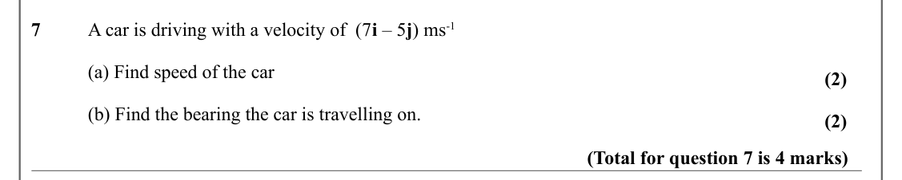

Text (lossy): 7 / A car is driving with a velocity of  (7 i – 5 j) ms-1    / (a) Find speed of the car / (2) / (b) Find the bearing the car is travelling on.  / (2) / (Total for question 7 is 4 marks)

## Q8 (4 marks · parts a, b)

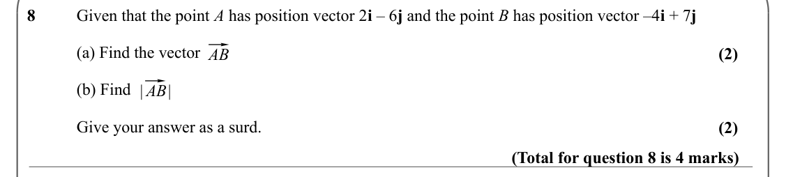

Text (lossy): 8 / Given that the point A has position vector 2 i – 6 j and the point B has position vector –4 i + 7 j / ⃗ / (a) Find the vector  / (2) / AB / |⃗ / (b) Find / AB| / Give your answer as a surd. / (2) / (Total for question 8 is 4 marks)

## Q9 (5 marks · parts a, b)

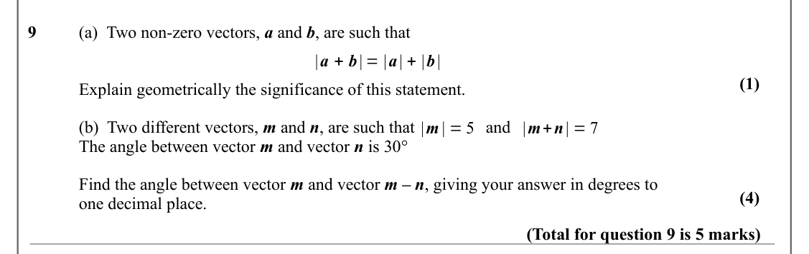

Text (lossy): 9 / (a)  Two non-zero vectors, a and b, are such that / |a + b| = |a| + |b| / (1) / Explain geometrically the significance of this statement.  / (b)  Two different vectors, m and n, are such that  / and / |m | = 5 / |m+n| = 7 / The angle between vector m and vector n is 30° / Find the angle between vector m and vector m – n, giving your answer in degrees to  / (4) / one decimal place.   / (Total f

## Q10 (6 marks · parts a, b)

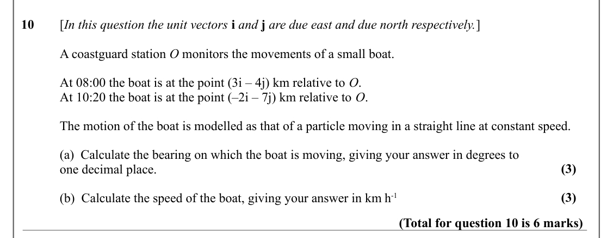

Text (lossy): 10 / [In this question the unit vectors i and j are due east and due north respectively.] / A coastguard station O monitors the movements of a small boat. / At 08:00 the boat is at the point (3i – 4j) km relative to O. / At 10:20 the boat is at the point (–2i – 7j) km relative to O. / The motion of the boat is modelled as that of a particle moving in a straight line at constant speed. / (a)  Calcu

## Q11 (6 marks · parts a, b)

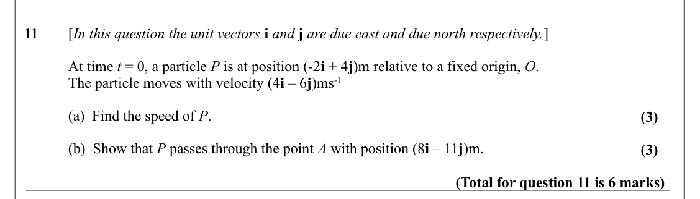

Text (lossy): 11 / [In this question the unit vectors i and j are due east and due north respectively.] / At time t = 0, a particle P is at position (-2 i + 4 j)m relative to a fixed origin, O.  / The particle moves with velocity (4 i – 6 j)ms-1 / (a)  Find the speed of P.  / (3) / (b)  Show that P passes through the point A with position (8 i – 11 j)m.  / (3) / (Total for question 11 is 6 marks)

## Q12 (7 marks · parts a, b, i, ii)

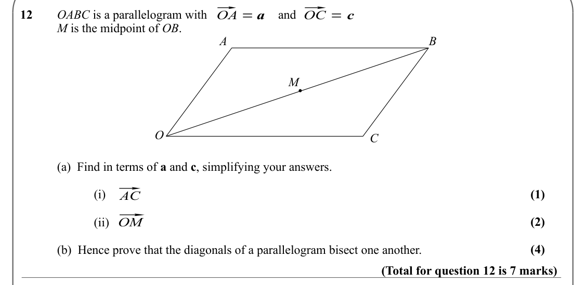

Text (lossy): ⃗ / ⃗ / OA = a / OC = c / 12 / OABC is a parallelogram with / and / M is the midpoint of OB.     / A / B / M / O / C / (a)  Find in terms of a and c, simplifying your answers. / ⃗ / (1) / (i)   / AC / ⃗ / (2) / OM / (ii) / (4) / (b)  Hence prove that the diagonals of a parallelogram bisect one another.   / (Total for question 12 is 7 marks)

## Q13 (6 marks · parts a, b, c)

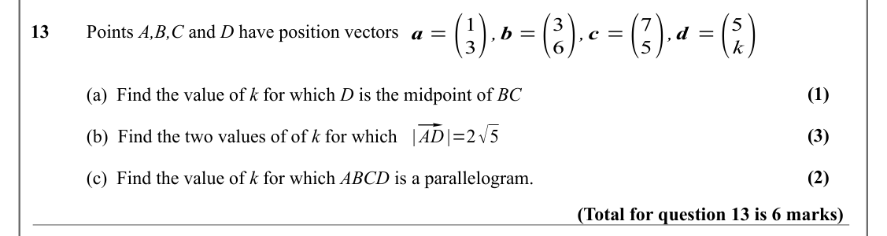

Text (lossy): a =( / 3) ,b =( / 6),c =( / 5),d =( / k) / 1 / 3 / 7 / 5 / 13 / Points A,B,C and D have position vectors / (1) / (a)  Find the value of k for which D is the midpoint of BC / |⃗ / AD |=2√5 / (3) / (b)  Find the two values of of k for which / (2) / (c)  Find the value of k for which ABCD is a parallelogram.  / (Total for question 13 is 6 marks)

## Q14 (5 marks · parts a, b)

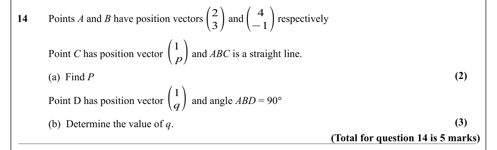

Text (lossy): ( / 3) / ( / −1) / 2 / 4 / 14 / Points A and B have position vectors         and  /     respectively  / ( / p) / 1 / Point C has position vector        and ABC is a straight line.  / (2) / (a)  Find P / ( / q) / 1 / Point D has position vector        and angle ABD = 90° / (3) / (b)  Determine the value of q. / (Total for question 14 is 5 marks)

## Q15 (3 marks)

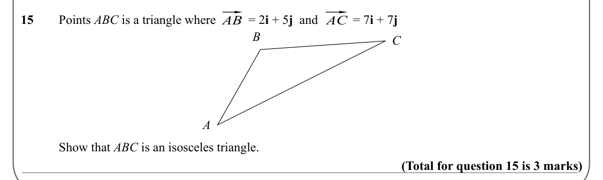

Text (lossy): ⃗ / ⃗ / 15 / Points ABC is a triangle where / = 2 i + 5 j  and          = 7 i + 7 j    / AB / AC / B / C / A / Show that ABC is an isosceles triangle.  / (Total for question 15 is 3 marks)

