# Functions and Graphs — Worked Solutions (A-Level Maths · Edexcel)

Mapping: `per-page` · 29 page scan(s) · source sha256 `cd2e4a8c2fc25287…`

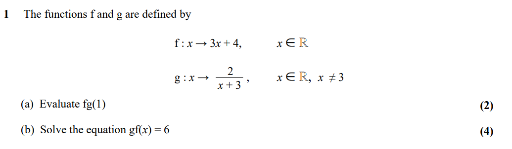

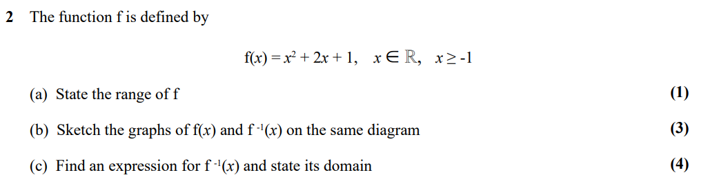

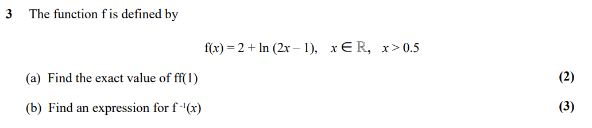

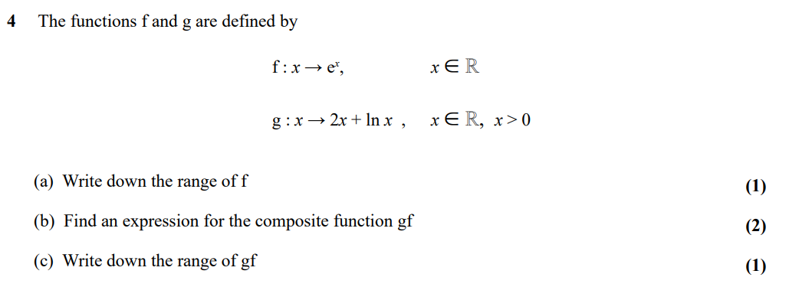

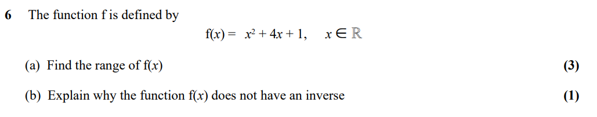

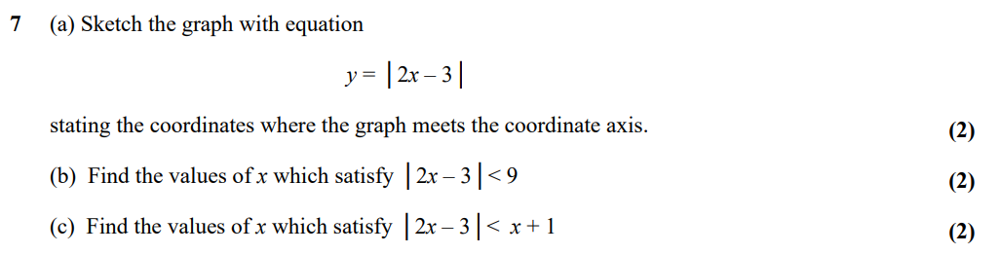

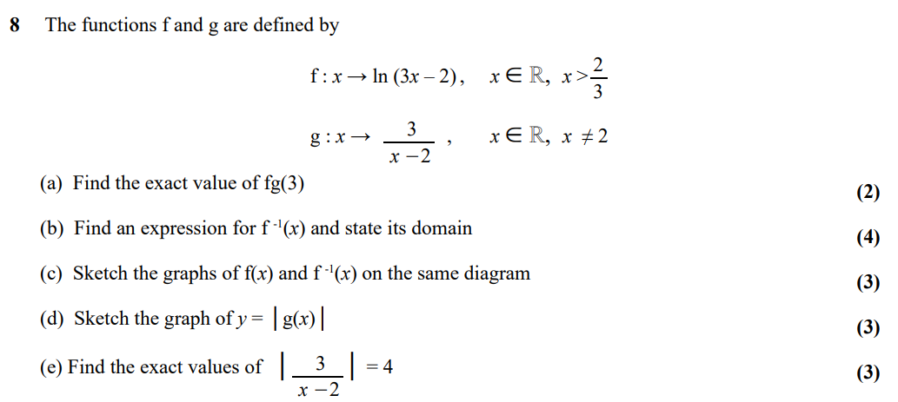

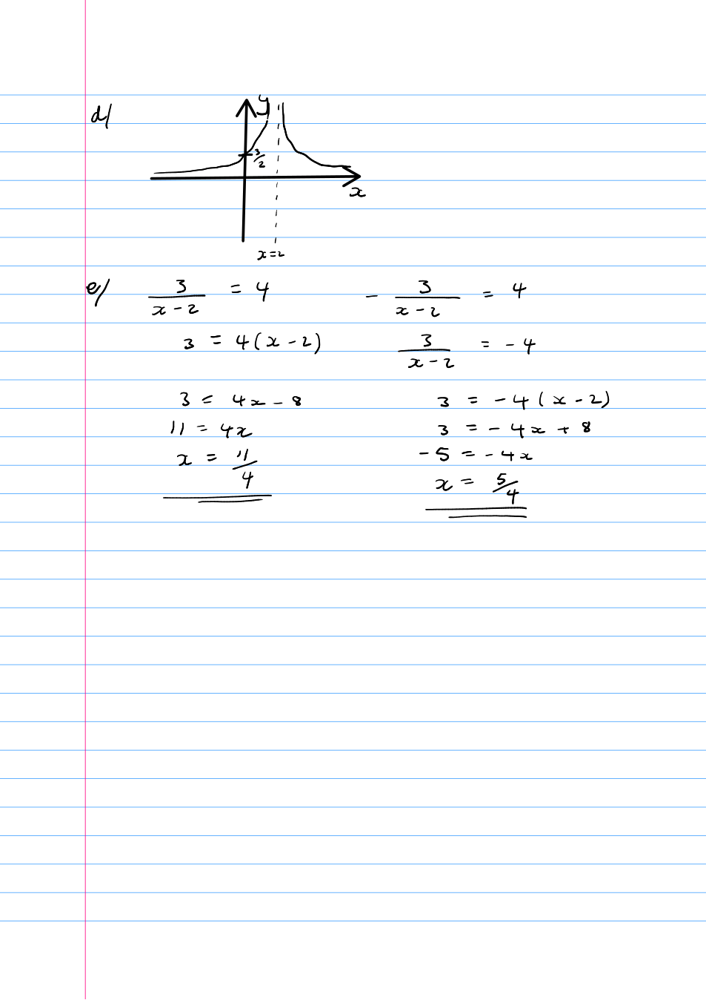

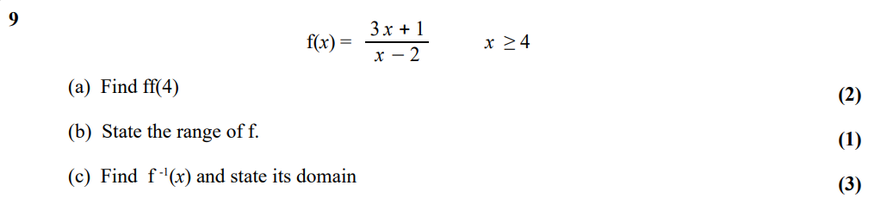

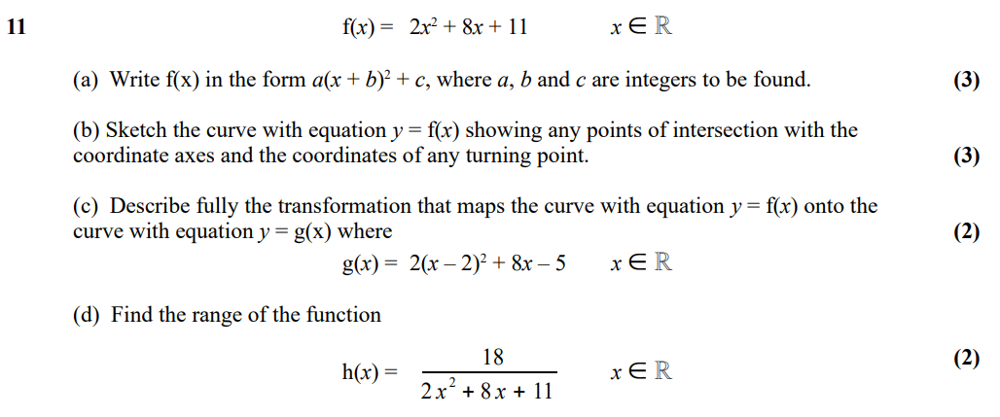

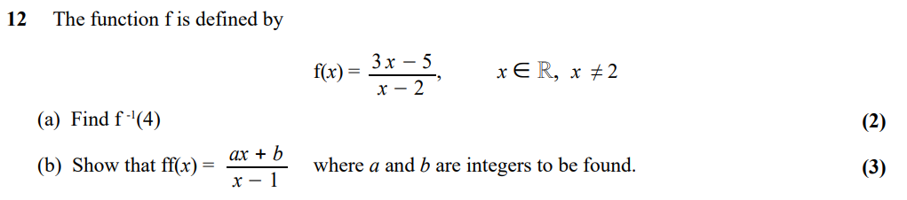

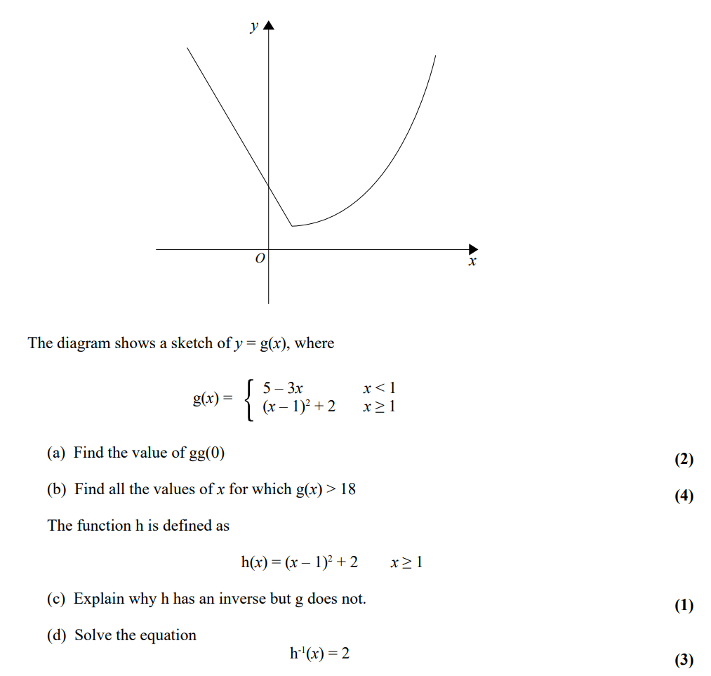

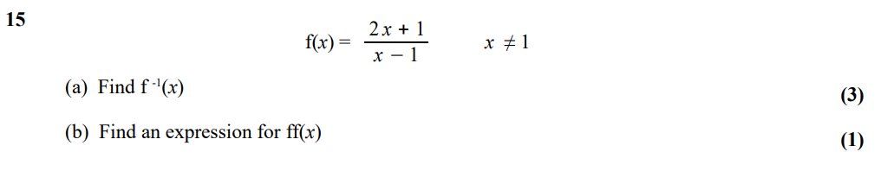

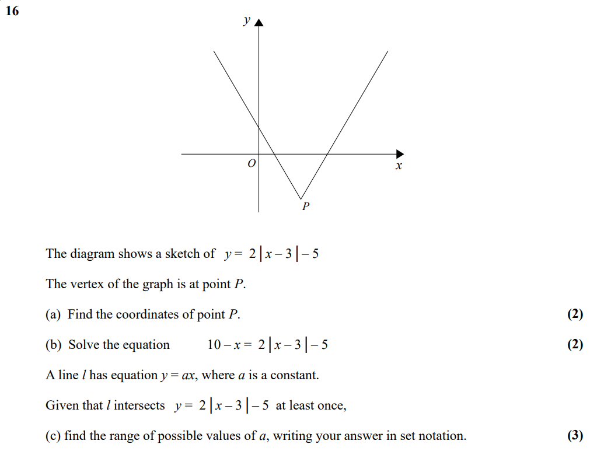

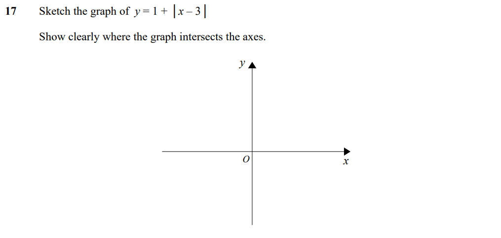

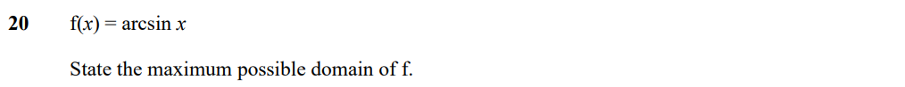

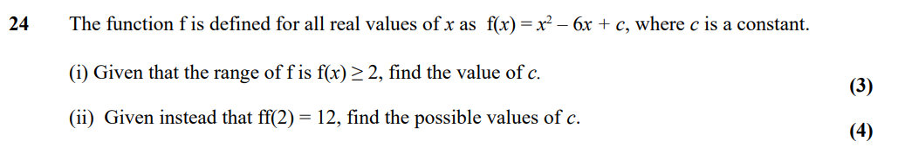

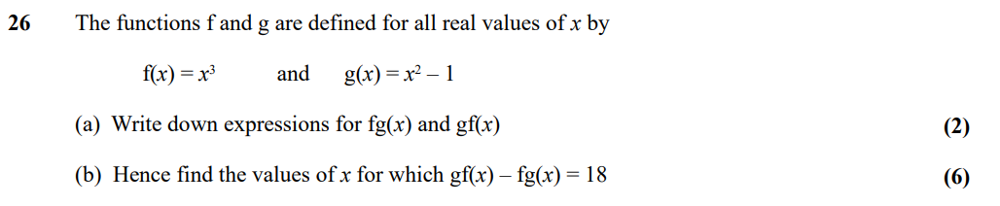

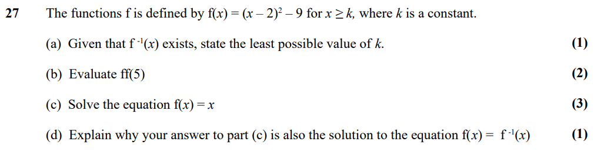

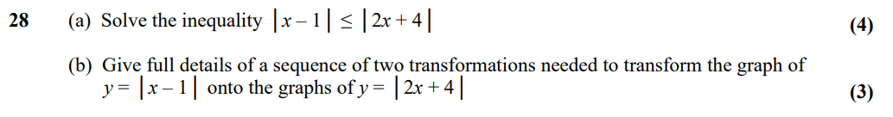

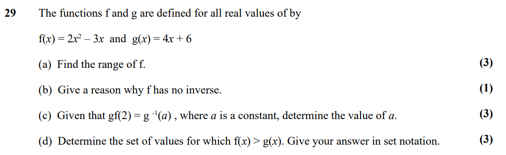

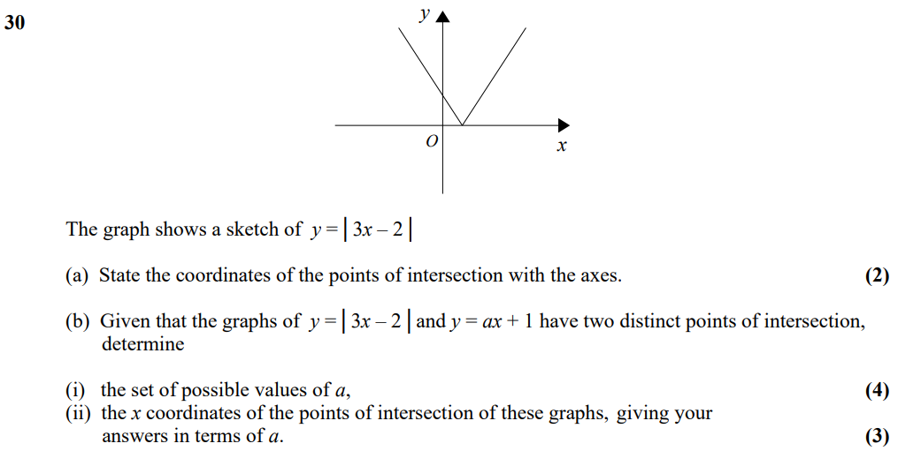

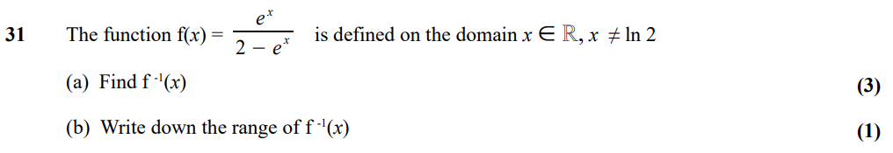

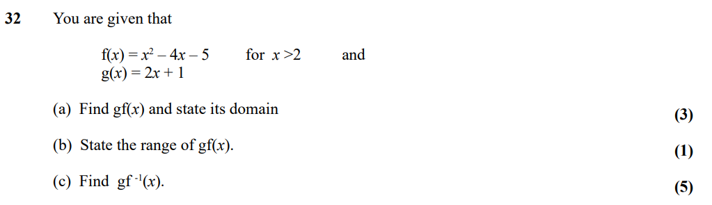

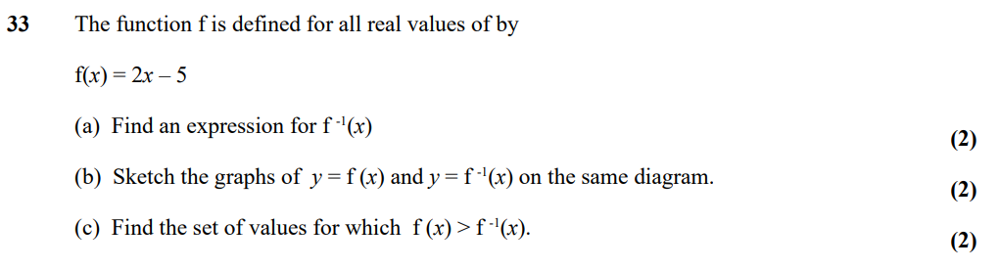

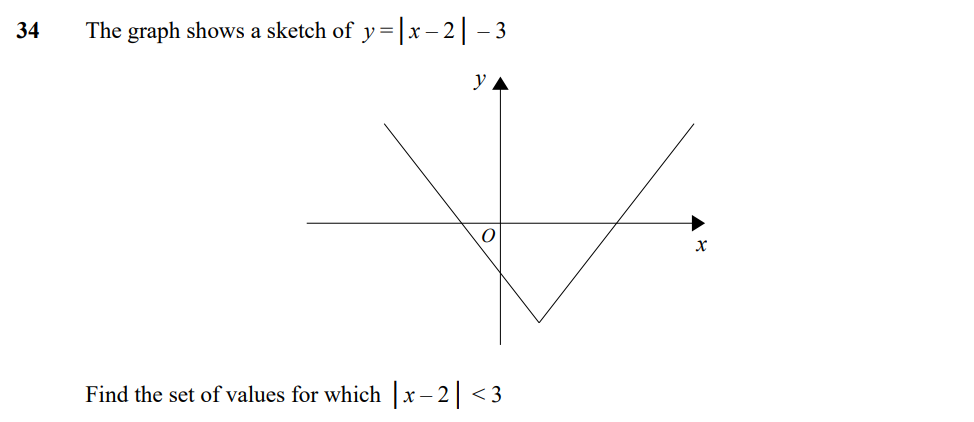

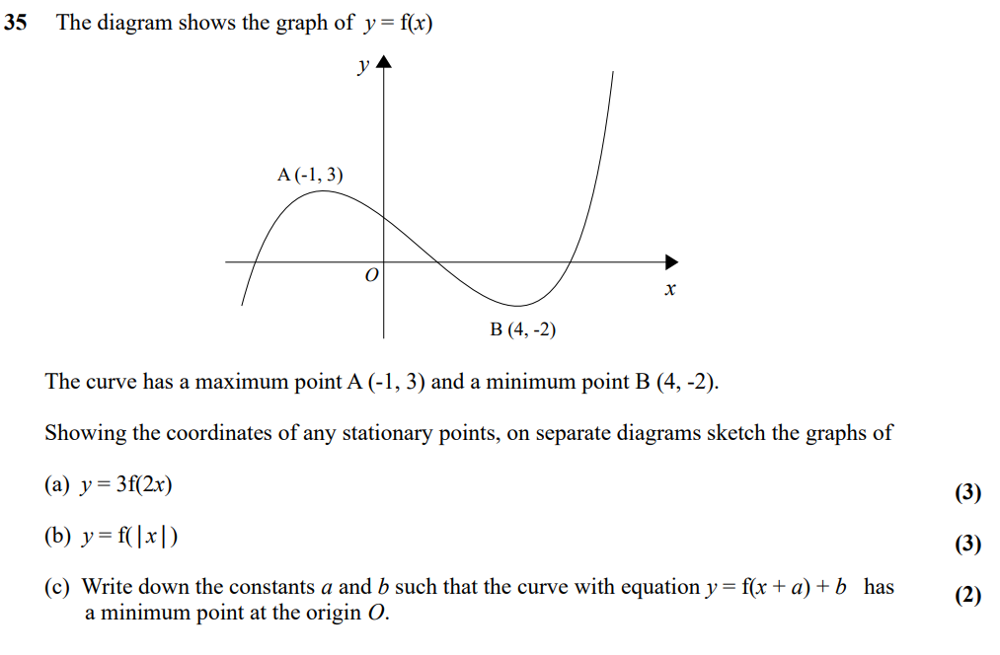

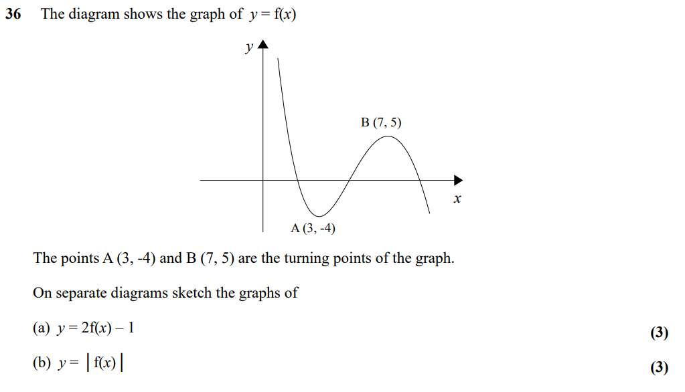

