# Functions and Graphs — Question Set (A-Level Maths · Edexcel · Year 2 Pure Mathematics)

Chapter question set · `a-level-pure-mathematics-2-functions-and-graphs` · 36 questions · segmented by printed total lines

## Q1 (6 marks · parts a, b)

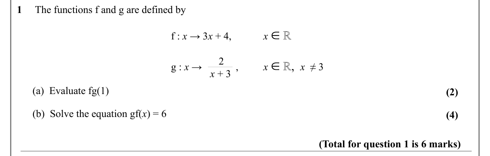

Text (lossy): 1     The functions f and g are defined by / x ∈ ℝ / f : x → 3 x + 4, /  2 / x ∈ ℝ,  x  ≠ 3  / g : x →             , / x + 3 /       (a)  Evaluate fg(1) / (2) /       (b)  Solve the equation gf(x) = 6 / (4) / (Total for question 1 is 6 marks)

## Q2 (8 marks · parts a, b, c)

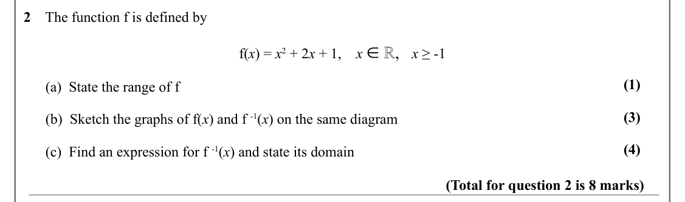

Text (lossy): 2    The function f is defined by / f(x) = x 2 + 2 x + 1,    x ∈ ℝ,   x ≥ -1 / (1) /       (a)  State the range of f / (3) /       (b)  Sketch the graphs of f(x) and f -1(x) on the same diagram / (4) /       (c)  Find an expression for f -1(x) and state its domain / (Total for question 2 is 8 marks)

## Q3 (5 marks · parts a, b)

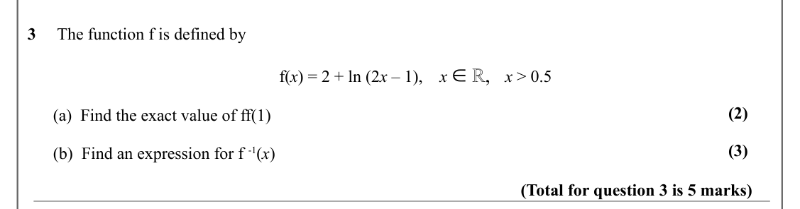

Text (lossy): 3     The function f is defined by / f(x) = 2 + ln (2 x – 1),    x ∈ ℝ,   x > 0.5 / (2) /       (a)  Find the exact value of ff(1) / (3) /       (b)  Find an expression for f -1(x) / (Total for question 3 is 5 marks)

## Q4 (4 marks · parts a, b, c)

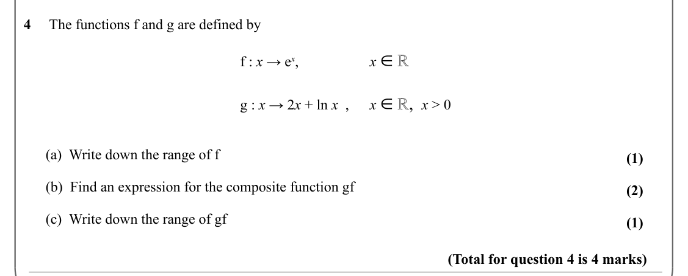

Text (lossy): 4     The functions f and g are defined by / x ∈ ℝ / f : x → e x, / x ∈ ℝ,  x > 0 / g : x → 2 x + ln x  , /       (a)  Write down the range of f / (1) /       (b)  Find an expression for the composite function gf / (2) /       (c)  Write down the range of gf  / (1) / (Total for question 4 is 4 marks)

## Q5 (8 marks · parts a, b, c)

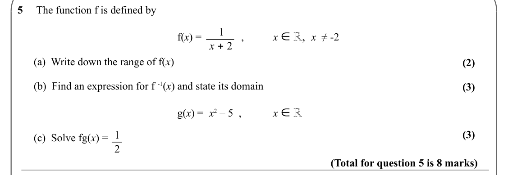

Text (lossy): 5     The function f is defined by / 1 / x ∈ ℝ,  x  ≠ -2  / f(x) =  / , / x + 2 /       (a)  Write down the range of f(x) / (2) /       (b)  Find an expression for f -1(x) and state its domain / (3) / x ∈ ℝ / g(x) = x 2 – 5  , / 1 / (3) /       (c)  Solve fg(x) =  / 2 / (Total for question 5 is 8 marks)

## Q6 (4 marks · parts a, b)

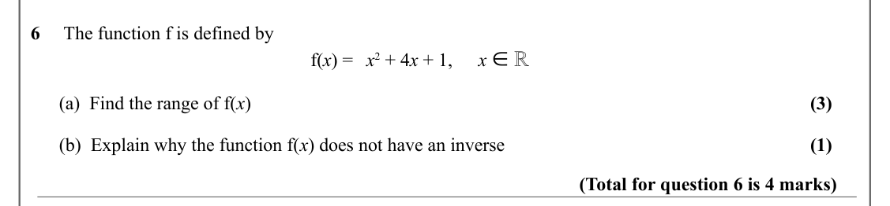

Text (lossy): 6     The function f is defined by / x ∈ ℝ / f(x) = x 2 + 4 x + 1, /       (a)  Find the range of f(x) / (3) /       (b)  Explain why the function f(x) does not have an inverse / (1) / (Total for question 6 is 4 marks)

## Q7 (6 marks · parts b, c)

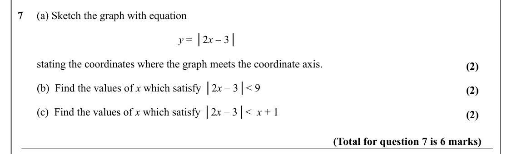

Text (lossy): 7     (a) Sketch the graph with equation / y = │2 x – 3│ /        stating the coordinates where the graph meets the coordinate axis.  / (2) /        (b)  Find the values of x which satisfy │2 x – 3│< 9 / (2) /        (c)  Find the values of x which satisfy │2 x – 3│<  x + 1 / (2) / (Total for question 7 is 6 marks)

## Q8 (15 marks · parts a, b, c, d, e)

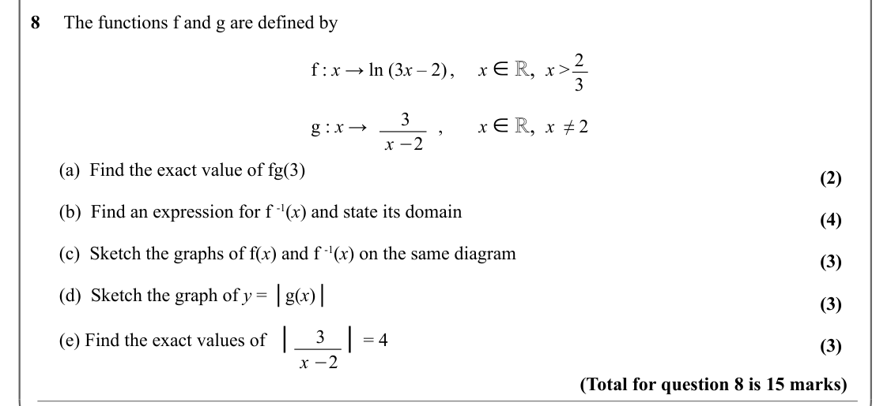

Text (lossy): 8     The functions f and g are defined by / 2 / x ∈ ℝ,  x >  / f : x → ln (3 x – 2) , / 3 / 3 / x ∈ ℝ,  x  ≠ 2  / g : x →               , / x −2 /       (a)  Find the exact value of fg(3) / (2) /       (b)  Find an expression for f -1(x) and state its domain / (4) /       (c)  Sketch the graphs of f(x) and f -1(x) on the same diagram / (3) /       (d)  Sketch the graph of y = │g(x)│ / (3) / 3 /  

## Q9 (6 marks · parts a, b, c)

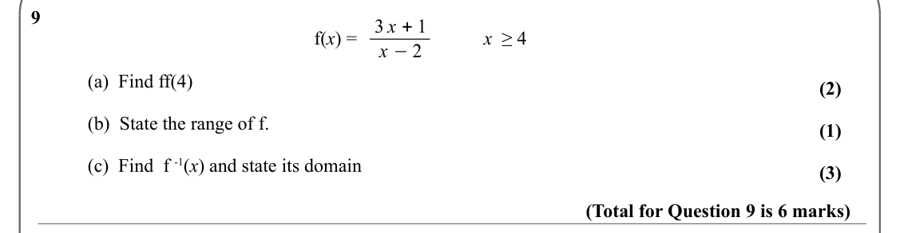

Text (lossy): 9  / 3 x + 1 / f(x) =  / x  ≥ 4 / x −2 / (a)  Find ff(4) / (2) / (b)  State the range of f.  / (1) / (c)  Find  f -1(x) and state its domain / (3) / (Total for Question 9 is 6 marks)

## Q10 (3 marks · parts i, ii)

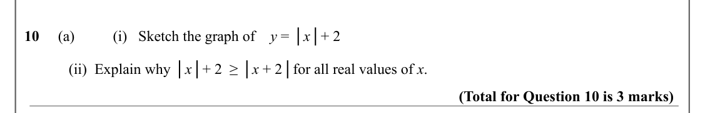

Text (lossy): 10     (a) / (i)   Sketch the graph of    y = │x│+ 2 / (ii)  Explain why │x│+ 2  ≥ │x + 2│for all real values of x.  / (Total for Question 10 is 3 marks)

## Q11 (10 marks · parts a, b, c, d)

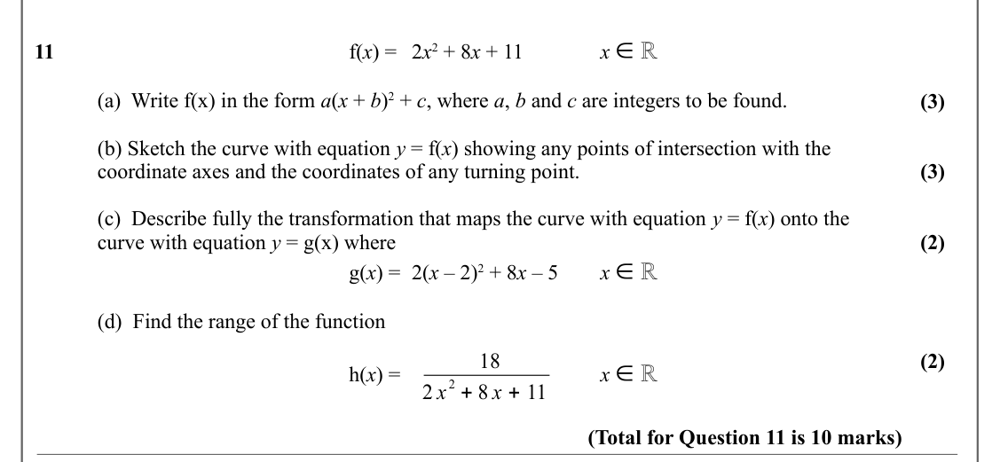

Text (lossy): x ∈ ℝ / 11  / f(x) = 2 x 2 + 8 x + 11 / (a)  Write f(x) in the form a(x + b)2 + c, where a, b and c are integers to be found.  / (3) / (b) Sketch the curve with equation y = f(x) showing any points of intersection with the  / coordinate axes and the coordinates of any turning point. / (3) / (c)  Describe fully the transformation that maps the curve with equation y = f(x) onto the  / curve with equ

## Q12 (5 marks · parts a, b)

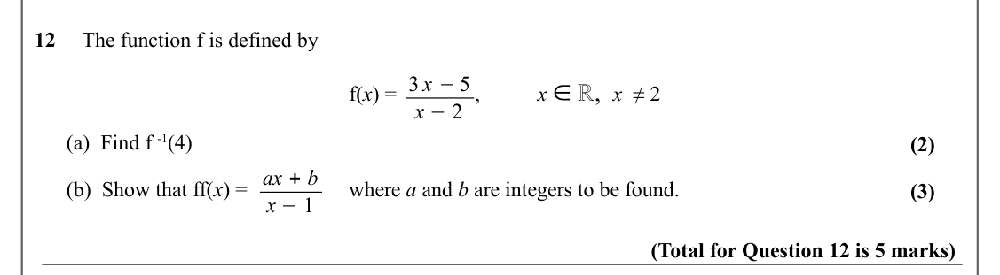

Text (lossy): 12     The function f is defined by / 3 x −5 / x ∈ ℝ,  x  ≠ 2  / f(x) =  / , / x −2 /       (a)  Find f -1(4) / (2) / ax + b /       (b)  Show that ff(x) =   / where a and b are integers to be found.  / (3) / x −1 / (Total for Question 12 is 5 marks)

## Q13 (3 marks)

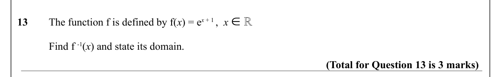

Text (lossy): 13     The function f is defined by f(x) = e x + 1 ,  x ∈ ℝ / Find f -1(x) and state its domain.  / (Total for Question 13 is 3 marks)

## Q14 (10 marks · parts a, b, c, d)

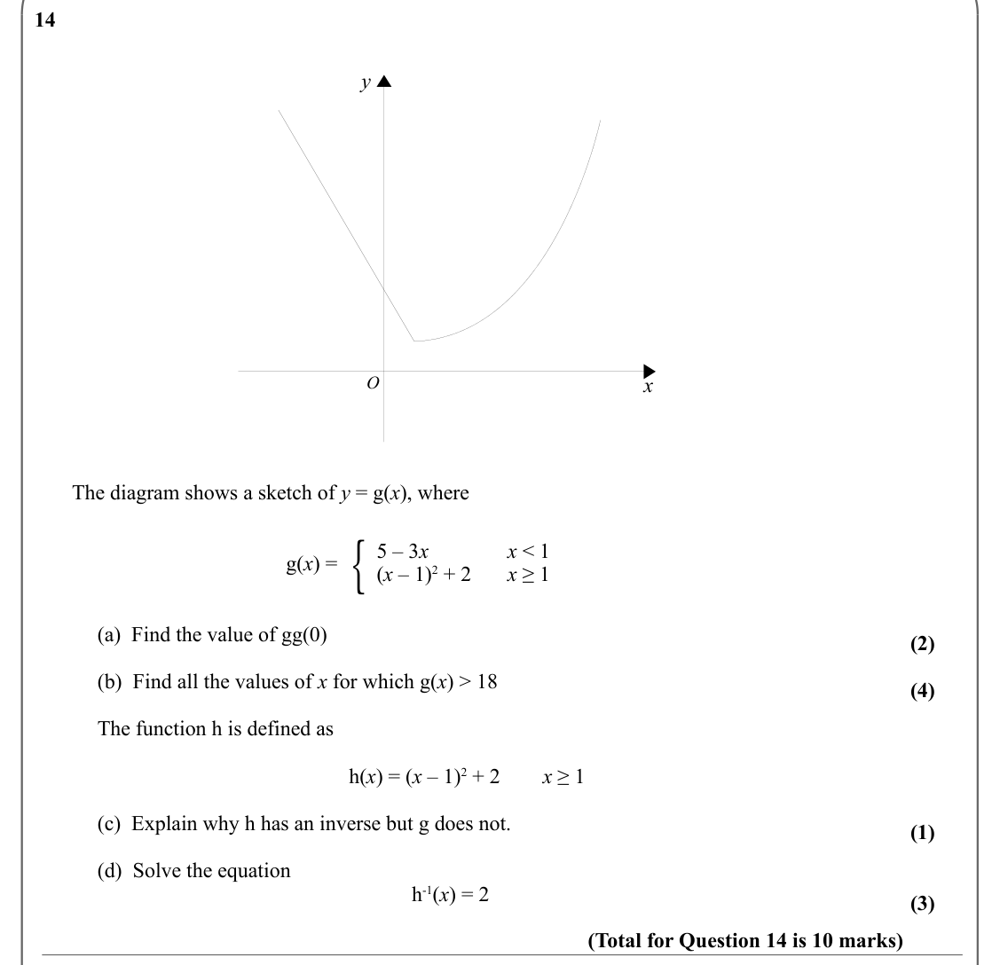

Text (lossy): 14      / y / O / x /        The diagram shows a sketch of y = g(x), where / { / 5 – 3 x   /  x < 1 / g(x) =   / (x – 1)2 + 2     x ≥ 1 / (a)  Find the value of gg(0) / (2) / (b)  Find all the values of x for which g(x) > 18 / (4) / The function h is defined as / h(x) = (x – 1)2 + 2     x ≥ 1 / (c)  Explain why h has an inverse but g does not.  / (1) / (d)  Solve the equation  / h-1(x) = 2 / (3) /

## Q15 (4 marks · parts a, b)

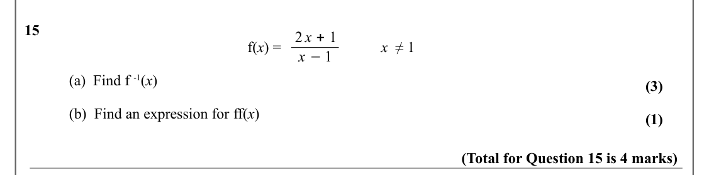

Text (lossy): 15   / 2 x + 1 / f(x) =  / x  ≠ 1 / x −1 / (a)  Find f -1(x) / (3) / (b)  Find an expression for ff(x)  / (1) / (Total for Question 15 is 4 marks)

## Q16 (7 marks · parts a, b, c)

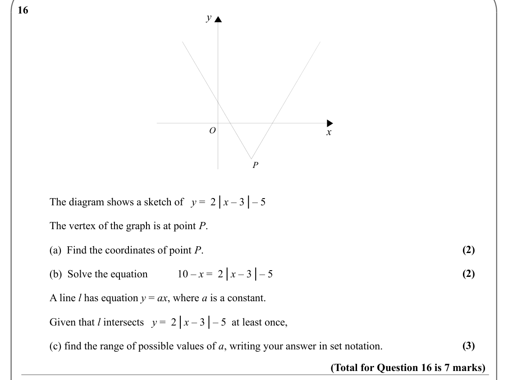

Text (lossy): 16      / y / O / x / P / The diagram shows a sketch of   y =  2│x – 3│– 5  / The vertex of the graph is at point P.  / (2) / (a)  Find the coordinates of point P. / (2) / (b)  Solve the equation  / 10 – x =  2│x – 3│– 5 / A line l has equation y = ax, where a is a constant. / Given that l intersects   y =  2│x – 3│– 5  at least once, / (3) / (c) find the range of possible values of a, writing you

## Q17 (2 marks)

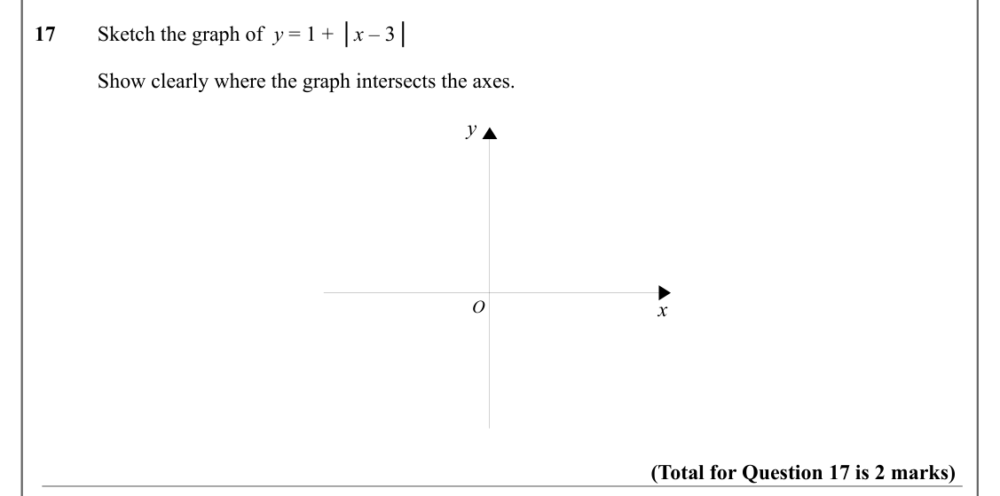

Text (lossy): 17     Sketch the graph of  y = 1 + │x – 3│ / Show clearly where the graph intersects the axes.  / y / O / x / (Total for Question 17 is 2 marks)

## Q18 (3 marks)

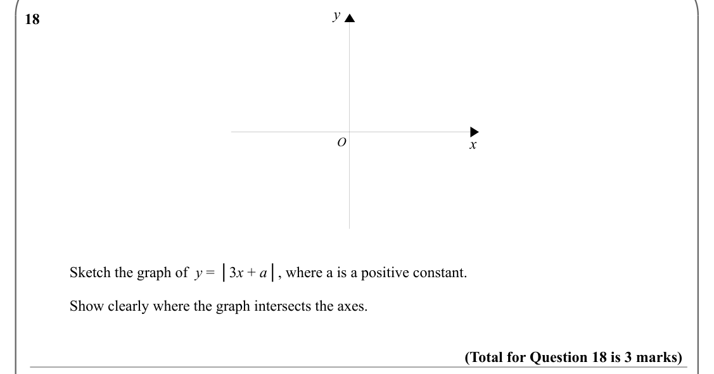

Text (lossy): y / 18      / O / x / Sketch the graph of  y = │3 x + a│, where a is a positive constant.  / Show clearly where the graph intersects the axes.  / (Total for Question 18 is 3 marks)

## Q19 (5 marks · parts a, b, c)

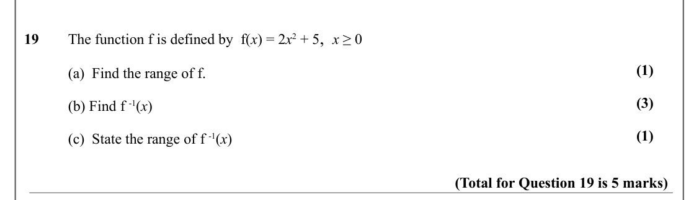

Text (lossy): The function f is defined by  f(x) = 2 x 2 + 5,  x ≥ 0  / 19     / (1) / (a)  Find the range of f.  / (3) / (b) Find f -1(x) / (1) / (c)  State the range of f -1(x) / (Total for Question 19 is 5 marks)

## Q20 (2 marks)

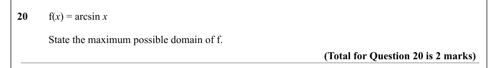

Text (lossy): 20     / f(x) = arcsin x / State the maximum possible domain of f. / (Total for Question 20 is 2 marks)

## Q21 (2 marks)

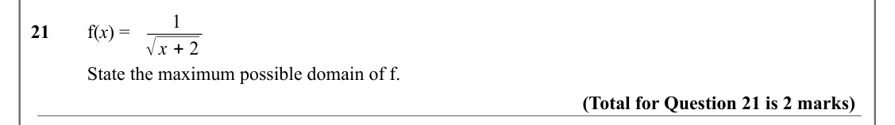

Text (lossy): 1 / 21     / f(x) =  / √x + 2 / State the maximum possible domain of f. / (Total for Question 21 is 2 marks)

## Q22 (5 marks · parts b)

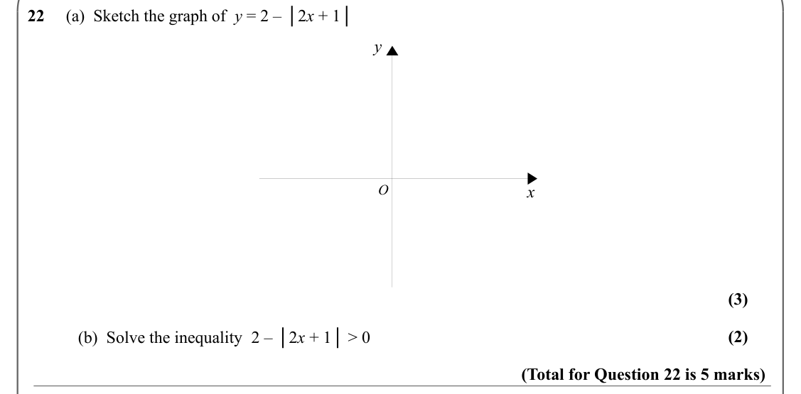

Text (lossy): 22     (a)  Sketch the graph of  y = 2 – │2 x + 1│  / y / O / x / (3) / (2) / (b)  Solve the inequality  2 – │2 x + 1│ > 0 / (Total for Question 22 is 5 marks)

## Q23 (5 marks · parts a, b)

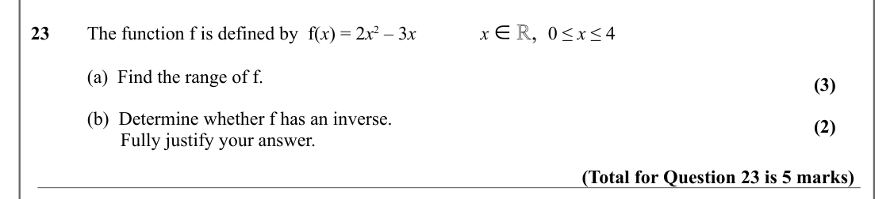

Text (lossy): x ∈ ℝ,  0 ≤ x ≤ 4  / 23     / The function f is defined by  f(x) = 2 x 2 – 3 x / (a)  Find the range of f.  / (3) / (b)  Determine whether f has an inverse.  / (2) /        Fully justify your answer.  / (Total for Question 23 is 5 marks)

## Q24 (7 marks · parts i, ii)

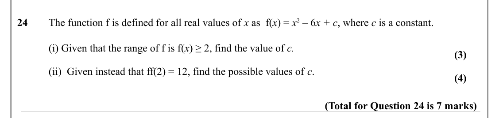

Text (lossy): 24     / The function f is defined for all real values of x as  f(x) = x 2 – 6 x + c, where c is a constant.  / (i) Given that the range of f is f(x) ≥ 2, find the value of c.   / (3) / (ii)  Given instead that ff(2) = 12, find the possible values of c.  / (4) / (Total for Question 24 is 7 marks)

## Q25 (3 marks)

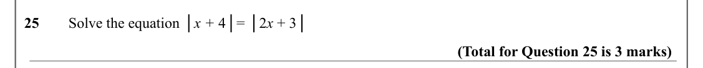

Text (lossy): 25     Solve the equation │x + 4│= │2 x + 3│  / (Total for Question 25 is 3 marks)

## Q26 (8 marks · parts a, b)

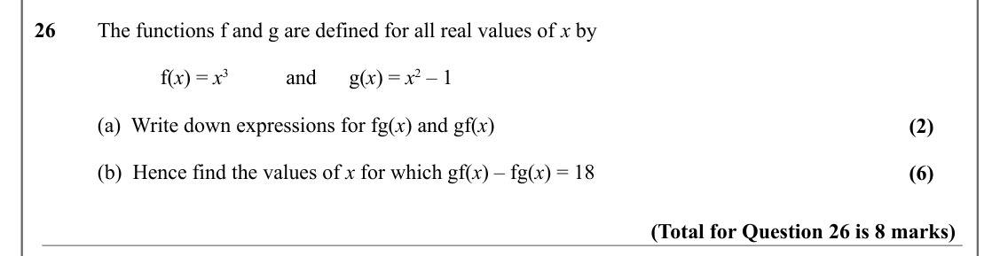

Text (lossy): 26     The functions f and g are defined for all real values of x by / f(x) = x 3  / and  / g(x) = x 2 – 1   / (a)  Write down expressions for fg(x) and gf(x)  / (2) / (b)  Hence find the values of x for which gf(x) – fg(x) = 18 / (6) / (Total for Question 26 is 8 marks)

## Q27 (7 marks · parts a, b, c, d)

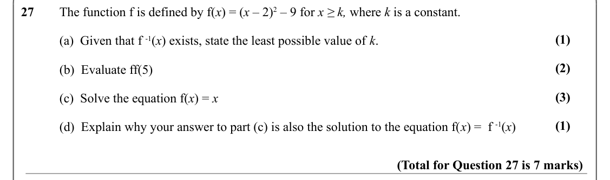

Text (lossy): 27     The function f is defined by f(x) = (x – 2)2 – 9 for x ≥ k, where k is a constant. / (1) / (a)  Given that f -1(x) exists, state the least possible value of k.    / (2) / (b)  Evaluate ff(5) / (3) / (c)  Solve the equation f(x) = x / (1) / (d)  Explain why your answer to part (c) is also the solution to the equation f(x) =  f -1(x)   / (Total for Question 27 is 7 marks)

## Q28 (7 marks · parts a, b)

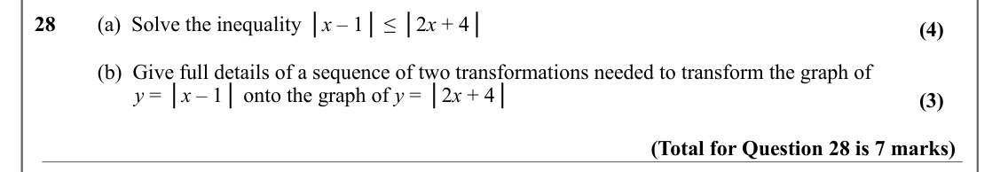

Text (lossy): 28     / (a)  Solve the inequality │x – 1│ ≤ │2 x + 4│ / (4) / (b)  Give full details of a sequence of two transformations needed to transform the graph of  /        y = │x – 1│ onto the graph of y = │2 x + 4│ / (3) / (Total for Question 28 is 7 marks)

## Q29 (10 marks · parts a, b, c, d)

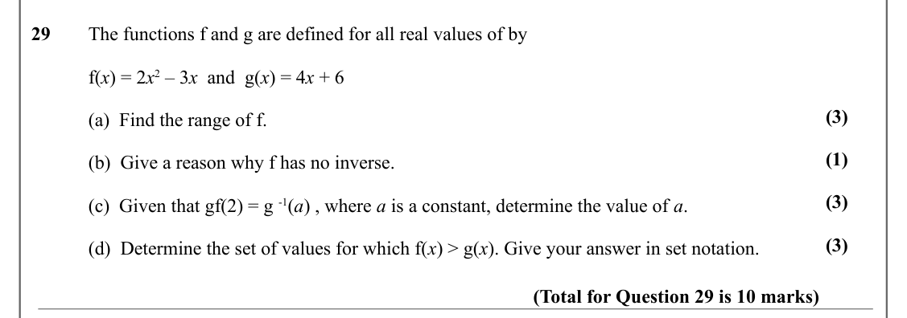

Text (lossy): 29     / The functions f and g are defined for all real values of by / f(x) = 2 x 2 – 3 x  and  g(x) = 4 x + 6 / (3) / (a)  Find the range of f.  / (1) / (b)  Give a reason why f has no inverse. / (3) / (c)  Given that gf(2) = g -1(a) , where a is a constant, determine the value of a. / (3) / (d)  Determine the set of values for which f(x) > g(x). Give your answer in set notation.  / (Total for Qu

## Q30 (9 marks · parts a, b, i, ii)

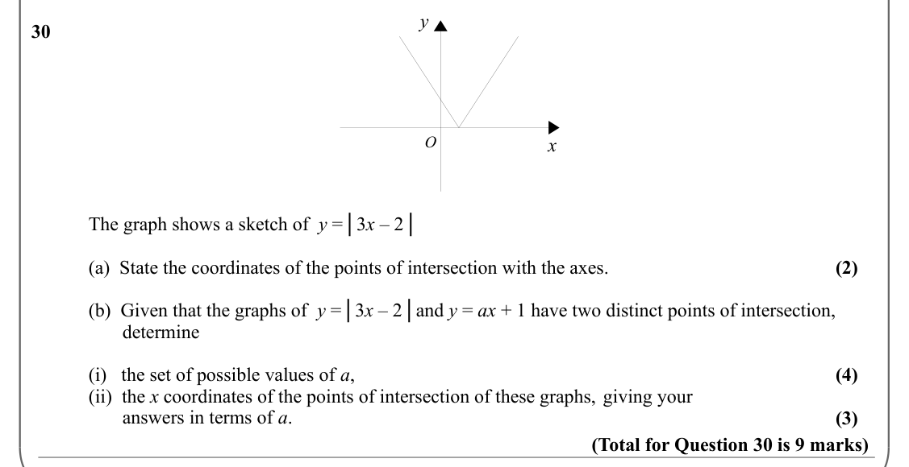

Text (lossy): y / 30     / O / x / The graph shows a sketch of  y =│3 x – 2│ / (a)  State the coordinates of the points of intersection with the axes.  / (2) / (b)  Given that the graphs of  y =│3 x – 2│and y = ax + 1 have two distinct points of intersection,  /        determine / (i)   the set of possible values of a, / (4) / (ii)  the x coordinates of the points of intersection of these graphs, giving your  /

## Q31 (4 marks · parts a, b)

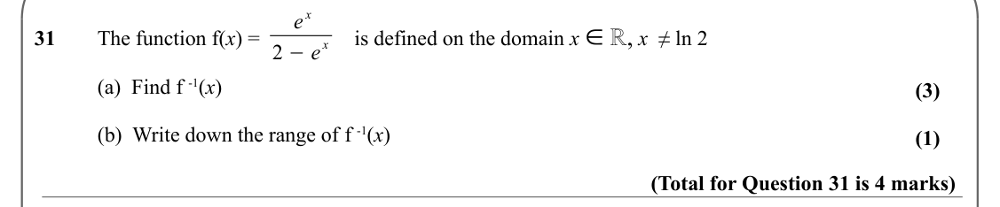

Text (lossy): e x /  is defined on the domain x ∈ ℝ, x  ≠ ln 2 / 31     The function f(x) =  / x / 2 −e / (a)  Find f -1(x)  / (3) / (b)  Write down the range of f -1(x)  / (1) / (Total for Question 31 is 4 marks)

## Q32 (9 marks · parts a, b, c)

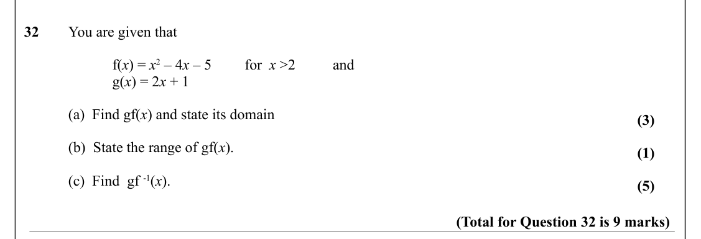

Text (lossy): 32     You are given that / f(x) = x 2 – 4 x – 5  / for  x >2  / and / g(x) = 2 x + 1 / (a)  Find gf(x) and state its domain  / (3) / (b)  State the range of gf(x).  / (1) / (c)  Find  gf -1(x). / (5) / (Total for Question 32 is 9 marks)

## Q33 (6 marks · parts a, b, c)

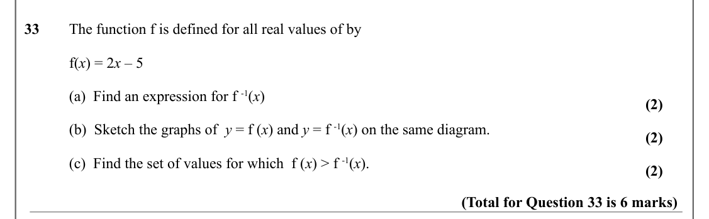

Text (lossy): 33     / The function f is defined for all real values of by / f(x) = 2 x – 5    / (a)  Find an expression for f -1(x) / (2) / (b)  Sketch the graphs of  y = f (x) and y = f -1(x) on the same diagram. / (2) / (c)  Find the set of values for which  f (x) > f -1(x). / (2) / (Total for Question 33 is 6 marks)

## Q34 (4 marks)

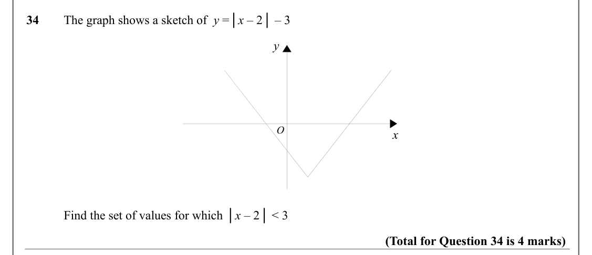

Text (lossy): 34     / The graph shows a sketch of  y =│x – 2│ – 3  / y / O / x / Find the set of values for which │x – 2│ < 3  / (Total for Question 34 is 4 marks)

## Q35 (8 marks · parts a, b, c)

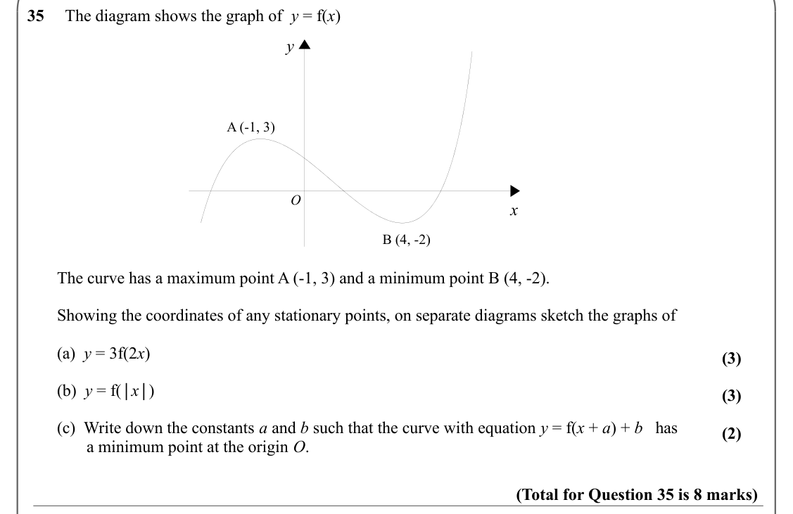

Text (lossy): 35     The diagram shows the graph of  y = f(x) / y / A (-1, 3)  / O / x / B (4, -2) /        The curve has a maximum point A (-1, 3) and a minimum point B (4, -2). /        Showing the coordinates of any stationary points, on separate diagrams sketch the graphs of     /        (a)  y = 3f(2 x) / (3) /        (b)  y = f(│x│) / (3) /        (c)  Write down the constants a and b such that the curve 

## Q36 (6 marks · parts a, b)

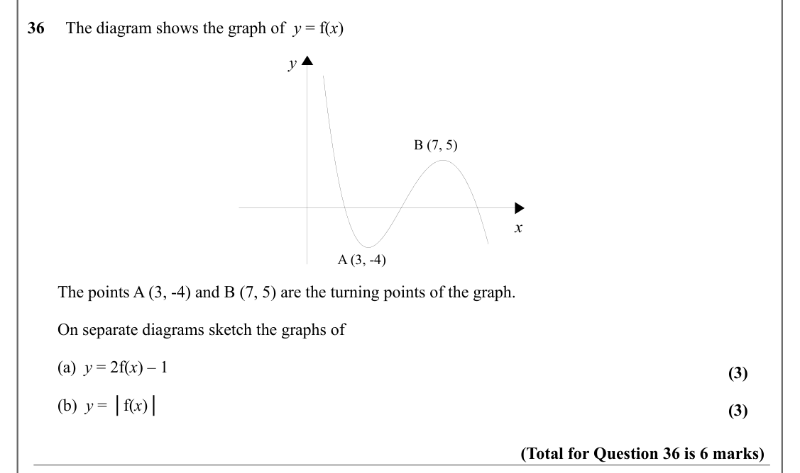

Text (lossy): 36     The diagram shows the graph of  y = f(x) / y / B (7, 5) / x / A (3, -4)  /        The points A (3, -4) and B (7, 5) are the turning points of the graph. /        On separate diagrams sketch the graphs of     /        (a)  y = 2f(x) – 1 / (3) /        (b)  y = │f(x)│ / (3) / (Total for Question 36 is 6 marks)

