# Sequences and Series — Question Set (A-Level Maths · Edexcel · Year 2 Pure Mathematics)

Chapter question set · `a-level-pure-mathematics-3-sequences-and-series` · 38 questions · segmented by printed total lines

## Q1 (4 marks)

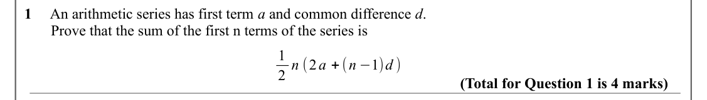

Text (lossy): 1     An arithmetic series has first term a and common difference d.  /        Prove that the sum of the first n terms of the series is  / 1 / 2 n (2 a + (n −1)d ) / (Total for Question 1 is 4 marks)

## Q2 (10 marks · parts a, b)

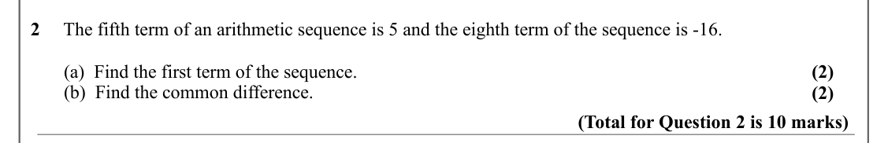

Text (lossy): 2     The fifth term of an arithmetic sequence is 5 and the eighth term of the sequence is -16.    /        (a)  Find the first term of the sequence.  / (2) /        (b)  Find the common difference.  / (2) / (Total for Question 2 is 10 marks)

## Q3 (10 marks · parts a, b, c)

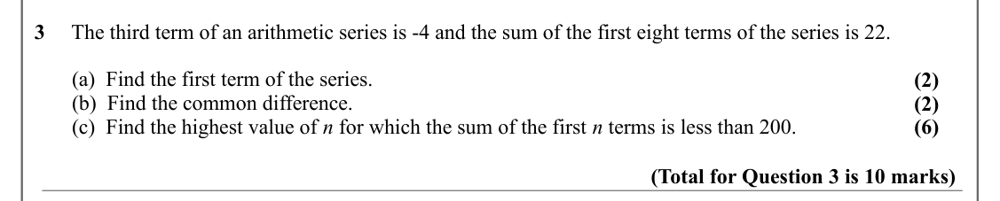

Text (lossy): 3     The third term of an arithmetic series is -4 and the sum of the first eight terms of the series is 22.    /        (a)  Find the first term of the series.  / (2) /        (b)  Find the common difference.  / (2) /        (c)  Find the highest value of n for which the sum of the first n terms is less than 200.    / (6) / (Total for Question 3 is 10 marks)

## Q4 (6 marks · parts a, b)

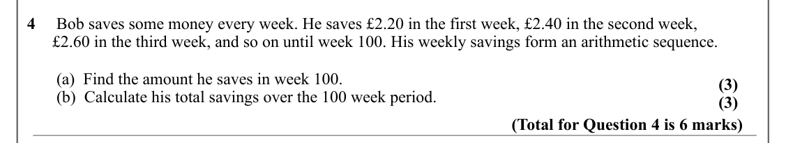

Text (lossy): 4     Bob saves some money every week. He saves £2.20 in the first week, £2.40 in the second week,  /       £2.60 in the third week, and so on until week 100. His weekly savings form an arithmetic sequence.  /        (a)  Find the amount he saves in week 100.   / (3) /        (b)  Calculate his total savings over the 100 week period.  / (3) / (Total for Question 4 is 6 marks)

## Q5 (5 marks · parts a, b)

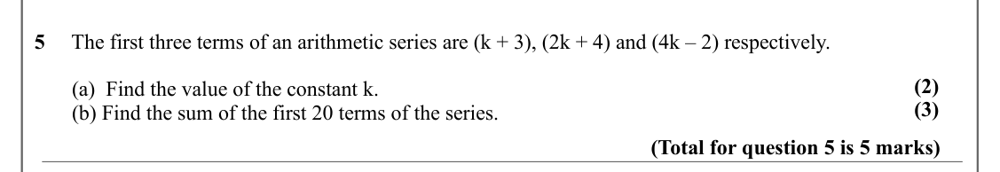

Text (lossy): 5     The first three terms of an arithmetic series are (k + 3), (2k + 4) and (4k – 2) respectively.  / (2) /        (a)  Find the value of the constant k.  / (3) /        (b) Find the sum of the first 20 terms of the series. / (Total for question 5 is 5 marks)

## Q6 (6 marks · parts a, b)

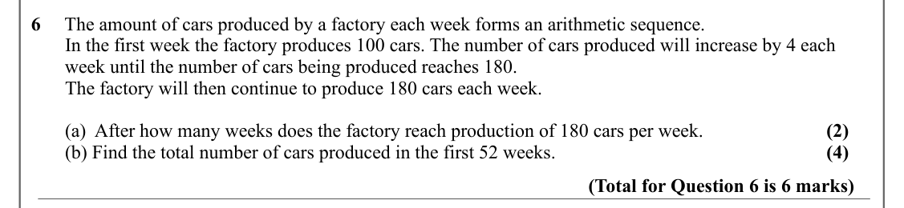

Text (lossy): 6     The amount of cars produced by a factory each week forms an arithmetic sequence.  /        In the first week the factory produces 100 cars. The number of cars produced will increase by 4 each         /        week until the number of cars being produced reaches 180.  /        The factory will then continue to produce 180 cars each week.  /        (a)  After how many weeks does the factory re

## Q7 (5 marks)

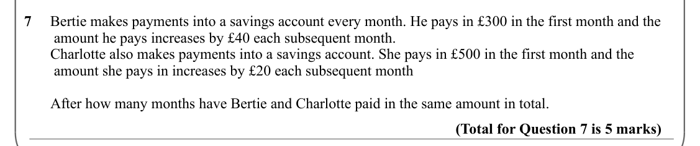

Text (lossy): 7     Bertie makes payments into a savings account every month. He pays in £300 in the first month and the     /         amount he pays increases by £40 each subsequent month.  /        Charlotte also makes payments into a savings account. She pays in £500 in the first month and the            /         amount she pays in increases by £20 each subsequent month   /        After how many months have

## Q8 (4 marks)

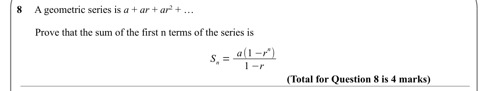

Text (lossy): 8     A geometric series is a + ar + ar 2 + … /        Prove that the sum of the first n terms of the series is  / n) / S n = a(1 −r / 1 −r / (Total for Question 8 is 4 marks)

## Q9 (9 marks · parts a, b, c) · printed as “2” (source typo)

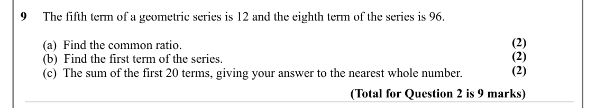

Text (lossy): 9     The fifth term of a geometric series is 12 and the eighth term of the series is 96.    / (2) /        (a)  Find the common ratio.  / (2) /        (b)  Find the first term of the series. / (2) /        (c)  The sum of the first 20 terms, giving your answer to the nearest whole number.  / (Total for Question 2 is 9 marks)

## Q10 (8 marks · parts a, b, c, d)

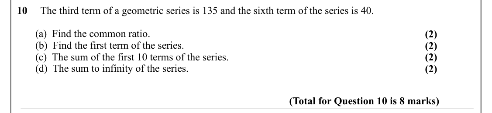

Text (lossy): 10     The third term of a geometric series is 135 and the sixth term of the series is 40.    /        (a)  Find the common ratio.  / (2) /        (b)  Find the first term of the series. / (2) /        (c)  The sum of the first 10 terms of the series.  / (2) /        (d)  The sum to infinity of the series.  / (2) / (Total for Question 10 is 8 marks)

## Q11 (6 marks · parts a, b, c)

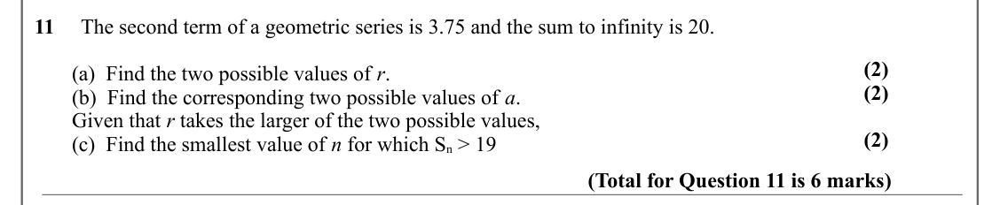

Text (lossy): 11     The second term of a geometric series is 3.75 and the sum to infinity is 20.    / (2) /        (a)  Find the two possible values of r.  / (2) /        (b)  Find the corresponding two possible values of a. /        Given that r takes the larger of the two possible values,  / (2) /        (c)  Find the smallest value of n for which S n > 19  / (Total for Question 11 is 6 marks)

## Q12 (10 marks · parts a, b, c, d)

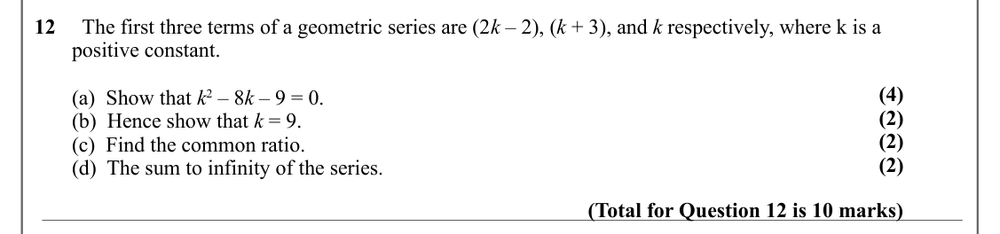

Text (lossy): 12     The first three terms of a geometric series are (2 k – 2), (k + 3), and k respectively, where k is a  /        positive constant.  / (4) /        (a)  Show that k 2 – 8 k – 9 = 0.  / (2) /        (b)  Hence show that k = 9. / (2) /        (c)  Find the common ratio.  / (2) /        (d)  The sum to infinity of the series.  / (Total for Question 12 is 10 marks)

## Q13 (6 marks · parts a, b)

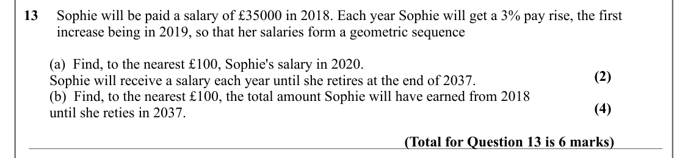

Text (lossy): 13     Sophie will be paid a salary of £35000 in 2018. Each year Sophie will get a 3% pay rise, the first             /          increase being in 2019, so that her salaries form a geometric sequence   /        (a)  Find, to the nearest £100, Sophie's salary in 2020.  / (2) /        Sophie will receive a salary each year until she retires at the end of 2037.  /        (b)  Find, to the nearest £10

## Q14 (6 marks · parts a, b, c)

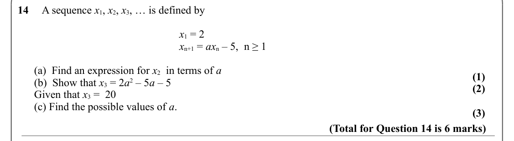

Text (lossy): 14     A sequence x 1, x 2, x 3, … is defined by / x 1 = 2 / x n+1 = ax n – 5, n ≥ 1  /       (a)  Find an expression for x 2  in terms of a / (1) /       (b)  Show that x 3 = 2 a 2 – 5 a – 5  / (2) /       Given that x 3 =  20 /       (c) Find the possible values of a. / (3) / (Total for Question 14 is 6 marks)

## Q15 (6 marks · parts a, b, c)

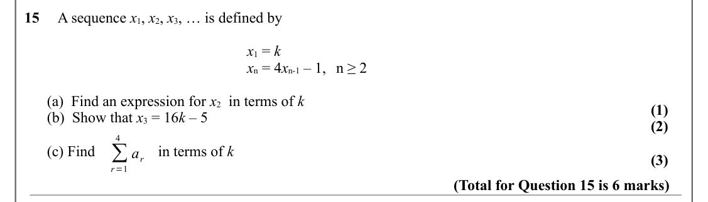

Text (lossy): 15     A sequence x 1, x 2, x 3, … is defined by / x 1 = k / x n = 4 x n-1 – 1, n ≥ 2  /       (a)  Find an expression for x 2  in terms of k / (1) /       (b)  Show that x 3 = 16 k – 5  / (2) / 4 / ∑ /       (c) Find / in terms of k  / a r / (3) / r=1 / (Total for Question 15 is 6 marks)

## Q16 (4 marks · parts a, b)

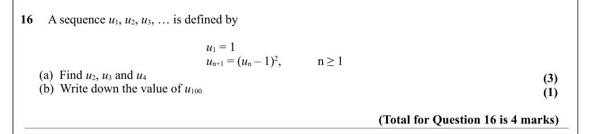

Text (lossy): 16     A sequence u 1, u 2, u 3, … is defined by / u 1 = 1 / u n+1 = (u n – 1)2,  / n ≥ 1 /       (a)  Find u 2, u 3 and u 4 / (3) /       (b)  Write down the value of u 100  / (1) / (Total for Question 16 is 4 marks)

## Q17 (5 marks · parts a, b)

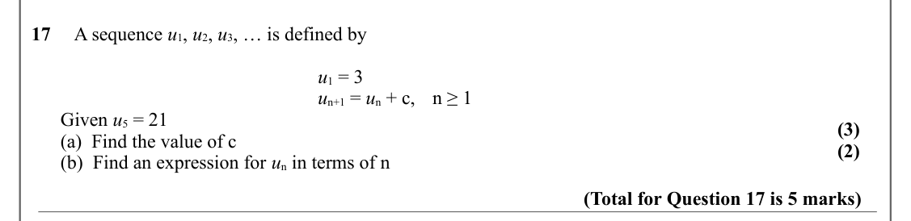

Text (lossy): 17     A sequence u 1, u 2, u 3, … is defined by / u 1 = 3 / u n+1 = u n + c, n ≥ 1 /       Given u 5 = 21 / (3) /       (a)  Find the value of c  / (2) /       (b)  Find an expression for u n in terms of n / (Total for Question 17 is 5 marks)

## Q18 (3 marks)

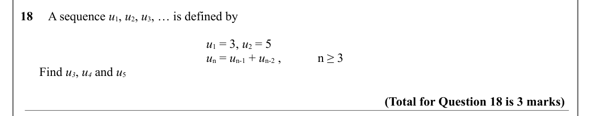

Text (lossy): 18     A sequence u 1, u 2, u 3, … is defined by / u 1 = 3, u 2 = 5 / u n = u n-1 + u n-2 ,  / n ≥ 3      /       Find u 3, u 4 and u 5 / (Total for Question 18 is 3 marks)

## Q19 (10 marks · parts a, b, c, i, ii)

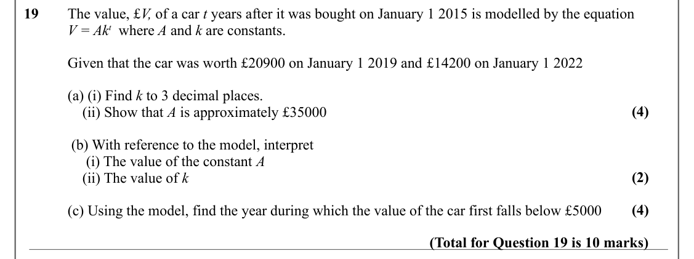

Text (lossy): 19     The value, £V, of a car t years after it was bought on January 1 2015 is modelled by the equation / V = Ak t  where A and k are constants.  / Given that the car was worth £20900 on January 1 2019 and £14200 on January 1 2022 / (a) (i) Find k to 3 decimal places.  / (4) /     (ii) Show that A is approximately £35000 /  (b) With reference to the model, interpret  /      (i) The value of the c

## Q20 (7 marks · parts b)

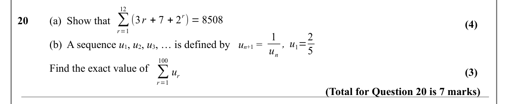

Text (lossy): 12 / ∑ / r) = 8508 / (3 r + 7 + 2 / 20     (a)  Show that / (4) / r=1 / 1 / , u 1=2 / (b)  A sequence u 1, u 2, u 3, … is defined by   u n+1 =  / u n / 5 / 100 / ∑ / Find the exact value of  / u r / (3) / r=1 / (Total for Question 20 is 7 marks)

## Q21 (8 marks · parts a, b)

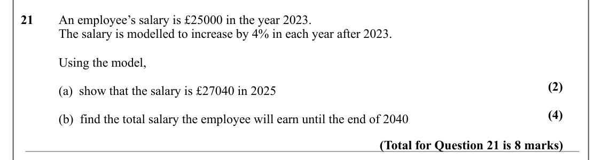

Text (lossy): 21     An employee’s salary is £25000 in the year 2023.  / The salary is modelled to increase by 4% in each year after 2023. / Using the model,  / (2) / (a)  show that the salary is £27040 in 2025 / (4) / (b)  find the total salary the employee will earn until the end of 2040 / (Total for Question 21 is 8 marks)

## Q22 (6 marks · parts b)

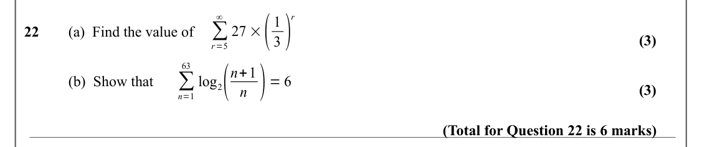

Text (lossy): 27 ×( / 3) / ∞ / r / 1 / ∑ / 22     (a)  Find the value of  / (3) / r=5 / log 2( / n ) = 6 / 63 / n+1 / ∑ / (b)  Show that / (3) / n=1 / (Total for Question 22 is 6 marks)

## Q23 (6 marks · parts a, b)

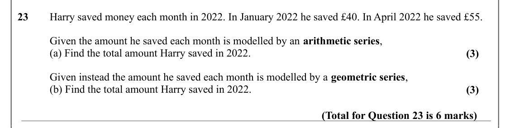

Text (lossy): 23     Harry saved money each month in 2022. In January 2022 he saved £40. In April 2022 he saved £55. / Given the amount he saved each month is modelled by an arithmetic series, / (a) Find the total amount Harry saved in 2022.  / (3) / Given instead the amount he saved each month is modelled by a geometric series, / (b) Find the total amount Harry saved in 2022.  / (3) / (Total for Question 23 is

## Q24 (7 marks · parts a, b, c)

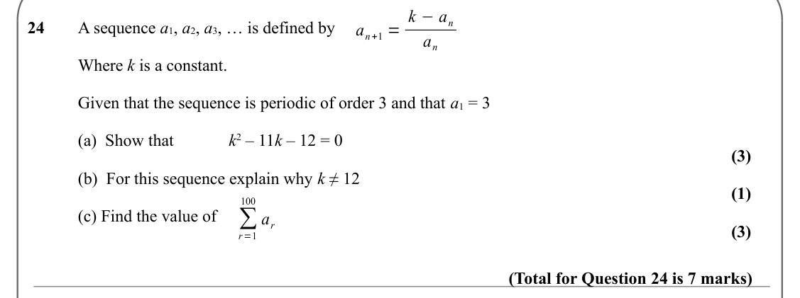

Text (lossy): a n+1 = k −a n / 24     A sequence a 1, a 2, a 3, … is defined by    / a n / Where k is a constant.  / Given that the sequence is periodic of order 3 and that a 1 = 3 / (a)  Show that   / k 2 – 11 k – 12 = 0 / (3) / (b)  For this sequence explain why k ≠ 12 / (1) / 100 / ∑ / (c) Find the value of  / a r / (3) / r=1 / (Total for Question 24 is 7 marks)

## Q25 (1 marks)

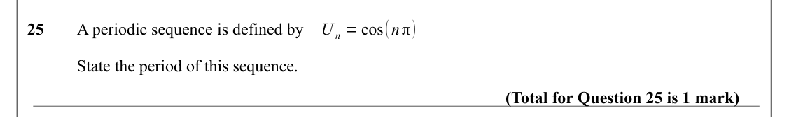

Text (lossy): U n = cos(n π) / 25     A periodic sequence is defined by  / State the period of this sequence.  / (Total for Question 25 is 1 mark)

## Q26 (9 marks · parts a, b)

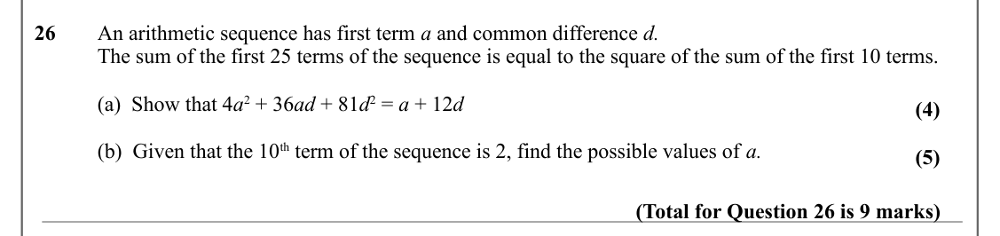

Text (lossy): 26     An arithmetic sequence has first term a and common difference d. / The sum of the first 25 terms of the sequence is equal to the square of the sum of the first 10 terms. / (a)  Show that 4 a 2 + 36 ad + 81 d 2 = a + 12 d / (4) / (b)  Given that the 10 th term of the sequence is 2, find the possible values of a.  / (5) / (Total for Question 26 is 9 marks)

## Q27 (7 marks · parts a, b, c)

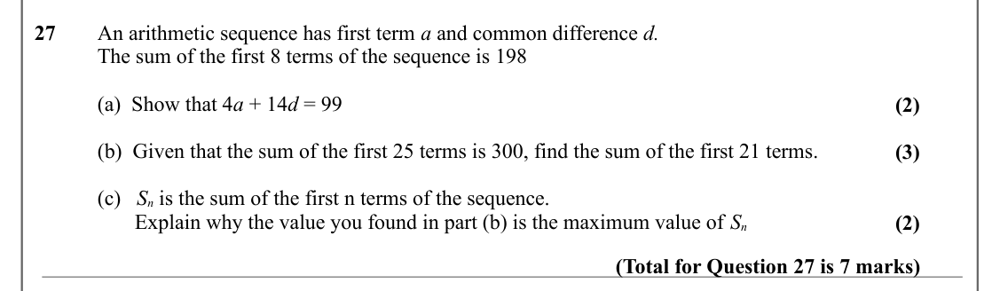

Text (lossy): 27     An arithmetic sequence has first term a and common difference d. / The sum of the first 8 terms of the sequence is 198 / (a)  Show that 4 a + 14 d = 99 / (2) / (b)  Given that the sum of the first 25 terms is 300, find the sum of the first 21 terms.  / (3) / (c)   S n is the sum of the first n terms of the sequence. /        Explain why the value you found in part (b) is the maximum value o

## Q28 (4 marks · parts a, b)

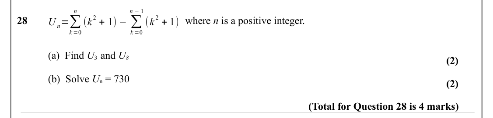

Text (lossy): n −1 / n / 2 + 1) −∑ / 2 + 1) / U n=∑ / 28      /      where n is a positive integer. / (k / (k / k =0 / k =0 / (a)  Find U 3  and U 8 / (2) / (b)  Solve U n = 730 / (2) / (Total for Question 28 is 4 marks)

## Q29 (4 marks · parts a, b, i, ii)

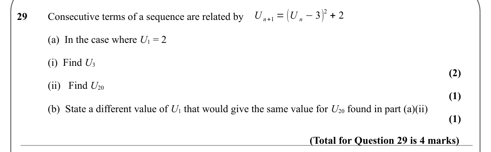

Text (lossy): 2 + 2 / U n+1 = (U n −3) / 29     Consecutive terms of a sequence are related by    / (a)  In the case where U 1 = 2 / (i)  Find U 3 / (2) / (ii)   Find U 20 / (1) / (b)  State a different value of U 1 that would give the same value for U 20 found in part (a)(ii) / (1) / (Total for Question 29 is 4 marks)

## Q30 (3 marks · parts a, i, ii, iii)

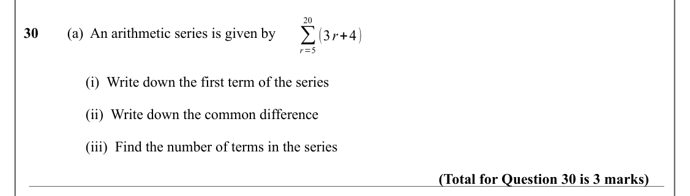

Text (lossy): 20 / ∑ / 30     / (a)  An arithmetic series is given by / (3 r+4) / r=5 /      (i)  Write down the first term of the series  /      (ii)  Write down the common difference /      (iii)  Find the number of terms in the series / (Total for Question 30 is 3 marks)

## Q31 (8 marks · parts a, b)

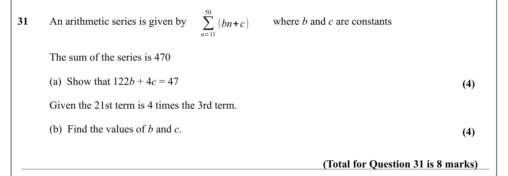

Text (lossy): 50 / ∑ / 31     An arithmetic series is given by / where b and c are constants  / (bn+c) / n=11 / The sum of the series is 470 / (a)  Show that 122 b + 4 c = 47 / (4) / Given the 21st term is 4 times the 3rd term.  / (b)  Find the values of b and c.  / (4) / (Total for Question 31 is 8 marks)

## Q32 (12 marks · parts a, b, ii)

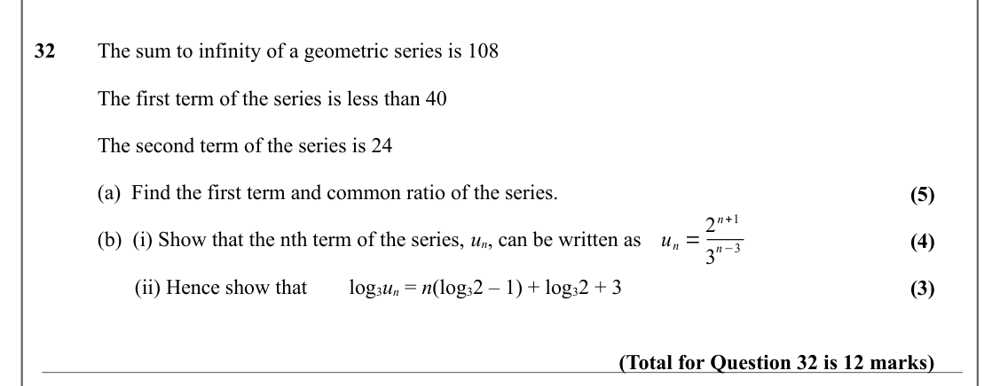

Text (lossy): 32     The sum to infinity of a geometric series is 108 / The first term of the series is less than 40 / The second term of the series is 24 / (a)  Find the first term and common ratio of the series.  / (5) / u n = 2 n+1 / (b)  (i) Show that the nth term of the series, u n, can be written as  / (4) / n−3 / 3 /        (ii) Hence show that  / log 3 u n = n(log 3 2 – 1) + log 3 2 + 3 / (3) / (Total f

## Q33 (7 marks · parts a, b)

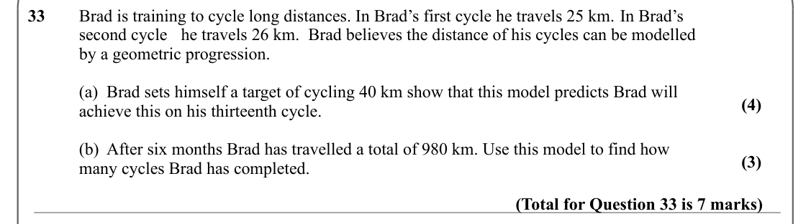

Text (lossy): 33     Brad is training to cycle long distances. In Brad’s first cycle he travels 25 km. In Brad’s  / second cycle he travels 26 km.  Brad believes the distance of his cycles can be modelled  / by a geometric progression.  / (a)  Brad sets himself a target of cycling 40 km show that this model predicts Brad will  / (4) / achieve this on his thirteenth cycle.   / (b)  After six months Brad has trav

## Q34 (6 marks · parts a, b)

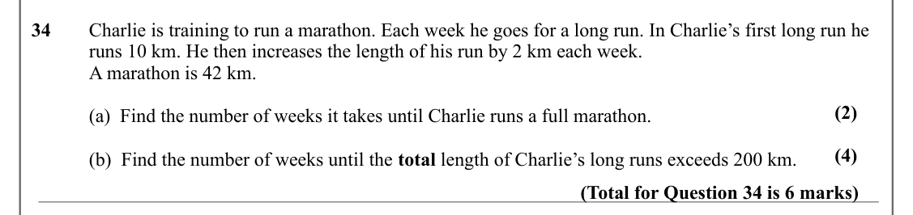

Text (lossy): 34     Charlie is training to run a marathon. Each week he goes for a long run. In Charlie’s first long run he  / runs 10 km. He then increases the length of his run by 2 km each week.   / A marathon is 42 km.  / (2) / (a)  Find the number of weeks it takes until Charlie runs a full marathon. / (4) / (b)  Find the number of weeks until the total length of Charlie’s long runs exceeds 200 km.  / (To

## Q35 (7 marks)

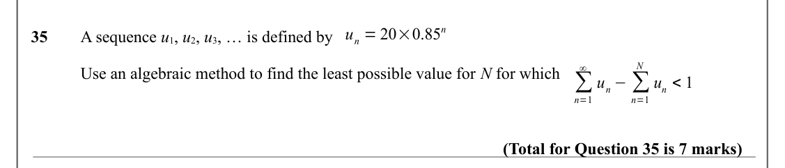

Text (lossy): u n = 20×0.85 n / 35     A sequence u 1, u 2, u 3, … is defined by    / N / ∞ / Use an algebraic method to find the least possible value for N for which   / ∑ / u n −∑ / u n < 1 / n=1 / n=1 / (Total for Question 35 is 7 marks)

## Q36 (7 marks · parts a, b)

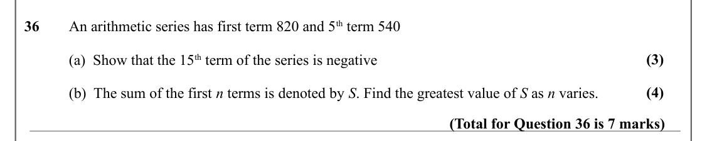

Text (lossy): 36     An arithmetic series has first term 820 and 5 th term 540 / (3) / (a)  Show that the 15 th term of the series is negative / (4) / (b)  The sum of the first n terms is denoted by S. Find the greatest value of S as n varies. / (Total for Question 36 is 7 marks)

## Q37 (3 marks · parts a, b)

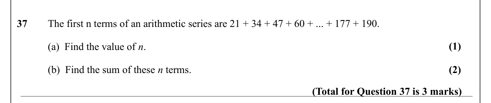

Text (lossy): 37     The first n terms of an arithmetic series are 21 + 34 + 47 + 60 + ... + 177 + 190. / (1) / (a)  Find the value of n.  / (2) / (b)  Find the sum of these n terms. / (Total for Question 37 is 3 marks)

## Q38 (3 marks)

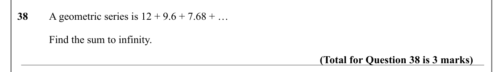

Text (lossy): 38     A geometric series is 12 + 9.6 + 7.68 + … / Find the sum to infinity.  / (Total for Question 38 is 3 marks)

