# Binomial Expansion — Question Set (A-Level Maths · Edexcel · Year 2 Pure Mathematics)

Chapter question set · `a-level-pure-mathematics-4-binomial-expansion` · 18 questions · segmented by printed total lines

## Q1 (3 marks)

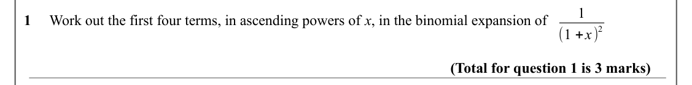

Text (lossy): 1 / 1     Work out the first four terms, in ascending powers of x, in the binomial expansion of  / 2 / (1 +x) / (Total for question 1 is 3 marks)

## Q2 (5 marks · parts b)

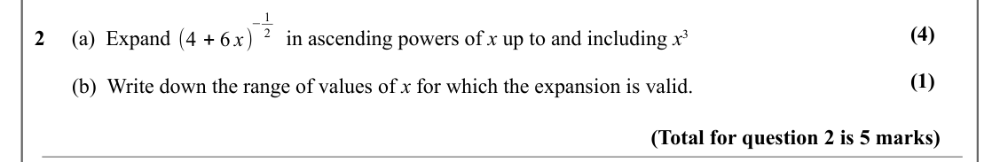

Text (lossy): −1 / (4) / 2 / 2     (a)  Expand / in ascending powers of x up to and including x 3  / (4 + 6 x) / (1) /        (b)  Write down the range of values of x for which the expansion is valid.  / (Total for question 2 is 5 marks)

## Q3 (5 marks · parts b)

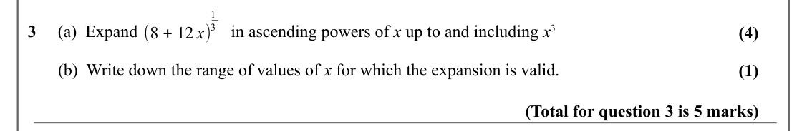

Text (lossy): 1 / 3 / 3     (a)  Expand / in ascending powers of x up to and including x 3  / (8 + 12 x) / (4) /        (b)  Write down the range of values of x for which the expansion is valid.  / (1) / (Total for question 3 is 5 marks)

## Q4 (7 marks · parts b)

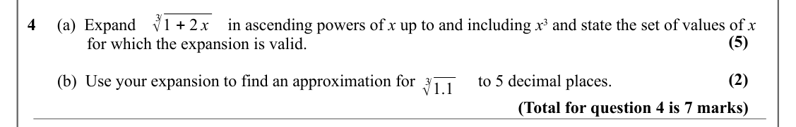

Text (lossy): 3√1 + 2 x / 4     (a)  Expand  / in ascending powers of x up to and including x 3 and state the set of values of x    / (5) /               for which the expansion is valid.  / (2) /        (b)  Use your expansion to find an approximation for / to 5 decimal places.  / 3√1.1 / (Total for question 4 is 7 marks)

## Q5 (5 marks · parts b)

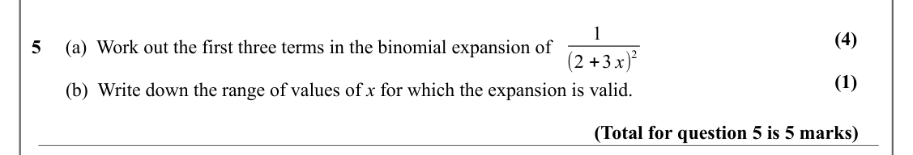

Text (lossy): 1 / (4) / 5     (a)  Work out the first three terms in the binomial expansion of  / 2 / (2 +3 x) / (1) /        (b)  Write down the range of values of x for which the expansion is valid.  / (Total for question 5 is 5 marks)

## Q6 (8 marks · parts b, c)

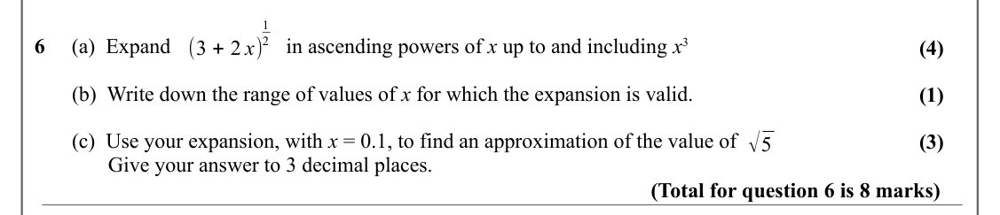

Text (lossy): 1 / 2 / 6     (a)  Expand / in ascending powers of x up to and including x 3  / (3 + 2 x) / (4) /        (b)  Write down the range of values of x for which the expansion is valid.   / (1) / √5 /        (c)  Use your expansion, with x = 0.1, to find an approximation of the value of  / (3) /   Give your answer to 3 decimal places.  / (Total for question 6 is 8 marks)

## Q7 (8 marks · parts b, c)

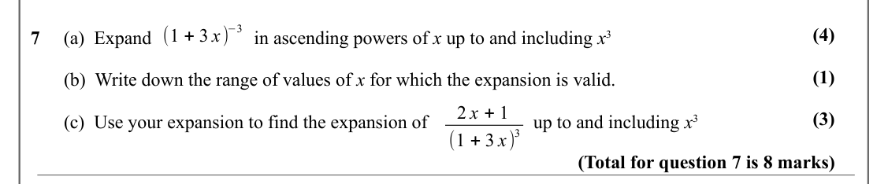

Text (lossy): −3 / (1 + 3 x) / (4) / 7     (a)  Expand / in ascending powers of x up to and including x 3  / (1) /        (b)  Write down the range of values of x for which the expansion is valid.   / 2 x + 1 / (3) /        (c)  Use your expansion to find the expansion of  / up to and including x 3  / 3 / (1 + 3 x) / (Total for question 7 is 8 marks)

## Q8 (7 marks · parts b, c)

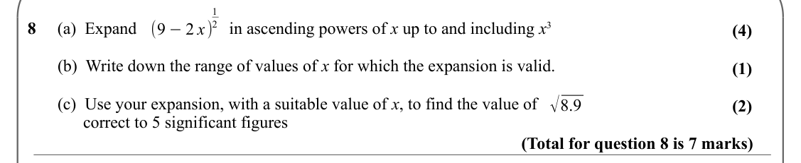

Text (lossy): 1 / 2 / 8     (a)  Expand / in ascending powers of x up to and including x 3  / (9 −2 x) / (4) /        (b)  Write down the range of values of x for which the expansion is valid.   / (1) / √8.9 /        (c)  Use your expansion, with a suitable value of x, to find the value of  / (2) /              correct to 5 significant figures / (Total for question 8 is 7 marks)

## Q9 (10 marks · parts a, b, c)

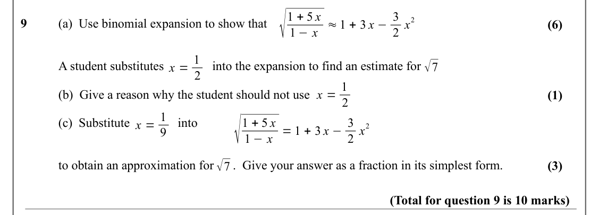

Text (lossy): √ / 1 + 5 x / 1 −x ≈1 + 3 x −3 / 2 / 9      / (a)  Use binomial expansion to show that   / (6) / 2 x / x = 1 / √7 / A student substitutes /  into the expansion to find an estimate for   / 2 / x = 1 / (b)  Give a reason why the student should not use  / (1) / 2 / √ / x = 1 / 1 + 5 x / (c)  Substitute /   into  / 1 −x = 1 + 3 x −3 / 2 / 2 x / 9 / √7 / to obtain an approximation for      .  Give your

## Q10 (6 marks · parts b, i, ii)

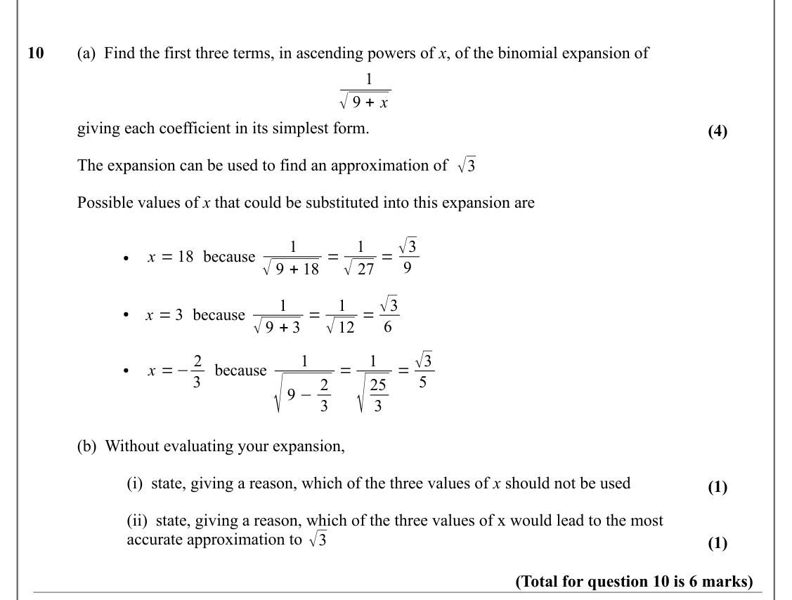

Text (lossy): 10     (a)  Find the first three terms, in ascending powers of x, of the binomial expansion of / 1 / √9 + x / giving each coefficient in its simplest form. / (4) / √3 / The expansion can be used to find an approximation of  / Possible values of x that could be substituted into this expansion are / √27 = √3 / 1 / 1 / x = 18 because / √9 + 18 = / ● / 9 / √12 = √3 / 1 / 1 / x = 3 because / √9 + 3 = /

## Q11 (5 marks · parts b)

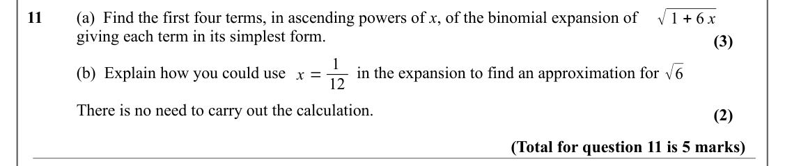

Text (lossy): √1 + 6 x / 11     (a)  Find the first four terms, in ascending powers of x, of the binomial expansion of / giving each term in its simplest form.  / (3) / x = 1 / √6 / (b)  Explain how you could use    /         in the expansion to find an approximation for / 12 / There is no need to carry out the calculation.    / (2) / (Total for question 11 is 5 marks)

## Q12 (5 marks · parts b)

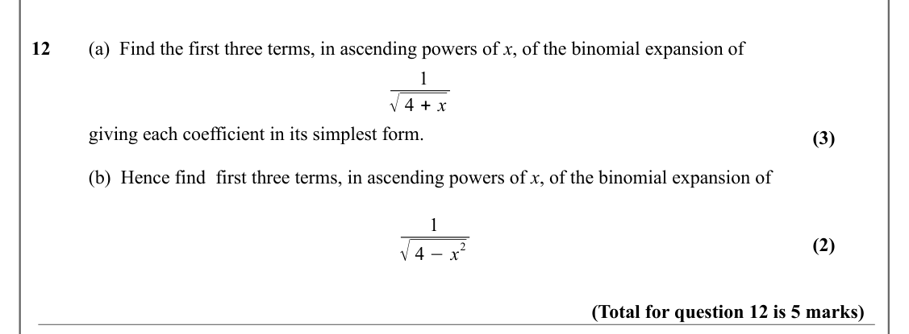

Text (lossy): 12     (a)  Find the first three terms, in ascending powers of x, of the binomial expansion of / 1 / √4 + x / giving each coefficient in its simplest form. / (3) / (b)  Hence find  first three terms, in ascending powers of x, of the binomial expansion of / 1 / (2) / √4 −x / 2 / (Total for question 12 is 5 marks)

## Q13 (7 marks · parts b)

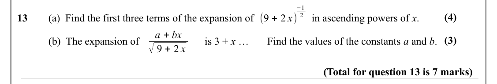

Text (lossy): −1 / (4) / 2 / (9 + 2 x) / 13     (a)  Find the first three terms of the expansion of /      in ascending powers of x. / a + bx / (3) / (b)  The expansion of  / is 3 + x … / Find the values of the constants a and b.   / √9 + 2 x / (Total for question 13 is 7 marks)

## Q14 (8 marks · parts b, ii, iii)

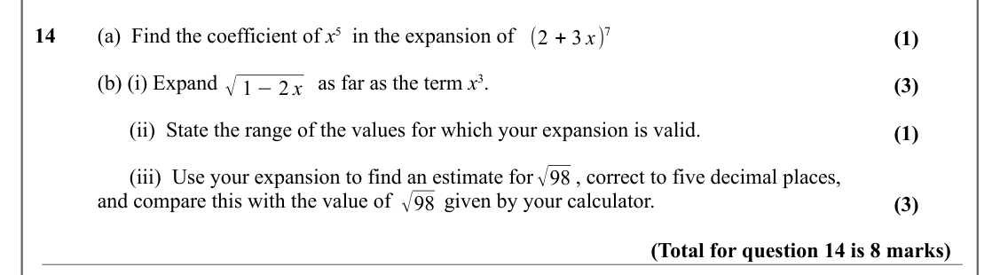

Text (lossy): 14     (a)  Find the coefficient of x 5  in the expansion of / (2 + 3 x)7 / (1) / (b) (i) Expand  /       as far as the term x 3.  / √1 −2 x / (3) /       (ii)  State the range of the values for which your expansion is valid. / (1) / √98 /       (iii)  Use your expansion to find an estimate for        , correct to five decimal places,  / √98 / and compare this with the value of          given by y

## Q15 (6 marks · parts a, b, c)

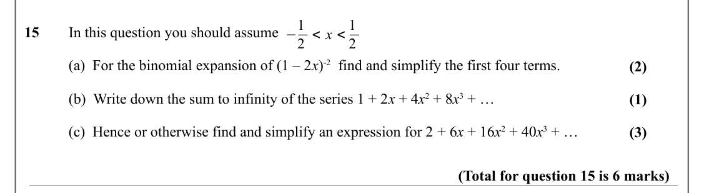

Text (lossy): −1 / 2 < x < 1 / 15     In this question you should assume  / 2 / (a)  For the binomial expansion of (1 – 2 x)-2  find and simplify the first four terms.  / (2) / (b)  Write down the sum to infinity of the series 1 + 2 x + 4 x 2 + 8 x 3 + … / (1) / (c)  Hence or otherwise find and simplify an expression for 2 + 6 x + 16 x 2 + 40 x 3 + …  / (3) / (Total for question 15 is 6 marks)

## Q16 (3 marks)

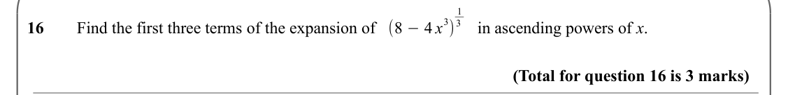

Text (lossy): 1 / 3) / 3 / (8 −4 x / 16     Find the first three terms of the expansion of /  in ascending powers of x. / (Total for question 16 is 3 marks)

## Q17 (5 marks · parts a, b, i, ii)

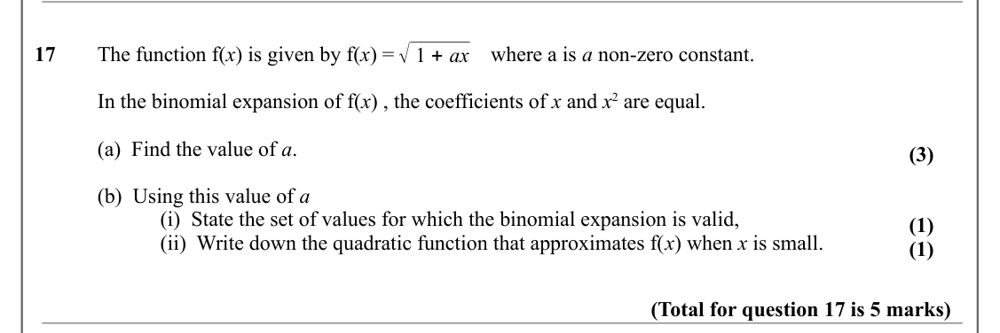

Text (lossy): √1 + ax / 17     The function f(x) is given by f(x) =   /    where a is a non-zero constant.  / In the binomial expansion of f(x) , the coefficients of x and x 2 are equal. / (a)  Find the value of a. / (3) / (b)  Using this value of a  / (i)  State the set of values for which the binomial expansion is valid,  / (1) / (ii)  Write down the quadratic function that approximates f(x) when x is small. 

## Q18 (4 marks · parts b)

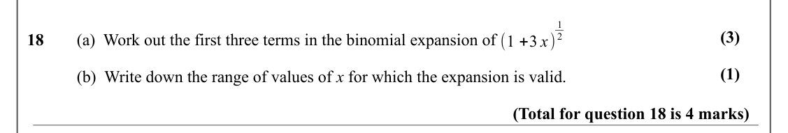

Text (lossy): 1 / (3) / 2 / 18     (a)  Work out the first three terms in the binomial expansion of  / (1 +3 x) / (1) / (b)  Write down the range of values of x for which the expansion is valid.  / (Total for question 18 is 4 marks)

