# Radians — Question Set (A-Level Maths · Edexcel · Year 2 Pure Mathematics)

Chapter question set · `a-level-pure-mathematics-5-radians` · 18 questions · segmented by printed total lines

## Q1 (6 marks · parts b, c)

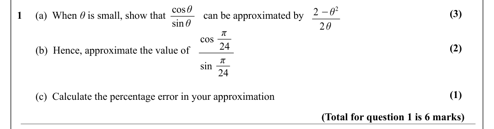

Text (lossy): cos θ / 2 −θ 2 / (3) / 1     (a)  When θ is small, show that / can be approximated by / sin θ / 2 θ / cos π / 24 / (2) /        (b)  Hence, approximate the value of / sin π / 24 / (1) /        (c)  Calculate the percentage error in your approximation  / (Total for question 1 is 6 marks)

## Q2 (6 marks · parts b, c)

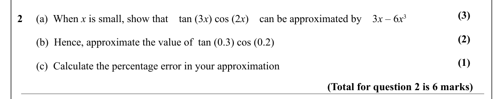

Text (lossy): (3) / 2     (a)  When x is small, show that    tan (3 x) cos (2 x)    can be approximated by    3 x – 6 x 3 / (2) /        (b)  Hence, approximate the value of  tan (0.3) cos (0.2) / (1) /        (c)  Calculate the percentage error in your approximation  / (Total for question 2 is 6 marks)

## Q3 (6 marks · parts b, c)

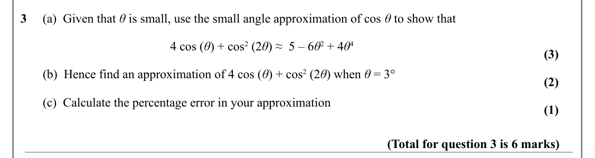

Text (lossy): 3     (a)  Given that θ is small, use the small angle approximation of cos θ to show that  / 4 cos (θ) + cos 2 (2 θ) ≈  5 – 6 θ 2 + 4 θ 4 / (3) /        (b)  Hence find an approximation of 4 cos (θ) + cos 2 (2 θ) when θ = 3° / (2) /        (c)  Calculate the percentage error in your approximation  / (1) / (Total for question 3 is 6 marks)

## Q4 (3 marks)

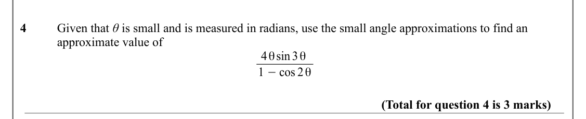

Text (lossy): 4     / Given that θ is small and is measured in radians, use the small angle approximations to find an / approximate value of / 4 θ sin3 θ / 1 −cos 2 θ / (Total for question 4 is 3 marks)

## Q5 (4 marks)

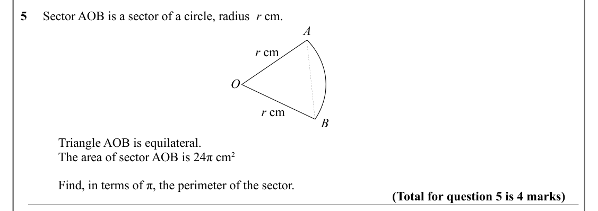

Text (lossy): 5     Sector AOB is a sector of a circle, radius  r cm.  / A / r cm / O / r cm / B / Triangle AOB is equilateral.  / The area of sector AOB is 24π cm 2 / Find, in terms of π, the perimeter of the sector. / (Total for question 5 is 4 marks)

## Q6 (8 marks · parts a, b, c)

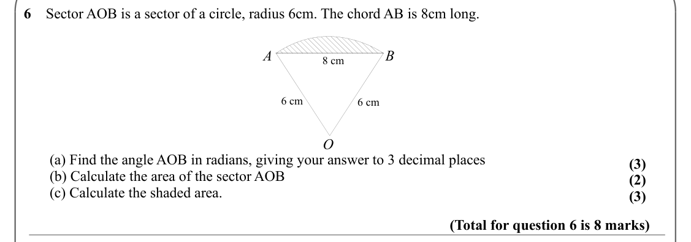

Text (lossy): 6    Sector AOB is a sector of a circle, radius 6cm. The chord AB is 8cm long.  / A / B / 8 cm / 6 cm / 6 cm / O /        (a) Find the angle AOB in radians, giving your answer to 3 decimal places / (3) /        (b) Calculate the area of the sector AOB / (2) /        (c) Calculate the shaded area.  / (3) / (Total for question 6 is 8 marks)

## Q7 (12 marks · parts a, b, c, d)

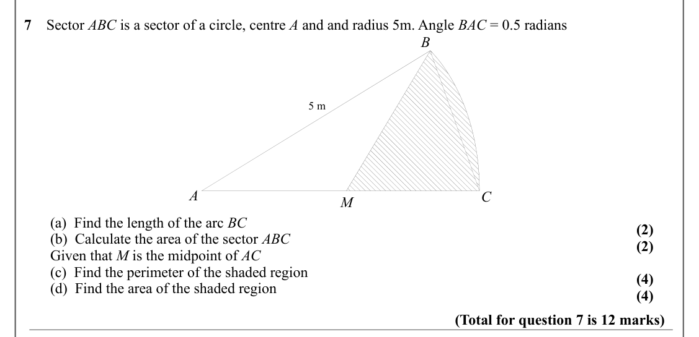

Text (lossy): 7    Sector ABC is a sector of a circle, centre A and and radius 5m. Angle BAC = 0.5 radians / B / 5 m / A / C / M /        (a)  Find the length of the arc BC / (2) /        (b)  Calculate the area of the sector ABC / (2) /        Given that M is the midpoint of AC /        (c)  Find the perimeter of the shaded region / (4) /        (d)  Find the area of the shaded region / (4) / (Total for questi

## Q8 (8 marks · parts a, b, c, d)

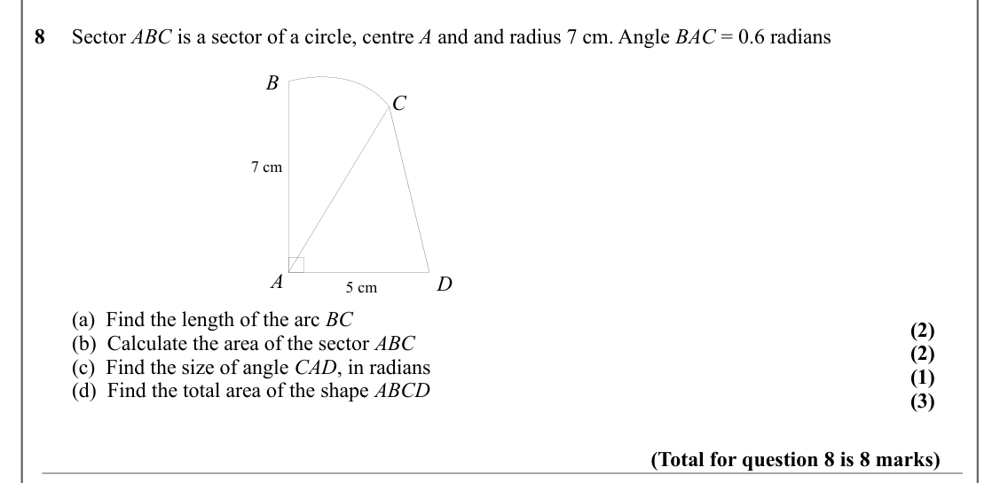

Text (lossy): 8     Sector ABC is a sector of a circle, centre A and and radius 7 cm. Angle BAC = 0.6 radians / B / C / 7 cm / A / D / 5 cm /        (a)  Find the length of the arc BC / (2) /        (b)  Calculate the area of the sector ABC / (2) /        (c)  Find the size of angle CAD, in radians / (1) /        (d)  Find the total area of the shape ABCD / (3) / (Total for question 8 is 8 marks)

## Q9 (5 marks · parts a, b)

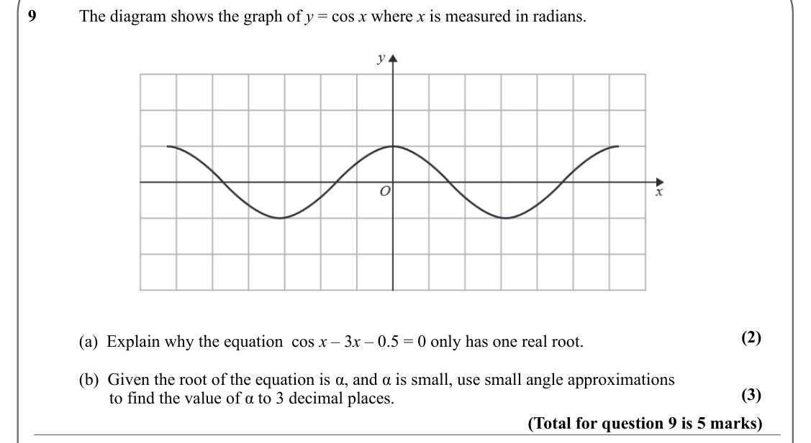

Text (lossy): 9      / The diagram shows the graph of y = cos x where x is measured in radians.  / (2) / (a)  Explain why the equation  cos x – 3 x – 0.5 = 0 only has one real root.    / (b)  Given the root of the equation is α, and α is small, use small angle approximations  / (3) /        to find the value of α to 3 decimal places.  / (Total for question 9 is 5 marks)

## Q10 (3 marks · parts a, b)

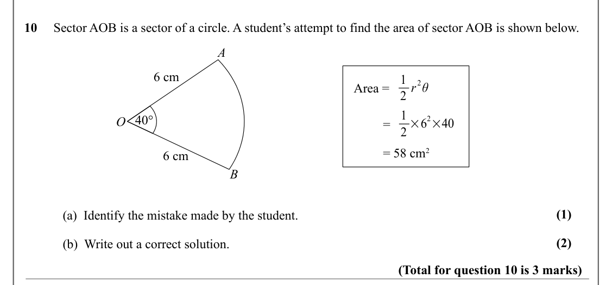

Text (lossy): 10     Sector AOB is a sector of a circle. A student’s attempt to find the area of sector AOB is shown below.  / A / 6 cm / 1 / 2 θ / 2 r / Area = / 1 / 40° / 2×40 / O / 2 ×6 /          = /          = 58 cm 2 / 6 cm / B / (1) / (a)  Identify the mistake made by the student.  / (2) / (b)  Write out a correct solution.  / (Total for question 10 is 3 marks)

## Q11 (3 marks)

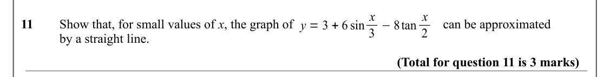

Text (lossy): y = 3 + 6 sin x / 3 −8tan x / 11     Show that, for small values of x, the graph of  / can be approximated  / 2 / by a straight line. / (Total for question 11 is 3 marks)

## Q12 (8 marks · parts a, b)

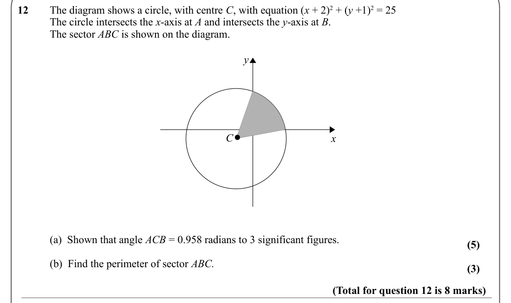

Text (lossy): 12     The diagram shows a circle, with centre C, with equation (x + 2)2 + (y +1)2 = 25   / The circle intersects the x-axis at A and intersects the y-axis at B. / The sector ABC is shown on the diagram.  / y / C / x / (a)  Shown that angle ACB = 0.958 radians to 3 significant figures. / (5) / (b)  Find the perimeter of sector ABC. / (3) / (Total for question 12 is 8 marks)

## Q13 (5 marks)

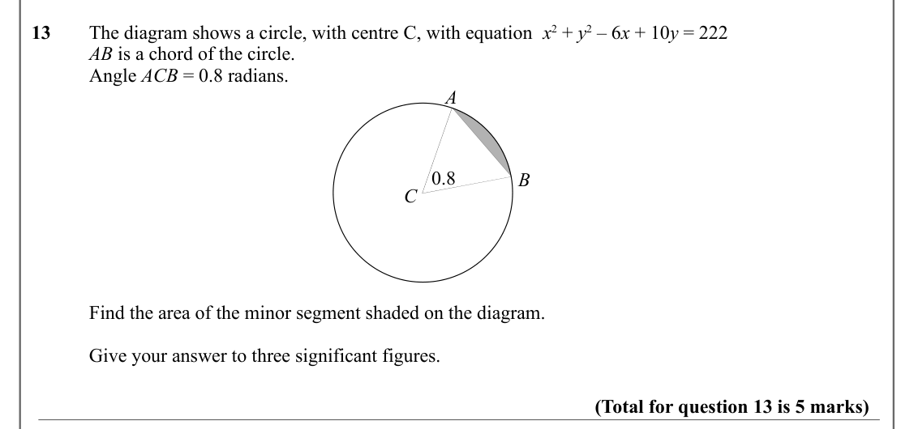

Text (lossy): 13     The diagram shows a circle, with centre C, with equation  x 2 + y 2 – 6 x + 10 y = 222   / AB is a chord of the circle.  / Angle ACB = 0.8 radians.  / A / 0.8 / B / C / Find the area of the minor segment shaded on the diagram. / Give your answer to three significant figures. / (Total for question 13 is 5 marks)

## Q14 (3 marks)

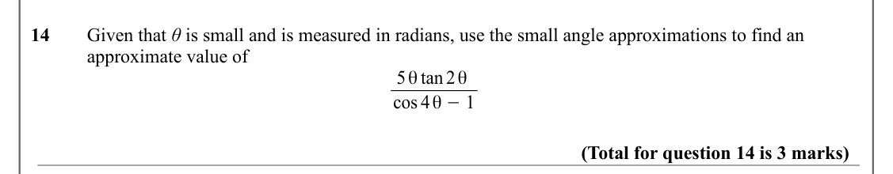

Text (lossy): 14     Given that θ is small and is measured in radians, use the small angle approximations to find an / approximate value of / 5 θ tan 2 θ / cos 4 θ −1 / (Total for question 14 is 3 marks)

## Q15 (5 marks · parts b)

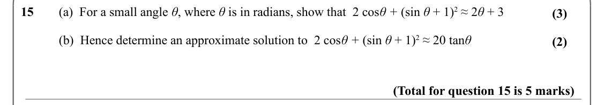

Text (lossy): 15     (a)  For a small angle θ, where θ is in radians, show that  2 cos θ + (sin θ + 1)2 ≈ 2 θ + 3 / (3) / (b)  Hence determine an approximate solution to  2 cos θ + (sin θ + 1)2 ≈ 20 tan θ  / (2) / (Total for question 15 is 5 marks)

## Q16 (3 marks)

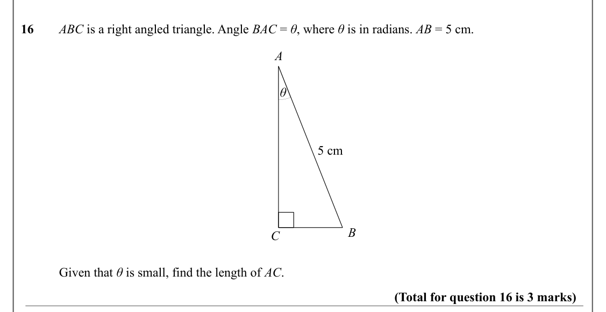

Text (lossy): 16     ABC is a right angled triangle. Angle BAC = θ, where θ is in radians. AB = 5 cm.  / A / θ / 5 cm / B / C / Given that θ is small, find the length of AC.  / (Total for question 16 is 3 marks)

## Q17 (3 marks)

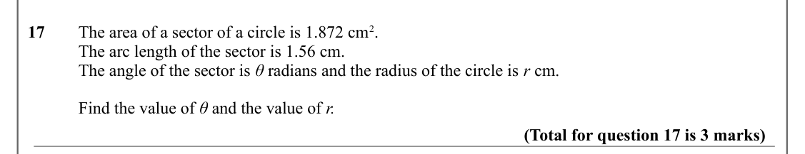

Text (lossy): 17     The area of a sector of a circle is 1.872 cm 2. / The arc length of the sector is 1.56 cm. / The angle of the sector is θ radians and the radius of the circle is r cm. / Find the value of θ and the value of r.  / (Total for question 17 is 3 marks)

## Q18 (3 marks · parts a, b)

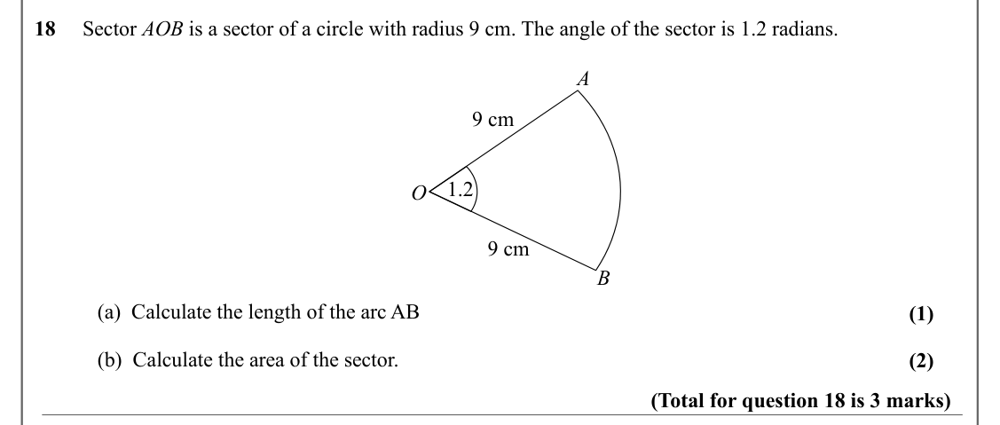

Text (lossy): 18     Sector AOB is a sector of a circle with radius 9 cm. The angle of the sector is 1.2 radians.  / A / 9 cm / 1.2 / O / 9 cm / B / (a)  Calculate the length of the arc AB / (1) / (b)  Calculate the area of the sector.   / (2) / (Total for question 18 is 3 marks)

