# Trigonometric Functions — Question Set (A-Level Maths · Edexcel · Year 2 Pure Mathematics)

Chapter question set · `a-level-pure-mathematics-6-trigonometric-functions` · 18 questions · segmented by printed total lines

## Q1 (12 marks · parts b, c)

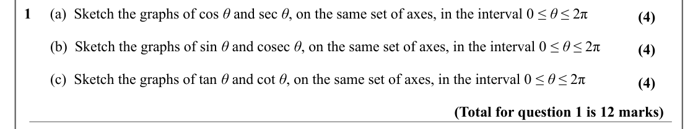

Text (lossy): 1     (a)  Sketch the graphs of cos θ and sec θ, on the same set of axes, in the interval 0 ≤ θ ≤ 2π / (4) /        (b)  Sketch the graphs of sin θ and cosec θ, on the same set of axes, in the interval 0 ≤ θ ≤ 2π / (4) /        (c)  Sketch the graphs of tan θ and cot θ, on the same set of axes, in the interval 0 ≤ θ ≤ 2π / (4) / (Total for question 1 is 12 marks)

## Q2 (4 marks)

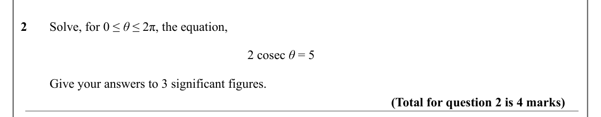

Text (lossy): 2       Solve, for 0 ≤ θ ≤ 2π, the equation,  / 2 cosec θ = 5 /          Give your answers to 3 significant figures. / (Total for question 2 is 4 marks)

## Q3 (5 marks)

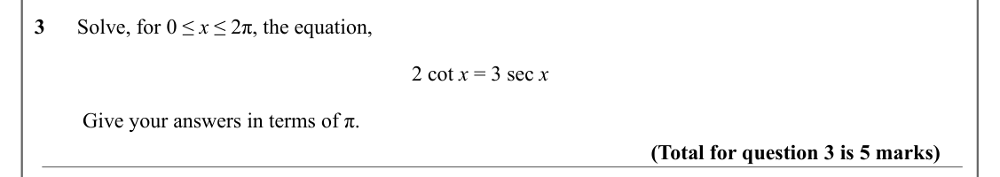

Text (lossy): 3      Solve, for 0 ≤ x ≤ 2π, the equation,  / 2 cot x = 3 sec x /          Give your answers in terms of π. / (Total for question 3 is 5 marks)

## Q4 (5 marks)

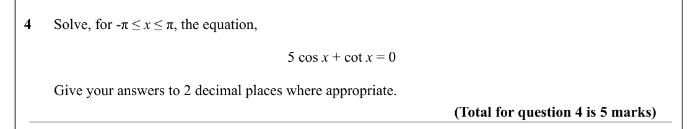

Text (lossy): 4      Solve, for -π ≤ x ≤ π, the equation,  / 5 cos x + cot x = 0 /         Give your answers to 2 decimal places where appropriate. / (Total for question 4 is 5 marks)

## Q5 (5 marks)

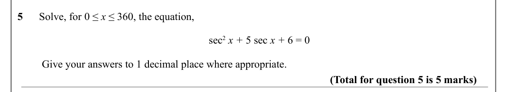

Text (lossy): 5      Solve, for 0 ≤ x ≤ 360, the equation,  / sec 2 x + 5 sec x + 6 = 0  /          Give your answers to 1 decimal place where appropriate. / (Total for question 5 is 5 marks)

## Q6 (5 marks)

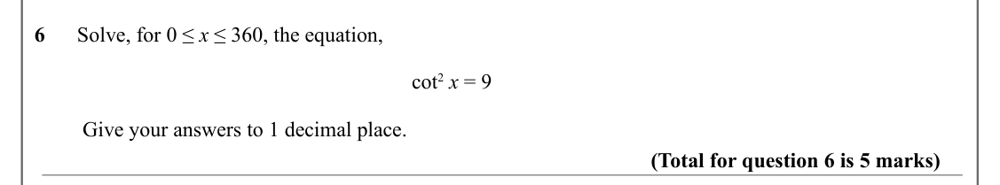

Text (lossy): 6      Solve, for 0 ≤ x ≤ 360, the equation,  / cot 2 x = 9 /          Give your answers to 1 decimal place. / (Total for question 6 is 5 marks)

## Q7 (4 marks)

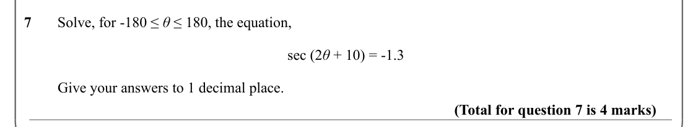

Text (lossy): 7       Solve, for -180 ≤ θ ≤ 180, the equation,  / sec (2 θ + 10) = -1.3 /          Give your answers to 1 decimal place. / (Total for question 7 is 4 marks)

## Q8 (7 marks · parts b)

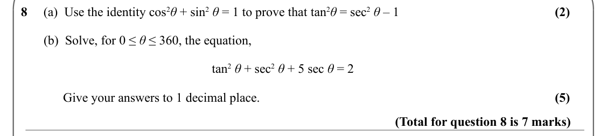

Text (lossy): (2) / 8     (a)  Use the identity cos 2 θ + sin 2 θ = 1 to prove that tan 2 θ = sec 2 θ – 1   /        (b)  Solve, for 0 ≤ θ ≤ 360, the equation,  / tan 2 θ + sec 2 θ + 5 sec θ = 2    / (5) /              Give your answers to 1 decimal place.  / (Total for question 8 is 7 marks)

## Q9 (7 marks · parts b)

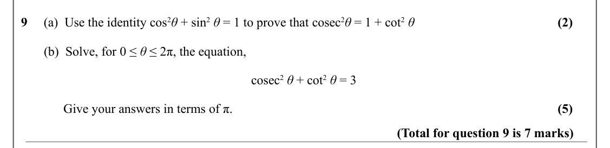

Text (lossy): (2) / 9     (a)  Use the identity cos 2 θ + sin 2 θ = 1 to prove that cosec 2 θ = 1 + cot 2 θ /        (b)  Solve, for 0 ≤ θ ≤ 2π, the equation,  / cosec 2 θ + cot 2 θ = 3    / (5) /              Give your answers in terms of π.  / (Total for question 9 is 7 marks)

## Q10 (5 marks)

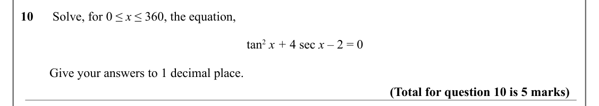

Text (lossy): 10      Solve, for 0 ≤ x ≤ 360, the equation,  / tan 2 x + 4 sec x – 2 = 0  /          Give your answers to 1 decimal place. / (Total for question 10 is 5 marks)

## Q11 (5 marks)

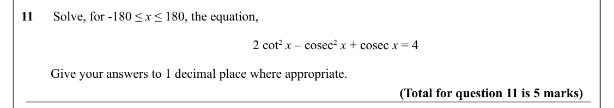

Text (lossy): 11      Solve, for -180 ≤ x ≤ 180, the equation,  / 2 cot 2 x – cosec 2 x + cosec x = 4  /          Give your answers to 1 decimal place where appropriate. / (Total for question 11 is 5 marks)

## Q12 (5 marks · parts a, b)

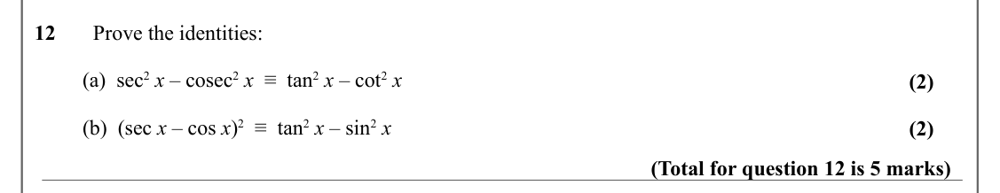

Text (lossy): 12       Prove the identities: /          (a)  sec 2 x – cosec 2 x  ≡  tan 2 x – cot 2 x / (2) /          (b)  (sec x – cos x)2  ≡  tan 2 x – sin 2 x / (2) / (Total for question 12 is 5 marks)

## Q13 (6 marks · parts a, b)

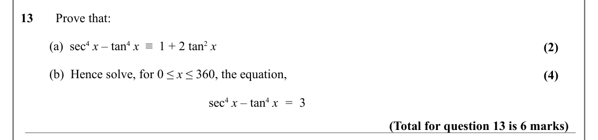

Text (lossy): 13       Prove that: /          (a)  sec 4 x – tan 4 x  ≡  1 + 2 tan 2 x / (2) /          (b)  Hence solve, for 0 ≤ x ≤ 360, the equation,  / (4) / sec 4 x – tan 4 x  =  3 / (Total for question 13 is 6 marks)

## Q14 (10 marks · parts a, b, c)

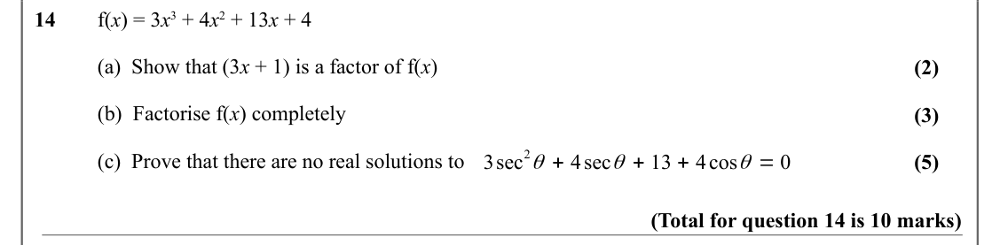

Text (lossy): 14       f(x) = 3 x 3 + 4 x 2 + 13 x + 4 / (a)  Show that (3 x + 1) is a factor of f(x) / (2) / (b)  Factorise f(x) completely / (3) / 2 θ + 4sec θ + 13 + 4cos θ = 0 / (c)  Prove that there are no real solutions to / 3sec / (5) / (Total for question 14 is 10 marks)

## Q15 (8 marks · parts b)

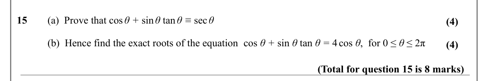

Text (lossy): 15       (a)  Prove that cos θ + sin θ tan θ ≡ sec θ / (4) / (b)  Hence find the exact roots of the equation  cos θ + sin θ tan θ = 4 cos θ,  for 0 ≤ θ ≤ 2π / (4) / (Total for question 15 is 8 marks)

## Q16 (7 marks · parts b)

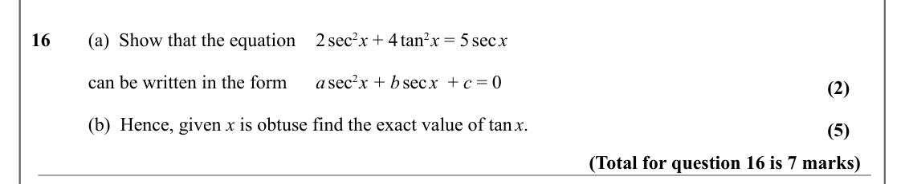

Text (lossy): 16       (a)  Show that the equation 2 sec 2 x + 4 tan 2 x = 5 sec x / can be written in the form  / a sec 2 x + b sec x  + c = 0 / (2) / (b)  Hence, given x is obtuse find the exact value of tan x.  / (5) / (Total for question 16 is 7 marks)

## Q17 (7 marks · parts b)

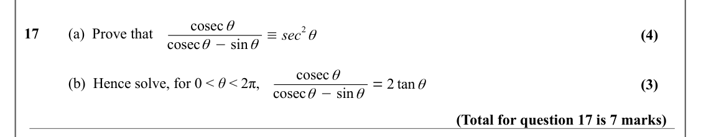

Text (lossy): cosec θ / 2 θ / 17       (a)  Prove that / cosec θ −sin θ ≡sec / (4) / cosec θ / (b)  Hence solve, for 0 < θ < 2π,  / cosec θ −sin θ = 2 tan θ / (3) / (Total for question 17 is 7 marks)

## Q18 (4 marks)

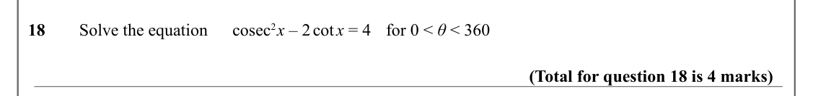

Text (lossy): 18       Solve the equation  / cosec 2 x – 2 cot  x = 4 / for 0 < θ < 360 / (Total for question 18 is 4 marks)

