# Trigonometry and Modelling — Question Set (A-Level Maths · Edexcel · Year 2 Pure Mathematics)

Chapter question set · `a-level-pure-mathematics-7-trigonometry-and-modelling` · 29 questions · segmented by printed total lines

## Q1 (10 marks · parts b, c, d)

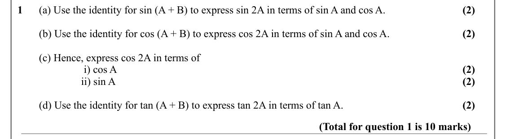

Text (lossy): 1      (a) Use the identity for sin (A + B) to express sin 2A in terms of sin A and cos A. / (2) /         (b) Use the identity for cos (A + B) to express cos 2A in terms of sin A and cos A. / (2) /         (c) Hence, express cos 2A in terms of /  i) cos A  / (2) / ii) sin A / (2) /         (d) Use the identity for tan (A + B) to express tan 2A in terms of tan A.  / (2) / (Total for question 1 is 

## Q2 (6 marks · parts b)

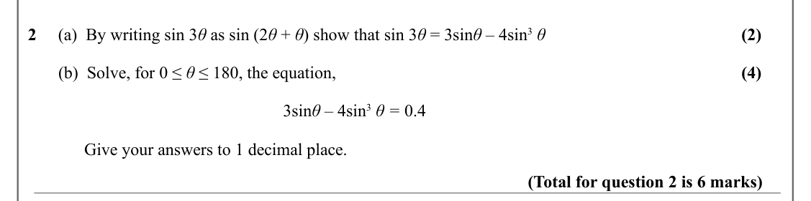

Text (lossy): (2) / 2     (a)  By writing sin 3 θ as sin (2 θ + θ) show that sin 3 θ = 3sin θ – 4sin 3 θ / (4) /        (b)  Solve, for 0 ≤ θ ≤ 180, the equation,  / 3sin θ – 4sin 3 θ = 0.4    /              Give your answers to 1 decimal place.  / (Total for question 2 is 6 marks)

## Q3 (6 marks · parts b)

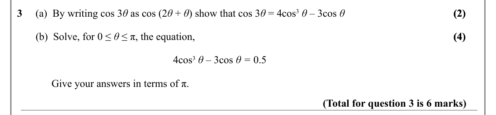

Text (lossy): (2) / (2) / 3     (a)  By writing cos 3 θ as cos (2 θ + θ) show that cos 3 θ = 4cos 3 θ – 3cos θ / (4) / (4) /        (b)  Solve, for 0 ≤ θ ≤ π, the equation,  / 4cos 3 θ – 3cos θ = 0.5    /              Give your answers in terms of π.  / (Total for question 3 is 6 marks)

## Q4 (5 marks)

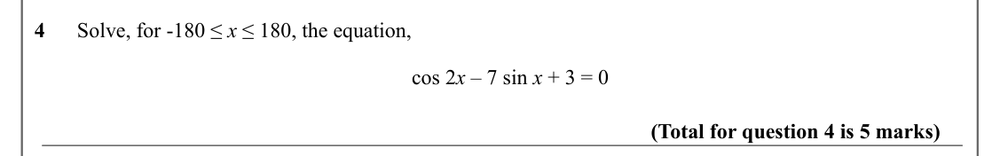

Text (lossy): 4      Solve, for -180 ≤ x ≤ 180, the equation,  / cos 2 x – 7 sin x + 3 = 0  / (Total for question 4 is 5 marks)

## Q5 (5 marks)

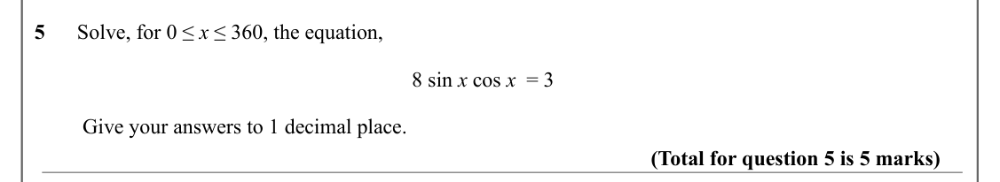

Text (lossy): 5      Solve, for 0 ≤ x ≤ 360, the equation,  / 8 sin x cos x  = 3  /          Give your answers to 1 decimal place. / (Total for question 5 is 5 marks)

## Q6 (2 marks)

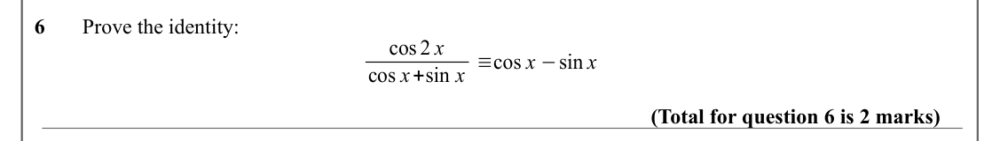

Text (lossy): 6       Prove the identity: / cos 2 x / cos x+sin x ≡cos x −sin x / (Total for question 6 is 2 marks)

## Q7 (12 marks · parts a, b, c, d)

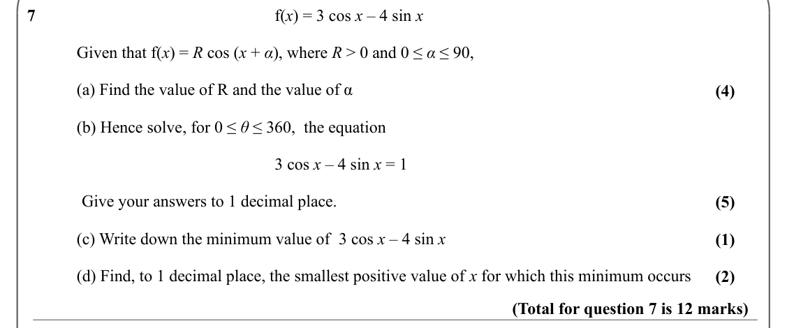

Text (lossy): 7 / f(x) = 3 cos x – 4 sin x / Given that f(x) = R cos (x + α), where R > 0 and 0 ≤ α ≤ 90, / (a) Find the value of R and the value of α / (4) / (b) Hence solve, for 0 ≤ θ ≤ 360,  the equation  / 3 cos x – 4 sin x = 1 /              Give your answers to 1 decimal place.  / (5) / (c) Write down the minimum value of  3 cos x – 4 sin x / (1) / (d) Find, to 1 decimal place, the smallest positive value

## Q8 (7 marks · parts a, b)

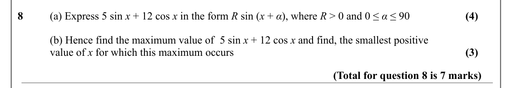

Text (lossy): 8 / (a) Express 5 sin x + 12 cos x in the form R sin (x + α), where R > 0 and 0 ≤ α ≤ 90 / (4) / (b) Hence find the maximum value of  5 sin x + 12 cos x and find, the smallest positive  / value of x for which this maximum occurs  / (3) / (Total for question 8 is 7 marks)

## Q9 (12 marks · parts a, b, c, d)

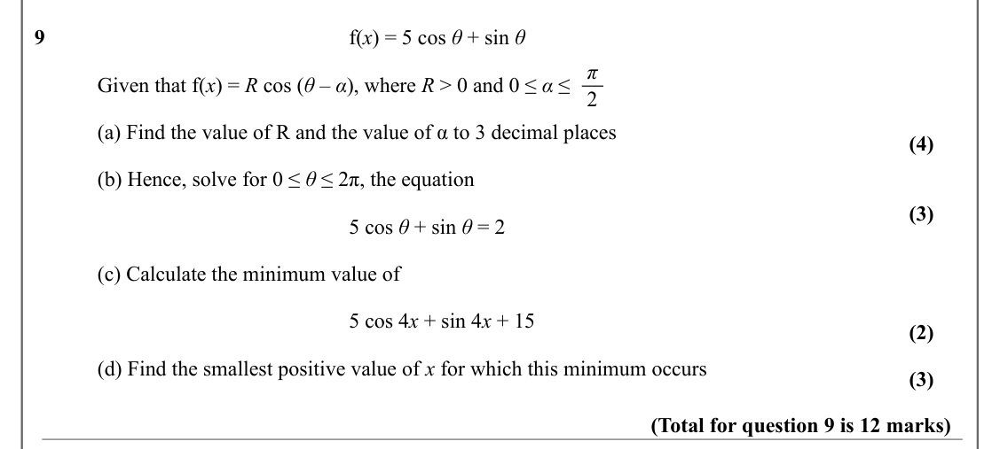

Text (lossy): 9 / f(x) = 5 cos θ + sin θ / π / Given that f(x) = R cos (θ – α), where R > 0 and 0 ≤ α ≤  / 2 / (a) Find the value of R and the value of α to 3 decimal places / (4) / (b) Hence, solve for 0 ≤ θ ≤ 2π, the equation / (3) / 5 cos θ + sin θ = 2 / (c) Calculate the minimum value of  / 5 cos 4 x + sin 4 x + 15 / (2) / (d) Find the smallest positive value of x for which this minimum occurs  / (3) / (Tot

## Q10 (11 marks · parts a, b, c)

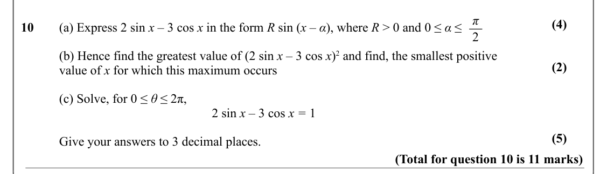

Text (lossy): π / (4) / 10 / (a) Express 2 sin x – 3 cos x in the form R sin (x – α), where R > 0 and 0 ≤ α ≤  / 2 / (b) Hence find the greatest value of (2 sin x – 3 cos x)2 and find, the smallest positive  / (2) / value of x for which this maximum occurs / (c) Solve, for 0 ≤ θ ≤ 2π,   / 2 sin x – 3 cos x = 1 / (5) / Give your answers to 3 decimal places.  / (Total for question 10 is 11 marks)

## Q11 (5 marks · parts a, b)

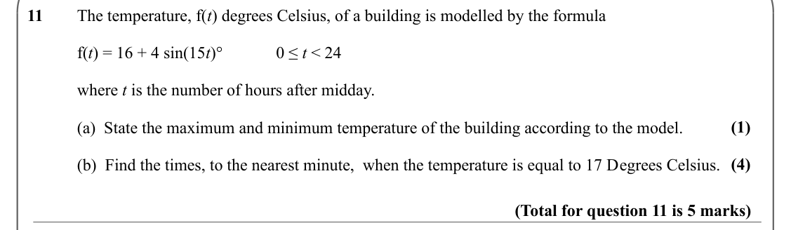

Text (lossy): 11 / The temperature, f(t) degrees Celsius, of a building is modelled by the formula / f(t) = 16 + 4 sin(15 t)° / 0 ≤ t < 24 / where t is the number of hours after midday. / (1) / (a)  State the maximum and minimum temperature of the building according to the model.  / (4) / (b)  Find the times, to the nearest minute,  when the temperature is equal to 17 Degrees Celsius. / (Total for question 11 i

## Q12 (5 marks)

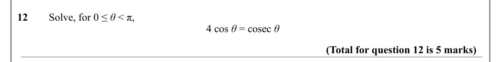

Text (lossy): 12 / Solve, for 0 ≤ θ < π,  / 4 cos θ = cosec θ  / (Total for question 12 is 5 marks)

## Q13 (5 marks)

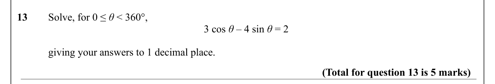

Text (lossy): 13 / Solve, for 0 ≤ θ < 360°,  / 3 cos θ – 4 sin θ = 2 / giving your answers to 1 decimal place.  / (Total for question 13 is 5 marks)

## Q14 (12 marks · parts a, b, c)

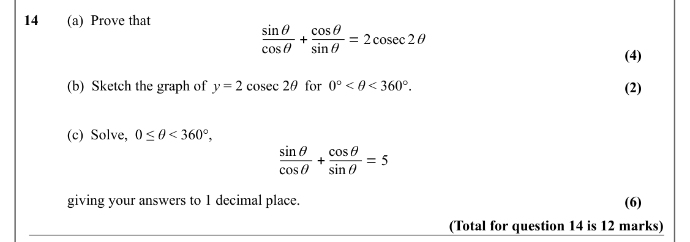

Text (lossy): 14 / (a)  Prove that  / cos θ + cos θ / sin θ / sin θ = 2cosec 2 θ / (4) / (b)  Sketch the graph of  y = 2 cosec 2 θ  for  0° < θ < 360°. / (2) / (c)  Solve,  0 ≤ θ < 360°,  / cos θ + cos θ / sin θ / sin θ = 5 / giving your answers to 1 decimal place.  / (6) / (Total for question 14 is 12 marks)

## Q15 (6 marks · parts a)

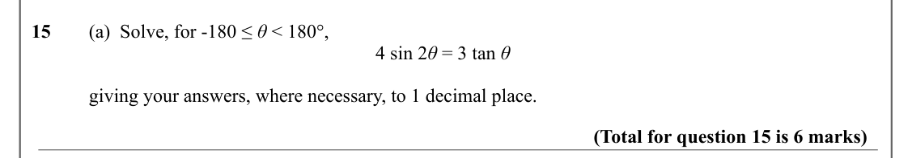

Text (lossy): 15 / (a)  Solve, for -180 ≤ θ < 180°,  / 4 sin 2 θ = 3 tan θ / giving your answers, where necessary, to 1 decimal place. / (Total for question 15 is 6 marks)

## Q16 (9 marks · parts a, b)

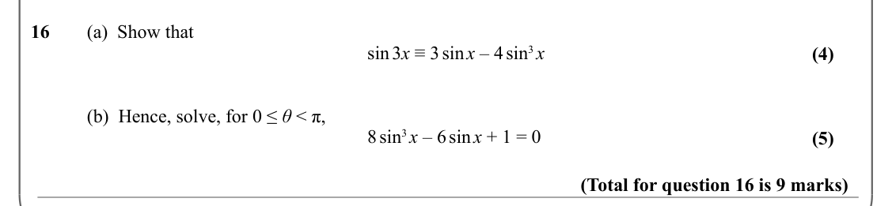

Text (lossy): 16 / (a)  Show that  / sin 3 x ≡ 3 sin x – 4 sin 3 x / (4) / (b)  Hence, solve, for 0 ≤ θ < π, / 8 sin 3 x – 6 sin x + 1 = 0 / (5) / (Total for question 16 is 9 marks)

## Q17 (7 marks · parts a, b, c)

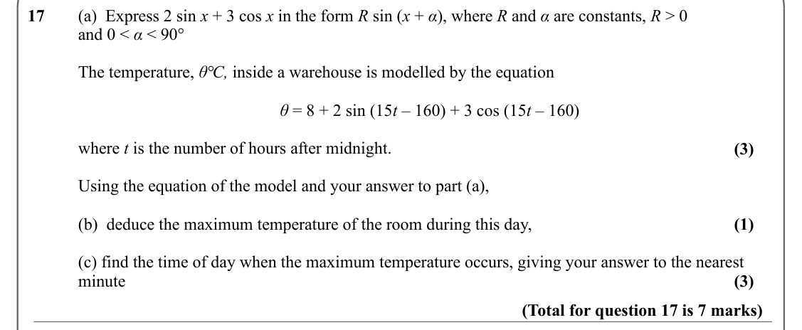

Text (lossy): 17 / (a)  Express 2 sin x + 3 cos x in the form R sin (x + α), where R and α are constants, R > 0  / and 0 < α < 90° / The temperature, θ℃, inside a warehouse is modelled by the equation / θ = 8 + 2 sin (15 t – 160) + 3 cos (15 t – 160)  / where t is the number of hours after midnight. / (3) / Using the equation of the model and your answer to part (a), / (b)  deduce the maximum temperature of the

## Q18 (9 marks · parts a, b)

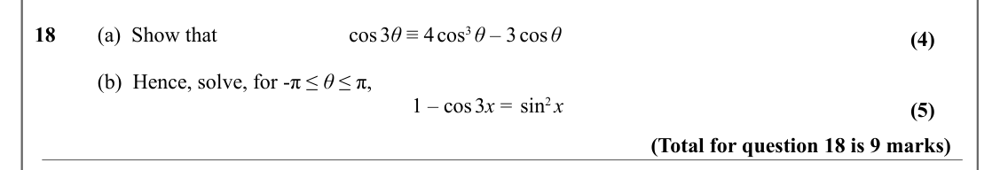

Text (lossy): 18 / (a)  Show that  / cos 3 θ ≡ 4 cos 3 θ – 3 cos θ / (4) / (b)  Hence, solve, for -π ≤ θ ≤ π, / 1 – cos 3 x =  sin 2 x / (5) / (Total for question 18 is 9 marks)

## Q19 (9 marks · parts a, b)

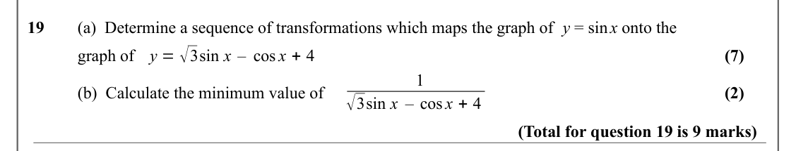

Text (lossy): 19 / (a)  Determine a sequence of transformations which maps the graph of  y = sin x onto the  / y = √3sin x – cos x + 4 / (7) / graph of / 1 / (2) / (b)  Calculate the minimum value of    / √3sin x – cos x + 4 / (Total for question 19 is 9 marks)

## Q20 (6 marks · parts a, b)

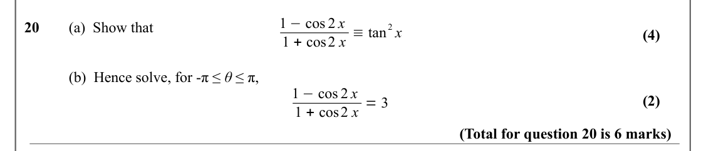

Text (lossy): 1 −cos 2 x / 2 x / 20 / (a)  Show that / 1 + cos2 x ≡tan / (4) / (b)  Hence solve, for -π ≤ θ ≤ π, / 1 −cos 2 x / (2) / 1 + cos2 x = 3 / (Total for question 20 is 6 marks)

## Q21 (7 marks · parts b)

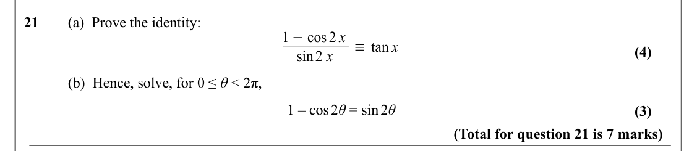

Text (lossy): 21       (a)  Prove the identity: / 1 −cos 2 x / ≡tan x / (4) / sin2 x / (b)  Hence, solve, for 0 ≤ θ < 2π, / 1 – cos 2 θ = sin 2 θ / (3) / (Total for question 21 is 7 marks)

## Q22 (4 marks)

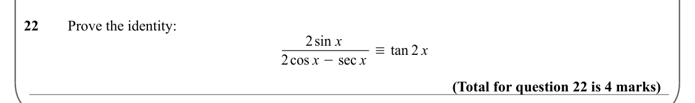

Text (lossy): 22       Prove the identity: / 2sin x / 2cos x −sec x ≡tan 2 x / (Total for question 22 is 4 marks)

## Q23 (6 marks)

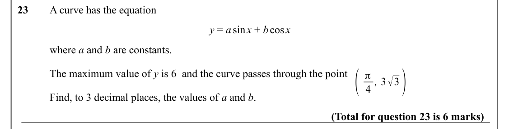

Text (lossy): 23       A curve has the equation  / y = a sin x + b cos x  / where a and b are constants.  / ( / 4 , 3√3) / The maximum value of y is 6  and the curve passes through the point  / π / Find, to 3 decimal places, the values of a and b. / (Total for question 23 is 6 marks)

## Q24 (6 marks)

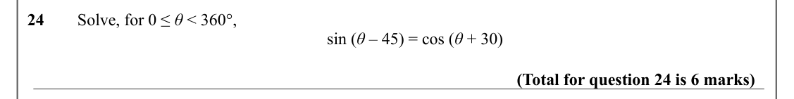

Text (lossy): 24 / Solve, for 0 ≤ θ < 360°,  / sin (θ – 45) = cos (θ + 30) / (Total for question 24 is 6 marks)

## Q25 (8 marks · parts a, b)

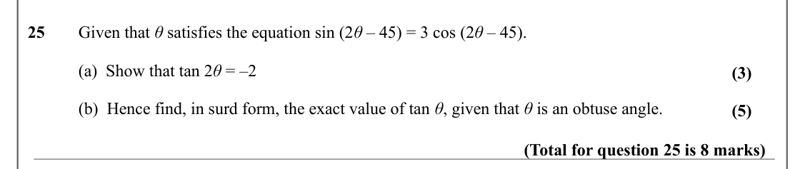

Text (lossy): 25 / Given that θ satisfies the equation sin (2 θ – 45) = 3 cos (2 θ – 45). / (a)  Show that tan 2 θ = –2   / (3) / (b)  Hence find, in surd form, the exact value of tan θ, given that θ is an obtuse angle. / (5) / (Total for question 25 is 8 marks)

## Q26 (7 marks · parts a, b)

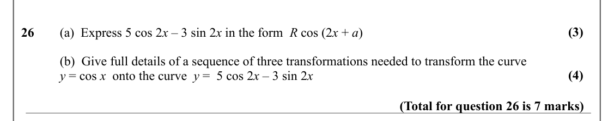

Text (lossy): (3) / 26 / (a)  Express 5 cos 2 x – 3 sin 2 x in the form  R cos (2 x + ɑ) / (b)  Give full details of a sequence of three transformations needed to transform the curve / (4) / y = cos x  onto the curve  y =  5 cos 2 x – 3 sin 2 x / (Total for question 26 is 7 marks)

## Q27 (4 marks)

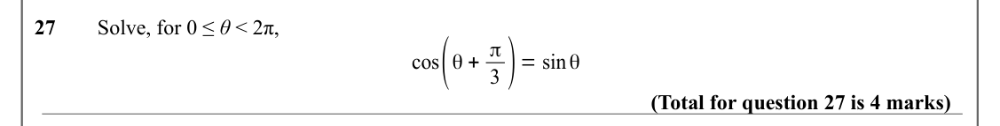

Text (lossy): 27       Solve, for 0 ≤ θ < 2π, / cos(θ + π / 3 )= sin θ / (Total for question 27 is 4 marks)

## Q28 (5 marks · parts a, b)

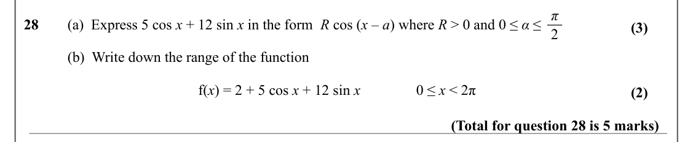

Text (lossy): π / 28 / (a)  Express 5 cos x + 12 sin x in the form  R cos (x – ɑ) where R > 0 and 0 ≤ α ≤  / (3) / 2 / (b)  Write down the range of the function  / f(x) = 2 + 5 cos x + 12 sin x / 0 ≤ x < 2π / (2) / (Total for question 28 is 5 marks)

## Q29 (7 marks · parts a, b)

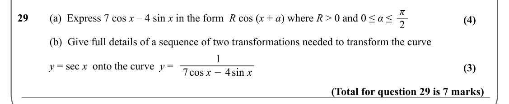

Text (lossy): π / 29 / (a)  Express 7 cos x – 4 sin x in the form  R cos (x + ɑ) where R > 0 and 0 ≤ α ≤  / (4) / 2 / (b)  Give full details of a sequence of two transformations needed to transform the curve / 1 / y = sec x  onto the curve  y =   / (3) / 7cos x −4sin x / (Total for question 29 is 7 marks)

