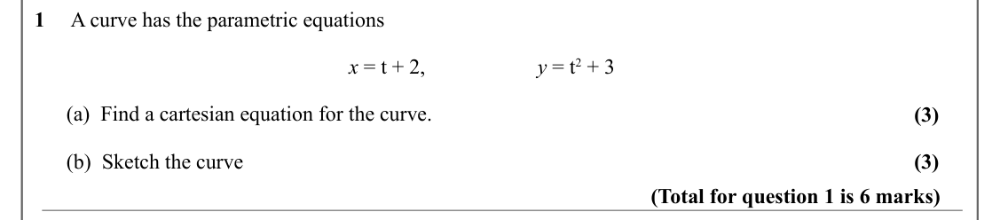
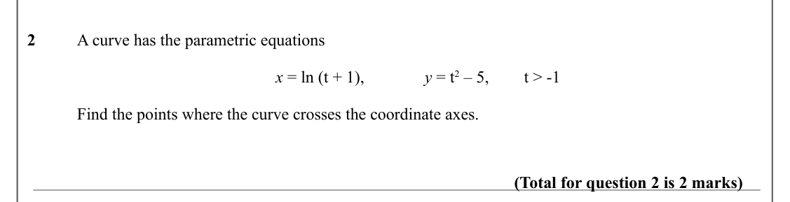
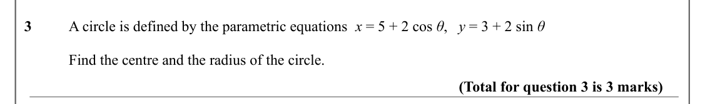
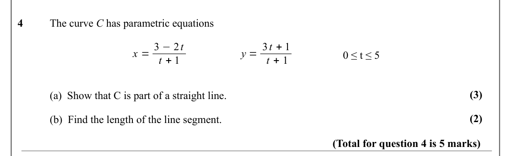
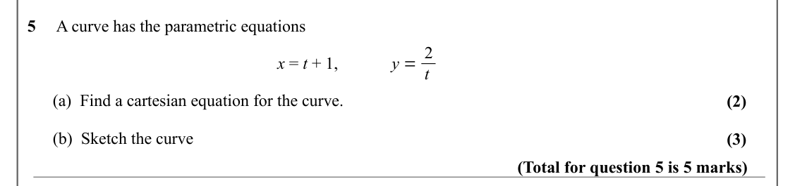
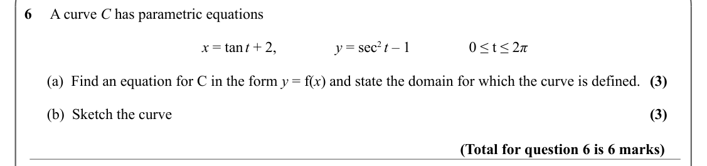
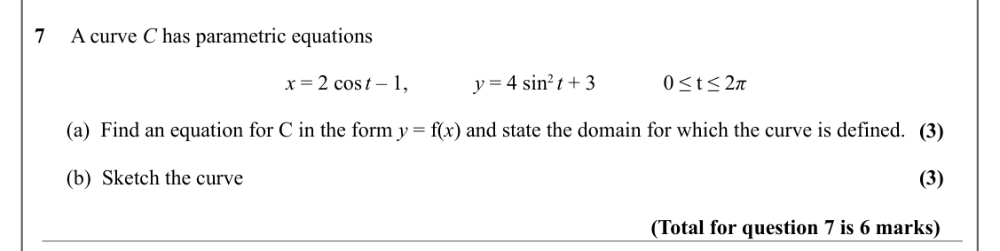
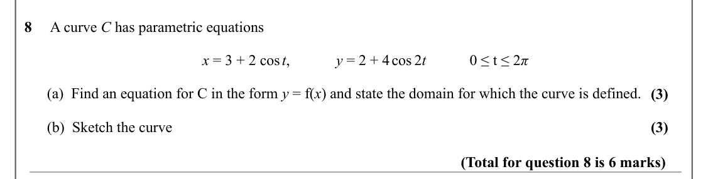
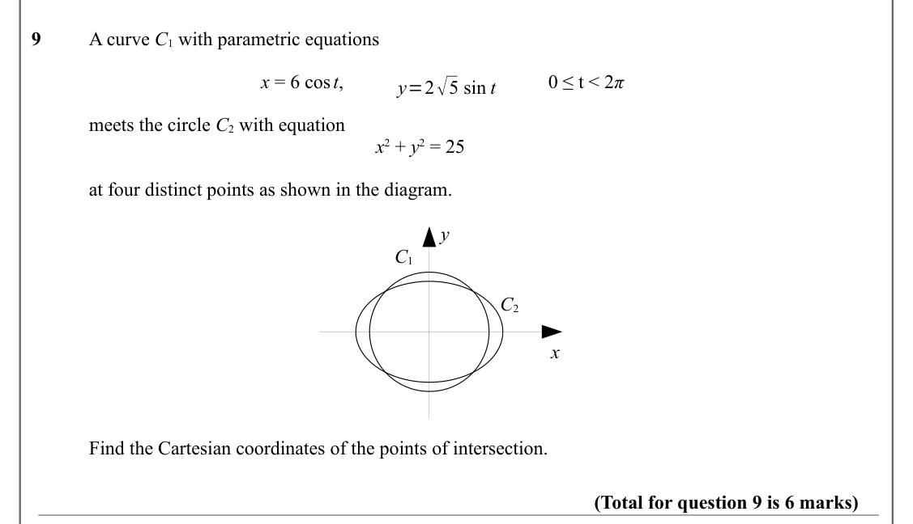

# Parametric Equations — Question Set (A-Level Maths · Edexcel · Year 2 Pure Mathematics)

Chapter question set · `a-level-pure-mathematics-8-parametric-equations` · 9 questions · segmented by printed total lines

## Q1 (6 marks · parts a, b)

Text (lossy): 1     A curve has the parametric equations / x = t + 2, / y = t 2 + 3 /       (a)  Find a cartesian equation for the curve.  / (3) /       (b)  Sketch the curve / (3) / (Total for question 1 is 6 marks)

## Q2 (2 marks)

Text (lossy): 2 / A curve has the parametric equations / x = ln (t + 1), / y = t 2 – 5, / t > -1  / Find the points where the curve crosses the coordinate axes. / (Total for question 2 is 2 marks)

## Q3 (3 marks)

Text (lossy): 3      / A circle is defined by the parametric equations  x = 5 + 2 cos θ,   y = 3 + 2 sin θ / Find the centre and the radius of the circle.  / (Total for question 3 is 3 marks)

## Q4 (5 marks · parts a, b)

Text (lossy): 4      / The curve C has parametric equations / x = 3 −2 t / y = 3 t + 1 / 0 ≤ t ≤ 5 / t + 1 / t + 1 / (3) / (a)  Show that C is part of a straight line. / (2) / (b)  Find the length of the line segment.  / (Total for question 4 is 5 marks)

## Q5 (5 marks · parts a, b)

Text (lossy): 5     A curve has the parametric equations / y = 2 / x = t + 1, / t /       (a)  Find a cartesian equation for the curve.  / (2) /       (b)  Sketch the curve / (3) / (Total for question 5 is 5 marks)

## Q6 (6 marks · parts a, b)

Text (lossy): 6     A curve C has parametric equations / x = tan t + 2, / y = sec 2 t – 1  / 0 ≤ t ≤ 2 π /       (a)  Find an equation for C in the form y = f(x) and state the domain for which the curve is defined.  / (3) /       (b)  Sketch the curve / (3) / (Total for question 6 is 6 marks)

## Q7 (6 marks · parts a, b)

Text (lossy): 7     A curve C has parametric equations / x = 2 cos t – 1, / y = 4 sin 2 t + 3 / 0 ≤ t ≤ 2 π /       (a)  Find an equation for C in the form y = f(x) and state the domain for which the curve is defined.  / (3) /       (b)  Sketch the curve / (3) / (Total for question 7 is 6 marks)

## Q8 (6 marks · parts a, b)

Text (lossy): 8     A curve C has parametric equations / x = 3 + 2 cos t, / y = 2 + 4 cos 2 t / 0 ≤ t ≤ 2 π /       (a)  Find an equation for C in the form y = f(x) and state the domain for which the curve is defined.  / (3) /       (b)  Sketch the curve / (3) / (Total for question 8 is 6 marks)

## Q9 (6 marks)

Text (lossy): 9      / A curve C 1 with parametric equations / x = 6 cos t, / 0 ≤ t < 2 π / y=2√5 sin t / meets the circle C 2 with equation / x 2 + y 2 = 25 / at four distinct points as shown in the diagram. / y / C 1 / C 2 / x / Find the Cartesian coordinates of the points of intersection.  / (Total for question 9 is 6 marks)

