# Differentiation — Question Set (A-Level Maths · Edexcel · Year 2 Pure Mathematics)

Chapter question set · `a-level-pure-mathematics-9-differentiation` · 49 questions · segmented by printed total lines

## Q1 (3 marks · parts a, b)

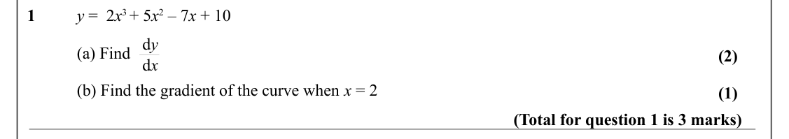

Text (lossy): 1 / y =  2 x 3 + 5 x 2 – 7 x + 10 / d y / (a) Find / (2) / d x / (b) Find the gradient of the curve when x = 2   / (1) / (Total for question 1 is 3 marks)

## Q2 (4 marks · parts a, b)

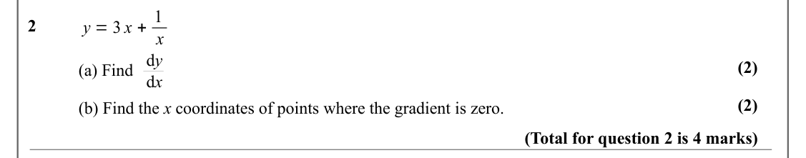

Text (lossy): y = 3 x + 1 / 2 / x / d y / (2) / (a) Find / d x / (2) / (b) Find the x coordinates of points where the gradient is zero.  / (Total for question 2 is 4 marks)

## Q3 (4 marks)

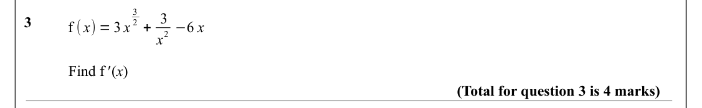

Text (lossy): 3 / 2 + 3 / 3 / f ( x) = 3 x / 2 −6 x / x / Find f ' (x) / (Total for question 3 is 4 marks)

## Q4 (5 marks · parts a, b)

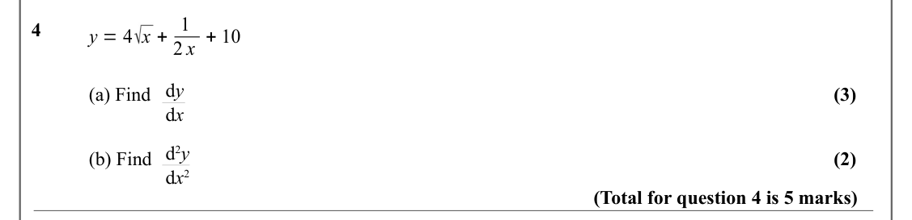

Text (lossy): y = 4 x + 1 / 4 / 2 x + 10 / d y / (3) / (a) Find / d x / d 2 y / (2) / (b) Find  / d x 2 / (Total for question 4 is 5 marks)

## Q5 (4 marks · parts a, b)

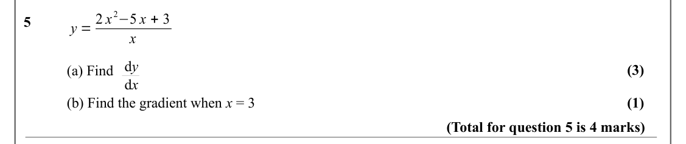

Text (lossy): y = 2 x 2−5 x + 3 / 5 / x / d y / (3) / (a) Find / d x / (1) / (b) Find the gradient when x = 3  / (Total for question 5 is 4 marks)

## Q6 (5 marks · parts a, b)

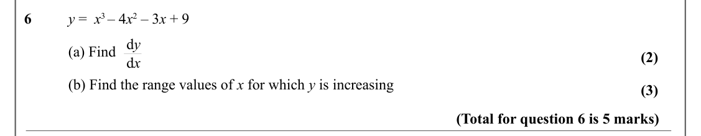

Text (lossy): 6 / y =  x 3 – 4 x 2 – 3 x + 9 / d y / (a) Find / (2) / d x / (b) Find the range values of x for which y is increasing / (3) / (Total for question 6 is 5 marks)

## Q7 (6 marks)

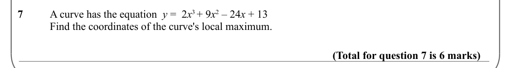

Text (lossy): 7 / A curve has the equation  y =  2 x 3 + 9 x 2 – 24 x + 13   / Find the coordinates of the curve's local maximum. / (Total for question 7 is 6 marks)

## Q8 (5 marks · parts a, b)

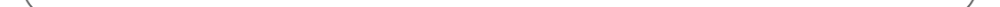

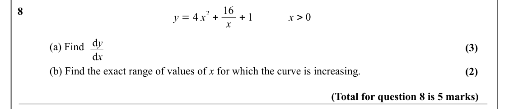

Text (lossy): 2 + 16 / 8 / y = 4 x / x + 1 / x > 0 / d y / (a) Find / (3) / d x / (b) Find the exact range of values of x for which the curve is increasing.  / (2) / (Total for question 8 is 5 marks)

## Q9 (6 marks · parts a, b)

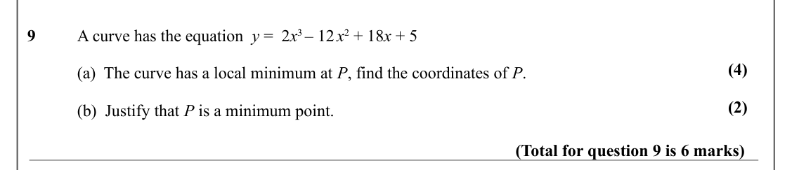

Text (lossy): 9 / A curve has the equation  y =  2 x 3 – 12 x 2 + 18 x + 5   / (4) / (a)  The curve has a local minimum at P, find the coordinates of P. / (2) / (b)  Justify that P is a minimum point.  / (Total for question 9 is 6 marks)

## Q10 (5 marks)

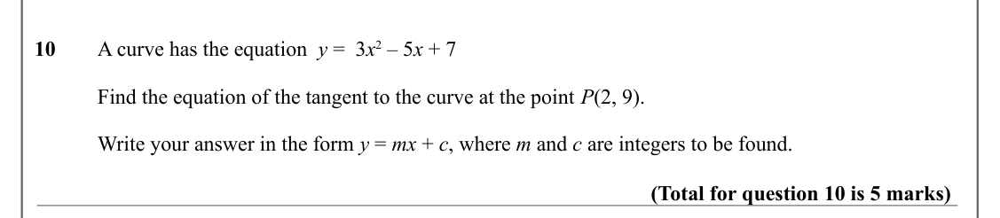

Text (lossy): 10 / A curve has the equation  y =  3 x 2 – 5 x + 7   / Find the equation of the tangent to the curve at the point P(2, 9). / Write your answer in the form y = mx + c, where m and c are integers to be found. / (Total for question 10 is 5 marks)

## Q11 (9 marks · parts a, b)

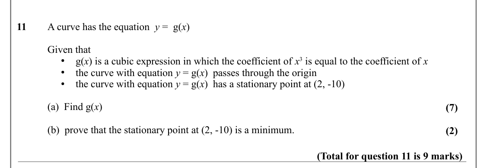

Text (lossy): 11 / A curve has the equation  y =  g(x) / Given that / g(x) is a cubic expression in which the coefficient of x 3 is equal to the coefficient of x / ● / the curve with equation y = g(x)  passes through the origin / ● / the curve with equation y = g(x)  has a stationary point at (2, -10) / ● / (a)  Find g(x) / (7) / (b)  prove that the stationary point at (2, -10) is a minimum. / (2) / (Total for 

## Q12 (2 marks)

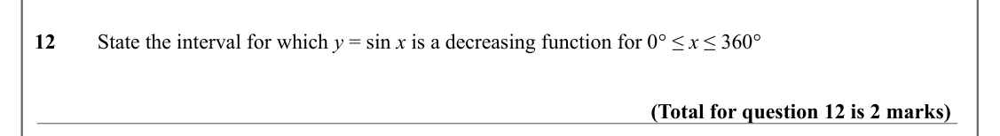

Text (lossy): 12 / State the interval for which y = sin x is a decreasing function for 0° ≤ x ≤ 360° / (Total for question 12 is 2 marks)

## Q13 (2 marks)

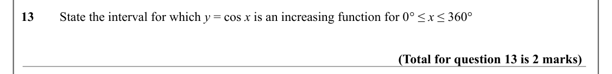

Text (lossy): 13 / State the interval for which y = cos x is an increasing function for 0° ≤ x ≤ 360° / (Total for question 13 is 2 marks)

## Q14 (6 marks)

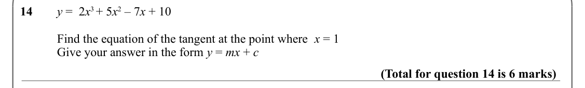

Text (lossy): 14 / y =  2 x 3 + 5 x 2 – 7 x + 10 / Find the equation of the tangent at the point where  x = 1 / Give your answer in the form y = mx + c   / (Total for question 14 is 6 marks)

## Q15 (6 marks)

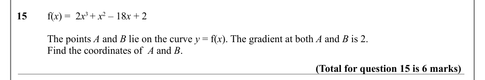

Text (lossy): 15 / f(x) =  2 x 3 + x 2 – 18 x + 2 / The points A and B lie on the curve y = f(x). The gradient at both A and B is 2.  / Find the coordinates of  A and B.  / (Total for question 15 is 6 marks)

## Q16 (6 marks)

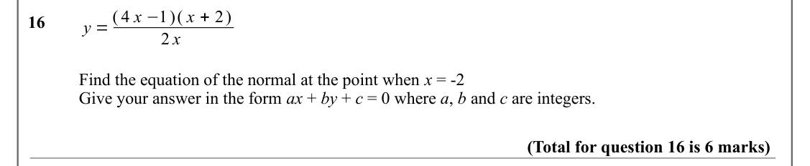

Text (lossy): y = ( 4 x −1)( x + 2) / 16 / 2 x / Find the equation of the normal at the point when x = -2 / Give your answer in the form ax + by + c = 0 where a, b and c are integers.  / (Total for question 16 is 6 marks)

## Q17 (9 marks · parts a, b, c)

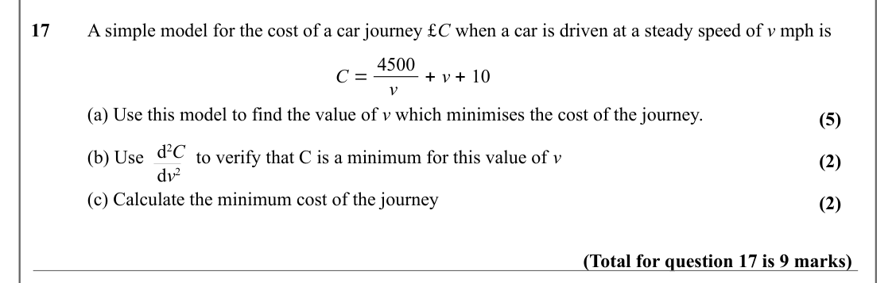

Text (lossy): 17 / A simple model for the cost of a car journey £C when a car is driven at a steady speed of v mph is / C = 4500 / + v + 10 / v / (a) Use this model to find the value of v which minimises the cost of the journey. / (5) / d 2 C / (b) Use           to verify that C is a minimum for this value of v / (2) / d v 2 / (c) Calculate the minimum cost of the journey / (2) / (Total for question 17 is 9 mar

## Q18 (12 marks · parts a, b, c)

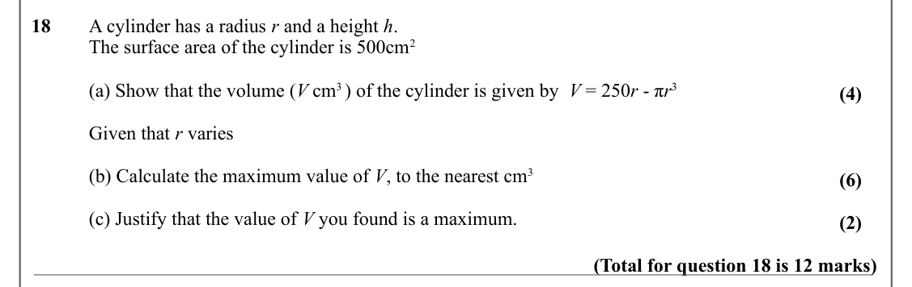

Text (lossy): 18 / A cylinder has a radius r and a height h.  / The surface area of the cylinder is 500cm 2 / (a) Show that the volume (V cm 3 ) of the cylinder is given by  V = 250 r - π r 3 / (4) / Given that r varies / (b) Calculate the maximum value of V, to the nearest cm 3 / (6) / (c) Justify that the value of V you found is a maximum.  / (2) / (Total for question 18 is 12 marks)

## Q19 (6 marks)

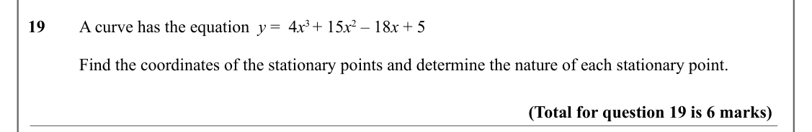

Text (lossy): 19 / A curve has the equation  y =  4 x 3 + 15 x 2 – 18 x + 5   / Find the coordinates of the stationary points and determine the nature of each stationary point. / (Total for question 19 is 6 marks)

## Q20 (11 marks · parts a, b)

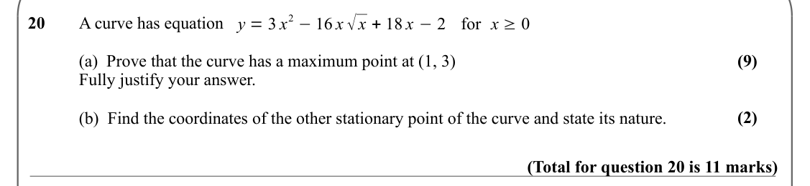

Text (lossy): y = 3 x 2 −16 x √x + 18 x −2 / 20 / A curve has equation  / for x ≥0 / (9) / (a)  Prove that the curve has a maximum point at (1, 3) / Fully justify your answer.  / (2) / (b)  Find the coordinates of the other stationary point of the curve and state its nature. / (Total for question 20 is 11 marks)

## Q21 (11 marks · parts a, b, c, d)

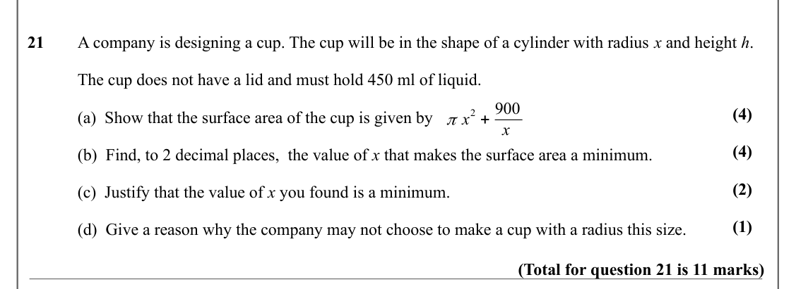

Text (lossy): 21 / A company is designing a cup. The cup will be in the shape of a cylinder with radius x and height h.  / The cup does not have a lid and must hold 450 ml of liquid.  / 2 + 900 / (4) / (a)  Show that the surface area of the cup is given by  / π x / x / (4) / (b)  Find, to 2 decimal places,  the value of x that makes the surface area a minimum.  / (2) / (c)  Justify that the value of x you found

## Q22 (6 marks)

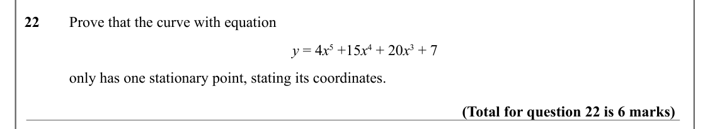

Text (lossy): 22 / Prove that the curve with equation / y = 4 x 5 +15 x 4 + 20 x 3 + 7  / only has one stationary point, stating its coordinates. / (Total for question 22 is 6 marks)

## Q23 (10 marks · parts a, b)

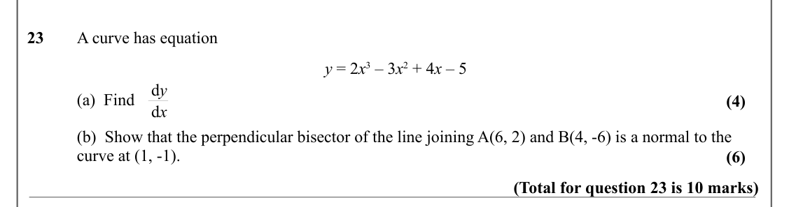

Text (lossy): 23 / A curve has equation / y = 2 x 3 – 3 x 2 + 4 x – 5   / d y / (a)  Find  / (4) / d x / (b)  Show that the perpendicular bisector of the line joining A(6, 2) and B(4, -6) is a normal to the  / curve at (1, -1). / (6) / (Total for question 23 is 10 marks)

## Q24 (5 marks)

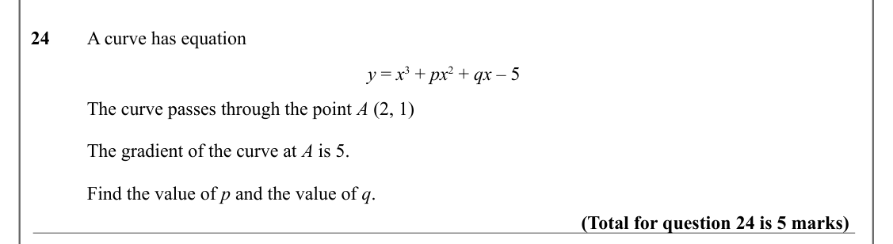

Text (lossy): 24 / A curve has equation / y = x 3 + px 2 + qx – 5   / The curve passes through the point A (2, 1) / The gradient of the curve at A is 5. / Find the value of p and the value of q. / (Total for question 24 is 5 marks)

## Q25 (10 marks · parts a, b)

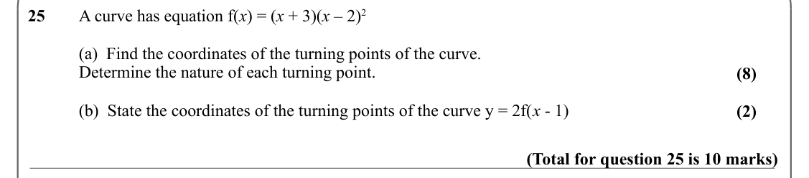

Text (lossy): 25 / A curve has equation f(x) = (x + 3)(x – 2)2  / (a)  Find the coordinates of the turning points of the curve.  / Determine the nature of each turning point.  / (8) / (b)  State the coordinates of the turning points of the curve y = 2f(x - 1) / (2) / (Total for question 25 is 10 marks)

## Q26 (3 marks)

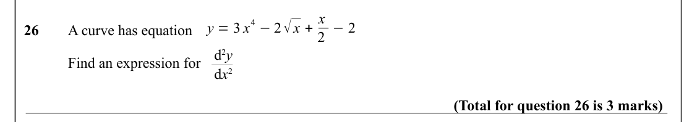

Text (lossy): 4 −2√x + x / y = 3 x / 2 −2 / 26 / A curve has equation  / d 2 y / Find an expression for  / d x 2 / (Total for question 26 is 3 marks)

## Q27 (7 marks · parts a, b)

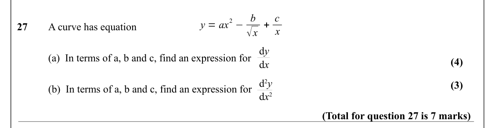

Text (lossy): 2 −b / √x + c / y = ax / 27 / A curve has equation  / x / d y / (a)  In terms of a, b and c, find an expression for / (4) / d x / (b)  In terms of a, b and c, find an expression for  d 2 y / (3) / d x 2 / (Total for question 27 is 7 marks)

## Q28 (10 marks · parts a, b)

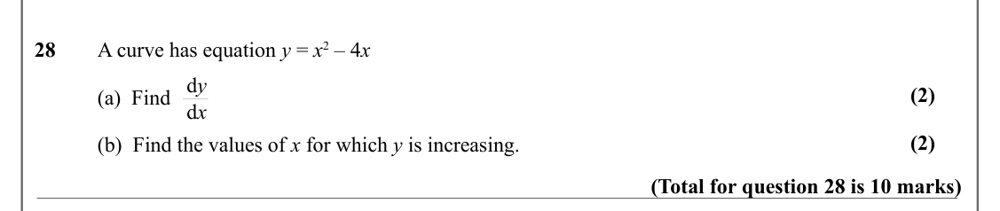

Text (lossy): 28 / A curve has equation y = x 2 – 4 x / d y / (2) / (a)  Find  / d x / (2) / (b)  Find the values of x for which y is increasing.   / (Total for question 28 is 10 marks)

## Q29 (5 marks)

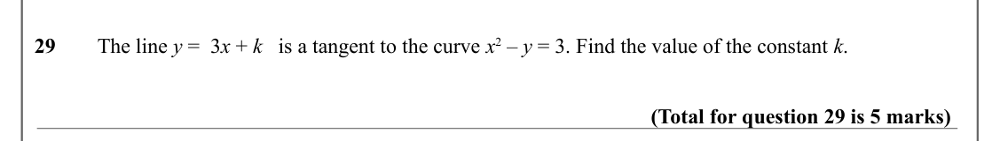

Text (lossy): 29 / The line y =  3 x + k   is a tangent to the curve x 2 – y = 3. Find the value of the constant k. / (Total for question 29 is 5 marks)

## Q30 (7 marks)

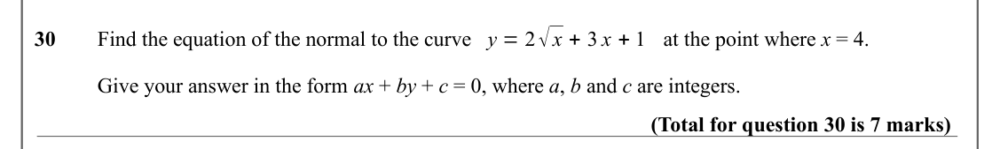

Text (lossy): y = 2√x + 3 x + 1 / 30 / Find the equation of the normal to the curve / at the point where x = 4.  / Give your answer in the form ax + by + c = 0, where a, b and c are integers.   / (Total for question 30 is 7 marks)

## Q31 (6 marks)

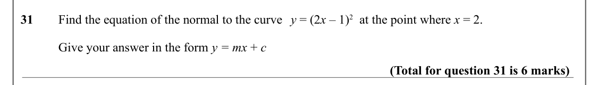

Text (lossy): 31 / Find the equation of the normal to the curve   y = (2 x – 1)2  at the point where x = 2.  / Give your answer in the form y = mx + c / (Total for question 31 is 6 marks)

## Q32 (7 marks · parts a, b)

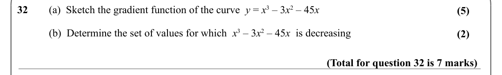

Text (lossy): 32 / (a)  Sketch the gradient function of the curve  y = x 3 – 3 x 2 – 45 x  / (5) / (b)  Determine the set of values for which  x 3 – 3 x 2 – 45 x  is decreasing  / (2) / (Total for question 32 is 7 marks)

## Q33 (9 marks)

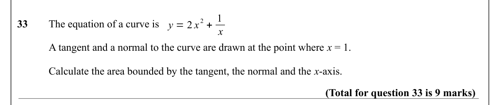

Text (lossy): 2 + 1 / 33 / The equation of a curve is / y = 2 x / x / A tangent and a normal to the curve are drawn at the point where x = 1. / Calculate the area bounded by the tangent, the normal and the x‑axis. / (Total for question 33 is 9 marks)

## Q34 (6 marks · parts a, b, c)

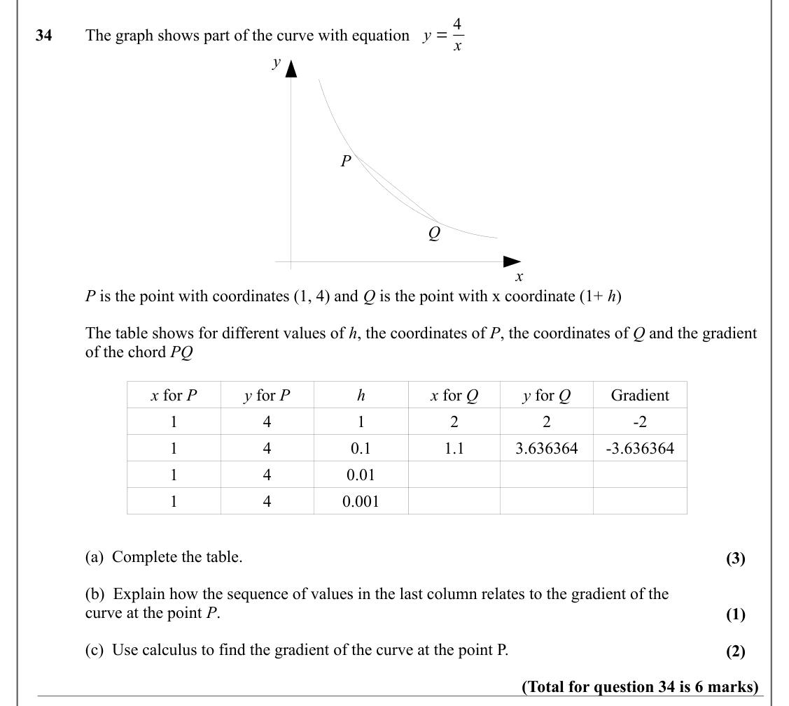

Text (lossy): y = 4 / 34 / The graph shows part of the curve with equation / x / y / P / Q / x / P is the point with coordinates (1, 4) and Q is the point with x coordinate (1+ h) / The table shows for different values of h, the coordinates of P, the coordinates of Q and the gradient  / of the chord PQ / x for P / y for P / h / x for Q / y for Q / Gradient / 1 / 4 / 1 / 2 / 2 / -2 / 1 / 4 / 0.1 / 1.1 / 3.636364

## Q35 (6 marks · parts a, b)

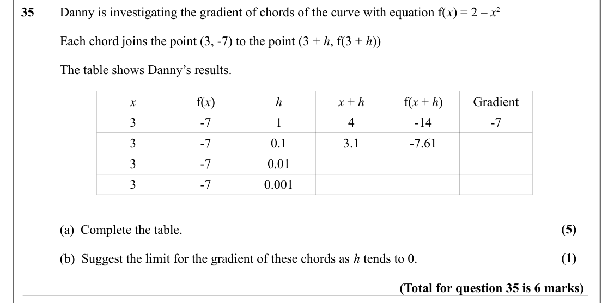

Text (lossy): 35 / Danny is investigating the gradient of chords of the curve with equation f(x) = 2 – x 2 / Each chord joins the point (3, -7) to the point (3 + h, f(3 + h)) / The table shows Danny’s results. / x / f(x) / h / x + h / f(x + h) / Gradient / 3 / -7 / 1 / 4 / -14 / -7 / 3 / -7 / 0.1 / 3.1 / -7.61 / 3 / -7 / 0.01 / 3 / -7 / 0.001 / (5) / (a)  Complete the table. / (1) / (b)  Suggest the limit for t

## Q36 (10 marks · parts a, b, c)

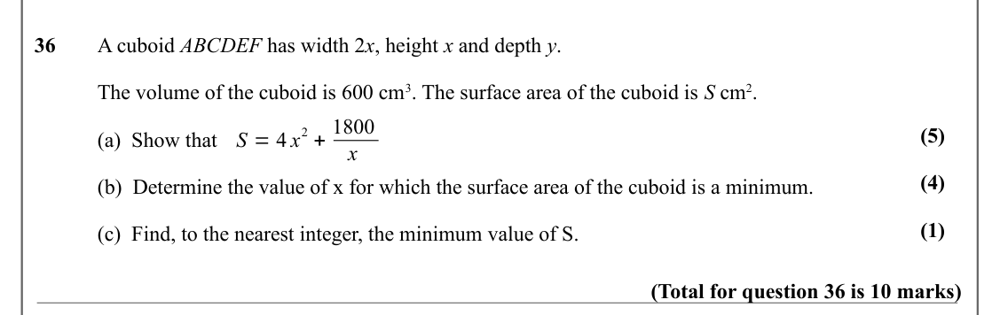

Text (lossy): 36 / A cuboid ABCDEF has width 2 x, height x and depth y.  / The volume of the cuboid is 600 cm 3. The surface area of the cuboid is S cm 2.  / 2 + 1800 / (5) / S = 4 x / (a)  Show that  / x / (4) / (b)  Determine the value of x for which the surface area of the cuboid is a minimum.  / (1) / (c)  Find, to the nearest integer, the minimum value of S. / (Total for question 36 is 10 marks)

## Q37 (9 marks · parts a, b, i, ii)

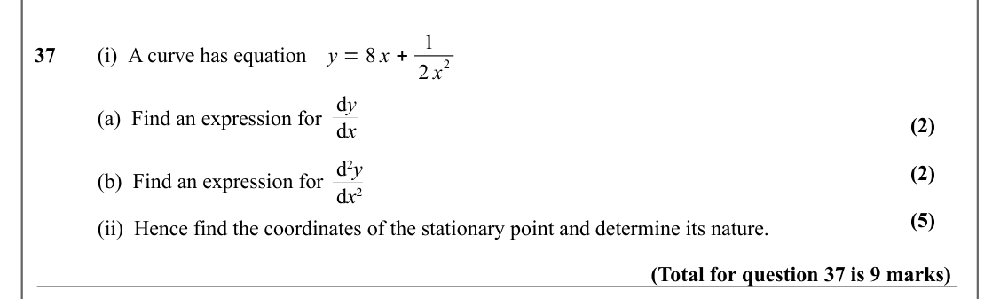

Text (lossy): y = 8 x + 1 / 37 / (i)  A curve has equation  / 2 / 2 x / d y / (a)  Find an expression for / (2) / d x / d 2 y / (2) / (b)  Find an expression for  / d x 2 / (5) / (ii)  Hence find the coordinates of the stationary point and determine its nature.  / (Total for question 37 is 9 marks)

## Q38 (7 marks)

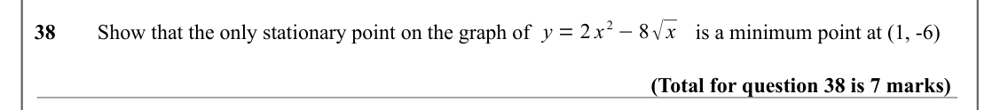

Text (lossy): y = 2 x 2 −8√x / 38 / Show that the only stationary point on the graph of /       is a minimum point at (1, -6) / (Total for question 38 is 7 marks)

## Q39 (4 marks)

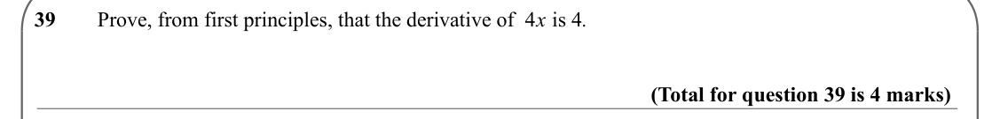

Text (lossy): 39 / Prove, from first principles, that the derivative of  4 x  is 4. / (Total for question 39 is 4 marks)

## Q40 (5 marks)

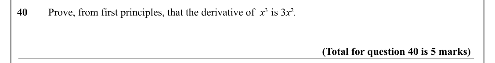

Text (lossy): 40 / Prove, from first principles, that the derivative of  x 3  is 3 x 2. / (Total for question 40 is 5 marks)

## Q41 (5 marks)

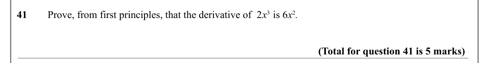

Text (lossy): 41 / Prove, from first principles, that the derivative of  2 x 3  is 6 x 2. / (Total for question 41 is 5 marks)

## Q42 (4 marks)

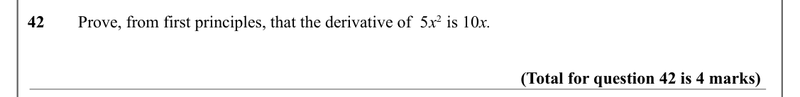

Text (lossy): 42 / Prove, from first principles, that the derivative of  5 x 2  is 10 x. / (Total for question 42 is 4 marks)

## Q43 (5 marks)

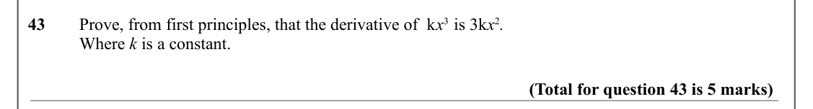

Text (lossy): 43 / Prove, from first principles, that the derivative of  k x 3  is 3k x 2. / Where k is a constant.  / (Total for question 43 is 5 marks)

## Q44 (6 marks · parts a, b, c)

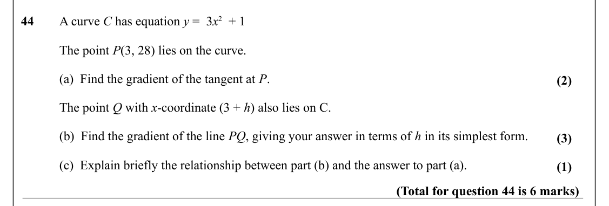

Text (lossy): 44 / A curve C has equation y =  3 x 2  + 1 / The point P(3, 28) lies on the curve.  / (a)  Find the gradient of the tangent at P.  / (2) / The point Q with x-coordinate (3 + h) also lies on C.  / (b)  Find the gradient of the line PQ, giving your answer in terms of h in its simplest form. / (3) / (c)  Explain briefly the relationship between part (b) and the answer to part (a).   / (1) / (Total f

## Q45 (5 marks)

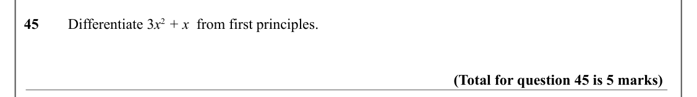

Text (lossy): 45 / Differentiate 3 x 2 + x  from first principles. / (Total for question 45 is 5 marks)

## Q46 (5 marks)

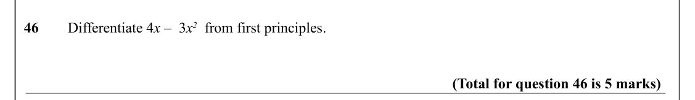

Text (lossy): 46 / Differentiate 4 x –  3 x 2  from first principles. / (Total for question 46 is 5 marks)

## Q47 (7 marks · parts a, b)

Text (lossy): 47 / (a)  Sketch the gradient function of the curve  y = x 3 + 3 x 2 – 24 x  / (5) / (b)  Determine the set of values for which  x 3 + 3 x 2 – 24 x  is increasing  / (2) / (Total for question 47 is 7 marks)

## Q48 (12 marks · parts a, b)

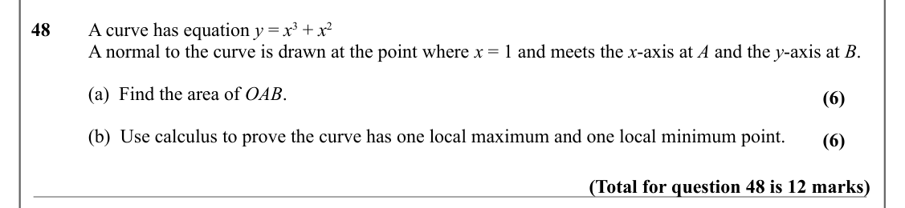

Text (lossy): 48 / A curve has equation y = x 3 + x 2 / A normal to the curve is drawn at the point where x = 1 and meets the x-axis at A and the y-axis at B.  / (a)  Find the area of OAB.  / (6) / (b)  Use calculus to prove the curve has one local maximum and one local minimum point.  / (6) / (Total for question 48 is 12 marks)

## Q49 (8 marks · parts a, b, c)

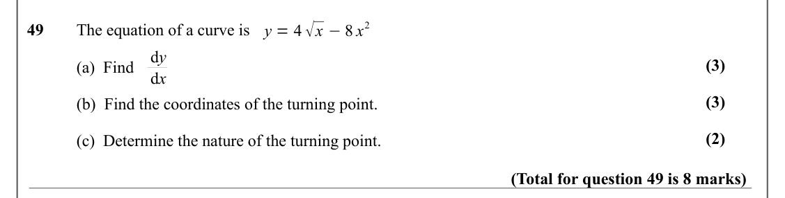

Text (lossy): y = 4 √x −8 x 2 / 49 / The equation of a curve is  / d y / (3) / (a)  Find  / d x / (3) / (b)  Find the coordinates of the turning point. / (2) / (c)  Determine the nature of the turning point. / (Total for question 49 is 8 marks)

