# Regression, Correlation and Hypothesis Testing — Question Set (A-Level Maths · Edexcel · Year 2 Statistics)

Chapter question set · `a-level-statistics-1-regression-correlation-and-hypothesis-testing` · 11 questions · segmented by printed total lines

## Q1 (10 marks · parts a, b, c, d, e)

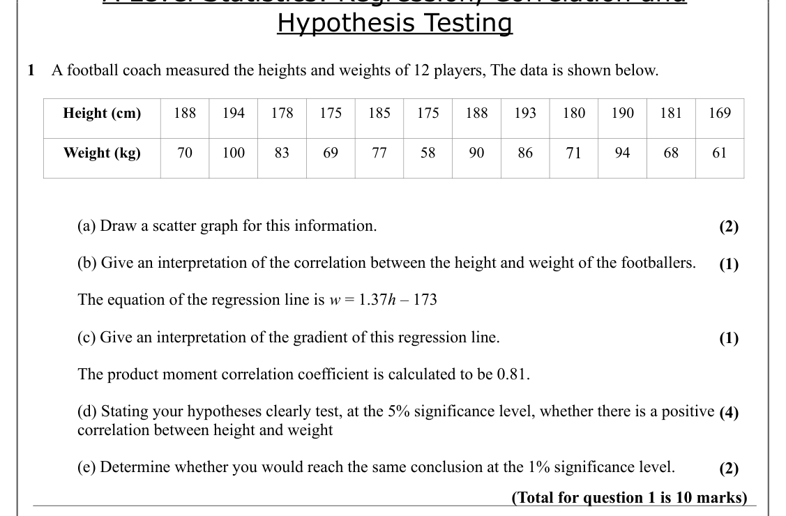

Text (lossy): Hypothesis Testing / 1    A football coach measured the heights and weights of 12 players, The data is shown below.  / Height (cm) / 188 / 194 / 178 / 175 / 185 / 175 / 188 / 193 / 180 / 190 / 181 / 169 / 71 / Weight (kg) / 70 / 100 / 83 / 69 / 77 / 58 / 90 / 86 / 94 / 68 / 61 / (a) Draw a scatter graph for this information. / (2) / (b) Give an interpretation of the correlation between the height 

## Q2 (4 marks · parts a, b)

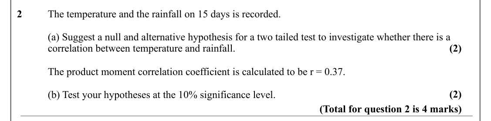

Text (lossy): 2      / The temperature and the rainfall on 15 days is recorded. / (a) Suggest a null and alternative hypothesis for a two tailed test to investigate whether there is a  / (2) / correlation between temperature and rainfall.  / The product moment correlation coefficient is calculated to be r = 0.37.  / (2) / (b) Test your hypotheses at the 10% significance level. / (Total for question 2 is 4 marks

## Q3 (4 marks)

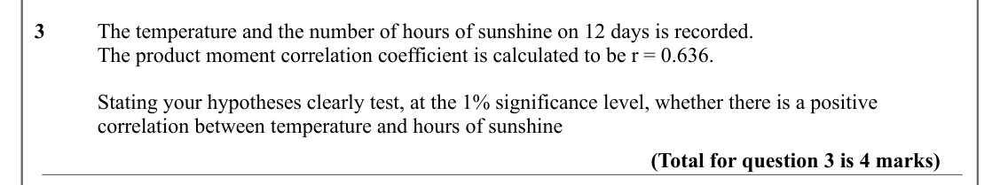

Text (lossy): 3      / The temperature and the number of hours of sunshine on 12 days is recorded. / The product moment correlation coefficient is calculated to be r = 0.636.  / Stating your hypotheses clearly test, at the 1% significance level, whether there is a positive  / correlation between temperature and hours of sunshine / (Total for question 3 is 4 marks)

## Q4 (4 marks · parts a, b)

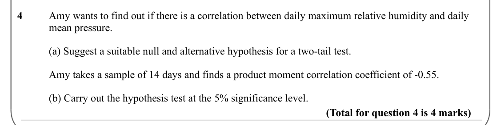

Text (lossy): 4      / Amy wants to find out if there is a correlation between daily maximum relative humidity and daily  / mean pressure.  / (a) Suggest a suitable null and alternative hypothesis for a two-tail test.  / Amy takes a sample of 14 days and finds a product moment correlation coefficient of -0.55. / (b) Carry out the hypothesis test at the 5% significance level.  / (Total for question 4 is 4 marks)

## Q5 (6 marks · parts a, b, c, d)

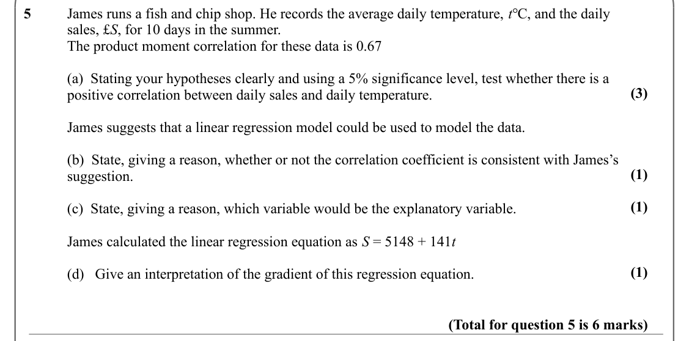

Text (lossy): 5      / James runs a fish and chip shop. He records the average daily temperature, t℃, and the daily  / sales, £S, for 10 days in the summer.  / The product moment correlation for these data is 0.67 / (a)  Stating your hypotheses clearly and using a 5% significance level, test whether there is a  / (3) / positive correlation between daily sales and daily temperature. / James suggests that a linea

## Q6 (9 marks · parts a, b, c)

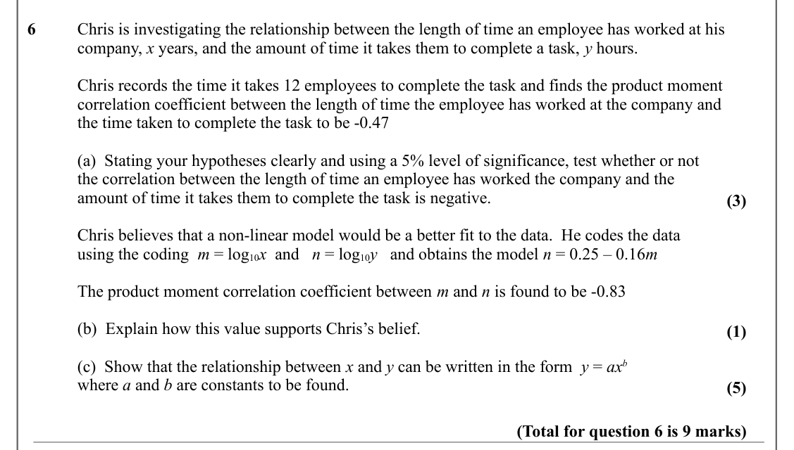

Text (lossy): 6      / Chris is investigating the relationship between the length of time an employee has worked at his  / company, x years, and the amount of time it takes them to complete a task, y hours.  / Chris records the time it takes 12 employees to complete the task and finds the product moment / correlation coefficient between the length of time the employee has worked at the company and / the time ta

## Q7 (3 marks)

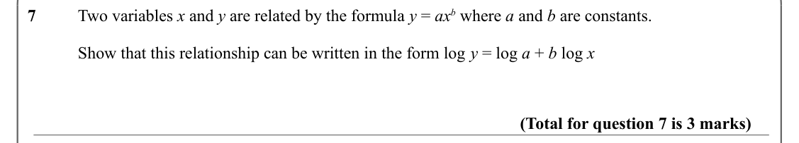

Text (lossy): 7      / Two variables x and y are related by the formula y = ax b where a and b are constants.   / Show that this relationship can be written in the form log y = log a + b log x / (Total for question 7 is 3 marks)

## Q8 (5 marks · parts a, b, c)

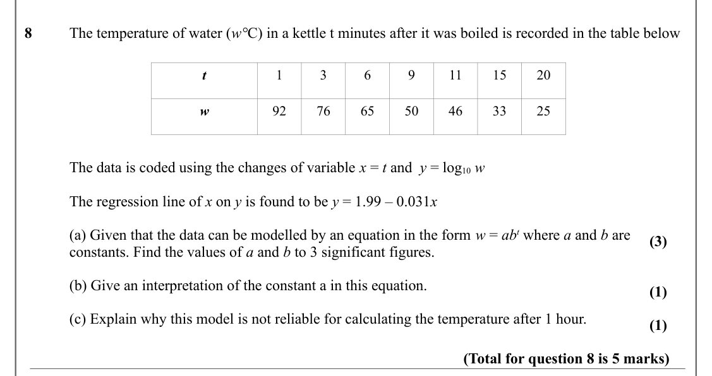

Text (lossy): 8      / The temperature of water (w°C) in a kettle t minutes after it was boiled is recorded in the table below / t / 1 / 3 / 6 / 9 / 11 / 15 / 20 / w / 92 / 76 / 65 / 50 / 46 / 33 / 25 / The data is coded using the changes of variable x = t and  y = log 10 w / The regression line of x on y is found to be y = 1.99 – 0.031 x / (a) Given that the data can be modelled by an equation in the form w = 

## Q9 (6 marks · parts a, b)

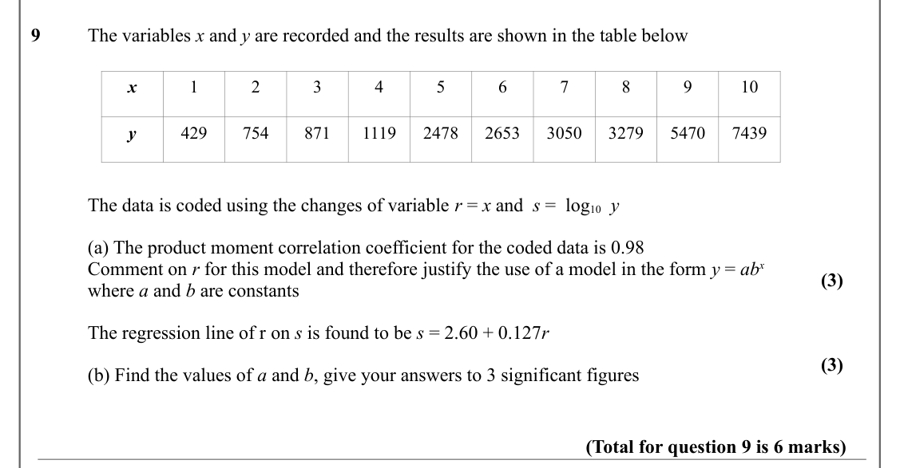

Text (lossy): 9      / The variables x and y are recorded and the results are shown in the table below / x / 1 / 2 / 3 / 4 / 5 / 6 / 7 / 8 / 9 / 10 / y / 429 / 754 / 871 / 1119 / 2478 / 2653 / 3050 / 3279 / 5470 / 7439 / The data is coded using the changes of variable r = x and  s =  log 10  y / (a) The product moment correlation coefficient for the coded data is 0.98 / Comment on r for this model and therefore

## Q10 (3 marks)

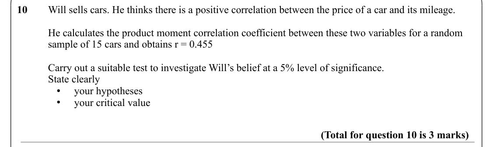

Text (lossy): 10     Will sells cars. He thinks there is a positive correlation between the price of a car and its mileage.  / He calculates the product moment correlation coefficient between these two variables for a random  / sample of 15 cars and obtains r = 0.455 / Carry out a suitable test to investigate Will’s belief at a 5% level of significance. / State clearly  /  your hypotheses / ● /  your critical v

## Q11 (3 marks)

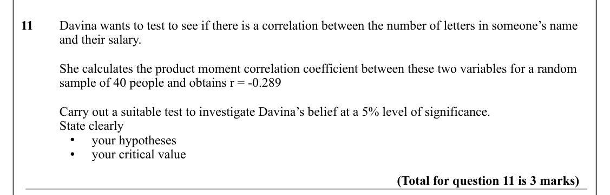

Text (lossy): 11     Davina wants to test to see if there is a correlation between the number of letters in someone’s name  / and their salary.  / She calculates the product moment correlation coefficient between these two variables for a random  / sample of 40 people and obtains r = -0.289 / Carry out a suitable test to investigate Davina’s belief at a 5% level of significance. / State clearly  /  your hypothe

