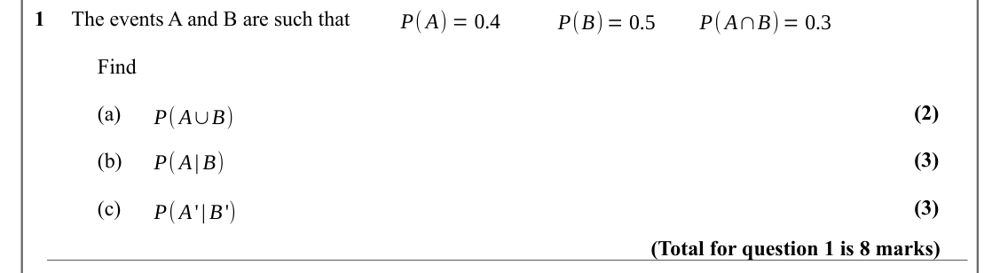
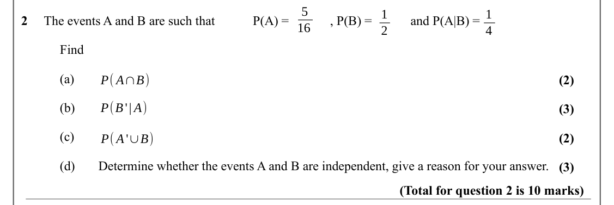
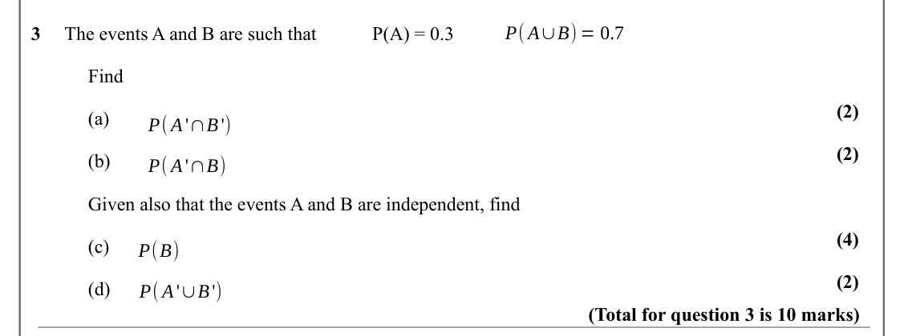
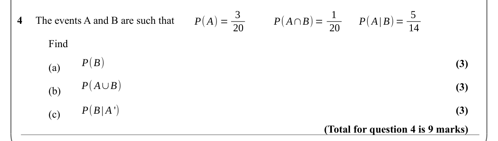
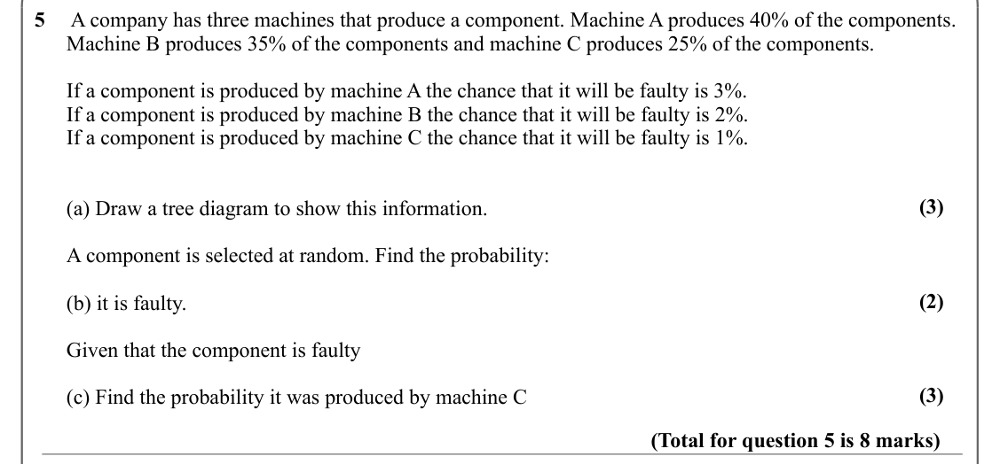
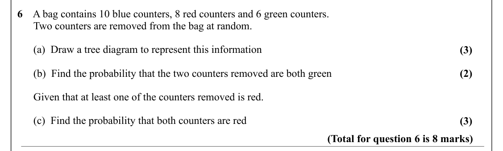
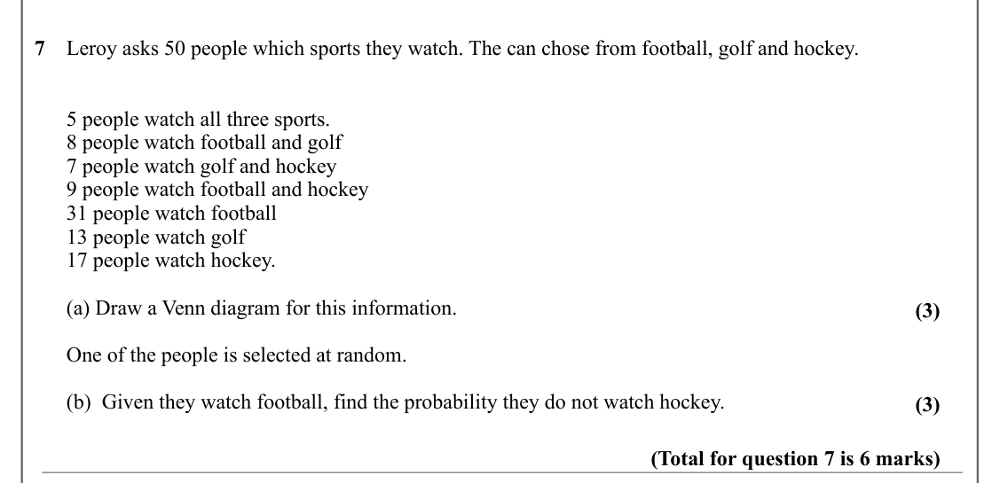
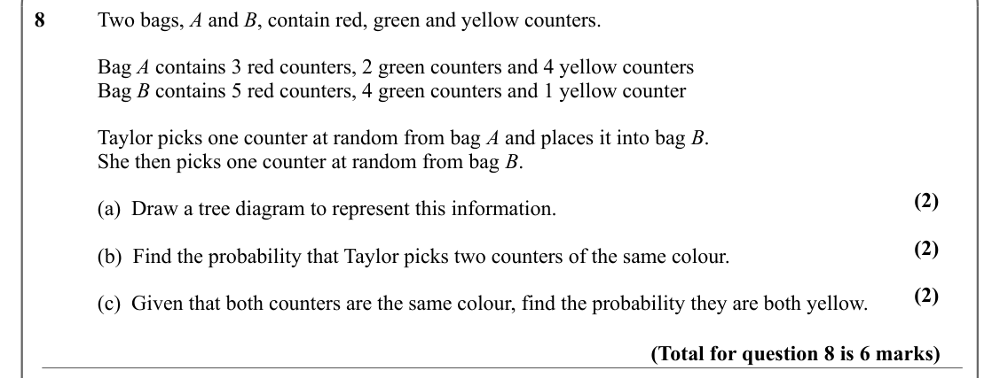
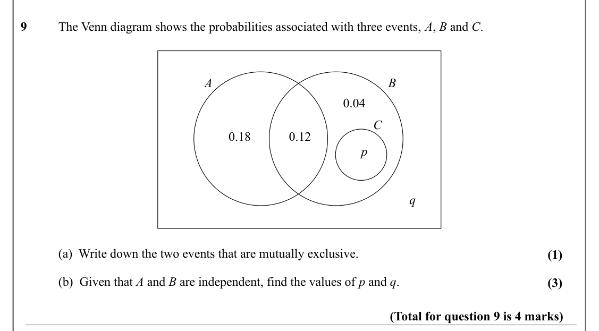
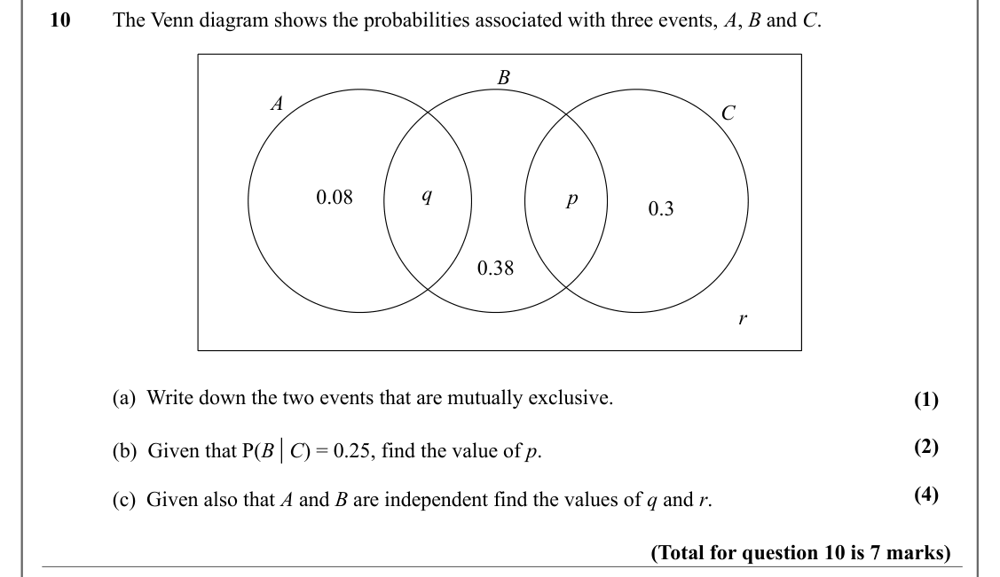

# Conditional Probability — Question Set (A-Level Maths · Edexcel · Year 2 Statistics)

Chapter question set · `a-level-statistics-2-conditional-probability` · 10 questions · segmented by printed total lines

## Q1 (8 marks · parts a, b, c)

Text (lossy): 1     The events A and B are such that / P( A) = 0.4 / P(B) = 0.5 / P( A∩B) = 0.3 / Find  / (2) / (a) / P( A∪B) / (3) / (b) / P( A| B) / (3) / (c) / P( A'| B') / (Total for question 1 is 8 marks)

## Q2 (10 marks · parts a, b, c, d)

Text (lossy): 5 / 1 / 1 / 2     The events A and B are such that / P(A) =  / , P(B) = /  and P(A|B) =  / 16 / 2 / 4 / Find / (a) / P( A∩B) / (2) / P(B'| A) / (b) / (3) / (c) / (2) / P( A'∪B) / (d) / Determine whether the events A and B are independent, give a reason for your answer. / (3) / (Total for question 2 is 10 marks)

## Q3 (10 marks · parts a, b, c, d)

Text (lossy): P( A∪B) = 0.7 / 3     The events A and B are such that / P(A) = 0.3  / Find / (2) / (a) / P( A'∩B') / (2) / (b) / P( A'∩B) / Given also that the events A and B are independent, find / (4) / (c) / P(B) / (2) / (d) / P( A'∪B') / (Total for question 3 is 10 marks)

## Q4 (9 marks · parts a, b, c)

Text (lossy): P( A) = 3 / P( A∩B) = 1 / P( A| B) = 5 / 4     The events A and B are such that / 20 / 20 / 14 / Find / P(B) / (3) / (a) / P( A∪B) / (3) / (b) / P(B| A ') / (3) / (c) / (Total for question 4 is 9 marks)

## Q5 (8 marks · parts a, b, c)

Text (lossy): 5     A company has three machines that produce a component. Machine A produces 40% of the components.   /       Machine B produces 35% of the components and machine C produces 25% of the components.  /       If a component is produced by machine A the chance that it will be faulty is 3%.  /       If a component is produced by machine B the chance that it will be faulty is 2%.  /       If a compon

## Q6 (8 marks · parts a, b, c)

Text (lossy): 6    A bag contains 10 blue counters, 8 red counters and 6 green counters.    /       Two counters are removed from the bag at random.  /       (a)  Draw a tree diagram to represent this information / (3) /       (b)  Find the probability that the two counters removed are both green / (2) /       Given that at least one of the counters removed is red.  /       (c)  Find the probability that both c

## Q7 (6 marks · parts a, b)

Text (lossy): 7    Leroy asks 50 people which sports they watch. The can chose from football, golf and hockey.  /       5 people watch all three sports.  /       8 people watch football and golf /       7 people watch golf and hockey /       9 people watch football and hockey  /       31 people watch football /       13 people watch golf /       17 people watch hockey.  /       (a) Draw a Venn diagram for this 

## Q8 (6 marks · parts a, b, c)

Text (lossy): 8      / Two bags, A and B, contain red, green and yellow counters.  / Bag A contains 3 red counters, 2 green counters and 4 yellow counters / Bag B contains 5 red counters, 4 green counters and 1 yellow counter / Taylor picks one counter at random from bag A and places it into bag B.  / She then picks one counter at random from bag B.  / (2) / (a)  Draw a tree diagram to represent this informatio

## Q9 (4 marks · parts a, b)

Text (lossy): 9      / The Venn diagram shows the probabilities associated with three events, A, B and C.  / A / B / 0.04 / C / 0.18 / 0.12 / p / q / (a)  Write down the two events that are mutually exclusive.  / (1) / (b)  Given that A and B are independent, find the values of p and q.  / (3) / (Total for question 9 is 4 marks)

## Q10 (7 marks · parts a, b, c)

Text (lossy): 10     The Venn diagram shows the probabilities associated with three events, A, B and C.  / B / A / C / q / 0.08 / p / 0.3 / 0.38 / r / (a)  Write down the two events that are mutually exclusive.  / (1) / (b)  Given that P(B | C) = 0.25, find the value of p.  / (2) / (4) / (c)  Given also that A and B are independent find the values of q and r.   / (Total for question 10 is 7 marks)

