# The Normal Distribution — Question Set (A-Level Maths · Edexcel · Year 2 Statistics)

Chapter question set · `a-level-statistics-3-the-normal-distribution` · 13 questions · segmented by printed total lines

## Q1 (3 marks · parts a, b, c)

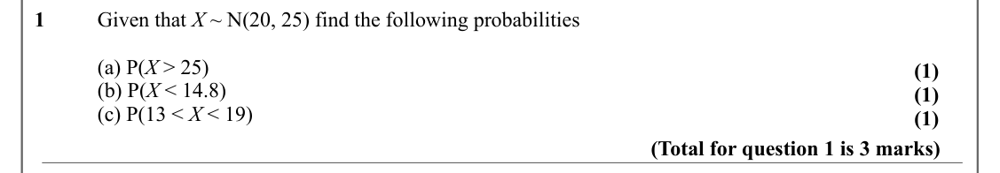

Text (lossy): 1      / Given that X ~ N(20, 25) find the following probabilities / (a) P(X > 25) / (1) / (b) P(X < 14.8) / (1) / (c) P(13 < X < 19) / (1) / (Total for question 1 is 3 marks)

## Q2 (3 marks · parts a, b, c) · printed as “1” (source typo)

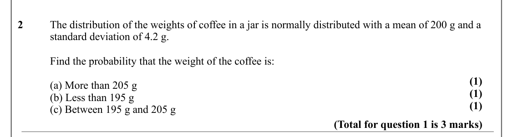

Text (lossy): 2      / The distribution of the weights of coffee in a jar is normally distributed with a mean of 200 g and a  / standard deviation of 4.2 g.  / Find the probability that the weight of the coffee is: / (1) / (a) More than 205 g / (1) / (b) Less than 195 g / (1) / (c) Between 195 g and 205 g / (Total for question 1 is 3 marks)

## Q3 (2 marks)

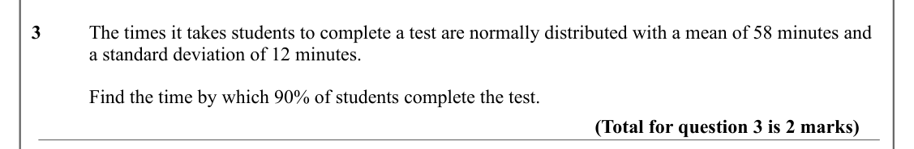

Text (lossy): 3      / The times it takes students to complete a test are normally distributed with a mean of 58 minutes and   / a standard deviation of 12 minutes.  / Find the time by which 90% of students complete the test.  / (Total for question 3 is 2 marks)

## Q4 (4 marks)

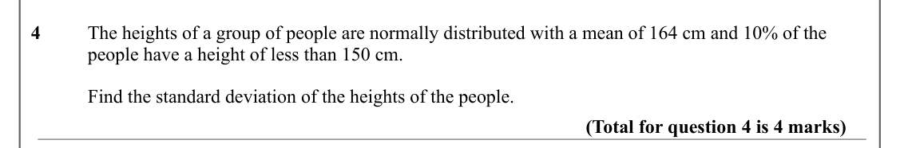

Text (lossy): 4      / The heights of a group of people are normally distributed with a mean of 164 cm and 10% of the  / people have a height of less than 150 cm.  / Find the standard deviation of the heights of the people.  / (Total for question 4 is 4 marks)

## Q5 (4 marks)

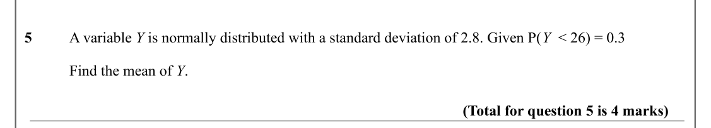

Text (lossy): 5      / A variable Y is normally distributed with a standard deviation of 2.8. Given P(Y  < 26) = 0.3  / Find the mean of Y.  / (Total for question 5 is 4 marks)

## Q6 (6 marks)

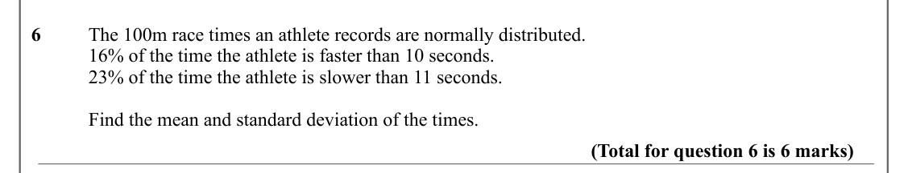

Text (lossy): 6      / The 100m race times an athlete records are normally distributed.  / 16% of the time the athlete is faster than 10 seconds.  / 23% of the time the athlete is slower than 11 seconds.  / Find the mean and standard deviation of the times.  / (Total for question 6 is 6 marks)

## Q7 (6 marks)

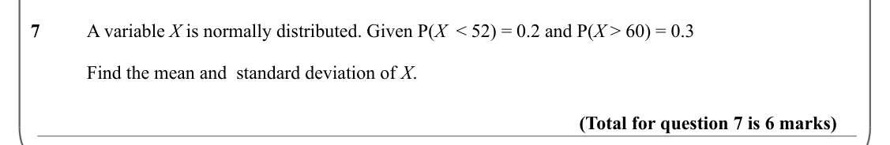

Text (lossy): 7      / A variable X is normally distributed. Given P(X  < 52) = 0.2 and P(X > 60) = 0.3  / Find the mean and  standard deviation of X.  / (Total for question 7 is 6 marks)

## Q8 (6 marks · parts a, b, c)

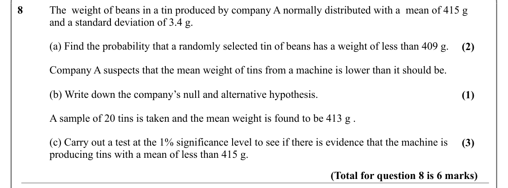

Text (lossy): 8      / The  weight of beans in a tin produced by company A normally distributed with a  mean of 415 g / and a standard deviation of 3.4 g.  / (a) Find the probability that a randomly selected tin of beans has a weight of less than 409 g.  / (2) / Company A suspects that the mean weight of tins from a machine is lower than it should be.  / (b) Write down the company’s null and alternative hypothe

## Q9 (4 marks · parts a, b, c)

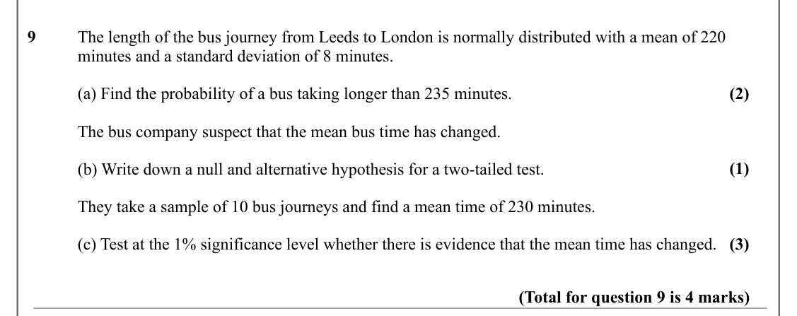

Text (lossy): 9      / The length of the bus journey from Leeds to London is normally distributed with a mean of 220  / minutes and a standard deviation of 8 minutes.  / (2) / (a) Find the probability of a bus taking longer than 235 minutes. / The bus company suspect that the mean bus time has changed.  / (1) / (b) Write down a null and alternative hypothesis for a two-tailed test.   / They take a sample of 10 

## Q10 (8 marks · parts a, b)

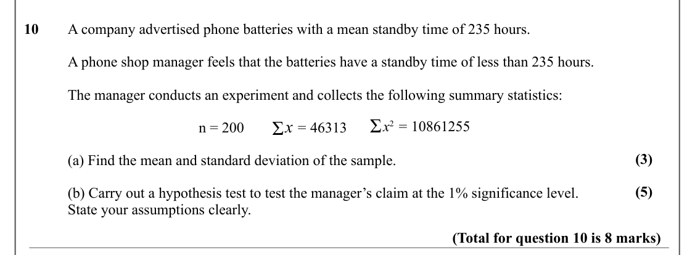

Text (lossy): 10     / A company advertised phone batteries with a mean standby time of 235 hours. / A phone shop manager feels that the batteries have a standby time of less than 235 hours.  / The manager conducts an experiment and collects the following summary statistics: / Ʃ /  x 2 = 10861255 / Ʃ x = 46313 / n = 200 / (3) / (a) Find the mean and standard deviation of the sample.  / (5) / (b) Carry out a hyp

## Q11 (10 marks · parts a, b, c)

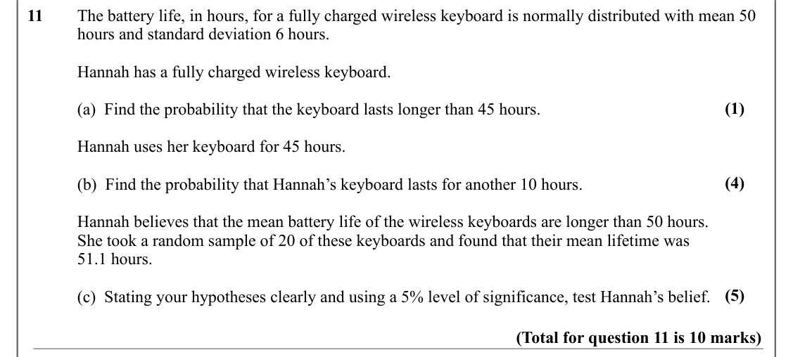

Text (lossy): 11     The battery life, in hours, for a fully charged wireless keyboard is normally distributed with mean 50  / hours and standard deviation 6 hours. / Hannah has a fully charged wireless keyboard.  / (1) / (a)  Find the probability that the keyboard lasts longer than 45 hours.  / Hannah uses her keyboard for 45 hours.  / (4) / (b)  Find the probability that Hannah’s keyboard lasts for another 10

## Q12 (9 marks · parts a, b)

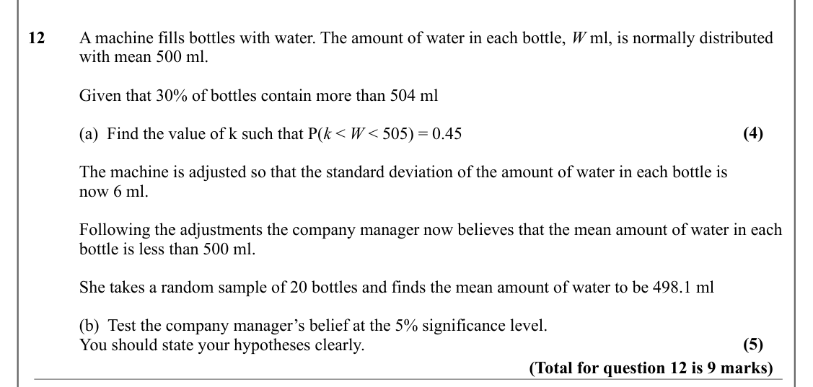

Text (lossy): 12     A machine fills bottles with water. The amount of water in each bottle, W ml, is normally distributed  / with mean 500 ml.  / Given that 30% of bottles contain more than 504 ml / (4) / (a)  Find the value of k such that P(k < W < 505) = 0.45 / The machine is adjusted so that the standard deviation of the amount of water in each bottle is  / now 6 ml. / Following the adjustments the company 

## Q13 (5 marks · parts a, b)

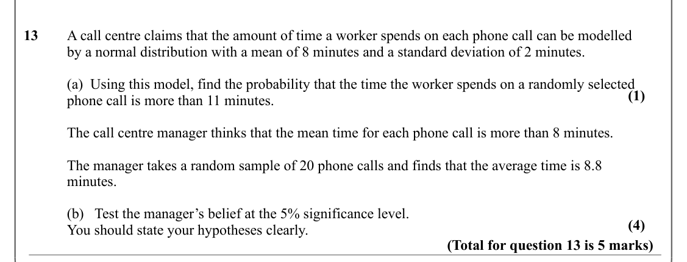

Text (lossy): 13     A call centre claims that the amount of time a worker spends on each phone call can be modelled  / by a normal distribution with a mean of 8 minutes and a standard deviation of 2 minutes.  / (a)  Using this model, find the probability that the time the worker spends on a randomly selected  / (1) / phone call is more than 11 minutes.  / The call centre manager thinks that the mean time for e

