# Constant Acceleration — Question Set (A-Level Maths · Edexcel · Year 1 Mechanics)

Chapter question set · `as-mechanics-1-constant-acceleration` · 17 questions · segmented by printed total lines

## Q1 (10 marks · parts a, b, c, d, e)

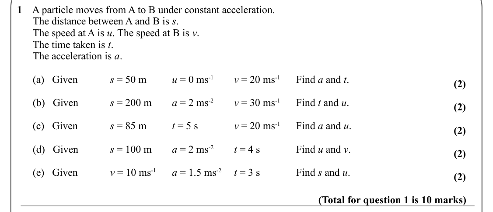

Text (lossy): 1    A particle moves from A to B under constant acceleration.  /       The distance between A and B is s.  /       The speed at A is u. The speed at B is v.  /       The time taken is t.  /       The acceleration is a.  /       (a)   Given  / s = 50 m / u = 0 ms-1 / v = 20 ms-1 / Find a and t.  / (2) /       (b)   Given  / s = 200 m / a = 2 ms-2 / v = 30 ms-1 / Find t and u.  / (2) /       (c)   

## Q2 (6 marks · parts a, b)

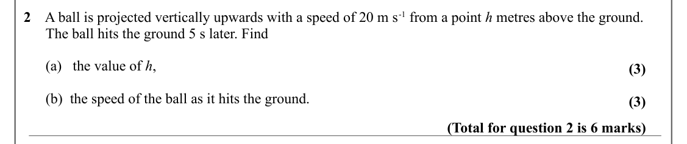

Text (lossy): 2    A ball is projected vertically upwards with a speed of 20 m s-1 from a point h metres above the ground.  /       The ball hits the ground 5 s later. Find /       (a)   the value of h, / (3) /       (b)  the speed of the ball as it hits the ground.  / (3) / (Total for question 2 is 6 marks)

## Q3 (6 marks · parts a, b)

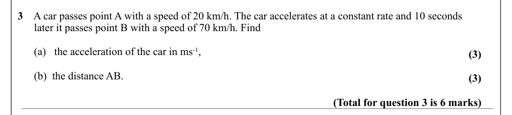

Text (lossy): 3    A car passes point A with a speed of 20 km/h. The car accelerates at a constant rate and 10 seconds  /       later it passes point B with a speed of 70 km/h. Find /       (a)   the acceleration of the car in ms-1, / (3) /       (b)  the distance AB.  / (3) / (Total for question 3 is 6 marks)

## Q4 (6 marks · parts a, b)

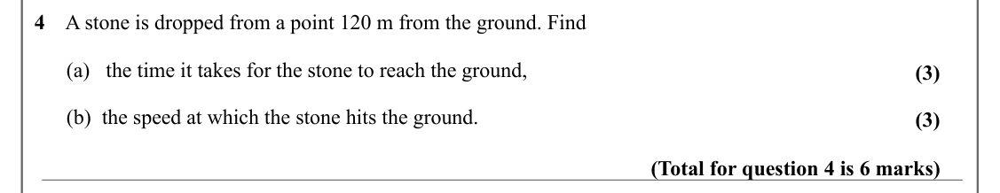

Text (lossy): 4    A stone is dropped from a point 120 m from the ground. Find /       (a)   the time it takes for the stone to reach the ground, / (3) /       (b)  the speed at which the stone hits the ground.  / (3) / (Total for question 4 is 6 marks)

## Q5 (6 marks · parts a, b)

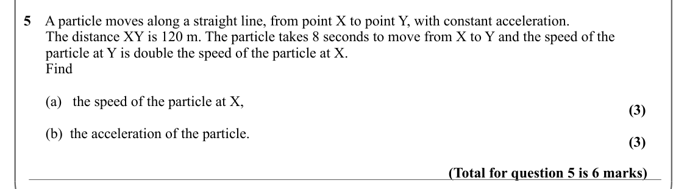

Text (lossy): 5    A particle moves along a straight line, from point X to point Y, with constant acceleration.    /       The distance XY is 120 m. The particle takes 8 seconds to move from X to Y and the speed of the  /       particle at Y is double the speed of the particle at X. /       Find /       (a)   the speed of the particle at X, / (3) /       (b)  the acceleration of the particle.  / (3) / (Total fo

## Q6 (10 marks · parts a, b, c)

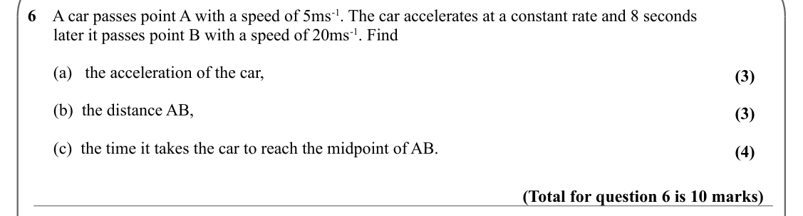

Text (lossy): 6    A car passes point A with a speed of 5ms-1. The car accelerates at a constant rate and 8 seconds  /       later it passes point B with a speed of 20ms-1. Find /       (a)   the acceleration of the car, / (3) /       (b)  the distance AB, / (3) /       (c)  the time it takes the car to reach the midpoint of AB.  / (4) / (Total for question 6 is 10 marks)

## Q7 (9 marks · parts a, b, c)

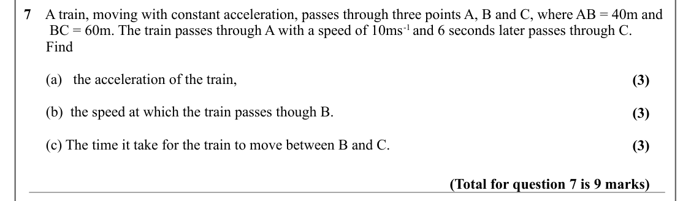

Text (lossy): 7    A train, moving with constant acceleration, passes through three points A, B and C, where AB = 40m and  /        BC = 60m. The train passes through A with a speed of 10ms-1 and 6 seconds later passes through C.  /       Find /       (a)   the acceleration of the train, / (3) /       (b)  the speed at which the train passes though B.  / (3) /       (c) The time it take for the train to move be

## Q8 (9 marks · parts a, b, c)

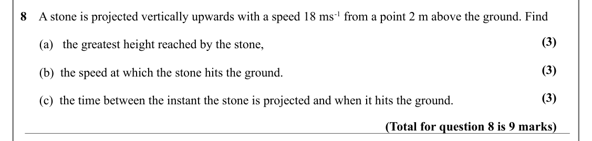

Text (lossy): 8    A stone is projected vertically upwards with a speed 18 ms-1 from a point 2 m above the ground. Find / (3) /       (a)   the greatest height reached by the stone, / (3) /       (b)  the speed at which the stone hits the ground.  / (3) /       (c)  the time between the instant the stone is projected and when it hits the ground.  / (Total for question 8 is 9 marks)

## Q9 (6 marks · parts a, b)

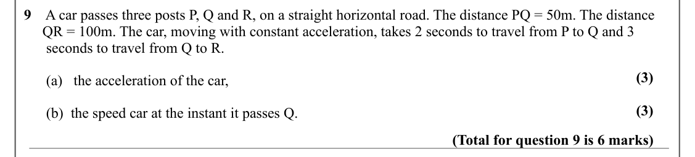

Text (lossy): 9    A car passes three posts P, Q and R, on a straight horizontal road. The distance PQ = 50m. The distance      /      QR = 100m. The car, moving with constant acceleration, takes 2 seconds to travel from P to Q and 3           /       seconds to travel from Q to R.  / (3) /       (a)   the acceleration of the car, / (3) /       (b)  the speed car at the instant it passes Q.  / (Total for questi

## Q10 (6 marks · parts a, b)

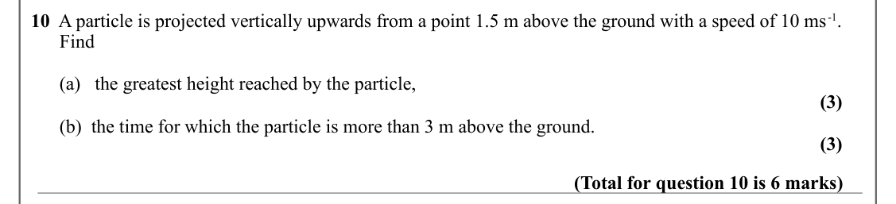

Text (lossy): 10  A particle is projected vertically upwards from a point 1.5 m above the ground with a speed of 10 ms-1. /       Find  /       (a)   the greatest height reached by the particle, / (3) /       (b)  the time for which the particle is more than 3 m above the ground.   / (3) / (Total for question 10 is 6 marks)

## Q11 (7 marks · parts a, b, c)

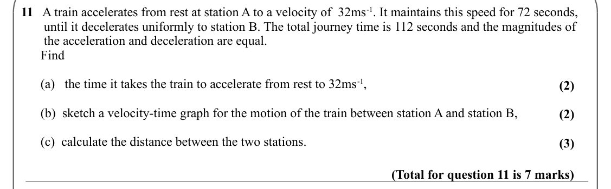

Text (lossy): 11   A train accelerates from rest at station A to a velocity of  32ms-1. It maintains this speed for 72 seconds,     /        until it decelerates uniformly to station B. The total journey time is 112 seconds and the magnitudes of     /        the acceleration and deceleration are equal.  /       Find /       (a)   the time it takes the train to accelerate from rest to 32ms-1, / (2) /       (b)  

## Q12 (6 marks · parts a, b)

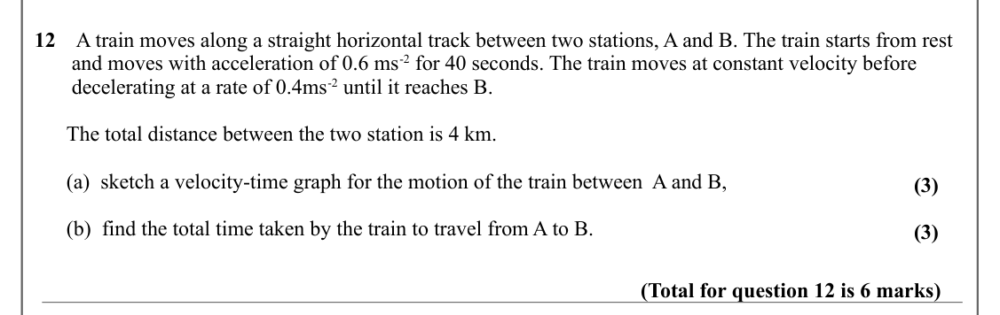

Text (lossy): 12    A train moves along a straight horizontal track between two stations, A and B. The train starts from rest    /        and moves with acceleration of 0.6 ms-2 for 40 seconds. The train moves at constant velocity before          /        decelerating at a rate of 0.4ms-2 until it reaches B.  /       The total distance between the two station is 4 km.  /       (a)  sketch a velocity-time graph 

## Q13 (12 marks · parts a, b, c)

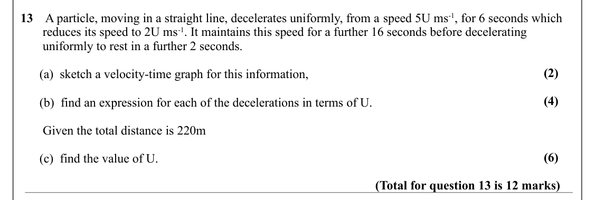

Text (lossy): 13    A particle, moving in a straight line, decelerates uniformly, from a speed 5U ms-1, for 6 seconds which     /        reduces its speed to 2U ms-1. It maintains this speed for a further 16 seconds before decelerating                /        uniformly to rest in a further 2 seconds.  / (2) /       (a)  sketch a velocity-time graph for this information, / (4) /       (b)  find an expression for

## Q14 (9 marks · parts a, b, c)

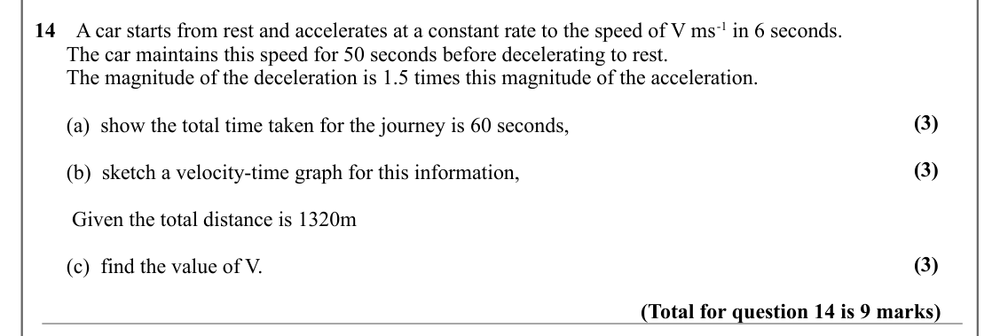

Text (lossy): 14    A car starts from rest and accelerates at a constant rate to the speed of V ms-1 in 6 seconds.  /       The car maintains this speed for 50 seconds before decelerating to rest.  /       The magnitude of the deceleration is 1.5 times this magnitude of the acceleration.  / (3) /       (a)  show the total time taken for the journey is 60 seconds, / (3) /       (b)  sketch a velocity-time graph 

## Q15 (5 marks)

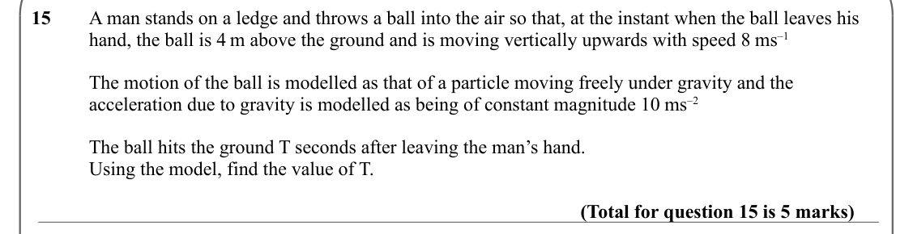

Text (lossy): 15    / A man stands on a ledge and throws a ball into the air so that, at the instant when the ball leaves his  / hand, the ball is 4 m above the ground and is moving vertically upwards with speed 8 ms–1 / The motion of the ball is modelled as that of a particle moving freely under gravity and the  / acceleration due to gravity is modelled as being of constant magnitude 10 ms–2 / The ball hits th

## Q16 (7 marks · parts a, b, c)

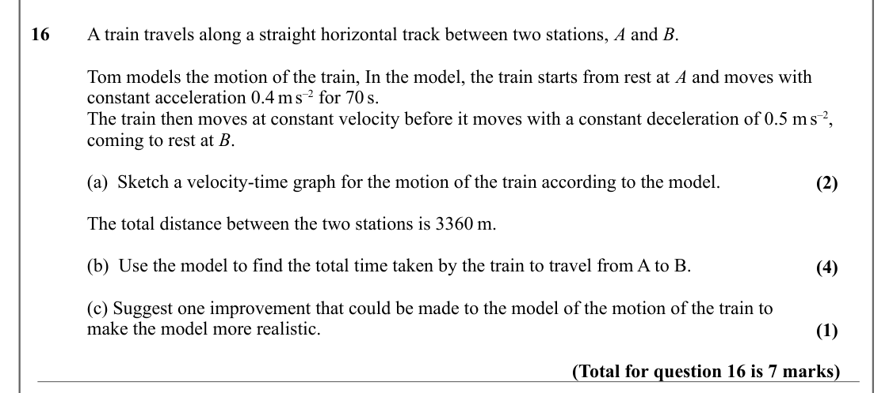

Text (lossy): 16     / A train travels along a straight horizontal track between two stations, A and B. / Tom models the motion of the train, In the model, the train starts from rest at A and moves with / constant acceleration 0.4 m s–2 for 70 s.   / The train then moves at constant velocity before it moves with a constant deceleration of 0.5 m s–2,  / coming to rest at B. / (a)  Sketch a velocity-time graph fo

## Q17 (8 marks · parts a, b, c, d, e)

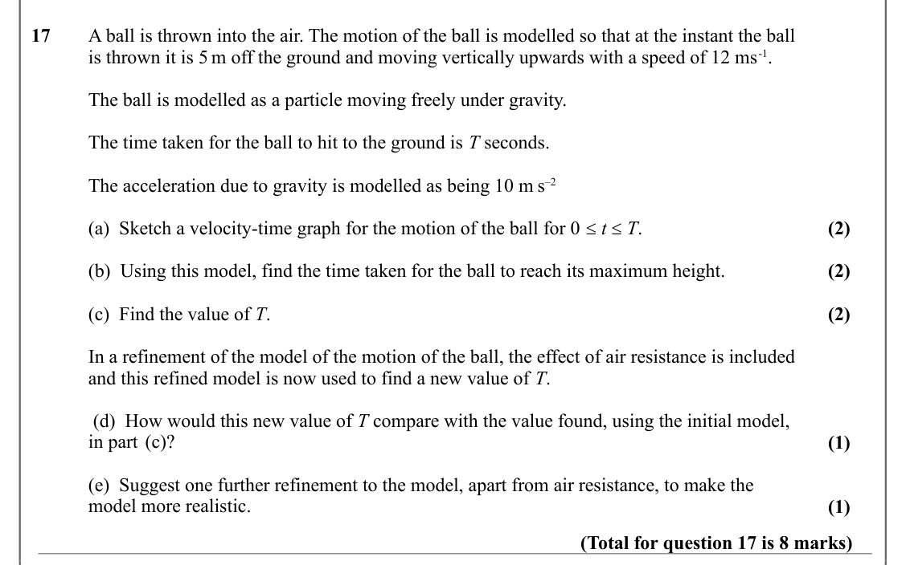

Text (lossy): 17     / A ball is thrown into the air. The motion of the ball is modelled so that at the instant the ball  / is thrown it is 5 m off the ground and moving vertically upwards with a speed of 12 ms-1.  / The ball is modelled as a particle moving freely under gravity.  / The time taken for the ball to hit to the ground is T seconds. / The acceleration due to gravity is modelled as being 10 m s–2  / 

