# Forces and Motion — Question Set (A-Level Maths · Edexcel · Year 1 Mechanics)

Chapter question set · `as-mechanics-2-forces-and-motion` · 15 questions · segmented by printed total lines

## Q1 (11 marks · parts a, b, c)

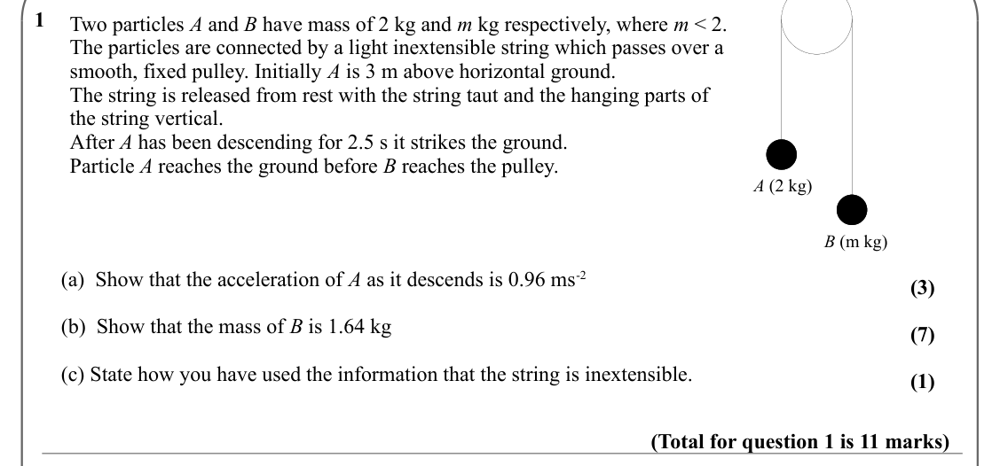

Text (lossy): 1     / Two particles A and B have mass of 2 kg and m kg respectively, where m < 2.  / The particles are connected by a light inextensible string which passes over a  / smooth, fixed pulley. Initially A is 3 m above horizontal ground.  / The string is released from rest with the string taut and the hanging parts of  / the string vertical.  / After A has been descending for 2.5 s it strikes the gro

## Q2 (9 marks · parts a, b)

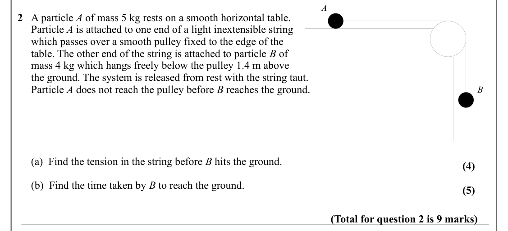

Text (lossy): A  / 2   A particle A of mass 5 kg rests on a smooth horizontal table.  /      Particle A is attached to one end of a light inextensible string  /      which passes over a smooth pulley fixed to the edge of the  /      table. The other end of the string is attached to particle B of  /      mass 4 kg which hangs freely below the pulley 1.4 m above  /      the ground. The system is released from res

## Q3 (13 marks · parts a, b, c)

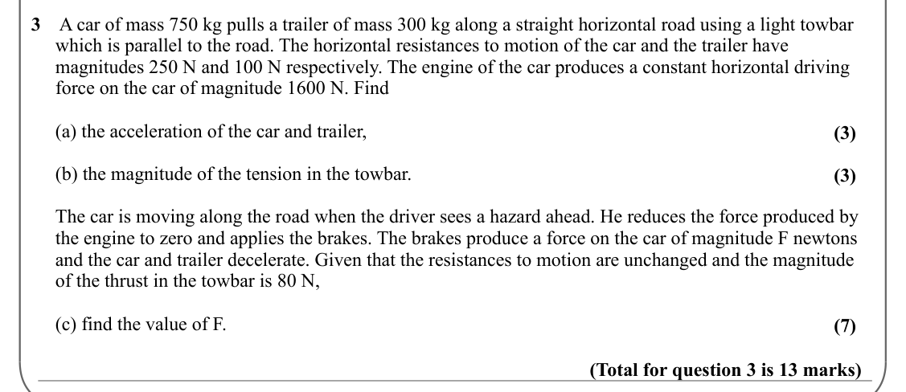

Text (lossy): 3    A car of mass 750 kg pulls a trailer of mass 300 kg along a straight horizontal road using a light towbar      /      which is parallel to the road. The horizontal resistances to motion of the car and the trailer have                   /      magnitudes 250 N and 100 N respectively. The engine of the car produces a constant horizontal driving      /      force on the car of magnitude 1600 N. 

## Q4 (13 marks · parts a, b, c, d)

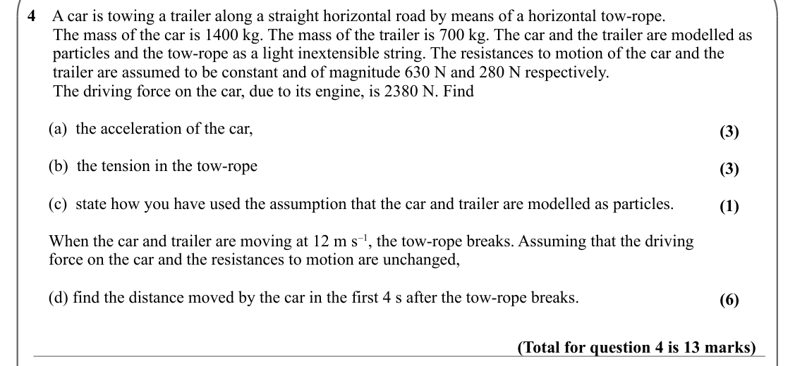

Text (lossy): 4    A car is towing a trailer along a straight horizontal road by means of a horizontal tow-rope.  /       The mass of the car is 1400 kg. The mass of the trailer is 700 kg. The car and the trailer are modelled as     /       particles and the tow-rope as a light inextensible string. The resistances to motion of the car and the           /       trailer are assumed to be constant and of magnitude

## Q5 (15 marks · parts a, b, c, d, e)

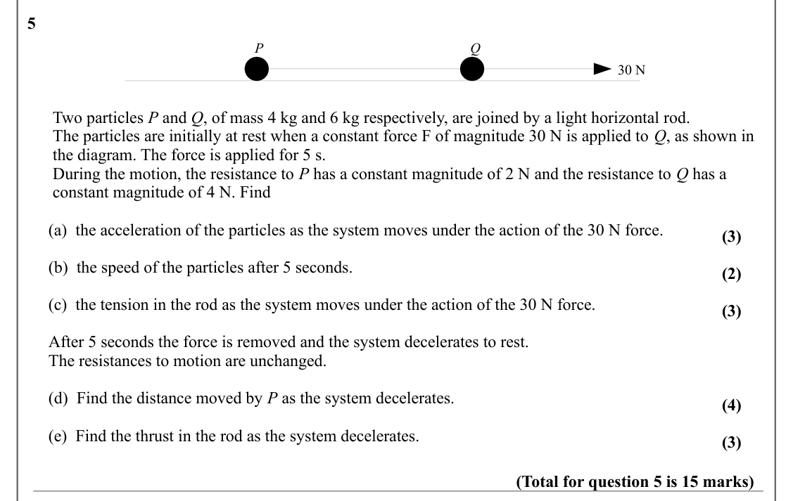

Text (lossy): 5 / P / Q / 30 N /       Two particles P and Q, of mass 4 kg and 6 kg respectively, are joined by a light horizontal rod.  /       The particles are initially at rest when a constant force F of magnitude 30 N is applied to Q, as shown in    /       the diagram. The force is applied for 5 s.  /       During the motion, the resistance to P has a constant magnitude of 2 N and the resistance to Q has 

## Q6 (4 marks)

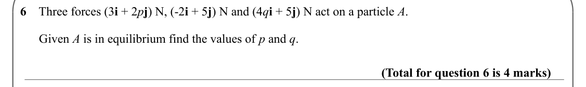

Text (lossy): 6    Three forces (3 i + 2 p j) N, (-2 i + 5 j) N and (4 q i + 5 j) N act on a particle A.  /       Given A is in equilibrium find the values of p and q.  / (Total for question 6 is 4 marks)

## Q7 (5 marks · parts a, b)

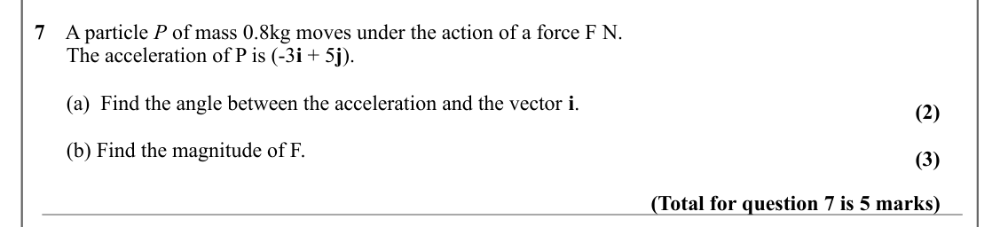

Text (lossy): 7    A particle P of mass 0.8kg moves under the action of a force F N.  /       The acceleration of P is (-3 i + 5 j).  /       (a)  Find the angle between the acceleration and the vector i.  / (2) /       (b) Find the magnitude of F. / (3) / (Total for question 7 is 5 marks)

## Q8 (6 marks · parts a, b)

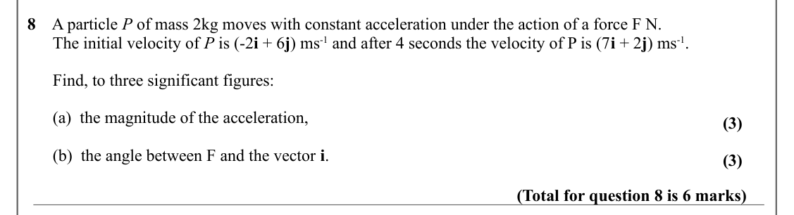

Text (lossy): 8    A particle P of mass 2kg moves with constant acceleration under the action of a force F N.  /       The initial velocity of P is (-2 i + 6 j) ms-1 and after 4 seconds the velocity of P is (7 i + 2 j) ms-1.  /       Find, to three significant figures: /       (a)  the magnitude of the acceleration, / (3) /       (b)  the angle between F and the vector i.  / (3) / (Total for question 8 is 6 mar

## Q9 (5 marks)

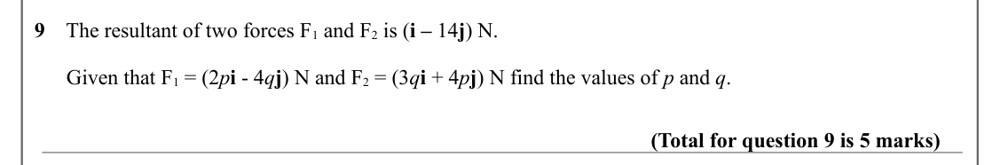

Text (lossy): 9    The resultant of two forces F 1 and F 2 is (i – 14 j) N.   /       Given that F 1 = (2 p i - 4 q j) N and F 2 = (3 q i + 4 p j) N find the values of p and q.  / (Total for question 9 is 5 marks)

## Q10 (5 marks · parts a, b)

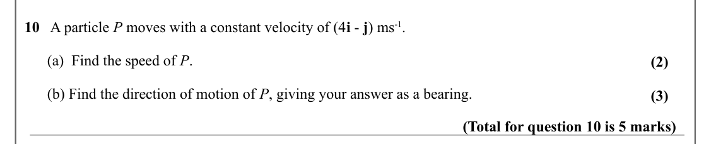

Text (lossy): 10   A particle P moves with a constant velocity of (4 i - j) ms-1.  /       (a)  Find the speed of P.  / (2) /       (b) Find the direction of motion of P, giving your answer as a bearing. / (3) / (Total for question 10 is 5 marks)

## Q11 (5 marks)

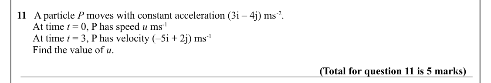

Text (lossy): 11   A particle P moves with constant acceleration (3i – 4j) ms-2.   /       At time t = 0, P has speed u ms-1 /       At time t = 3, P has velocity (–5i + 2j) ms-1 /       Find the value of u.  / (Total for question 11 is 5 marks)

## Q12 (5 marks)

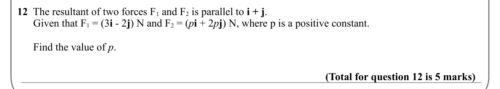

Text (lossy): 12  The resultant of two forces F 1 and F 2 is parallel to i + j. /       Given that F 1 = (3 i - 2 j) N and F 2 = (p i + 2 p j) N, where p is a positive constant.  /       Find the value of p.  / (Total for question 12 is 5 marks)

## Q13 (7 marks · parts a, b, c)

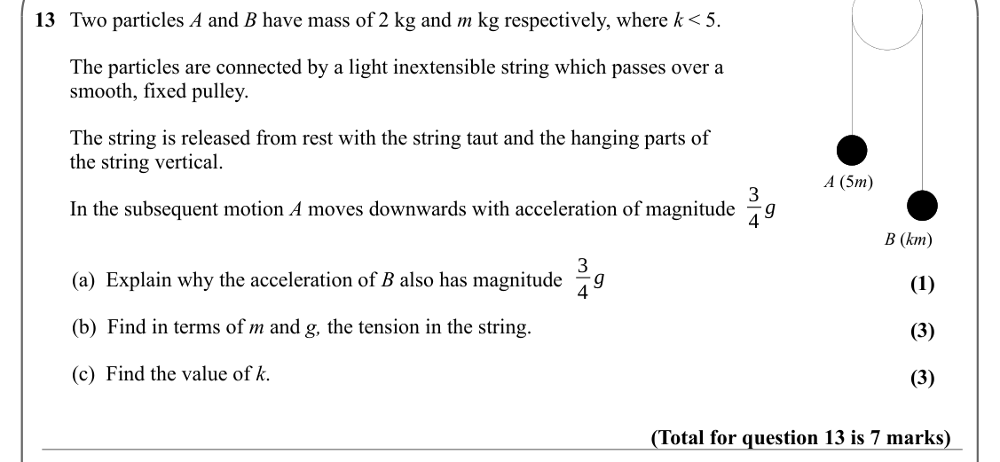

Text (lossy): 13     / Two particles A and B have mass of 2 kg and m kg respectively, where k < 5. / The particles are connected by a light inextensible string which passes over a  / smooth, fixed pulley. / The string is released from rest with the string taut and the hanging parts of  / the string vertical.  / A (5 m) / 3 / 4 g / In the subsequent motion A moves downwards with acceleration of magnitude / B (km

## Q14 (11 marks · parts a, b, c)

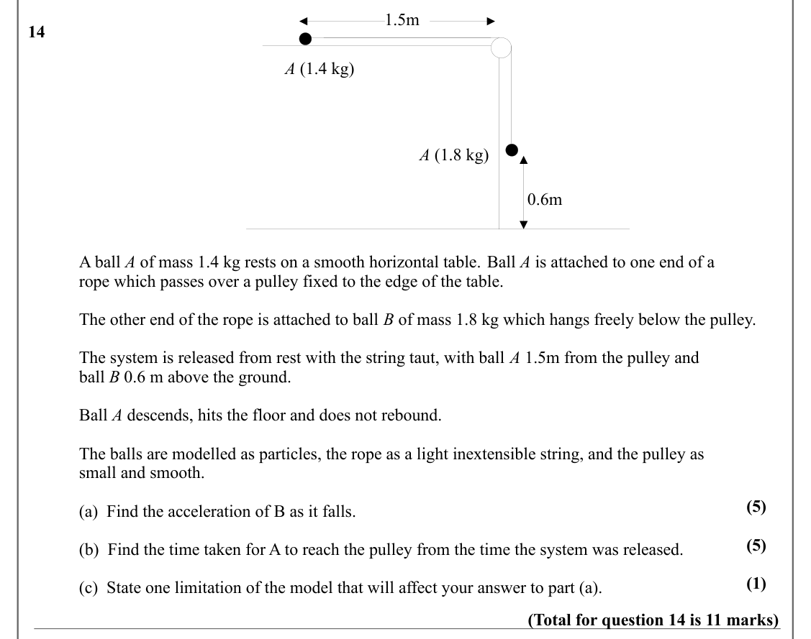

Text (lossy): 1.5m / 14   / A (1.4 kg) / A (1.8 kg) / 0.6m / A ball A of mass 1.4 kg rests on a smooth horizontal table. Ball A is attached to one end of a  / rope which passes over a pulley fixed to the edge of the table.  / The other end of the rope is attached to ball B of mass 1.8 kg which hangs freely below the pulley.  / The system is released from rest with the string taut, with ball A 1.5m from the pull

## Q15 (9 marks · parts a, b)

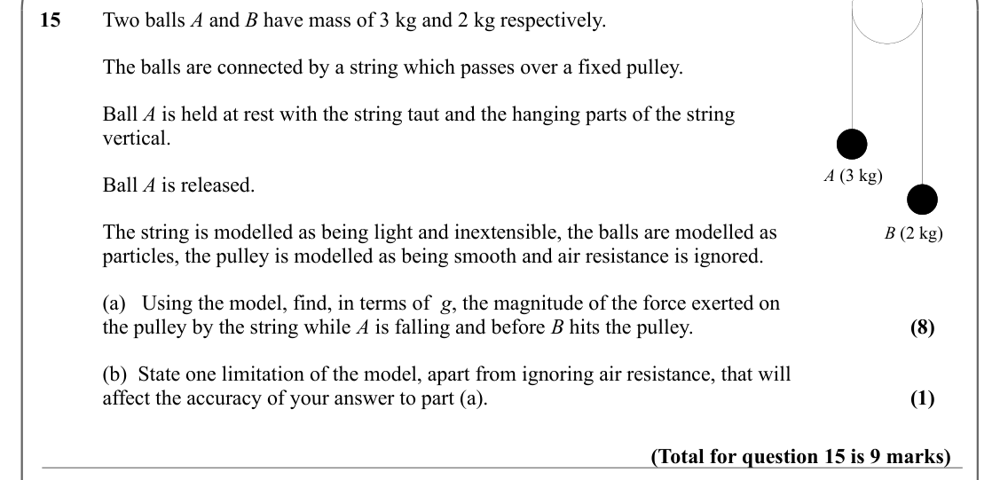

Text (lossy): 15 / Two balls A and B have mass of 3 kg and 2 kg respectively. / The balls are connected by a string which passes over a fixed pulley. / Ball A is held at rest with the string taut and the hanging parts of the string  / vertical.  / A (3 kg) / Ball A is released.  / The string is modelled as being light and inextensible, the balls are modelled as  / B (2 kg) / particles, the pulley is modelled as

