# Variable Acceleration — Question Set (A-Level Maths · Edexcel · Year 1 Mechanics)

Chapter question set · `as-mechanics-3-variable-acceleration` · 16 questions · segmented by printed total lines

## Q1 (10 marks · parts a, b)

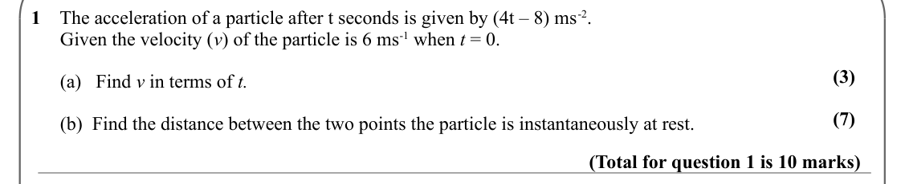

Text (lossy): 1    The acceleration of a particle after t seconds is given by (4t – 8) ms-2.  /       Given the velocity (v) of the particle is 6 ms-1 when t = 0.  / (3) /       (a)   Find v in terms of t. / (7) /       (b)  Find the distance between the two points the particle is instantaneously at rest. / (Total for question 1 is 10 marks)

## Q2 (5 marks · parts a, b)

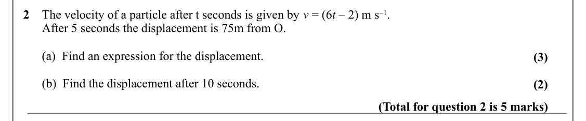

Text (lossy): 2    The velocity of a particle after t seconds is given by v = (6 t – 2) m s1. /       After 5 seconds the displacement is 75m from O.  /       (a)  Find an expression for the displacement.  / (3) /       (b)  Find the displacement after 10 seconds.  / (2) / (Total for question 2 is 5 marks)

## Q3 (8 marks · parts a, b)

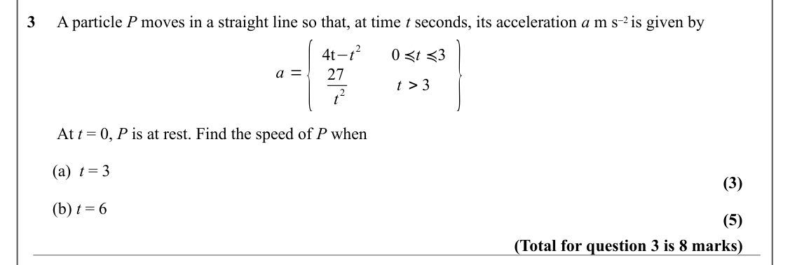

Text (lossy): 3     A particle P moves in a straight line so that, at time t seconds, its acceleration a m s2 is given by / t > 3 } / a ={ / 2 / 4t−t / 0 ≼t ≼3 / 27 / 2 / t /        At t = 0, P is at rest. Find the speed of P when /       (a)  t = 3  / (3) /       (b) t = 6 / (5) / (Total for question 3 is 8 marks)

## Q4 (10 marks · parts a, b)

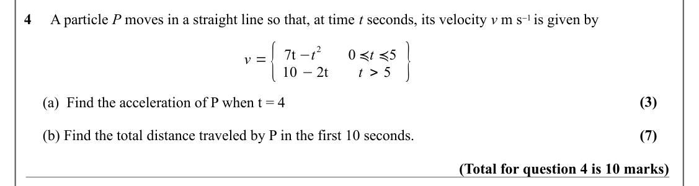

Text (lossy): 4     A particle P moves in a straight line so that, at time t seconds, its velocity v m s1 is given by / v ={ / t > 5 } / 2 / 7t −t / 0 ≼t ≼5 / 10 −2t / (3) /      (a)  Find the acceleration of P when t = 4 / (7) /      (b) Find the total distance traveled by P in the first 10 seconds.   / (Total for question 4 is 10 marks)

## Q5 (3 marks)

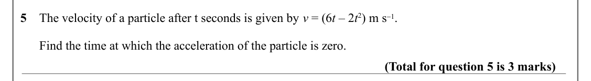

Text (lossy): 5    The velocity of a particle after t seconds is given by v = (6 t – 2 t 2) m s1. /       Find the time at which the acceleration of the particle is zero. / (Total for question 5 is 3 marks)

## Q6 (6 marks · parts a, b)

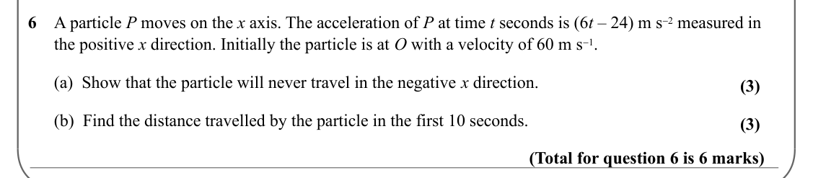

Text (lossy): 6    A particle P moves on the x axis. The acceleration of P at time t seconds is (6 t – 24) m s2 measured in       /       the positive x direction. Initially the particle is at O with a velocity of 60 m s1. /       (a)  Show that the particle will never travel in the negative x direction.  / (3) /       (b)  Find the distance travelled by the particle in the first 10 seconds.  / (3) / (Total f

## Q7 (8 marks · parts a, b, c)

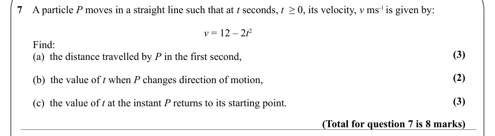

Text (lossy): 7    A particle P moves in a straight line such that at t seconds, t  ≥ 0, its velocity, v ms-1 is given by: / v = 12 – 2 t 2 /       Find: / (3) /       (a)  the distance travelled by P in the first second, / (2) /       (b)  the value of t when P changes direction of motion, / (3) /       (c)  the value of t at the instant P returns to its starting point.  / (Total for question 7 is 8 marks)

## Q8 (5 marks · parts a, b)

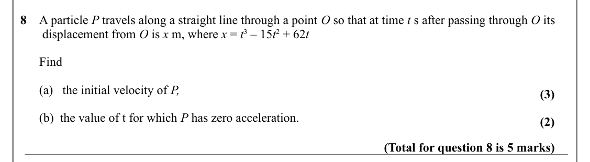

Text (lossy): 8    A particle P travels along a straight line through a point O so that at time t s after passing through O its      /        displacement from O is x m, where x = t 3 – 15 t 2 + 62 t /       Find /       (a)   the initial velocity of P, / (3) /       (b)  the value of t for which P has zero acceleration. / (2) / (Total for question 8 is 5 marks)

## Q9 (8 marks · parts a, b)

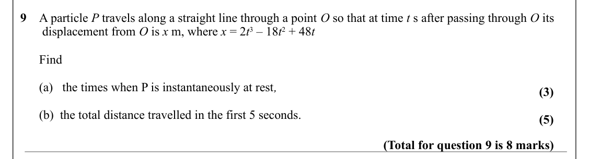

Text (lossy): 9    A particle P travels along a straight line through a point O so that at time t s after passing through O its      /        displacement from O is x m, where x = 2 t 3 – 18 t 2 + 48 t /       Find /       (a)   the times when P is instantaneously at rest, / (3) /       (b)  the total distance travelled in the first 5 seconds. / (5) / (Total for question 9 is 8 marks)

## Q10 (6 marks)

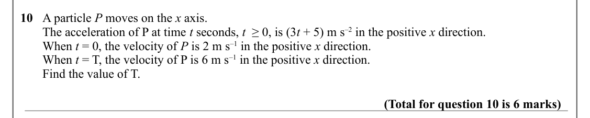

Text (lossy): 10   A particle P moves on the x axis.  /        The acceleration of P at time t seconds, t  ≥ 0, is (3 t + 5) m s–2 in the positive x direction.  /        When t = 0, the velocity of P is 2 m s–1 in the positive x direction.  /        When t = T, the velocity of P is 6 m s–1 in the positive x direction. /        Find the value of T. / (Total for question 10 is 6 marks)

## Q11 (8 marks)

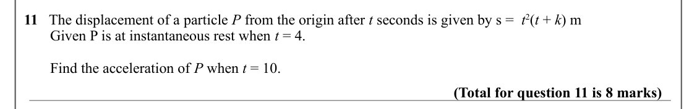

Text (lossy): 11   The displacement of a particle P from the origin after t seconds is given by s =  t 2(t + k) m /        Given P is at instantaneous rest when t = 4.  /        Find the acceleration of P when t = 10.  / (Total for question 11 is 8 marks)

## Q12 (5 marks)

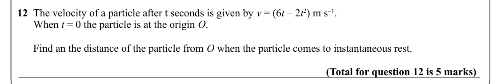

Text (lossy): 12  The velocity of a particle after t seconds is given by v = (6 t – 2 t 2) m s1. /       When t = 0 the particle is at the origin O.  /       Find an the distance of the particle from O when the particle comes to instantaneous rest. / (Total for question 12 is 5 marks)

## Q13 (8 marks · parts a, b)

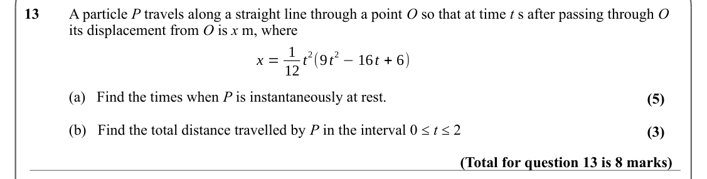

Text (lossy): 13 / A particle P travels along a straight line through a point O so that at time t s after passing through O  / its displacement from O is x m, where / x = 1 / 2 −16 t + 6) / 2(9 t / 12 t / (a)   Find the times when P is instantaneously at rest. / (5) / (b)   Find the total distance travelled by P in the interval 0 ≤ t ≤ 2 / (3) / (Total for question 13 is 8 marks)

## Q14 (9 marks · parts a, b, c)

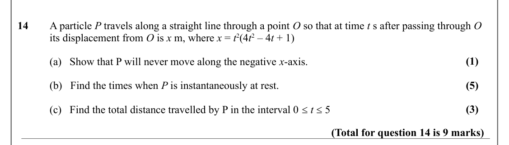

Text (lossy): 14 / A particle P travels along a straight line through a point O so that at time t s after passing through O  / its displacement from O is x m, where x = t 2(4 t 2 – 4 t + 1) / (1) / (a)   Show that P will never move along the negative x-axis. / (5) / (b)   Find the times when P is instantaneously at rest. / (3) / (c)   Find the total distance travelled by P in the interval 0 ≤ t ≤ 5 / (Total for

## Q15 (8 marks · parts a, b)

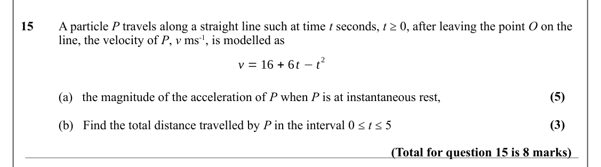

Text (lossy): 15 / A particle P travels along a straight line such at time t seconds, t ≥ 0, after leaving the point O on the  / line, the velocity of P, v ms-1, is modelled as / 2 / v = 16 + 6 t −t / (5) / (a)   the magnitude of the acceleration of P when P is at instantaneous rest, / (3) / (b)   Find the total distance travelled by P in the interval 0 ≤ t ≤ 5 / (Total for question 15 is 8 marks)

## Q16 (9 marks · parts a, b)

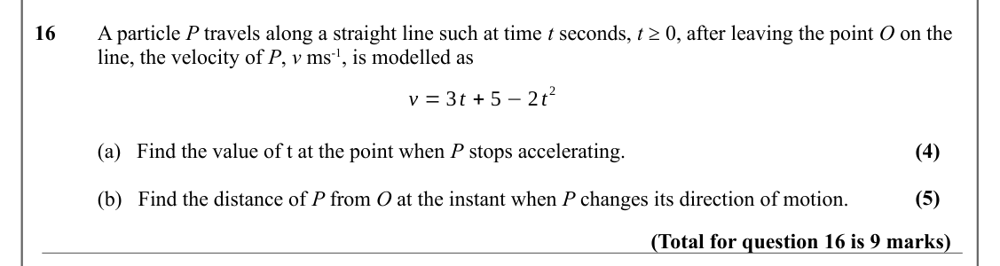

Text (lossy): 16 / A particle P travels along a straight line such at time t seconds, t ≥ 0, after leaving the point O on the  / line, the velocity of P, v ms-1, is modelled as / 2 / v = 3 t + 5 −2 t / (4) / (a)   Find the value of t at the point when P stops accelerating.  / (5) / (b)   Find the distance of P from O at the instant when P changes its direction of motion.  / (Total for question 16 is 9 marks)

