# Algebraic Expressions — Question Set (A-Level Maths · Edexcel · Year 1 Pure Mathematics)

Chapter question set · `as-pure-mathematics-1-algebraic-expressions` · 31 questions · segmented by printed total lines

## Q1 (2 marks)

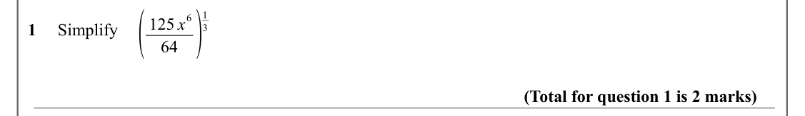

Text (lossy): ( / 64 ) / 1 / 6 / 125 x / 1     Simplify / 3 / (Total for question 1 is 2 marks)

## Q2 (2 marks)

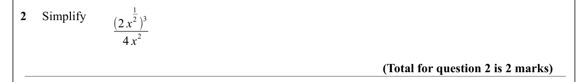

Text (lossy): 1 / 2     Simplify / 2 ) / 3 / (2 x / 2 / 4 x / (Total for question 2 is 2 marks)

## Q3 (2 marks)

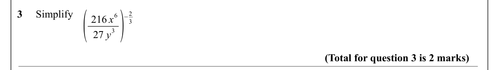

Text (lossy): 3 ) / ( / 3     Simplify / −2 / 6 / 216 x / 3 / 27 y / (Total for question 3 is 2 marks)

## Q4 (2 marks)

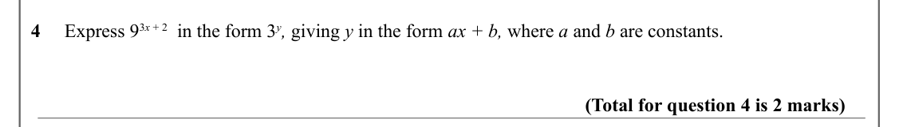

Text (lossy): 4     Express 9 3 x + 2  in the form 3 y, giving y in the form ax + b, where a and b are constants. / (Total for question 4 is 2 marks)

## Q5 (2 marks)

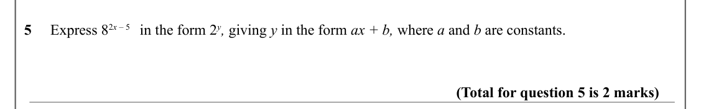

Text (lossy): 5     Express 8 2 x – 5   in the form 2 y, giving y in the form ax + b, where a and b are constants. / (Total for question 5 is 2 marks)

## Q6 (5 marks · parts a, b)

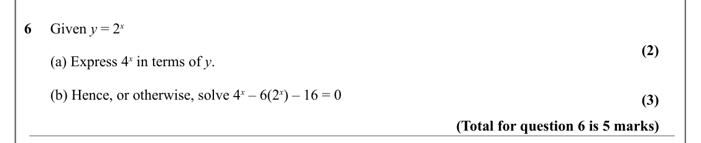

Text (lossy): 6     Given y = 2 x  / (2) /        (a) Express 4 x in terms of y. /        (b) Hence, or otherwise, solve 4 x – 6(2 x) – 16 = 0  / (3) / (Total for question 6 is 5 marks)

## Q7 (5 marks)

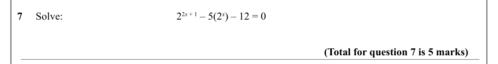

Text (lossy): 7     Solve:  /  2 2 x + 1 – 5(2 x) – 12 = 0  / (Total for question 7 is 5 marks)

## Q8 (3 marks)

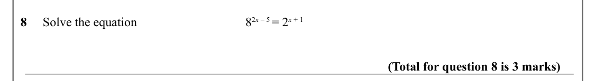

Text (lossy): 8     Solve the equation / 8 2 x – 5 = 2 x + 1  / (Total for question 8 is 3 marks)

## Q9 (4 marks · parts b)

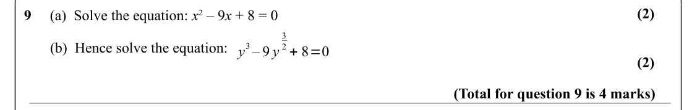

Text (lossy): (2) / 9     (a)  Solve the equation: x 2 – 9 x + 8 = 0  / 3 / 2 + 8=0 /        (b)  Hence solve the equation:  y / 3– 9 y / (2) / (Total for question 9 is 4 marks)

## Q10 (3 marks)

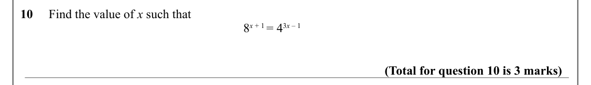

Text (lossy): 10     Find the value of x such that / 8 x + 1 = 4 3 x – 1   / (Total for question 10 is 3 marks)

## Q11 (2 marks)

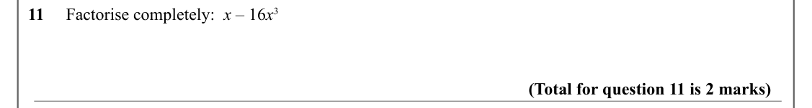

Text (lossy): 11     Factorise completely:  x – 16 x 3 / (Total for question 11 is 2 marks)

## Q12 (2 marks)

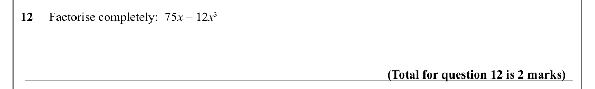

Text (lossy): 12     Factorise completely:  75 x – 12 x 3 / (Total for question 12 is 2 marks)

## Q13 (2 marks)

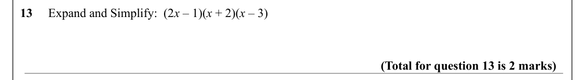

Text (lossy): 13     Expand and Simplify:  (2 x – 1)(x + 2)(x – 3) / (Total for question 13 is 2 marks)

## Q14 (2 marks)

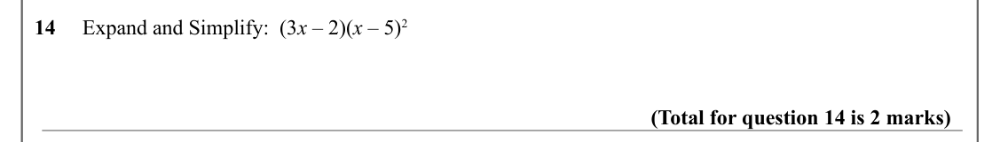

Text (lossy): 14     Expand and Simplify:  (3 x – 2)(x – 5)2 / (Total for question 14 is 2 marks)

## Q15 (4 marks)

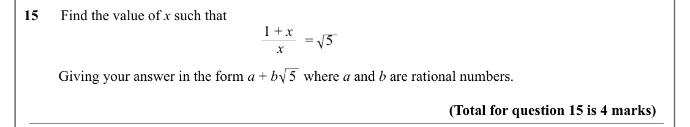

Text (lossy): 15      Find the value of x such that / 1 + x / = / 5 / x / Giving your answer in the form a + b   5  where a and b are rational numbers.   / (Total for question 15 is 4 marks)

## Q16 (3 marks)

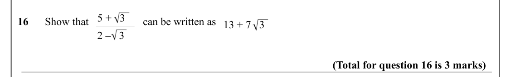

Text (lossy): 5 +   3 / 16      Show that                    can be written as   / 13 + 7   3 / 2 –   3   / (Total for question 16 is 3 marks)

## Q17 (3 marks)

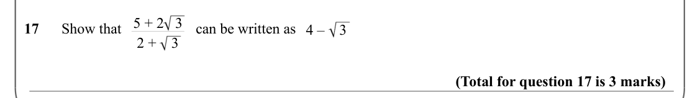

Text (lossy): 5 + 2   3 / 17      Show that                    can be written as   / 4 –    3 / 2 +    3 / (Total for question 17 is 3 marks)

## Q18 (3 marks)

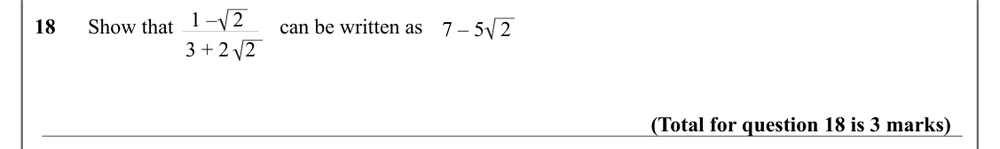

Text (lossy): 1 –   2 / 18      Show that                    can be written as   / 7 – 5   2 / 3 + 2   2 / (Total for question 18 is 3 marks)

## Q19 (1 marks)

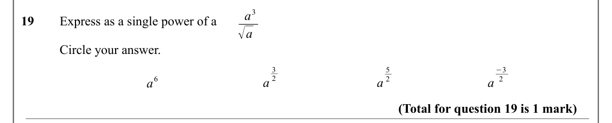

Text (lossy): a 3 / 19       Express as a single power of a         / √a / Circle your answer.  / 3 / −3 / 5 / 2 / 2 / 2 / a 6 / a / a / a / (Total for question 19 is 1 mark)

## Q20 (1 marks)

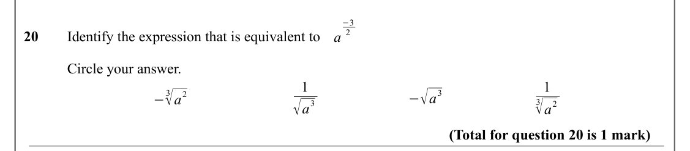

Text (lossy): −3 / 2 / 20       Identify the expression that is equivalent to        / a / Circle your answer.  / 1 / 1 / −√a / 3√a / 3 / 2 / − / 3√a / √a / 3 / 2 / (Total for question 20 is 1 mark)

## Q21 (3 marks)

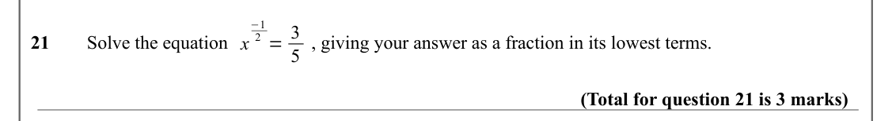

Text (lossy): −1 / 2 = 3 / 21    / Solve the equation  / , giving your answer as a fraction in its lowest terms. / x / 5 / (Total for question 21 is 3 marks)

## Q22 (3 marks)

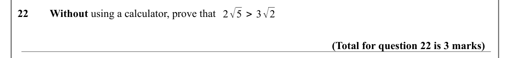

Text (lossy): 2√5 > 3√2 / 22     / Without using a calculator, prove that  / (Total for question 22 is 3 marks)

## Q23 (3 marks)

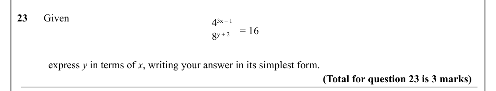

Text (lossy): 23      Given / 4 3x – 1 / = 16 / 8 y + 2 / express y in terms of x, writing your answer in its simplest form. / (Total for question 23 is 3 marks)

## Q24 (4 marks)

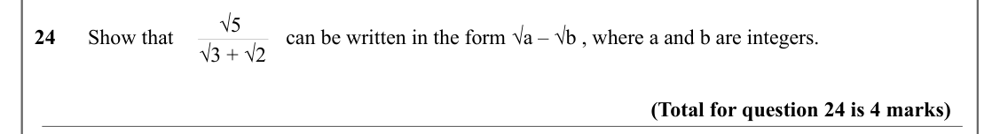

Text (lossy): √5 / 24      Show that  / can be written in the form √a – √b , where a and b are integers.   / √3 + √2 / (Total for question 24 is 4 marks)

## Q25 (2 marks)

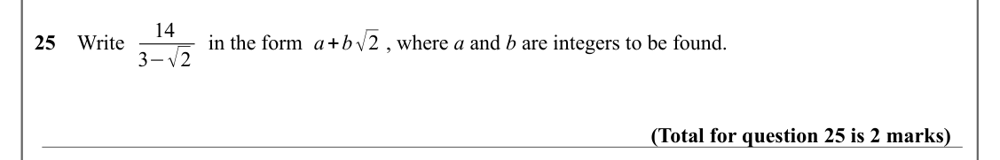

Text (lossy): 14 / a+b√2 / 25    Write /          in the form /        , where a and b are integers to be found. / 3−√2 / (Total for question 25 is 2 marks)

## Q26 (5 marks · parts i, ii)

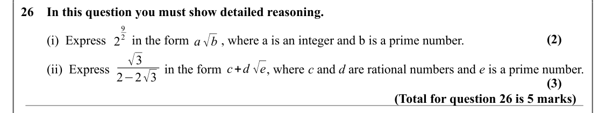

Text (lossy): 26    In this question you must show detailed reasoning. / 9 / a √b / (2) / 2 /         (i)  Express        in the form          , where a is an integer and b is a prime number. / 2 / √3 / c+d √e /         (ii)  Express                 in the form              , where c and d are rational numbers and e is a prime number. / 2−2√3 / (3) / (Total for question 26 is 5 marks)

## Q27 (3 marks)

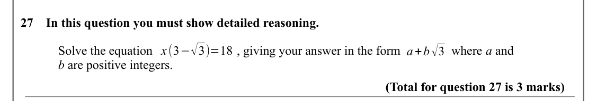

Text (lossy): 27    In this question you must show detailed reasoning. / x(3−√3)=18 / a+b√3 / Solve the equation /          , giving your answer in the form                where a and  / b are positive integers. / (Total for question 27 is 3 marks)

## Q28 (7 marks · parts i, ii)

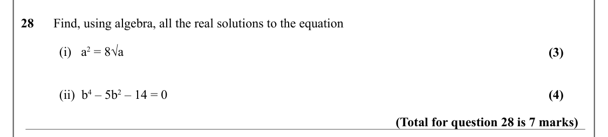

Text (lossy): 28      Find, using algebra, all the real solutions to the equation / (i)   a 2 = 8√a / (3) / (ii)  b 4 – 5b 2 – 14 = 0 / (4) / (Total for question 28 is 7 marks)

## Q29 (4 marks)

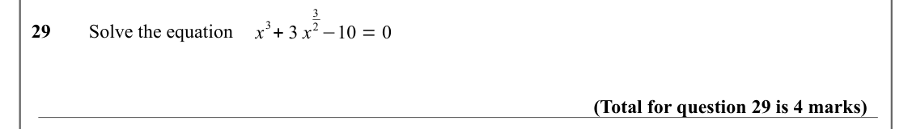

Text (lossy): 3 / 3+ 3 x / 2−10 = 0 / 29     / Solve the equation / x / (Total for question 29 is 4 marks)

## Q30 (6 marks · parts ii)

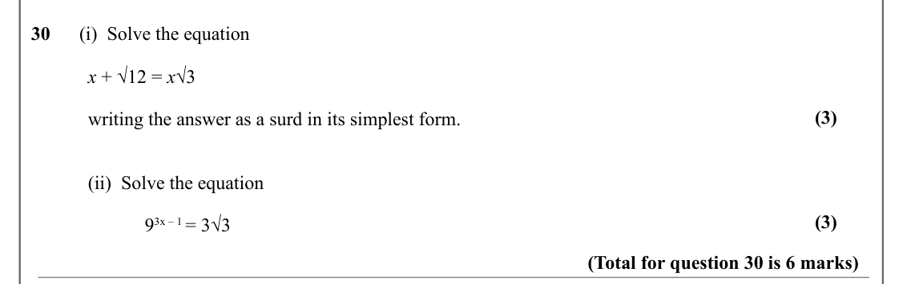

Text (lossy): 30      (i)  Solve the equation / x + √12 = x√3 / (3) / writing the answer as a surd in its simplest form.  / (ii)  Solve the equation / (3) / 9 3x – 1 = 3√3 / (Total for question 30 is 6 marks)

## Q31 (4 marks)

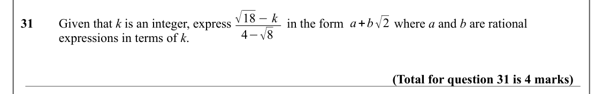

Text (lossy): √18 −k / a+b√2 / 31     / Given that k is an integer, express /             in the form  /           where a and b are rational / 4−√8 / expressions in terms of k. / (Total for question 31 is 4 marks)

