# Trigonometric Identities and Equations — Question Set (A-Level Maths · Edexcel · Year 1 Pure Mathematics)

Chapter question set · `as-pure-mathematics-10-trigonometric-identities-and-equations` · 30 questions · segmented by printed total lines

## Q1 (5 marks)

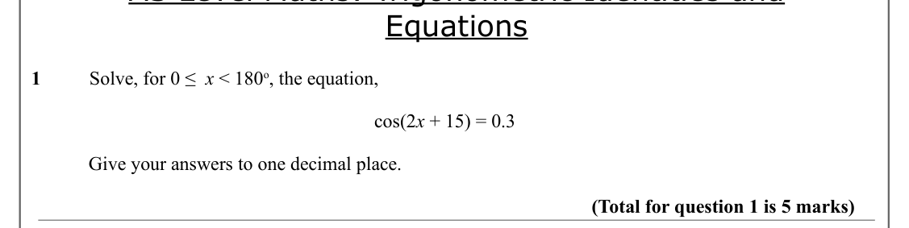

Text (lossy): Equations / 1          Solve, for 0 ≤  x < 180 o, the equation, / cos(2 x + 15) = 0.3 / Give your answers to one decimal place.  / (Total for question 1 is 5 marks)

## Q2 (5 marks)

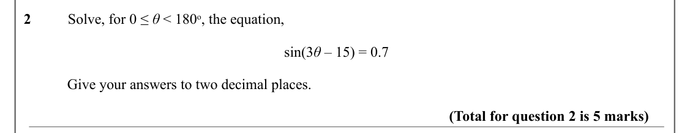

Text (lossy): 2          Solve, for 0 ≤ θ < 180 o, the equation, / sin(3 θ – 15) = 0.7 / Give your answers to two decimal places.  / (Total for question 2 is 5 marks)

## Q3 (4 marks)

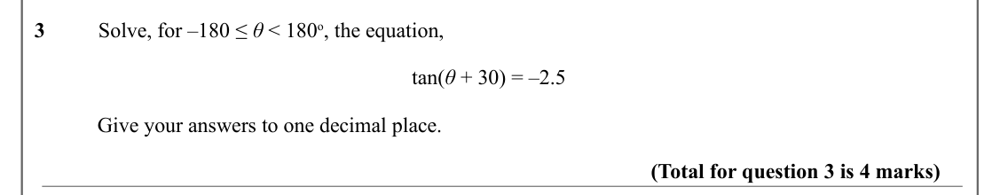

Text (lossy): 3          Solve, for –180 ≤ θ < 180 o, the equation, / tan(θ + 30) = –2.5 / Give your answers to one decimal place.  / (Total for question 3 is 4 marks)

## Q4 (4 marks)

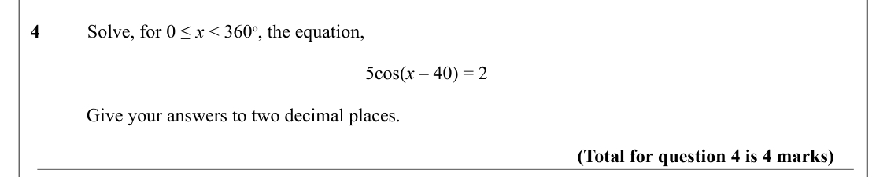

Text (lossy): 4          Solve, for 0 ≤ x < 360 o, the equation, / 5cos(x – 40) = 2 / Give your answers to two decimal places.  / (Total for question 4 is 4 marks)

## Q5 (5 marks)

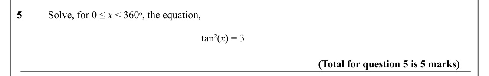

Text (lossy): 5          Solve, for 0 ≤ x < 360 o, the equation, / tan 2(x) = 3                          / (Total for question 5 is 5 marks)

## Q6 (8 marks · parts b)

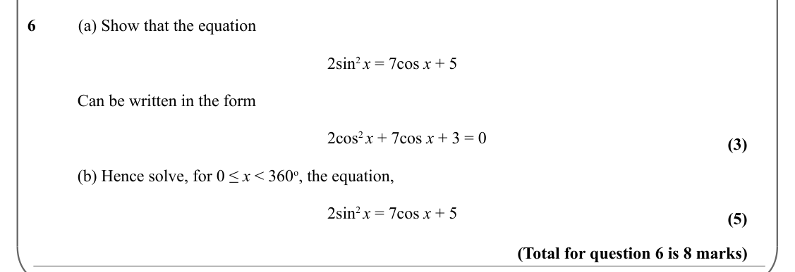

Text (lossy): 6          (a) Show that the equation / 2sin 2 x = 7cos x + 5 / Can be written in the form / 2cos 2 x + 7cos x + 3 = 0 / (3) / (b) Hence solve, for 0 ≤ x < 360 o, the equation, / 2sin 2 x = 7cos x + 5 / (5) / (Total for question 6 is 8 marks)

## Q7 (9 marks · parts b)

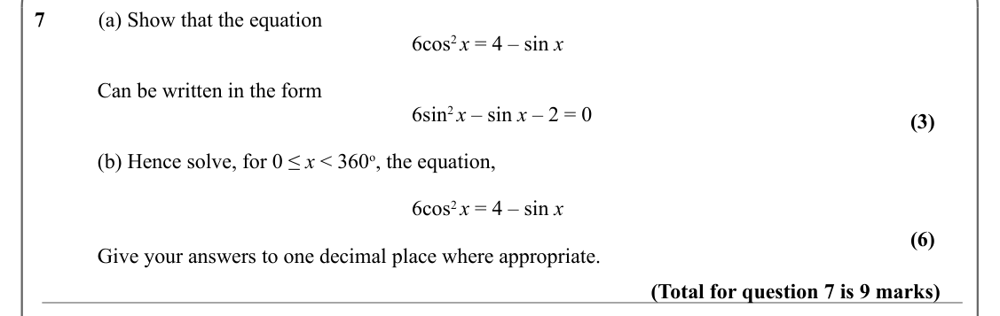

Text (lossy): 7          (a) Show that the equation / 6cos 2 x = 4 – sin x / Can be written in the form / 6sin 2 x – sin x – 2 = 0 / (3) / (b) Hence solve, for 0 ≤ x < 360 o, the equation, / 6cos 2 x = 4 – sin x / (6) / Give your answers to one decimal place where appropriate.  / (Total for question 7 is 9 marks)

## Q8 (8 marks)

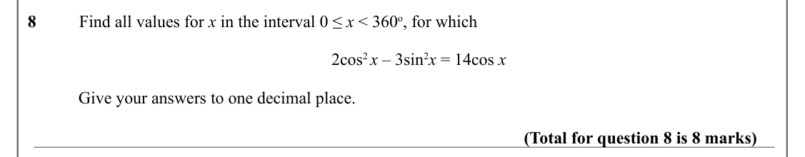

Text (lossy): 8          Find all values for x in the interval 0 ≤ x < 360 o, for which / 2cos 2 x – 3sin 2 x = 14cos x / Give your answers to one decimal place.  / (Total for question 8 is 8 marks)

## Q9 (6 marks · parts b)

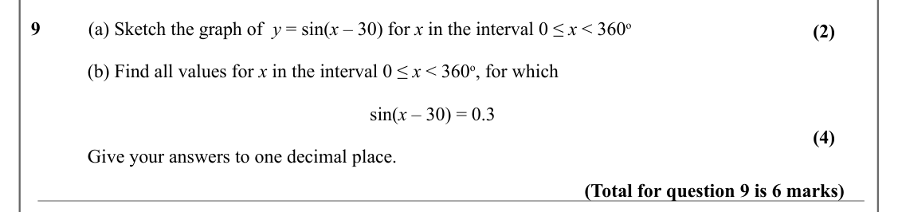

Text (lossy): 9          (a) Sketch the graph of  y = sin(x – 30) for x in the interval 0 ≤ x < 360 o / (2) / (b) Find all values for x in the interval 0 ≤ x < 360 o, for which / sin(x – 30) = 0.3 / (4) / Give your answers to one decimal place.  / (Total for question 9 is 6 marks)

## Q10 (7 marks)

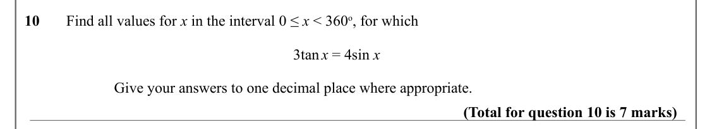

Text (lossy): 10       Find all values for x in the interval 0 ≤ x < 360 o, for which / 3tan x = 4sin x / Give your answers to one decimal place where appropriate.  / (Total for question 10 is 7 marks)

## Q11 (10 marks · parts b)

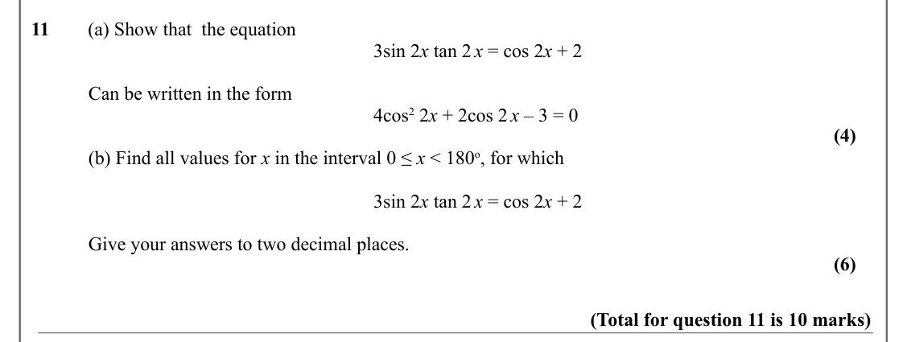

Text (lossy): 11        (a) Show that  the equation / 3sin 2 x tan 2 x = cos 2 x + 2 / Can be written in the form / 4cos 2 2 x + 2cos 2 x – 3 = 0 / (4) / (b) Find all values for x in the interval 0 ≤ x < 180 o, for which / 3sin 2 x tan 2 x = cos 2 x + 2 / Give your answers to two decimal places.  / (6) / (Total for question 11 is 10 marks)

## Q12 (9 marks · parts b)

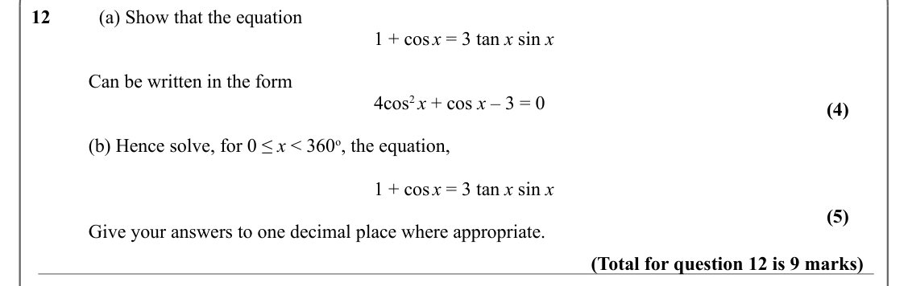

Text (lossy): 12          (a) Show that the equation / 1 + cos x = 3 tan x sin x / Can be written in the form / 4cos 2 x + cos x – 3 = 0 / (4) / (b) Hence solve, for 0 ≤ x < 360 o, the equation, / 1 + cos x = 3 tan x sin x / (5) / Give your answers to one decimal place where appropriate.  / (Total for question 12 is 9 marks)

## Q13 (7 marks · parts b)

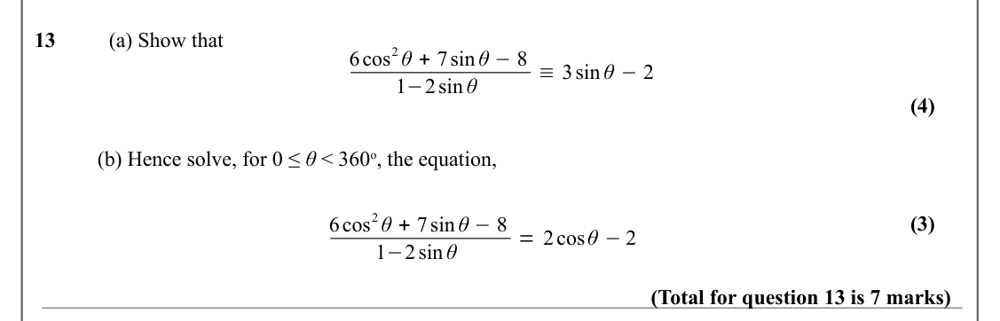

Text (lossy): 13          (a) Show that / 6cos 2 θ + 7sin θ −8 / ≡3sin θ −2 / 1−2sin θ / (4) / (b) Hence solve, for 0 ≤ θ < 360 o, the equation, / 6cos 2 θ + 7sin θ −8 / (3) / = 2cos θ −2 / 1−2sin θ / (Total for question 13 is 7 marks)

## Q14 (8 marks · parts b)

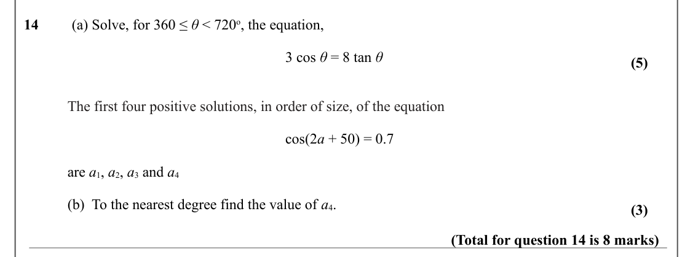

Text (lossy): 14         (a) Solve, for 360 ≤ θ < 720 o, the equation, / 3 cos θ = 8 tan θ  / (5) / The first four positive solutions, in order of size, of the equation / cos(2 a + 50) = 0.7  / are a 1, a 2, a 3 and a 4 / (b)  To the nearest degree find the value of a 4.  / (3) / (Total for question 14 is 8 marks)

## Q15 (4 marks)

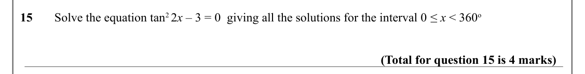

Text (lossy): 15       Solve the equation tan 2 2 x – 3 = 0  giving all the solutions for the interval 0 ≤ x < 360 o / (Total for question 15 is 4 marks)

## Q16 (3 marks)

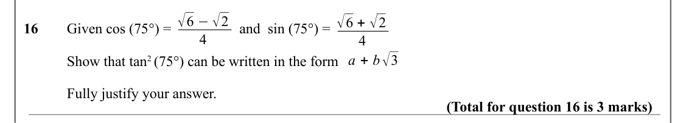

Text (lossy): √6 −√2 / √6 + √2 / 16      Given cos (75°) =  / and  sin (75°) =  / 4 / 4 / a + b√3 / Show that tan 2 (75°) can be written in the form / Fully justify your answer.   / (Total for question 16 is 3 marks)

## Q17 (8 marks · parts a, b, c, i, ii)

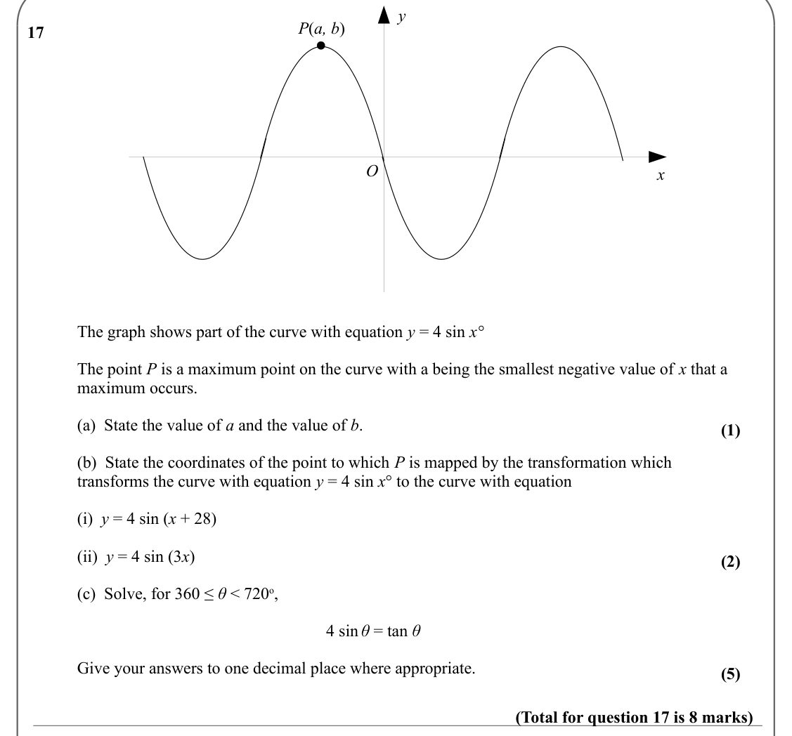

Text (lossy): y / P(a, b) / 17         / O / x / The graph shows part of the curve with equation y = 4 sin x°    / The point P is a maximum point on the curve with a being the smallest negative value of x that a  / maximum occurs. / (a)  State the value of a and the value of b.  / (1) / (b)  State the coordinates of the point to which P is mapped by the transformation which / transforms the curve with equation 

## Q18 (3 marks)

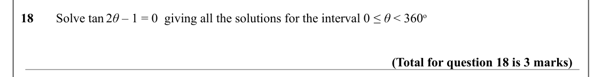

Text (lossy): 18       Solve tan 2 θ – 1 = 0  giving all the solutions for the interval 0 ≤ θ < 360 o / (Total for question 18 is 3 marks)

## Q19 (6 marks · parts b)

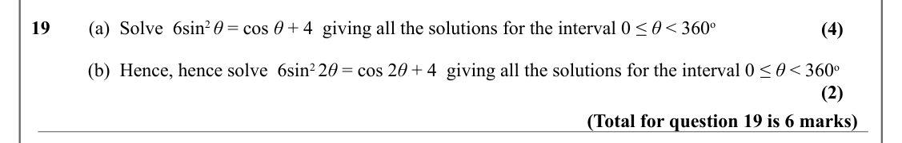

Text (lossy): 19        (a)  Solve  6sin 2 θ = cos θ + 4  giving all the solutions for the interval 0 ≤ θ < 360 o / (4) / (b)  Hence, hence solve  6sin 2 2 θ = cos 2 θ + 4  giving all the solutions for the interval 0 ≤ θ < 360 o / (2) / (Total for question 19 is 6 marks)

## Q20 (7 marks · parts a, b, c, d)

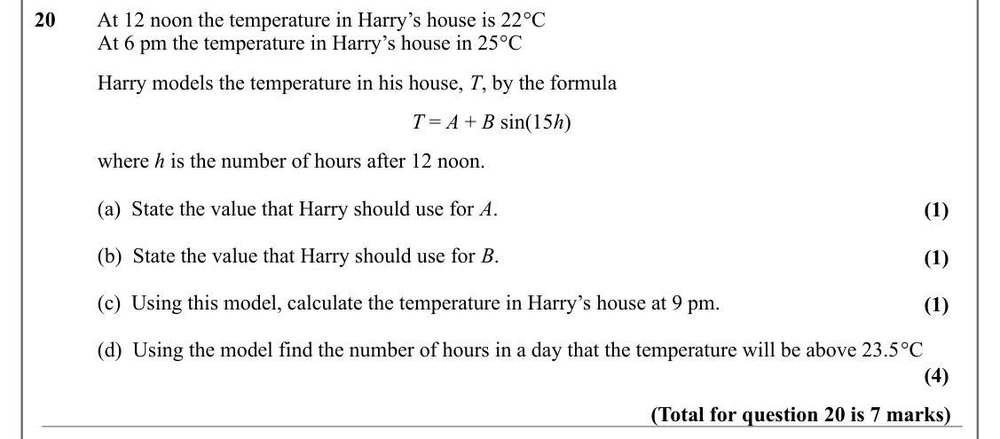

Text (lossy): 20        At 12 noon the temperature in Harry’s house is 22°C  / At 6 pm the temperature in Harry’s house in 25°C     / Harry models the temperature in his house, T, by the formula / T = A + B sin(15 h) / where h is the number of hours after 12 noon. / (a)  State the value that Harry should use for A.  / (1) / (b)  State the value that Harry should use for B.  / (1) / (c)  Using this model, calcul

## Q21 (2 marks)

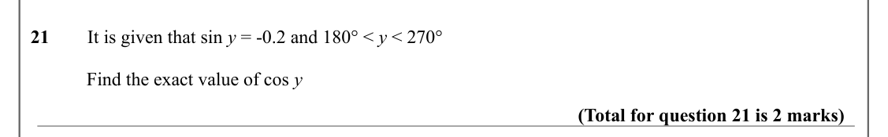

Text (lossy): 21        It is given that sin y = -0.2 and 180° < y < 270° / Find the exact value of cos y / (Total for question 21 is 2 marks)

## Q22 (4 marks · parts a, b)

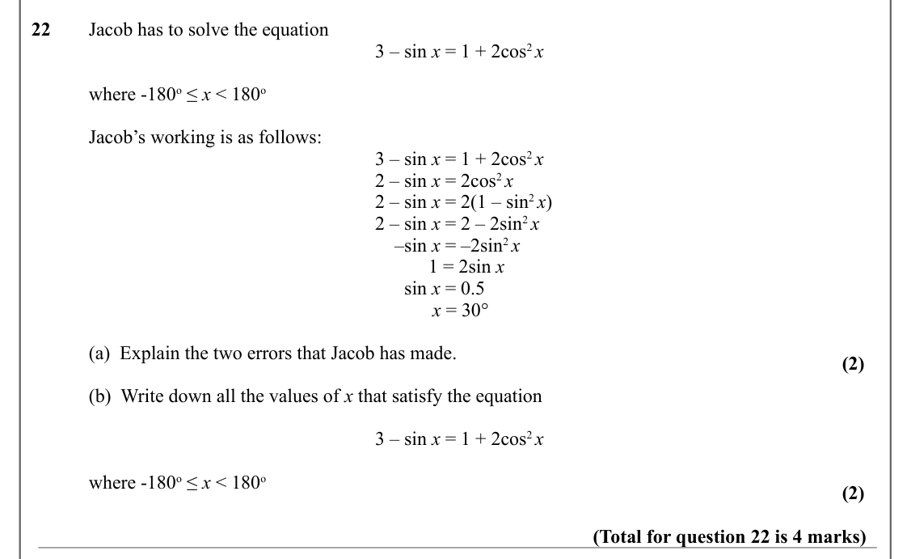

Text (lossy): 22       Jacob has to solve the equation / 3 – sin x = 1 + 2cos 2 x / where -180 o ≤ x < 180 o / Jacob’s working is as follows: / 3 – sin x = 1 + 2cos 2 x / 2 – sin x = 2cos 2 x / 2 – sin x = 2(1 – sin 2 x) / 2 – sin x = 2 – 2sin 2 x /     –sin x = –2sin 2 x /            1 = 2sin x  /       sin x = 0.5 / x = 30° / (a)  Explain the two errors that Jacob has made.  / (2) / (b)  Write down all the va

## Q23 (4 marks)

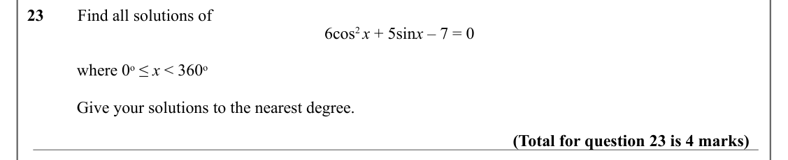

Text (lossy): 23        Find all solutions of  / 6cos 2 x + 5sin x – 7 = 0 / where 0 o ≤ x < 360 o / Give your solutions to the nearest degree.  / (Total for question 23 is 4 marks)

## Q24 (8 marks · parts b)

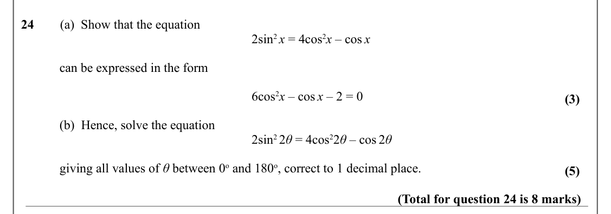

Text (lossy): 24        (a)  Show that the equation  / 2sin 2 x = 4cos 2 x – cos x / can be expressed in the form / 6cos 2 x – cos x – 2 = 0 / (3) / (b)  Hence, solve the equation  / 2sin 2 2 θ = 4cos 2 2 θ – cos 2 θ / giving all values of θ between 0 o and 180 o, correct to 1 decimal place.  / (5) / (Total for question 24 is 8 marks)

## Q25 (6 marks · parts b)

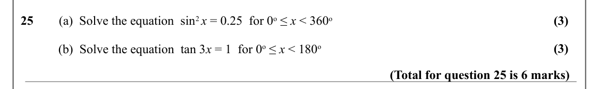

Text (lossy): (3) / 25        (a)  Solve the equation  sin 2 x = 0.25  for 0 o ≤ x < 360 o / (3) / (b)  Solve the equation  tan 3 x = 1  for 0 o ≤ x < 180 o / (Total for question 25 is 6 marks)

## Q26 (7 marks · parts b)

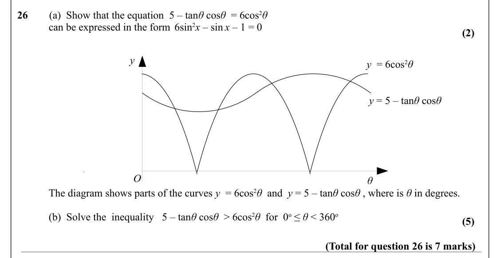

Text (lossy): 26        (a)  Show that the equation  5 – tan θ cos θ  = 6cos 2 θ    / can be expressed in the form 6sin 2 x – sin x – 1 = 0  / (2) / y / y  = 6cos 2 θ    / y = 5 – tan θ cos θ / O / θ / The diagram shows parts of the curves y  = 6cos 2 θ  and  y = 5 – tan θ cos θ , where is θ in degrees. / (b)  Solve the  inequality   5 – tan θ cos θ  > 6cos 2 θ  for  0 o ≤ θ < 360 o / (5) / (Total for question 

## Q27 (8 marks · parts b)

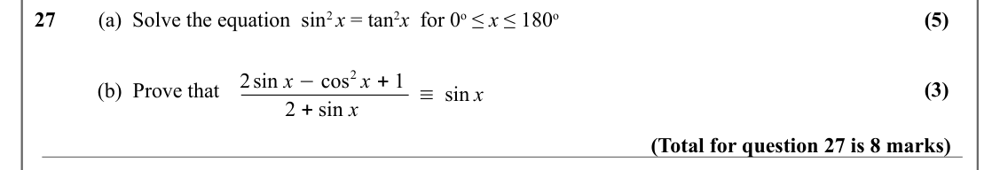

Text (lossy): (5) / 27        (a)  Solve the equation  sin 2 x = tan 2 x  for 0 o ≤ x ≤ 180 o / 2sin x −cos 2 x + 1 / (3) / (b)  Prove that / ≡sin x / 2 + sin x / (Total for question 27 is 8 marks)

## Q28 (6 marks · parts b)

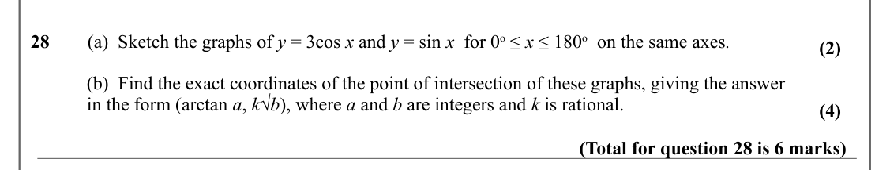

Text (lossy): 28        (a)  Sketch the graphs of y = 3cos x and y = sin x  for 0 o ≤ x ≤ 180 o  on the same axes.  / (2) / (b)  Find the exact coordinates of the point of intersection of these graphs, giving the answer  / in the form (arctan a, k√b), where a and b are integers and k is rational. / (4) / (Total for question 28 is 6 marks)

## Q29 (3 marks)

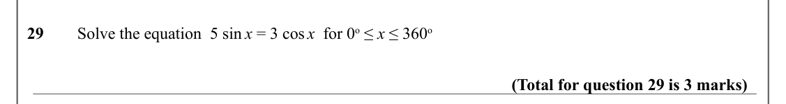

Text (lossy): 29        Solve the equation  5 sin x = 3 cos x  for 0 o ≤ x ≤ 360 o / (Total for question 29 is 3 marks)

## Q30 (6 marks)

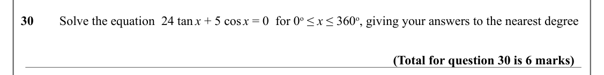

Text (lossy): 30        Solve the equation  24 tan x + 5 cos x = 0  for 0 o ≤ x ≤ 360 o, giving your answers to the nearest degree / (Total for question 30 is 6 marks)

