# Exponentials and Logarithms — Question Set (A-Level Maths · Edexcel · Year 1 Pure Mathematics)

Chapter question set · `as-pure-mathematics-14-exponentials-and-logarithms` · 40 questions · segmented by printed total lines

## Q1 (3 marks)

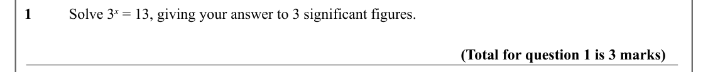

Text (lossy): 1 / Solve 3 x = 13, giving your answer to 3 significant figures.  / (Total for question 1 is 3 marks)

## Q2 (2 marks)

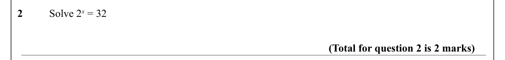

Text (lossy): 2 / Solve 2 x = 32  / (Total for question 2 is 2 marks)

## Q3 (4 marks)

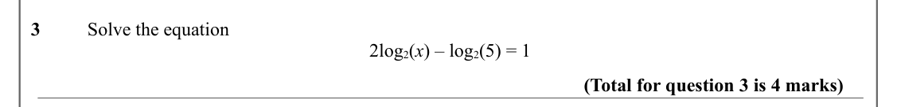

Text (lossy): 3 / Solve the equation / 2log 2(x) – log 2(5) = 1  / (Total for question 3 is 4 marks)

## Q4 (4 marks)

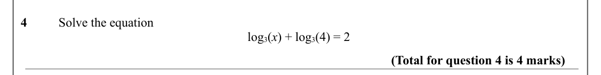

Text (lossy): 4 / Solve the equation / log 3(x) + log 3(4) = 2 / (Total for question 4 is 4 marks)

## Q5 (4 marks)

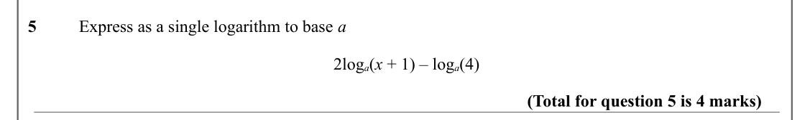

Text (lossy): 5 / Express as a single logarithm to base a / 2log a(x + 1) – log a(4) / (Total for question 5 is 4 marks)

## Q6 (7 marks)

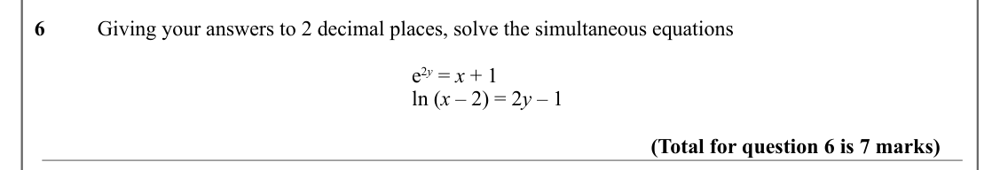

Text (lossy): 6 / Giving your answers to 2 decimal places, solve the simultaneous equations / e 2 y = x + 1 / ln (x – 2) = 2 y – 1 / (Total for question 6 is 7 marks)

## Q7 (3 marks)

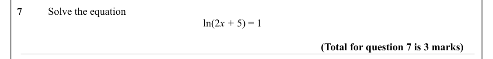

Text (lossy): 7 / Solve the equation / ln(2 x + 5) = 1 / (Total for question 7 is 3 marks)

## Q8 (6 marks · parts a, b, c)

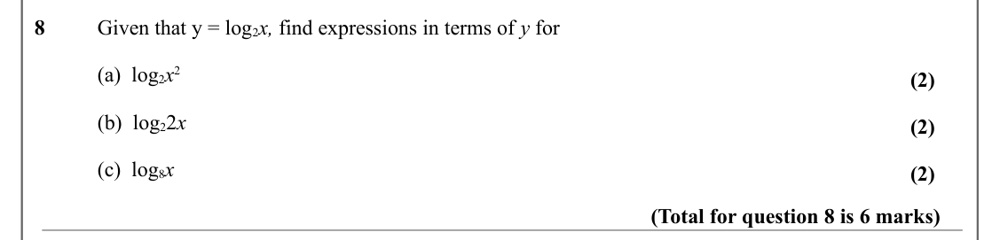

Text (lossy): 8 / Given that y = log 2 x, find expressions in terms of y for / (a)  log 2 x 2 / (2) / (b)  log 2 2 x / (2) / (c)  log 8 x / (2) / (Total for question 8 is 6 marks)

## Q9 (5 marks)

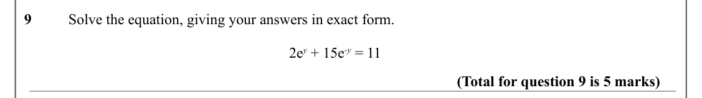

Text (lossy): 9 / Solve the equation, giving your answers in exact form. / 2e y + 15e-y = 11 / (Total for question 9 is 5 marks)

## Q10 (7 marks · parts a, b, c)

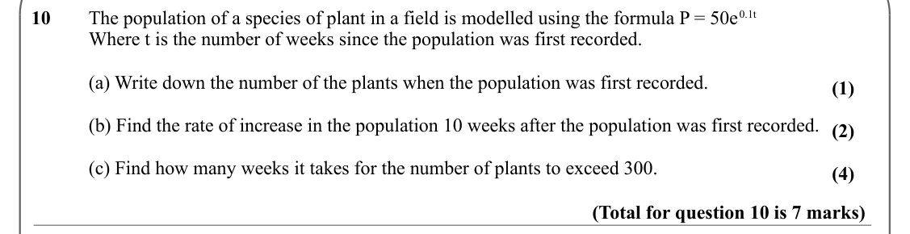

Text (lossy): 10 / The population of a species of plant in a field is modelled using the formula P = 50e 0.1t  / Where t is the number of weeks since the population was first recorded.  / (a) Write down the number of the plants when the population was first recorded.  / (1) / (b) Find the rate of increase in the population 10 weeks after the population was first recorded.  / (2) / (c) Find how many weeks it tak

## Q11 (6 marks · parts a, b, c)

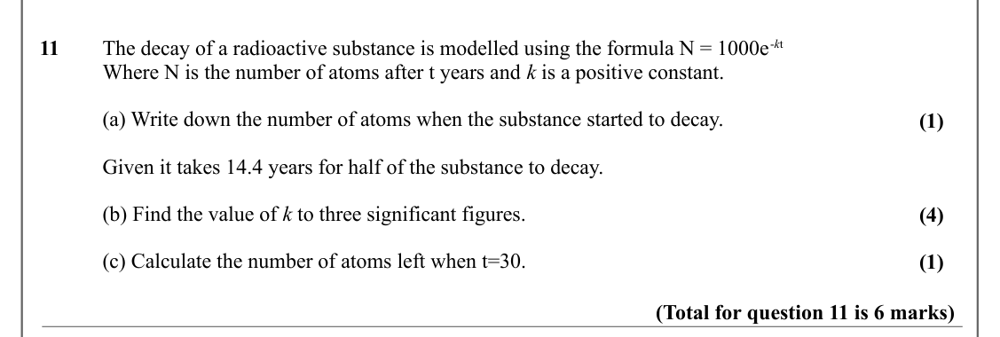

Text (lossy): 11 / The decay of a radioactive substance is modelled using the formula N = 1000e-k t  / Where N is the number of atoms after t years and k is a positive constant. / (a) Write down the number of atoms when the substance started to decay.  / (1) / Given it takes 14.4 years for half of the substance to decay. / (b) Find the value of k to three significant figures.  / (4) / (c) Calculate the number o

## Q12 (9 marks · parts a, b, c)

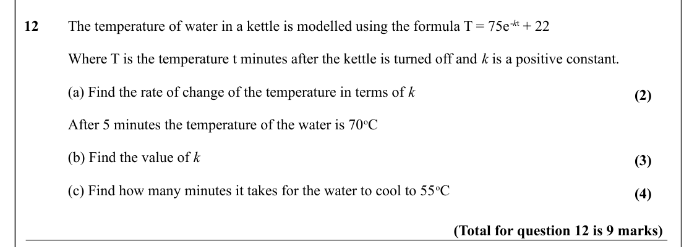

Text (lossy): 12 / The temperature of water in a kettle is modelled using the formula T = 75e-k t + 22 / Where T is the temperature t minutes after the kettle is turned off and k is a positive constant. / (a) Find the rate of change of the temperature in terms of k / (2) / After 5 minutes the temperature of the water is 70 o C / (b) Find the value of k / (3) / (c) Find how many minutes it takes for the water to

## Q13 (9 marks · parts a, b, c)

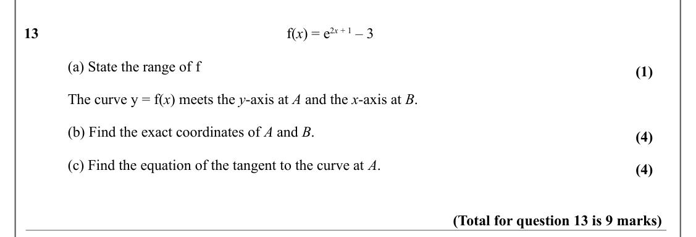

Text (lossy): 13 / f(x) = e 2 x + 1 – 3  / (a) State the range of f / (1) / The curve y = f(x) meets the y-axis at A and the x-axis at B.  / (b) Find the exact coordinates of A and B.  / (4) / (c) Find the equation of the tangent to the curve at A. / (4) / (Total for question 13 is 9 marks)

## Q14 (7 marks · parts a, b, c)

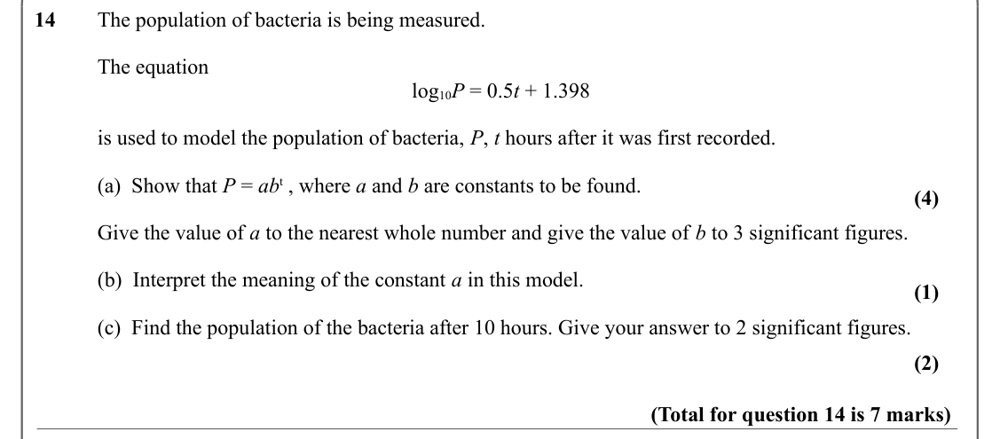

Text (lossy): 14 / The population of bacteria is being measured.  / The equation  / log 10 P = 0.5 t + 1.398 / is used to model the population of bacteria, P, t hours after it was first recorded. / (a)  Show that P = ab t , where a and b are constants to be found. / (4) / Give the value of a to the nearest whole number and give the value of b to 3 significant figures. / (b)  Interpret the meaning of the constan

## Q15 (9 marks · parts a, b, c, d)

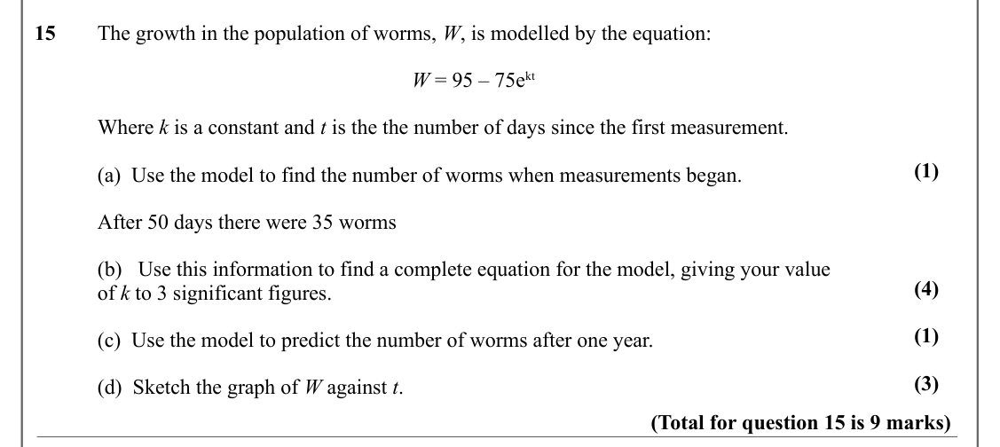

Text (lossy): 15 / The growth in the population of worms, W, is modelled by the equation:  / W = 95 – 75e kt / Where k is a constant and t is the the number of days since the first measurement.  / (1) / (a)  Use the model to find the number of worms when measurements began.  / After 50 days there were 35 worms / (b)   Use this information to find a complete equation for the model, giving your value / (4) / of k

## Q16 (7 marks · parts a, b, c)

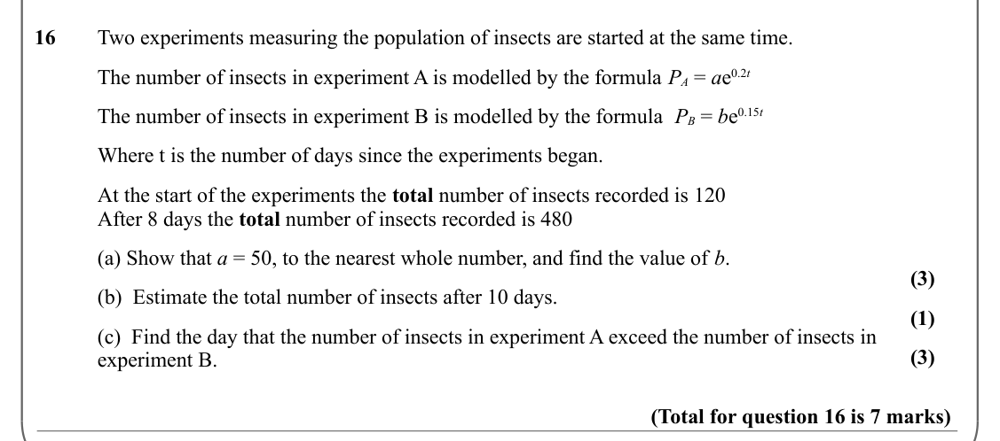

Text (lossy): 16 / Two experiments measuring the population of insects are started at the same time.  / The number of insects in experiment A is modelled by the formula P A = a e 0.2 t  / The number of insects in experiment B is modelled by the formula  P B = b e 0.15 t  / Where t is the number of days since the experiments began.  / At the start of the experiments the total number of insects recorded is 120 / 

## Q17 (6 marks · parts a, b, c)

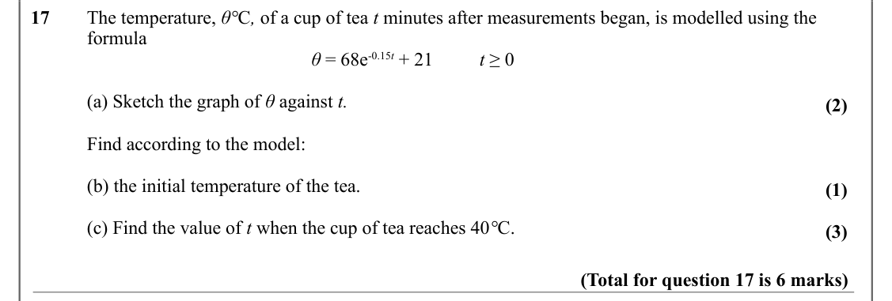

Text (lossy): 17 / The temperature, θ°C, of a cup of tea t minutes after measurements began, is modelled using the  / formula  / θ = 68e-0.15 t + 21  / t ≥ 0 / (a) Sketch the graph of θ against t. / (2) / Find according to the model:  / (b) the initial temperature of the tea. / (1) / (c) Find the value of t when the cup of tea reaches 40°C. / (3) / (Total for question 17 is 6 marks)

## Q18 (5 marks)

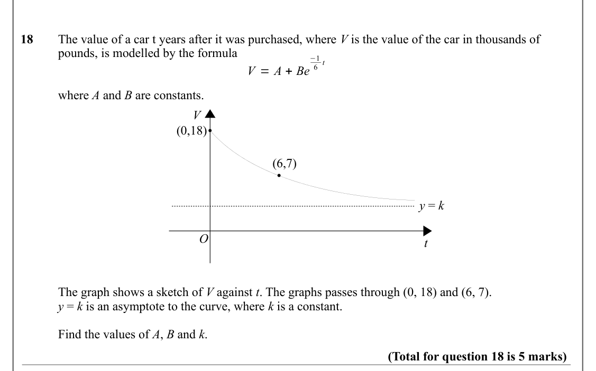

Text (lossy): 18 / The value of a car t years after it was purchased, where V is the value of the car in thousands of  / pounds, is modelled by the formula / −1 / 6 t / V = A + Be / where A and B are constants.  / V / (0,18) / (6,7) / y = k / O / t / The graph shows a sketch of V against t. The graphs passes through (0, 18) and (6, 7).  / y = k is an asymptote to the curve, where k is a constant. / Find the val

## Q20 (6 marks · parts a, b)

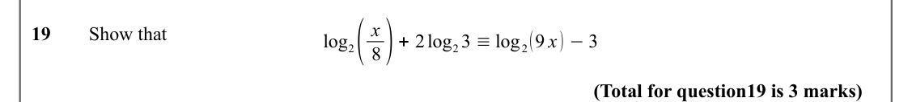

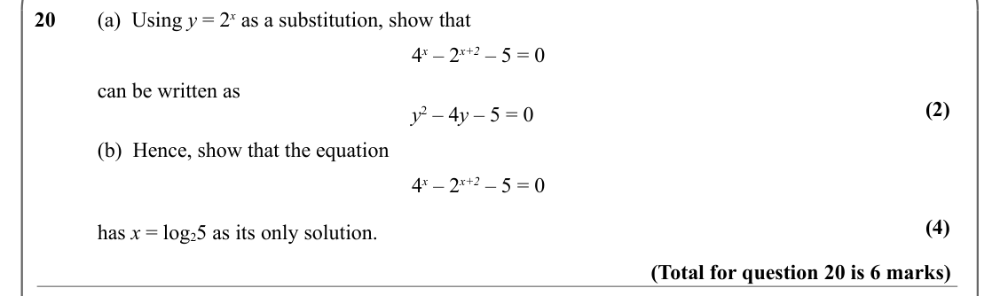

Text (lossy): log 2( / 8) + 2log 2 3 ≡log 2(9 x) −3 / x / 19 / Show that / (Total for question19 is 3 marks) / 20 / (a)  Using y = 2 x as a substitution, show that / 4 x – 2 x+2 – 5 = 0 / can be written as  / (2) / y 2 – 4 y – 5 = 0 / (b)  Hence, show that the equation  / 4 x – 2 x+2 – 5 = 0 / (4) / has x = log 2 5 as its only solution. / (Total for question 20 is 6 marks)

## Q21 (7 marks)

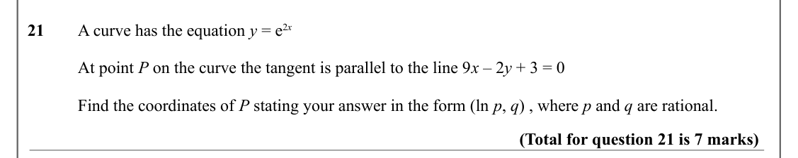

Text (lossy): 21 / A curve has the equation y = e 2 x / At point P on the curve the tangent is parallel to the line 9 x – 2 y + 3 = 0 / Find the coordinates of P stating your answer in the form (ln p, q) , where p and q are rational. / (Total for question 21 is 7 marks)

## Q22 (5 marks · parts a, b)

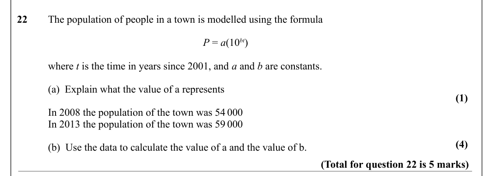

Text (lossy): 22 / The population of people in a town is modelled using the formula / P = a(10 bt) / where t is the time in years since 2001, and a and b are constants.  / (a)  Explain what the value of a represents / (1) / In 2008 the population of the town was 54 000 / In 2013 the population of the town was 59 000 / (4) / (b)  Use the data to calculate the value of a and the value of b.  / (Total for question

## Q23 (2 marks)

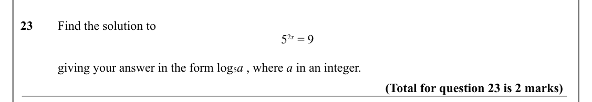

Text (lossy): 23 / Find the solution to / 5 2 x = 9 / giving your answer in the form log 5 a , where a in an integer. / (Total for question 23 is 2 marks)

## Q24 (8 marks · parts a, b, c)

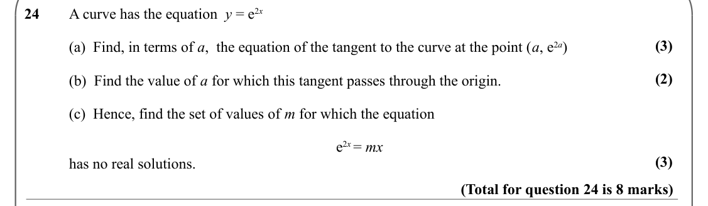

Text (lossy): 24 / A curve has the equation  y = e 2 x  / (3) / (a)  Find, in terms of a,  the equation of the tangent to the curve at the point (a, e 2 a) / (2) / (b)  Find the value of a for which this tangent passes through the origin.  / (c)  Hence, find the set of values of m for which the equation / e 2 x = mx / (3) / has no real solutions. / (Total for question 24 is 8 marks)

## Q25 (8 marks · parts a, b, c)

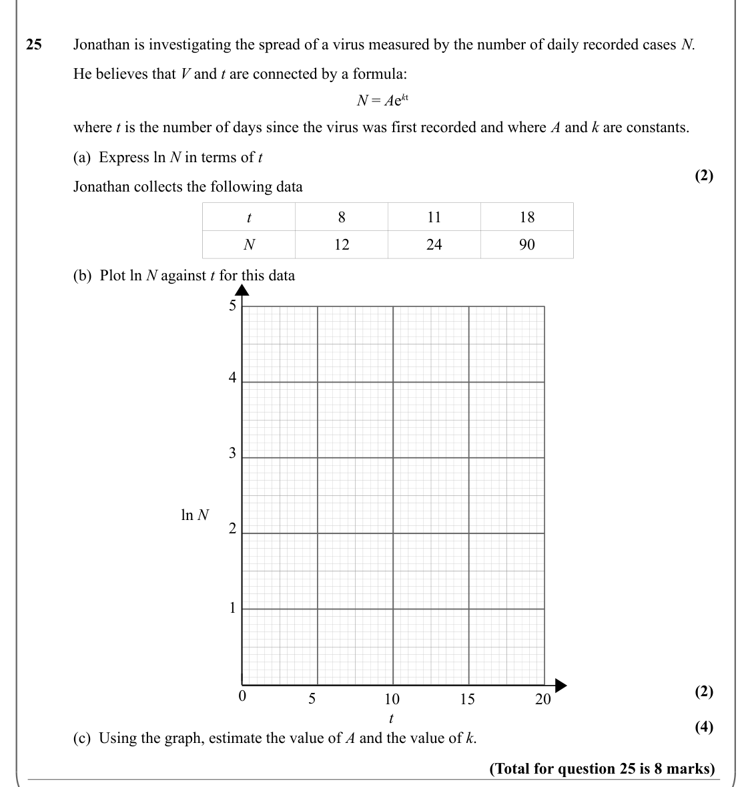

Text (lossy): 25 / Jonathan is investigating the spread of a virus measured by the number of daily recorded cases N.  / He believes that V and t are connected by a formula:  / N = A e k t  / where t is the number of days since the virus was first recorded and where A and k are constants.  / (a)  Express ln N in terms of t / (2) / Jonathan collects the following data / t / 8 / 11 / 18 / N / 12 / 24 / 90 / (b)  P

## Q26 (7 marks · parts a, b, c)

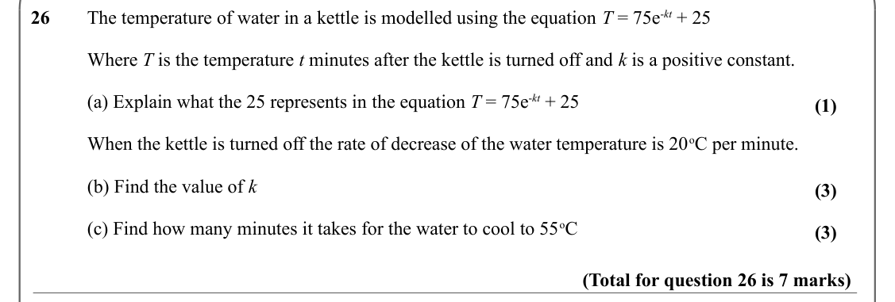

Text (lossy): 26 / The temperature of water in a kettle is modelled using the equation T = 75e-kt + 25 / Where T is the temperature t minutes after the kettle is turned off and k is a positive constant. / (a) Explain what the 25 represents in the equation T = 75e-kt + 25 / (1) / When the kettle is turned off the rate of decrease of the water temperature is 20 o C per minute.  / (b) Find the value of k / (3) / (

## Q27 (4 marks)

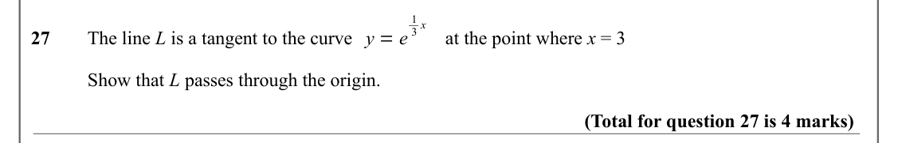

Text (lossy): 1 / 3 x / y = e / 27 / The line L is a tangent to the curve /     at the point where x = 3 / Show that L passes through the origin. / (Total for question 27 is 4 marks)

## Q28 (6 marks)

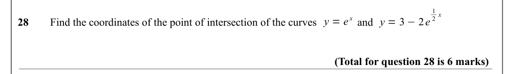

Text (lossy): 1 / 2 x / y = e x / y = 3 −2 e / 28 / Find the coordinates of the point of intersection of the curves /       and  / (Total for question 28 is 6 marks)

## Q29 (5 marks)

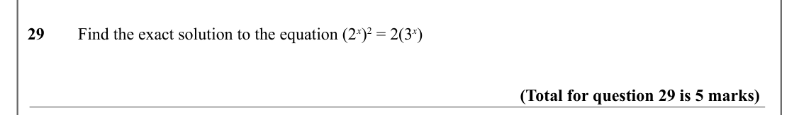

Text (lossy): 29 / Find the exact solution to the equation (2 x)2 = 2(3 x) / (Total for question 29 is 5 marks)

## Q30 (4 marks)

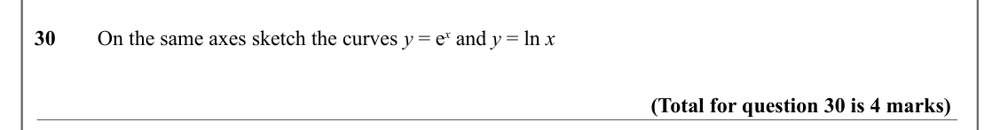

Text (lossy): 30 / On the same axes sketch the curves y = e x and y = ln x  / (Total for question 30 is 4 marks)

## Q31 (2 marks · parts a, b)

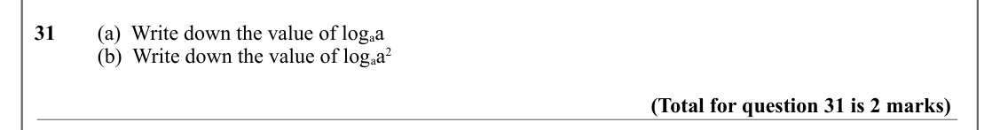

Text (lossy): 31 / (a)  Write down the value of log a a / (b)  Write down the value of log a a 2 / (Total for question 31 is 2 marks)

## Q32 (6 marks · parts a, b)

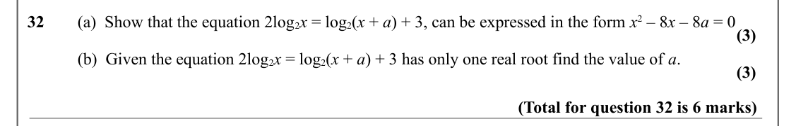

Text (lossy): 32 / (a)  Show that the equation 2log 2 x = log 2(x + a) + 3, can be expressed in the form x 2 – 8 x – 8 a = 0 / (3) / (b)  Given the equation 2log 2 x = log 2(x + a) + 3 has only one real root find the value of a.  / (3) / (Total for question 32 is 6 marks)

## Q33 (5 marks)

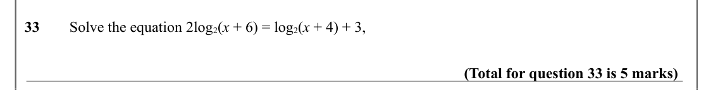

Text (lossy): 33 / Solve the equation 2log 2(x + 6) = log 2(x + 4) + 3, / (Total for question 33 is 5 marks)

## Q34 (4 marks)

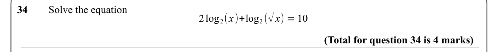

Text (lossy): 34 / Solve the equation / 2log 2(x)+log 2(√x) = 10 / (Total for question 34 is 4 marks)

## Q35 (9 marks · parts a, b, c, d, i, ii)

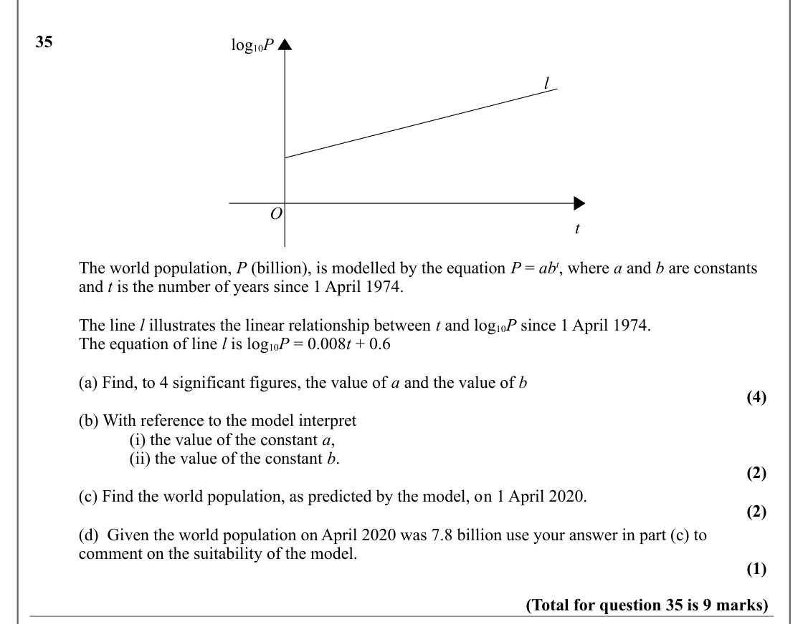

Text (lossy): 35 / log 10 P / l / O / t / The world population, P (billion), is modelled by the equation P = ab t, where a and b are constants  / and t is the number of years since 1 April 1974. / The line l illustrates the linear relationship between t and log 10 P since 1 April 1974. / The equation of line l is log 10 P = 0.008 t + 0.6 / (a) Find, to 4 significant figures, the value of a and the value of b / 

## Q36 (7 marks · parts a, b, i, ii)

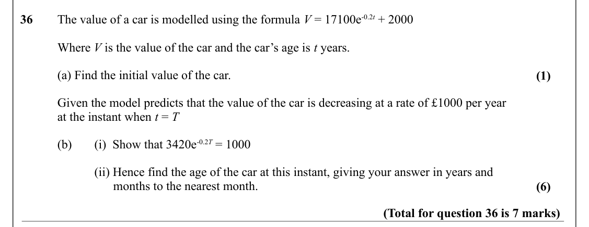

Text (lossy): 36 / The value of a car is modelled using the formula V = 17100e-0.2 t + 2000 / Where V is the value of the car and the car’s age is t years. / (a) Find the initial value of the car. / (1) / Given the model predicts that the value of the car is decreasing at a rate of £1000 per year / at the instant when t = T / (b)  / (i)  Show that 3420e-0.2 T = 1000 / (ii) Hence find the age of the car at this 

## Q37 (7 marks · parts a, b, c)

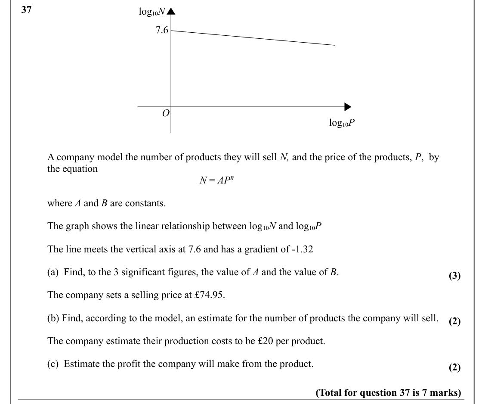

Text (lossy): 37 / log 10 N / 7.6 / O / log 10 P / A company model the number of products they will sell N, and the price of the products, P,  by / the equation / N = AP B  / where A and B are constants.  / The graph shows the linear relationship between log 10 N and log 10 P / The line meets the vertical axis at 7.6 and has a gradient of -1.32 / (a)  Find, to the 3 significant figures, the value of A and the v

## Q38 (2 marks)

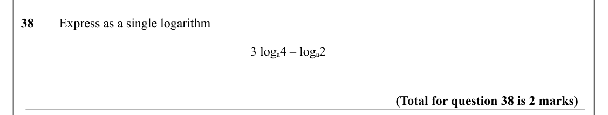

Text (lossy): 38 / Express as a single logarithm / 3 log a 4 – log a 2 / (Total for question 38 is 2 marks)

## Q39 (2 marks)

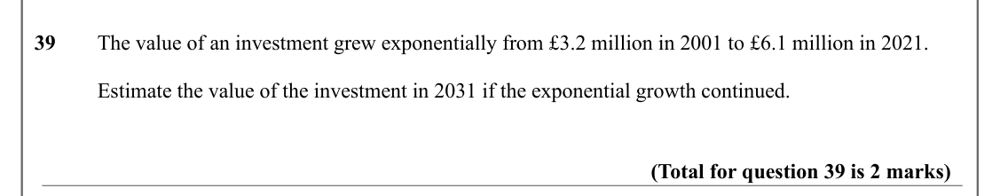

Text (lossy): 39 / The value of an investment grew exponentially from £3.2 million in 2001 to £6.1 million in 2021.  / Estimate the value of the investment in 2031 if the exponential growth continued. / (Total for question 39 is 2 marks)

## Q40 (5 marks)

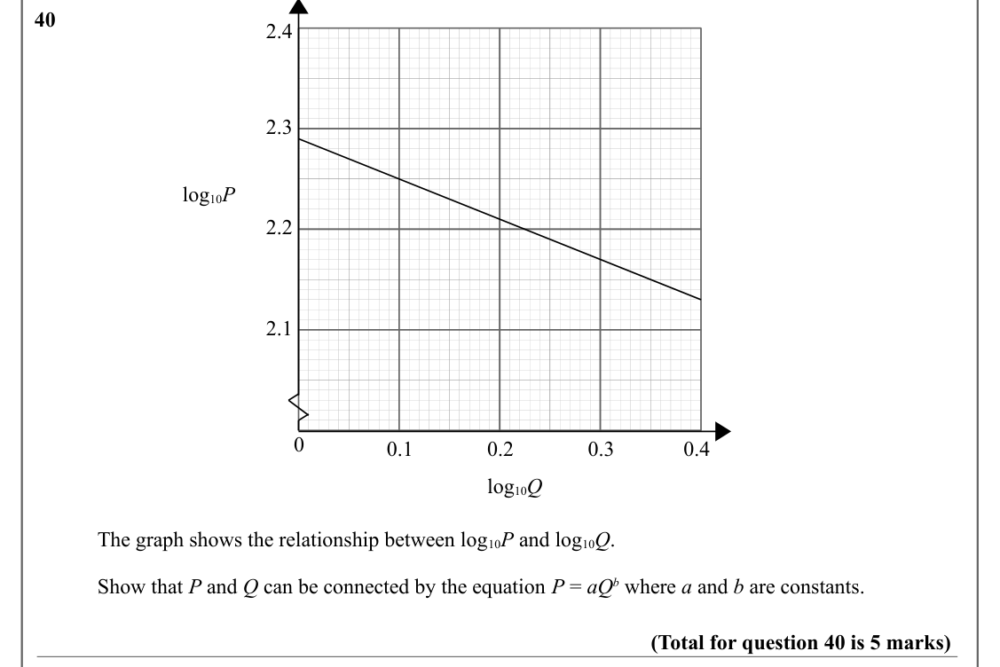

Text (lossy): 40 / 2.4 / 2.3 / log 10 P / 2.2 / 2.1 / 0 / 0.1 / 0.2 / 0.3 / 0.4 / log 10 Q / The graph shows the relationship between log 10 P and log 10 Q.  / Show that P and Q can be connected by the equation P = aQ b where a and b are constants. / (Total for question 40 is 5 marks)

## Q41 (8 marks · parts a, b, c, d)

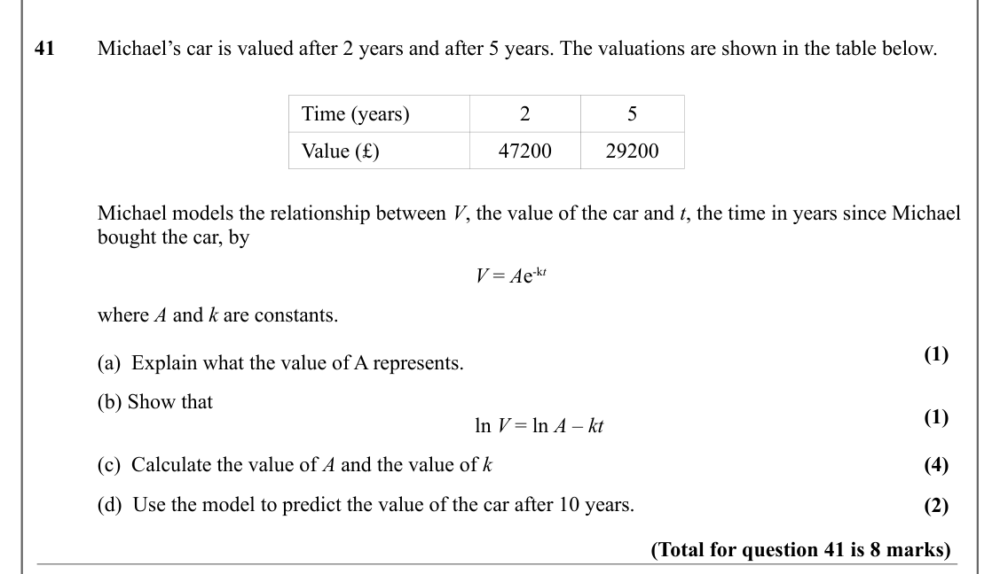

Text (lossy): 41 / Michael’s car is valued after 2 years and after 5 years. The valuations are shown in the table below.  / Time (years) / 2 / 5 / Value (£) / 47200 / 29200 / Michael models the relationship between V, the value of the car and t, the time in years since Michael  / bought the car, by / V = A e-k t / where A and k are constants. / (1) / (a)  Explain what the value of A represents.  / (b) Show that

