# Quadratics — Question Set (A-Level Maths · Edexcel · Year 1 Pure Mathematics)

Chapter question set · `as-pure-mathematics-2-quadratics` · 25 questions · segmented by printed total lines

## Q1 (3 marks)

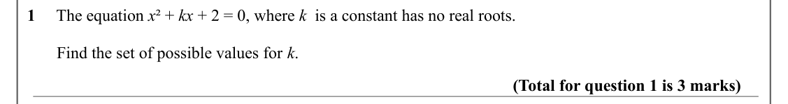

Text (lossy): 1     The equation x ² + kx + 2 = 0, where k  is a constant has no real roots.  /        Find the set of possible values for k. / (Total for question 1 is 3 marks)

## Q2 (3 marks)

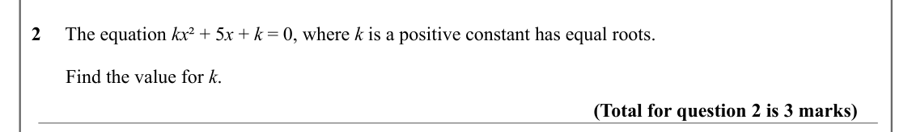

Text (lossy): 2     The equation kx ² + 5 x + k = 0, where k is a positive constant has equal roots.  /        Find the value for k. / (Total for question 2 is 3 marks)

## Q3 (4 marks)

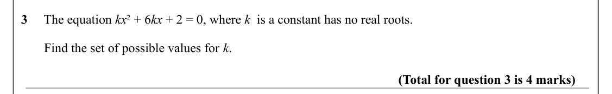

Text (lossy): 3     The equation kx ² + 6 kx + 2 = 0, where k  is a constant has no real roots.  /        Find the set of possible values for k. / (Total for question 3 is 4 marks)

## Q4 (3 marks)

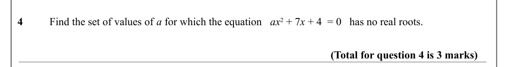

Text (lossy): 4 / Find the set of values of a for which the equation   ax 2 + 7 x + 4  = 0   has no real roots.  / (Total for question 4 is 3 marks)

## Q5 (3 marks)

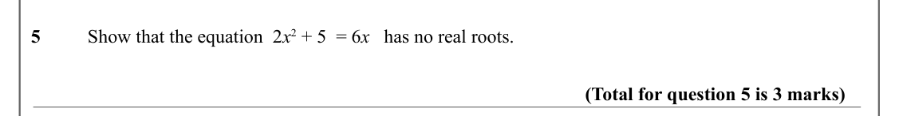

Text (lossy): 5 / Show that the equation  2 x 2 + 5  = 6 x   has no real roots.  / (Total for question 5 is 3 marks)

## Q6 (7 marks)

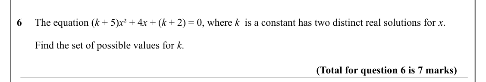

Text (lossy): 6     The equation (k + 5)x ² + 4 x + (k + 2) = 0, where k  is a constant has two distinct real solutions for x.  /        Find the set of possible values for k. / (Total for question 6 is 7 marks)

## Q7 (7 marks)

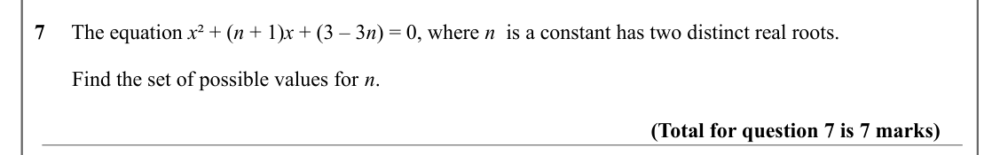

Text (lossy): 7     The equation x ² + (n + 1)x + (3 – 3 n) = 0, where n  is a constant has two distinct real roots.  /        Find the set of possible values for n. / (Total for question 7 is 7 marks)

## Q8 (8 marks)

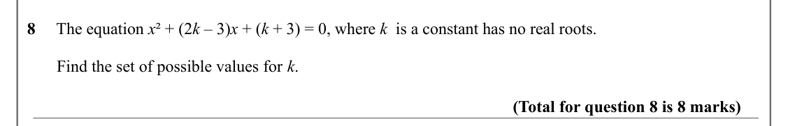

Text (lossy): 8     The equation x ² + (2 k – 3)x + (k + 3) = 0, where k  is a constant has no real roots.  /        Find the set of possible values for k. / (Total for question 8 is 8 marks)

## Q9 (3 marks)

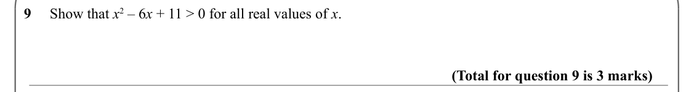

Text (lossy): 9     Show that x 2 – 6 x + 11 > 0 for all real values of x. / (Total for question 9 is 3 marks)

## Q10 (4 marks)

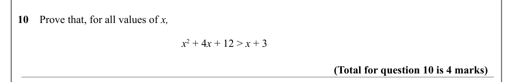

Text (lossy): 10    Prove that, for all values of x, /  x 2 + 4 x + 12 > x + 3 / (Total for question 10 is 4 marks)

## Q11 (4 marks · parts b)

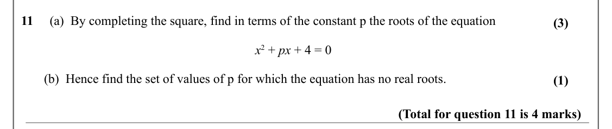

Text (lossy): 11     (a)  By completing the square, find in terms of the constant p the roots of the equation / (3) /  x 2 + px + 4 = 0 /        (b)  Hence find the set of values of p for which the equation has no real roots. / (1) / (Total for question 11 is 4 marks)

## Q12 (4 marks)

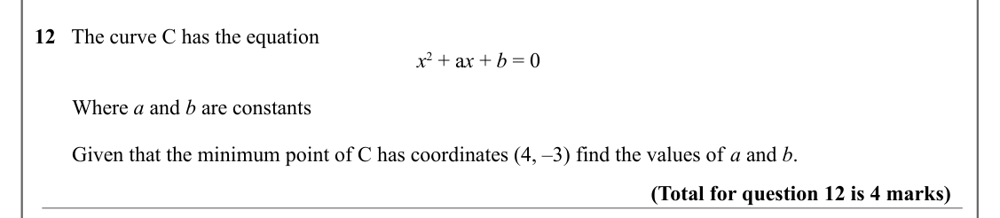

Text (lossy): 12   The curve C has the equation /  x 2 + a x + b = 0 /        Where a and b are constants /        Given that the minimum point of C has coordinates (4, –3) find the values of a and b.  / (Total for question 12 is 4 marks)

## Q13 (4 marks)

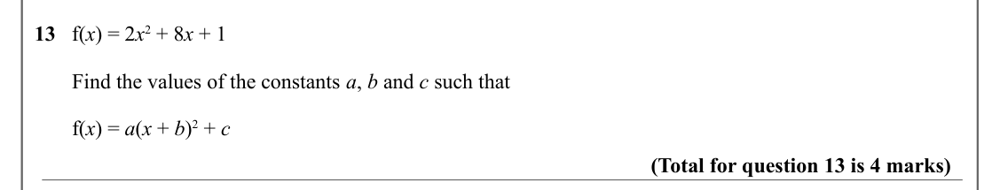

Text (lossy): 13   f(x) = 2 x 2 + 8 x + 1 /        Find the values of the constants a, b and c such that /        f(x) = a(x + b)2 + c / (Total for question 13 is 4 marks)

## Q14 (4 marks · parts b)

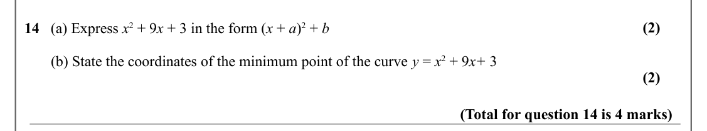

Text (lossy): (2) / 14   (a) Express x 2 + 9 x + 3 in the form (x + a)2 + b /        (b) State the coordinates of the minimum point of the curve y = x 2 + 9 x+ 3 / (2) / (Total for question 14 is 4 marks)

## Q15 (6 marks · parts b)

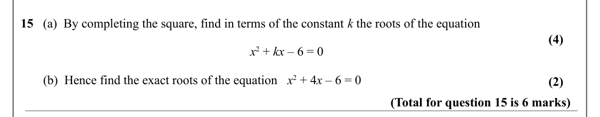

Text (lossy): 15   (a)  By completing the square, find in terms of the constant k the roots of the equation / (4) /  x 2 + kx – 6 = 0 /        (b)  Hence find the exact roots of the equation   x 2 + 4 x – 6 = 0 / (2) / (Total for question 15 is 6 marks)

## Q16 (5 marks · parts a, b)

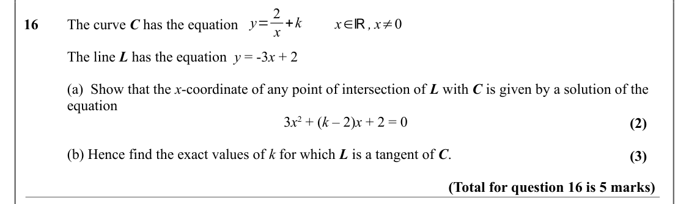

Text (lossy): y= 2 / x +k / x∈ℝ, x≠0 / 16     / The curve C has the equation / The line L has the equation  y = -3 x + 2 / (a)  Show that the x-coordinate of any point of intersection of L with C is given by a solution of the  / equation / 3 x 2 + (k – 2)x + 2 = 0  / (2) / (b) Hence find the exact values of k for which L is a tangent of C.  / (3) / (Total for question 16 is 5 marks)

## Q17 (5 marks · parts a, b, c)

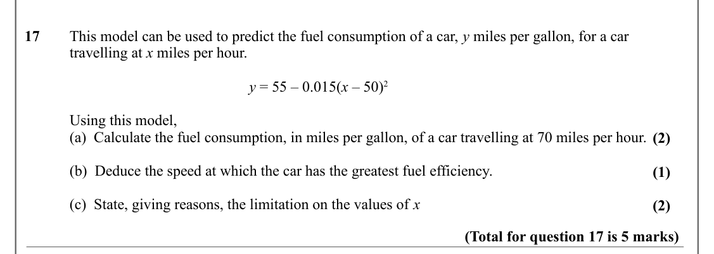

Text (lossy): 17     This model can be used to predict the fuel consumption of a car, y miles per gallon, for a car  / travelling at x miles per hour.  / y = 55 – 0.015(x – 50)2 / Using this model, / (a)  Calculate the fuel consumption, in miles per gallon, of a car travelling at 70 miles per hour.  / (2) / (b)  Deduce the speed at which the car has the greatest fuel efficiency. / (1) / (c)  State, giving reaso

## Q18 (5 marks · parts a, b)

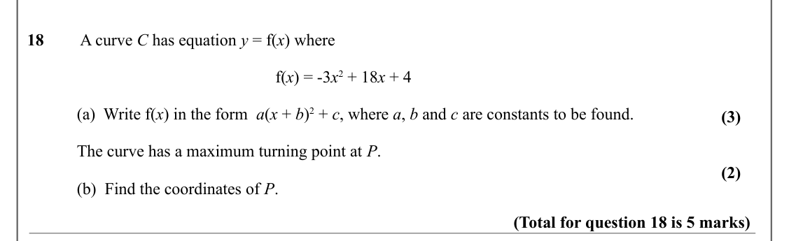

Text (lossy): 18      A curve C has equation y = f(x) where / f(x) = -3 x 2 + 18 x + 4 / (a)  Write f(x) in the form  a(x + b)2 + c, where a, b and c are constants to be found.  / (3) / The curve has a maximum turning point at P.  / (2) / (b)  Find the coordinates of P.  / (Total for question 18 is 5 marks)

## Q19 (5 marks · parts a, b)

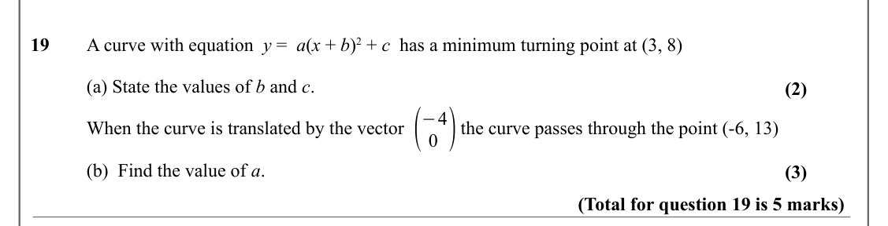

Text (lossy): 19 / A curve with equation  y =  a(x + b)2 + c  has a minimum turning point at (3, 8) / (a) State the values of b and c.  / (2) / ( / 0 ) / −4 / When the curve is translated by the vector            the curve passes through the point (-6, 13) / (b)  Find the value of a. / (3) / (Total for question 19 is 5 marks)

## Q20 (6 marks · parts b)

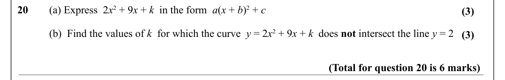

Text (lossy): 20     (a) Express  2 x 2 + 9 x + k  in the form  a(x + b)2 + c  / (3) / (b)  Find the values of k  for which the curve  y = 2 x 2 + 9 x + k  does not intersect the line y = 2 / (3) / (Total for question 20 is 6 marks)

## Q21 (8 marks · parts a, b, c)

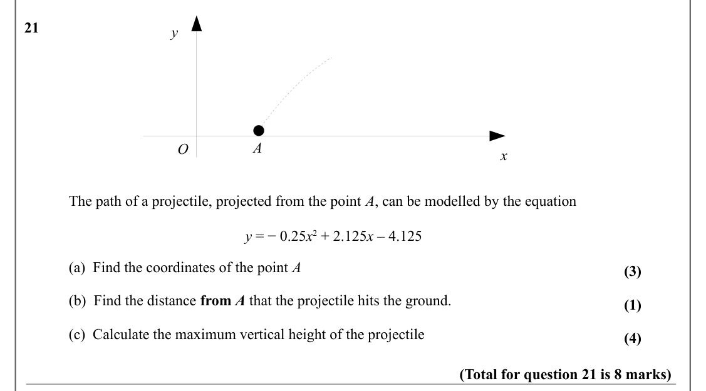

Text (lossy): 21      / y / A / O / x / The path of a projectile, projected from the point A, can be modelled by the equation / y = − 0.25 x 2 + 2.125 x – 4.125  / (a)  Find the coordinates of the point A / (3) / (b)  Find the distance from A that the projectile hits the ground.  / (1) / (c)  Calculate the maximum vertical height of the projectile / (4) / (Total for question 21 is 8 marks)

## Q22 (2 marks)

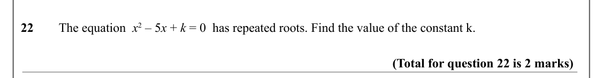

Text (lossy): 22 / The equation  x 2 – 5 x + k = 0  has repeated roots. Find the value of the constant k.  / (Total for question 22 is 2 marks)

## Q23 (6 marks · parts a, b, c)

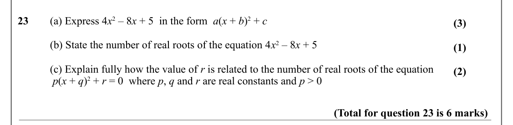

Text (lossy): 23 / (a) Express 4 x 2 – 8 x + 5  in the form  a(x + b)2 + c  / (3) / (b) State the number of real roots of the equation 4 x 2 – 8 x + 5 / (1) / (c) Explain fully how the value of r is related to the number of real roots of the equation / (2) /  p(x + q)2 + r = 0  where p, q and r are real constants and p > 0  / (Total for question 23 is 6 marks)

## Q24 (6 marks · parts a, b, c)

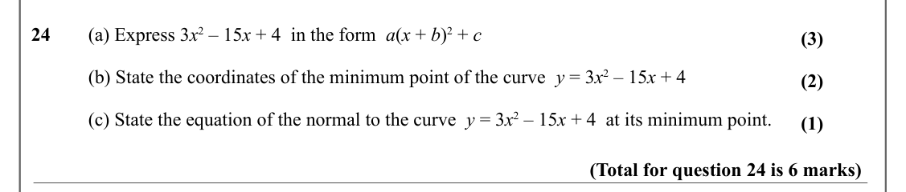

Text (lossy): 24 / (a) Express 3 x 2 – 15 x + 4  in the form  a(x + b)2 + c  / (3) / (b) State the coordinates of the minimum point of the curve  y = 3 x 2 – 15 x + 4 / (2) / (c) State the equation of the normal to the curve  y = 3 x 2 – 15 x + 4  at its minimum point. / (1) / (Total for question 24 is 6 marks)

## Q25 (8 marks · parts a, b, c, ii)

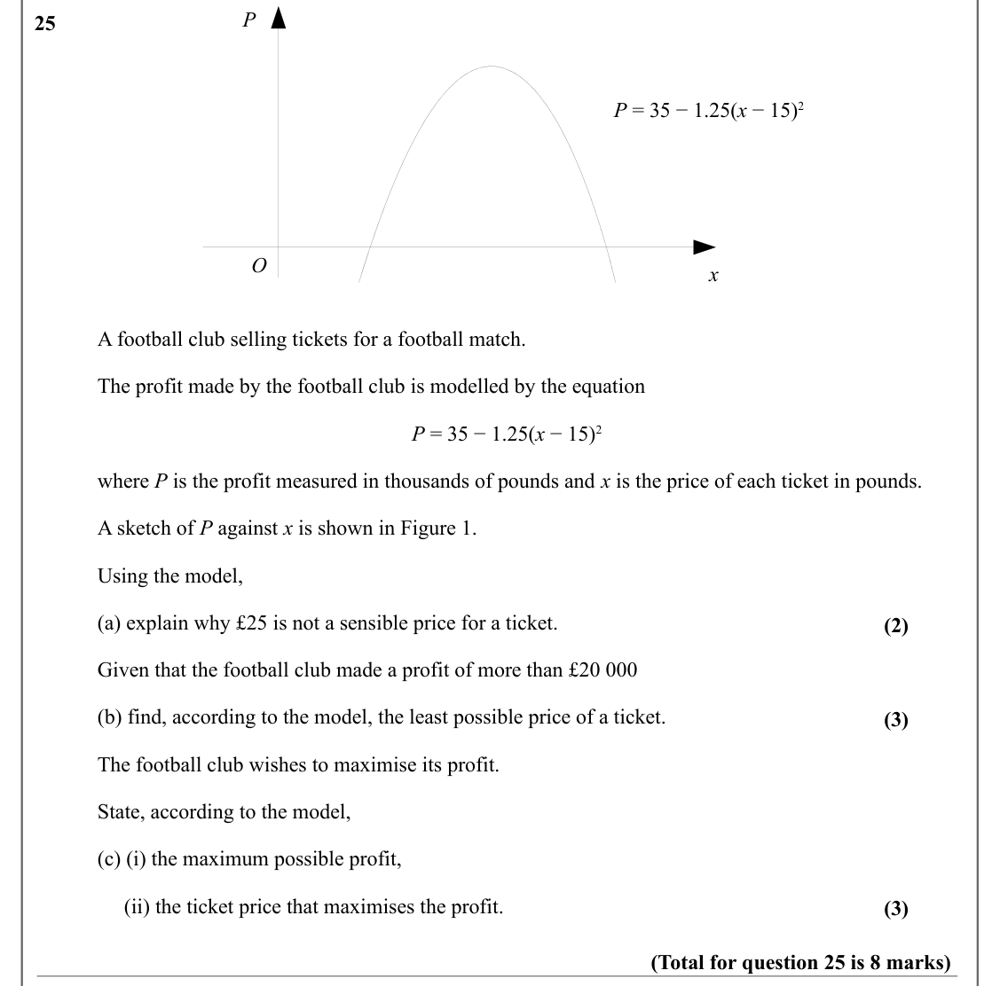

Text (lossy): P / 25      / P = 35 − 1.25(x − 15)2 / O / x / A football club selling tickets for a football match.  / The profit made by the football club is modelled by the equation / P = 35 − 1.25(x − 15)2 / where P is the profit measured in thousands of pounds and x is the price of each ticket in pounds. / A sketch of P against x is shown in Figure 1. / Using the model, / (a) explain why £25 is not a sensibl

