# Equations and Inequalities — Question Set (A-Level Maths · Edexcel · Year 1 Pure Mathematics)

Chapter question set · `as-pure-mathematics-3-equations-and-inequalities` · 15 questions · segmented by printed total lines

## Q1 (4 marks · parts b)

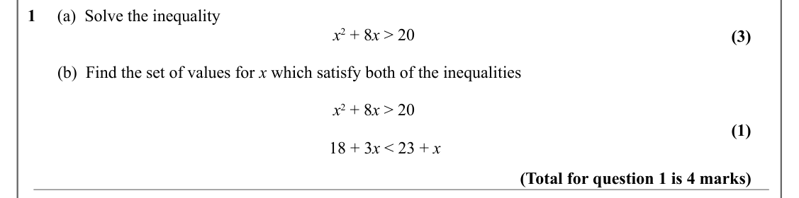

Text (lossy): 1     (a)  Solve the inequality /  x 2 + 8 x > 20 / (3) /        (b)  Find the set of values for x which satisfy both of the inequalities /  x 2 + 8 x > 20 / (1) / 18 + 3 x < 23 + x / (Total for question 1 is 4 marks)

## Q2 (4 marks)

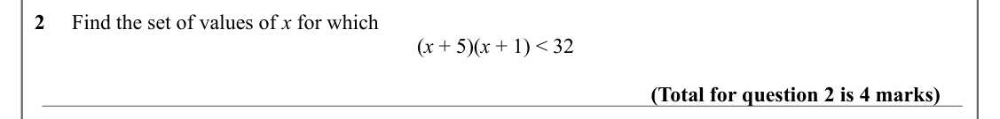

Text (lossy): 2     Find the set of values of x for which /  (x + 5)(x + 1) < 32 / (Total for question 2 is 4 marks)

## Q3 (4 marks)

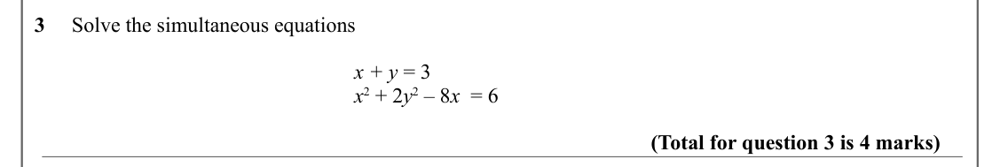

Text (lossy): 3     Solve the simultaneous equations /  x + y = 3 /  x 2 + 2 y 2 – 8 x  = 6     / (Total for question 3 is 4 marks)

## Q4 (3 marks)

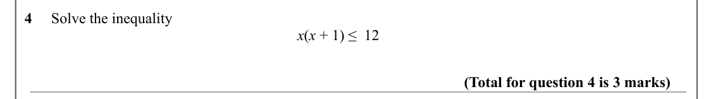

Text (lossy): 4     Solve the inequality /  x(x + 1) ≤  12 / (Total for question 4 is 3 marks)

## Q5 (4 marks)

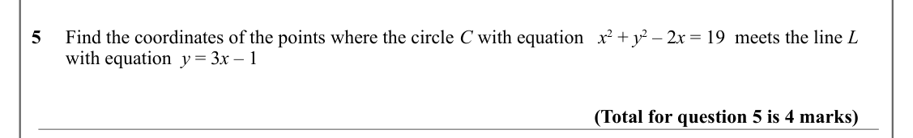

Text (lossy): 5     Find the coordinates of the points where the circle C with equation   x 2 + y 2 – 2 x = 19  meets the line L      /        with equation  y = 3 x – 1 / (Total for question 5 is 4 marks)

## Q6 (4 marks)

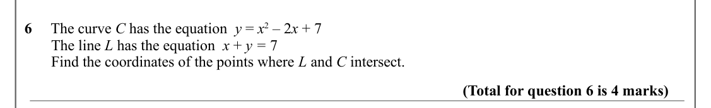

Text (lossy): 6     The curve C has the equation  y = x 2 – 2 x + 7  /        The line L has the equation  x + y = 7 /        Find the coordinates of the points where L and C intersect.  / (Total for question 6 is 4 marks)

## Q7 (7 marks)

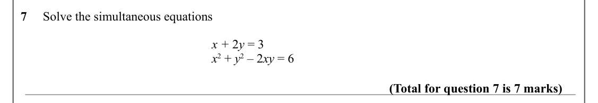

Text (lossy): 7     Solve the simultaneous equations /  x + 2 y = 3 /  x 2 + y 2 – 2 xy = 6     / (Total for question 7 is 7 marks)

## Q8 (5 marks · parts b)

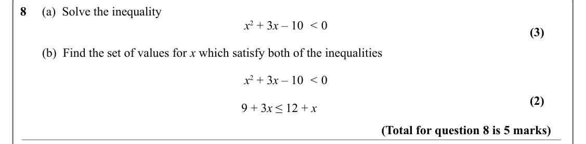

Text (lossy): 8     (a)  Solve the inequality /  x 2 + 3 x – 10  < 0 / (3) /        (b)  Find the set of values for x which satisfy both of the inequalities /  x 2 + 3 x – 10  < 0 / (2) / 9 + 3 x ≤ 12 + x / (Total for question 8 is 5 marks)

## Q9 (3 marks)

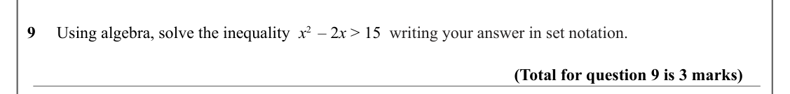

Text (lossy): 9     Using algebra, solve the inequality  x 2  – 2 x > 15  writing your answer in set notation. / (Total for question 9 is 3 marks)

## Q10 (2 marks)

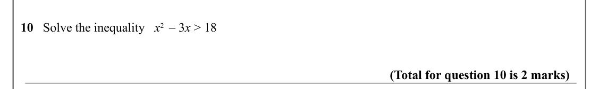

Text (lossy): 10   Solve the inequality   x 2  – 3 x > 18 / (Total for question 10 is 2 marks)

## Q11 (3 marks)

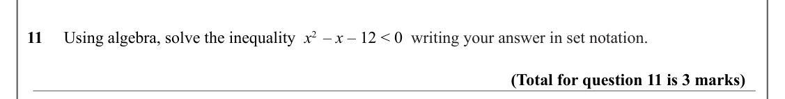

Text (lossy): 11     Using algebra, solve the inequality  x 2  – x – 12 < 0  writing your answer in set notation. / (Total for question 11 is 3 marks)

## Q12 (5 marks)

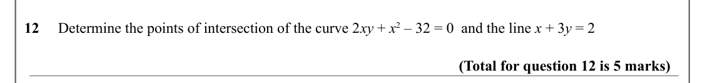

Text (lossy): 12     Determine the points of intersection of the curve 2 xy + x 2 – 32 = 0  and the line x + 3 y = 2 / (Total for question 12 is 5 marks)

## Q13 (2 marks)

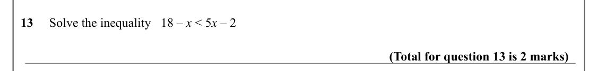

Text (lossy): 13     Solve the inequality   18 – x < 5 x – 2  / (Total for question 13 is 2 marks)

## Q14 (8 marks · parts a, b)

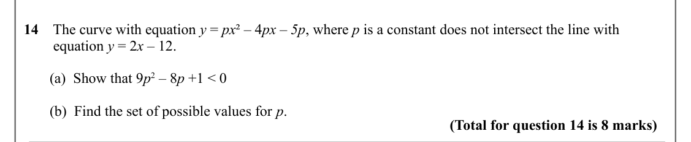

Text (lossy): 14    The curve with equation y = px ² – 4 px – 5p, where p is a constant does not intersect the line with              /         equation y = 2 x – 12.  /        (a)  Show that 9 p 2 – 8 p +1 < 0 /        (b)  Find the set of possible values for p. / (Total for question 14 is 8 marks)

## Q15 (3 marks)

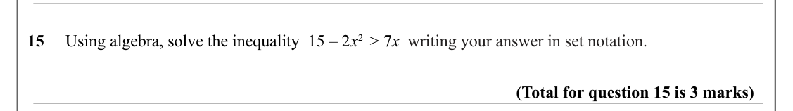

Text (lossy): 15     Using algebra, solve the inequality  15 – 2 x 2  > 7 x  writing your answer in set notation. / (Total for question 15 is 3 marks)

