# Graphs and Transformations — Question Set (A-Level Maths · Edexcel · Year 1 Pure Mathematics)

Chapter question set · `as-pure-mathematics-4-graphs-and-transformations` · 25 questions · segmented by printed total lines

## Q1 (7 marks · parts a, b, i, ii)

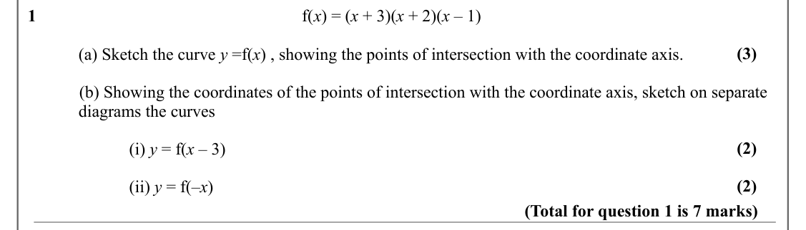

Text (lossy): 1                                                              f(x) = (x + 3)(x + 2)(x – 1) / (3) / (a) Sketch the curve y =f(x) , showing the points of intersection with the coordinate axis. /             (b) Showing the coordinates of the points of intersection with the coordinate axis, sketch on separate  / diagrams the curves / (2) / (i) y = f(x – 3) / (2) / (ii) y = f(–x)    / (Total for ques

## Q2 (6 marks · parts b)

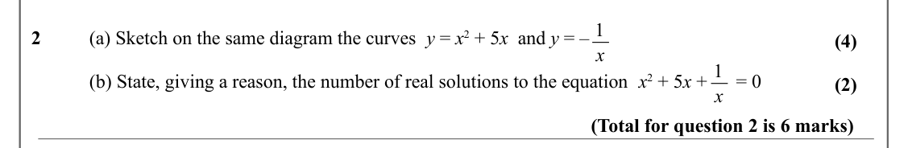

Text (lossy): 1 / 2          (a) Sketch on the same diagram the curves  y = x 2 + 5 x  and y = – / (4) / x / 1 /             (b) State, giving a reason, the number of real solutions to the equation  x 2 + 5 x +      = 0 / (2) / x / (Total for question 2 is 6 marks)

## Q3 (4 marks · parts i, ii)

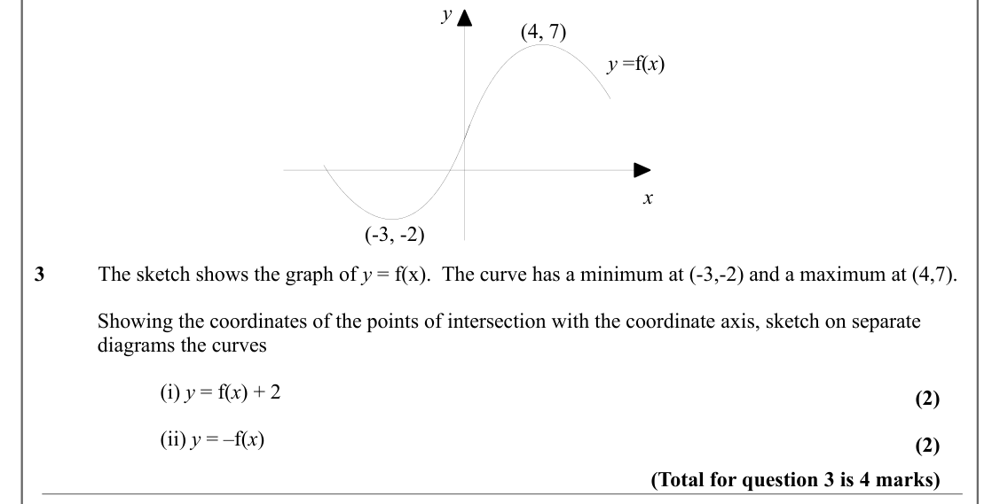

Text (lossy): y / (4, 7) / y =f(x) / x / (-3, -2) / 3          The sketch shows the graph of y = f(x).  The curve has a minimum at (-3,-2) and a maximum at (4,7). / Showing the coordinates of the points of intersection with the coordinate axis, sketch on separate  / diagrams the curves / (i) y = f(x) + 2 / (2) / (ii) y = –f(x)    / (2) / (Total for question 3 is 4 marks)

## Q4 (8 marks · parts a, b, c, i, ii)

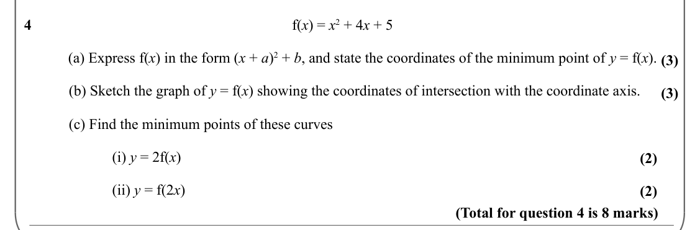

Text (lossy): 4          /  f(x) = x 2 + 4 x + 5 / (a) Express f(x) in the form (x + a)2 + b, and state the coordinates of the minimum point of y = f(x). / (3) /             (b) Sketch the graph of y = f(x) showing the coordinates of intersection with the coordinate axis. / (3) /             (c) Find the minimum points of these curves / (i) y = 2f(x) / (2) / (ii) y = f(2 x)     / (2) / (Total for question 4 is 

## Q5 (7 marks · parts a, b, i, ii)

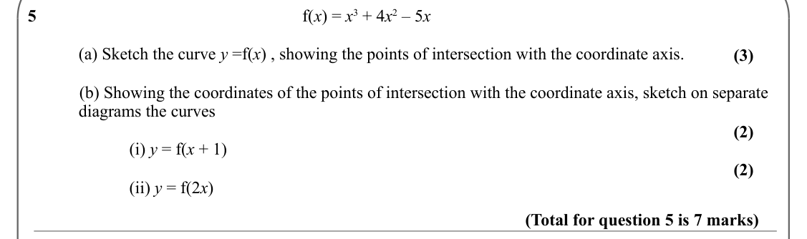

Text (lossy): 5                                                              f(x) = x 3 + 4 x 2 – 5 x  / (a) Sketch the curve y =f(x) , showing the points of intersection with the coordinate axis. / (3) /             (b) Showing the coordinates of the points of intersection with the coordinate axis, sketch on separate  / diagrams the curves / (2) / (i) y = f(x + 1) / (2) / (ii) y = f(2 x)    / (Total for questi

## Q6 (3 marks)

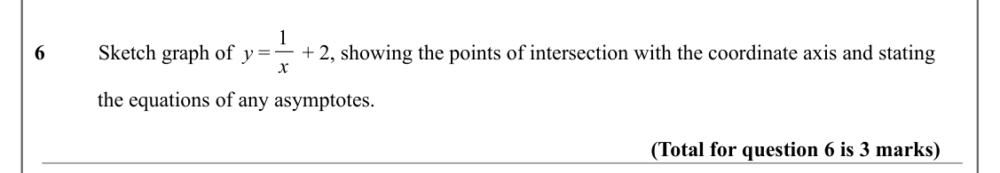

Text (lossy): 1 / 6          Sketch graph of  y =      + 2, showing the points of intersection with the coordinate axis and stating / x / the equations of any asymptotes. / (Total for question 6 is 3 marks)

## Q7 (7 marks · parts a, b, i, ii)

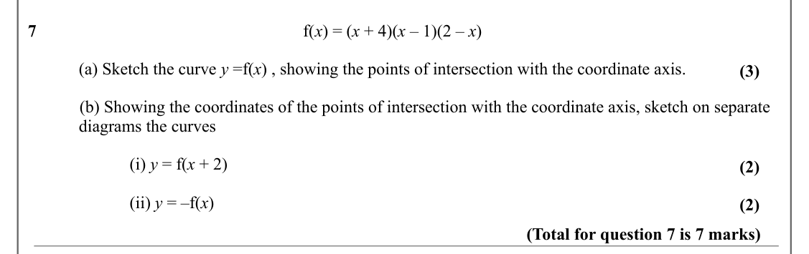

Text (lossy): 7                                                              f(x) = (x + 4)(x – 1)(2 – x)  / (a) Sketch the curve y =f(x) , showing the points of intersection with the coordinate axis. / (3) /             (b) Showing the coordinates of the points of intersection with the coordinate axis, sketch on separate  / diagrams the curves / (i) y = f(x + 2) / (2) / (ii) y = –f(x)      / (2) / (Total for q

## Q8 (5 marks · parts a, b)

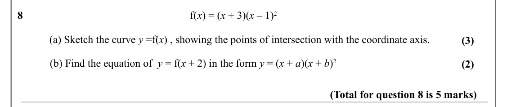

Text (lossy): 8                                                              f(x) = (x + 3)(x – 1)2 / (a) Sketch the curve y =f(x) , showing the points of intersection with the coordinate axis. / (3) /             (b) Find the equation of  y = f(x + 2) in the form y = (x + a)(x + b)2 / (2) / (Total for question 8 is 5 marks)

## Q9 (4 marks · parts b)

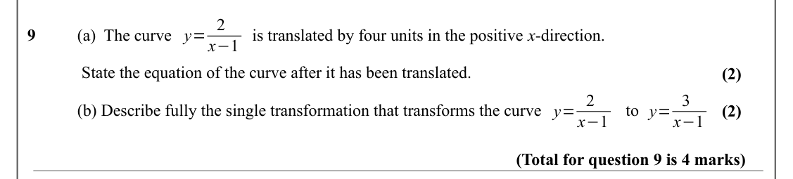

Text (lossy): y= 2 / 9         (a)  The curve  /       is translated by four units in the positive x-direction.  / x−1 /  State the equation of the curve after it has been translated.  / (2) / y= 2 / y= 3 / (b) Describe fully the single transformation that transforms the curve / to  / (2) / x−1 / x−1 / (Total for question 9 is 4 marks)

## Q10 (2 marks · parts a, b)

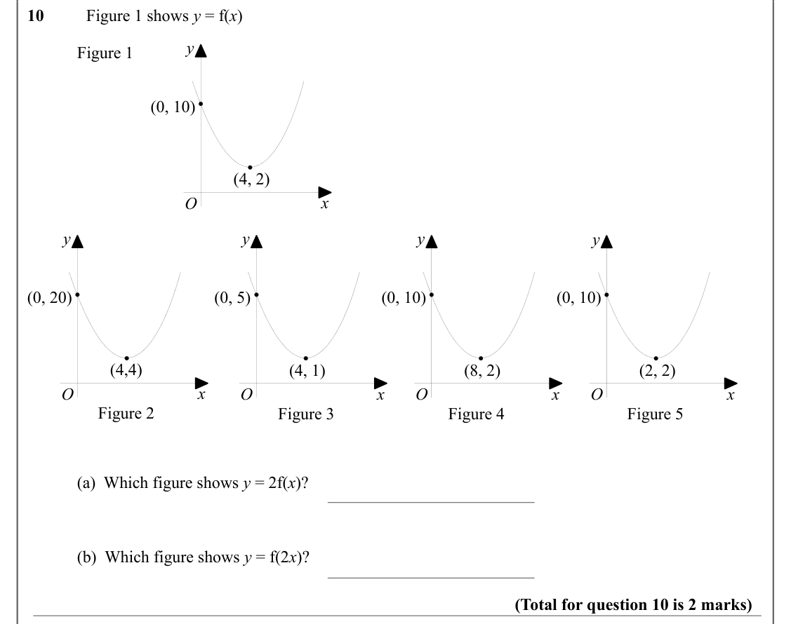

Text (lossy): 10          Figure 1 shows y = f(x) / y / Figure 1 / (0, 10) / (4, 2) / x / O / y / y / y / y / (0, 20) / (0, 5) / (0, 10) / (0, 10) / (4,4) / (4, 1) / (8, 2) / (2, 2) / x / x / x / x / O / O / O / O / Figure 2 / Figure 3 / Figure 4 / Figure 5 / (a)  Which figure shows y = 2f(x)? / (b)  Which figure shows y = f(2 x)? / (Total for question 10 is 2 marks)

## Q11 (1 marks)

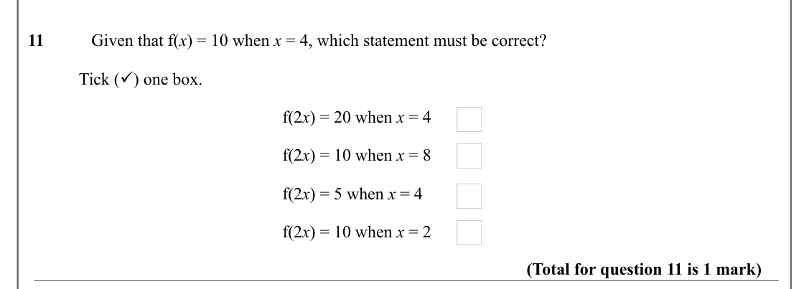

Text (lossy): 11           Given that f(x) = 10 when x = 4, which statement must be correct? / Tick () one box.  / f(2 x) = 20 when x = 4 / f(2 x) = 10 when x = 8 / f(2 x) = 5 when x = 4 / f(2 x) = 10 when x = 2 / (Total for question 11 is 1 mark)

## Q12 (6 marks)

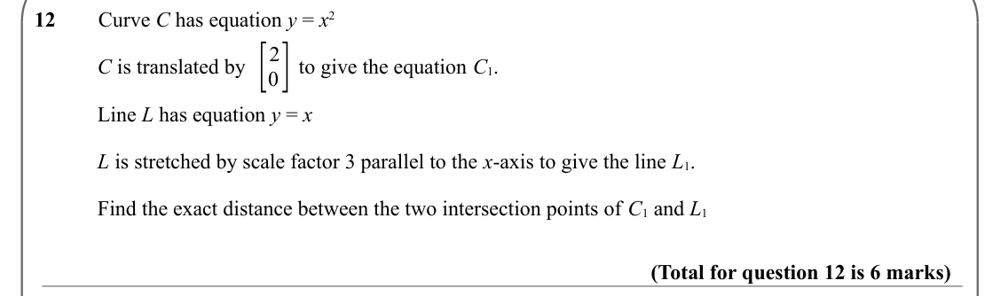

Text (lossy): 12        Curve C has equation y = x 2 / [ / 0] / 2 / C is translated by          to give the equation C 1.  / Line L has equation y = x / L is stretched by scale factor 3 parallel to the x-axis to give the line L 1.  / Find the exact distance between the two intersection points of C 1 and L 1 / (Total for question 12 is 6 marks)

## Q13 (3 marks · parts a, b)

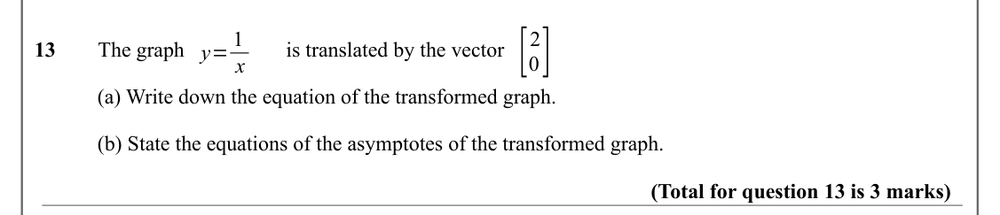

Text (lossy): [ / 0] / 2 / y= 1 / 13        The graph / is translated by the vector / x / (a) Write down the equation of the transformed graph.  / (b) State the equations of the asymptotes of the transformed graph.  / (Total for question 13 is 3 marks)

## Q14 (3 marks · parts a, b)

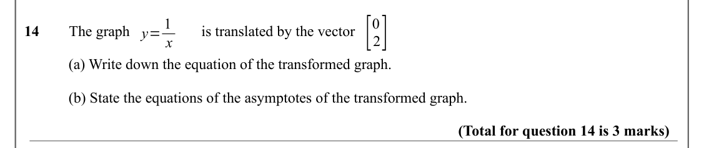

Text (lossy): [ / 2] / 0 / y= 1 / 14        The graph / is translated by the vector / x / (a) Write down the equation of the transformed graph.  / (b) State the equations of the asymptotes of the transformed graph.  / (Total for question 14 is 3 marks)

## Q15 (5 marks · parts b)

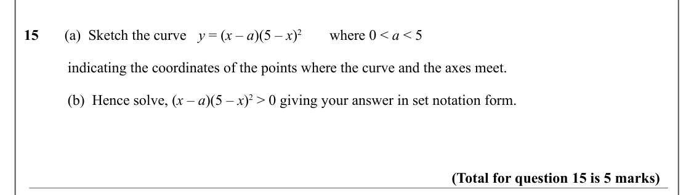

Text (lossy): 15       (a)  Sketch the curve / y = (x – a)(5 – x)2 / where 0 < a < 5 / indicating the coordinates of the points where the curve and the axes meet. / (b)  Hence solve, (x – a)(5 – x)2 > 0 giving your answer in set notation form.  / (Total for question 15 is 5 marks)

## Q16 (7 marks · parts a, b)

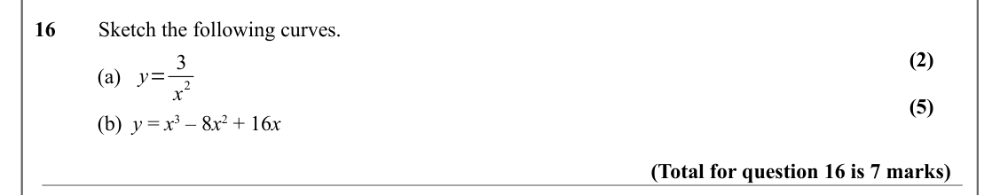

Text (lossy): 16        Sketch the following curves.  / (2) / y= 3 / (a)   / 2 / x / (5) / (b)  y = x 3 – 8 x 2 + 16 x / (Total for question 16 is 7 marks)

## Q17 (5 marks · parts b, c)

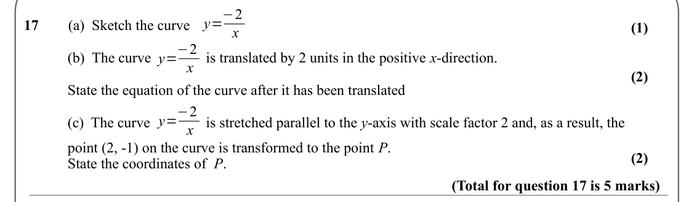

Text (lossy): y=−2 / 17        (a)  Sketch the curve  / (1) / x / y=−2 / (b)  The curve  /   is translated by 2 units in the positive x-direction.  / x / (2) / State the equation of the curve after it has been translated  / y=−2 / (c)  The curve  /   is stretched parallel to the y-axis with scale factor 2 and, as a result, the / x / point (2, -1) on the curve is transformed to the point P.  / (2) / State the co

## Q18 (4 marks · parts a, b)

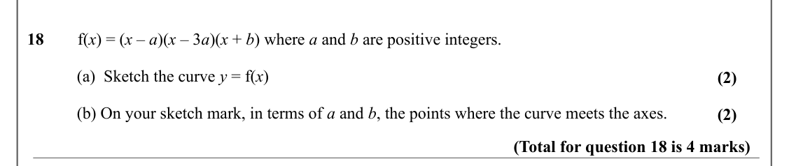

Text (lossy): 18        f(x) = (x – a)(x – 3 a)(x + b) where a and b are positive integers.   / (a)  Sketch the curve y = f(x) / (2) / (b) On your sketch mark, in terms of a and b, the points where the curve meets the axes.   / (2) / (Total for question 18 is 4 marks)

## Q19 (2 marks)

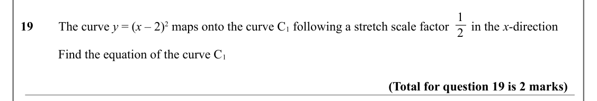

Text (lossy): 1 / 19        The curve y = (x – 2)2 maps onto the curve C 1 following a stretch scale factor       in the x-direction   / 2 / Find the equation of the curve C 1 / (Total for question 19 is 2 marks)

## Q20 (6 marks · parts b)

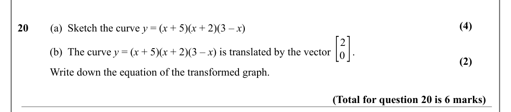

Text (lossy): (4) / 20        (a)  Sketch the curve y = (x + 5)(x + 2)(3 – x) / [ / 0] / 2 / (b)  The curve y = (x + 5)(x + 2)(3 – x) is translated by the vector        .   / (2) / Write down the equation of the transformed graph. / (Total for question 20 is 6 marks)

## Q21 (5 marks · parts a, b)

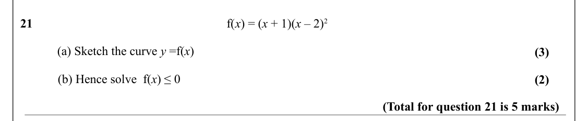

Text (lossy): 21                                                              f(x) = (x + 1)(x – 2)2 / (a) Sketch the curve y =f(x) / (3) /             (b) Hence solve  f(x) ≤ 0 / (2) / (Total for question 21 is 5 marks)

## Q22 (6 marks · parts a, b, i, ii) · printed as “2” (source typo)

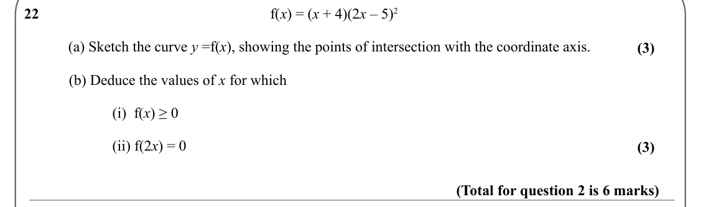

Text (lossy): 22                                                              f(x) = (x + 4)(2 x – 5)2 / (a) Sketch the curve y =f(x), showing the points of intersection with the coordinate axis. / (3) /             (b) Deduce the values of x for which / (i)  f(x) ≥ 0 / (ii) f(2 x) = 0 / (3) / (Total for question 2 is 6 marks)

## Q23 (8 marks · parts a, b, c)

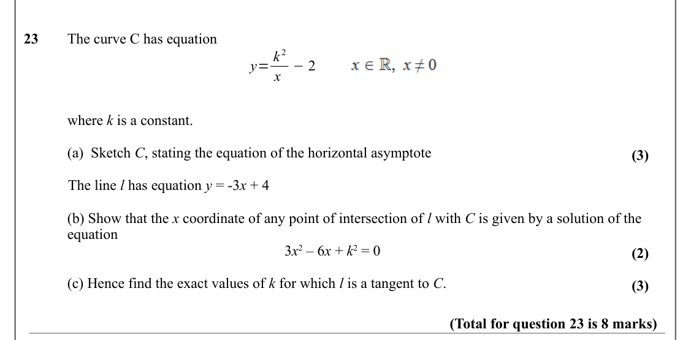

Text (lossy): 23     The curve C has equation / y= k 2 / −2 / x / where k is a constant.  / (a)  Sketch C, stating the equation of the horizontal asymptote / (3) /             The line l has equation y = -3 x + 4  / (b) Show that the x coordinate of any point of intersection of l with C is given by a solution of the  / equation  / 3 x 2 – 6 x + k 2 = 0 / (2) / (c) Hence find the exact values of k for which l is

## Q24 (5 marks · parts a, b)

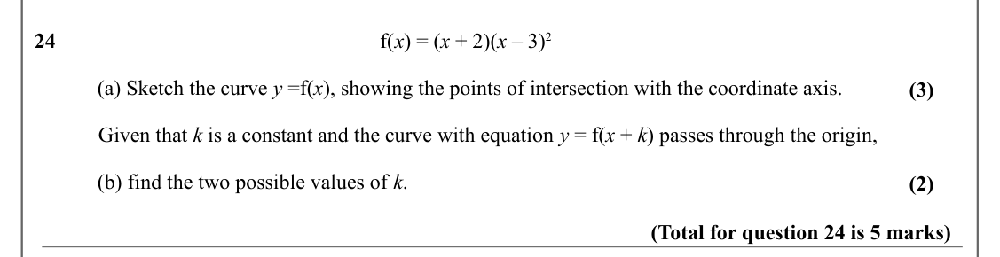

Text (lossy): 24                                                             f(x) = (x + 2)(x – 3)2 / (a) Sketch the curve y =f(x), showing the points of intersection with the coordinate axis. / (3) /             Given that k is a constant and the curve with equation y = f(x + k) passes through the origin, / (b) find the two possible values of k. / (2) / (Total for question 24 is 5 marks)

## Q25 (6 marks · parts b)

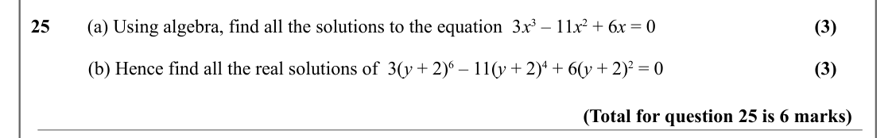

Text (lossy): (3) / 25      (a) Using algebra, find all the solutions to the equation  3 x 3 – 11 x 2 + 6 x = 0 / (3) /             (b) Hence find all the real solutions of  3(y + 2)6 – 11(y + 2)4 + 6(y + 2)2 = 0 / (Total for question 25 is 6 marks)

