# Straight Line Graphs — Question Set (A-Level Maths · Edexcel · Year 1 Pure Mathematics)

Chapter question set · `as-pure-mathematics-5-straight-line-graphs` · 22 questions · segmented by printed total lines

## Q1 (3 marks)

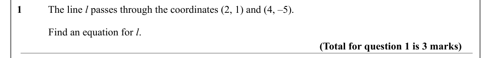

Text (lossy): 1          The line l passes through the coordinates (2, 1) and (4, –5).    /             Find an equation for l.       / (Total for question 1 is 3 marks)

## Q2 (4 marks)

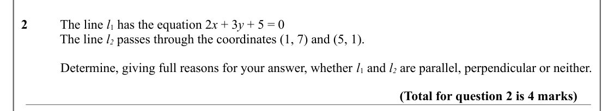

Text (lossy): 2          The line l 1 has the equation 2 x + 3 y + 5 = 0 / The line l 2 passes through the coordinates (1, 7) and (5, 1).    /             Determine, giving full reasons for your answer, whether l 1 and l 2 are parallel, perpendicular or neither.  / (Total for question 2 is 4 marks)

## Q3 (6 marks · parts a, b)

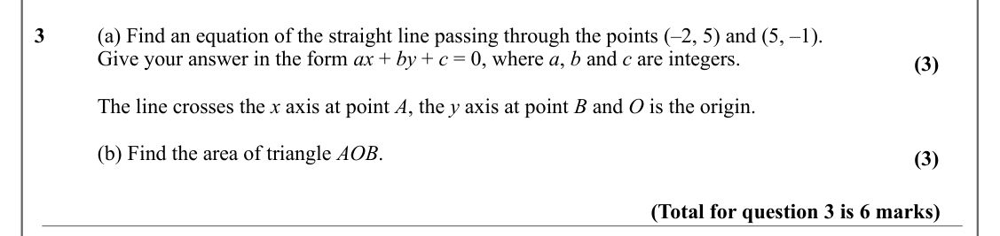

Text (lossy): 3      / (a) Find an equation of the straight line passing through the points (–2, 5) and (5, –1).  / Give your answer in the form ax + by + c = 0, where a, b and c are integers.   / (3) / The line crosses the x axis at point A, the y axis at point B and O is the origin.  / (b) Find the area of triangle AOB.  / (3) / (Total for question 3 is 6 marks)

## Q4 (9 marks · parts a, b, c)

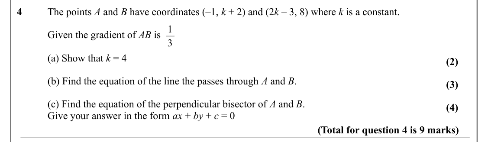

Text (lossy): 4      / The points A and B have coordinates (–1, k + 2) and (2 k – 3, 8) where k is a constant.  / 1 / Given the gradient of AB is  / 3 / (a) Show that k = 4 / (2) / (b) Find the equation of the line the passes through A and B.  / (3) / (c) Find the equation of the perpendicular bisector of A and B.  / (4) / Give your answer in the form ax + by + c = 0  / (Total for question 4 is 9 marks)

## Q5 (4 marks)

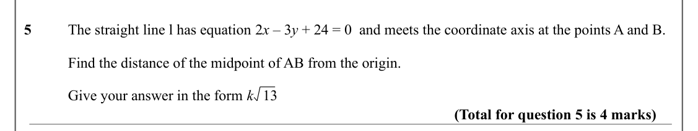

Text (lossy): 5      / The straight line l has equation 2 x – 3 y + 24 = 0  and meets the coordinate axis at the points A and B.  / Find the distance of the midpoint of AB from the origin. / Give your answer in the form k   13    / (Total for question 5 is 4 marks)

## Q6 (4 marks · parts a, b)

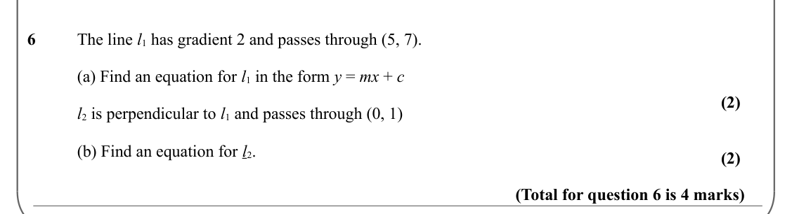

Text (lossy): 6      / The line l 1 has gradient 2 and passes through (5, 7).  / (a) Find an equation for l 1 in the form y = mx + c / (2) / l 2 is perpendicular to l 1 and passes through (0, 1) / (b) Find an equation for l 2.  / (2) / (Total for question 6 is 4 marks)

## Q7 (3 marks)

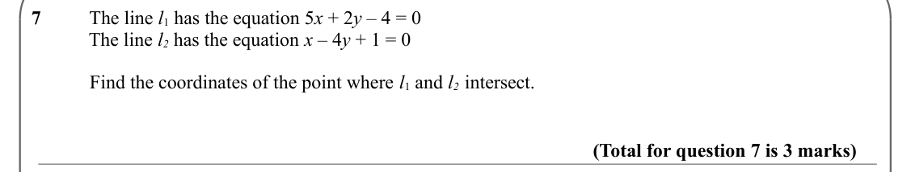

Text (lossy): 7          The line l 1 has the equation 5 x + 2 y – 4 = 0 / The line l 2 has the equation x – 4 y + 1 = 0 /             Find the coordinates of the point where l 1 and l 2  intersect. / (Total for question 7 is 3 marks)

## Q8 (5 marks)

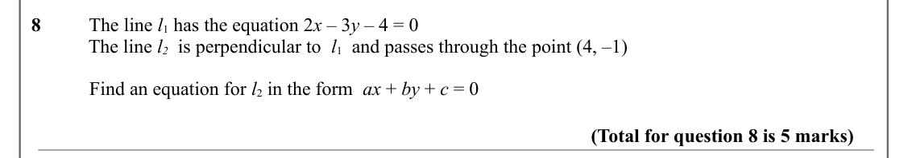

Text (lossy): 8          The line l 1 has the equation 2 x – 3 y – 4 = 0 / The line l 2  is perpendicular to  l 1  and passes through the point (4, –1)  /             Find an equation for l 2 in the form  ax + by + c = 0  / (Total for question 8 is 5 marks)

## Q9 (5 marks · parts a, b)

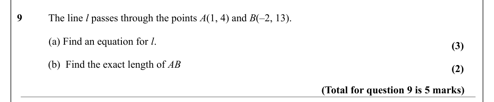

Text (lossy): 9          The line l passes through the points A(1, 4) and B(–2, 13).    /             (a) Find an equation for l.     / (3) / (b)  Find the exact length of AB / (2) / (Total for question 9 is 5 marks)

## Q10 (7 marks · parts a, b, c)

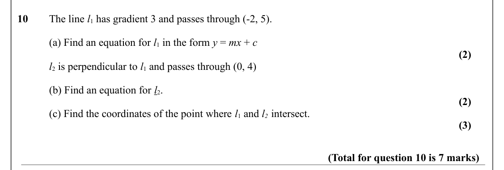

Text (lossy): 10     The line l 1 has gradient 3 and passes through (-2, 5).  / (a) Find an equation for l 1 in the form y = mx + c / (2) / l 2 is perpendicular to l 1 and passes through (0, 4) / (b) Find an equation for l 2.  / (2) / (c) Find the coordinates of the point where l 1 and l 2  intersect. / (3) / (Total for question 10 is 7 marks)

## Q11 (8 marks · parts a, b)

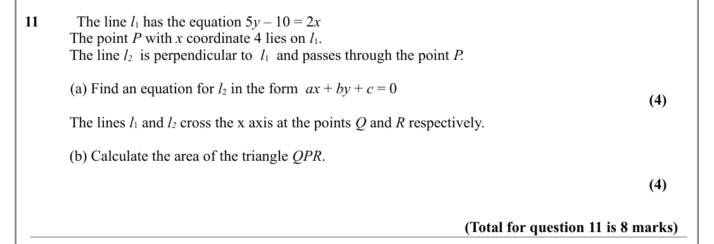

Text (lossy): 11          The line l 1 has the equation 5 y – 10 = 2 x / The point P with x coordinate 4 lies on l 1.  / The line l 2  is perpendicular to  l 1  and passes through the point P.  /             (a) Find an equation for l 2 in the form  ax + by + c = 0  / (4) / The lines l 1 and l 2 cross the x axis at the points Q and R respectively.  / (b) Calculate the area of the triangle QPR.  / (4) / (Total f

## Q12 (1 marks)

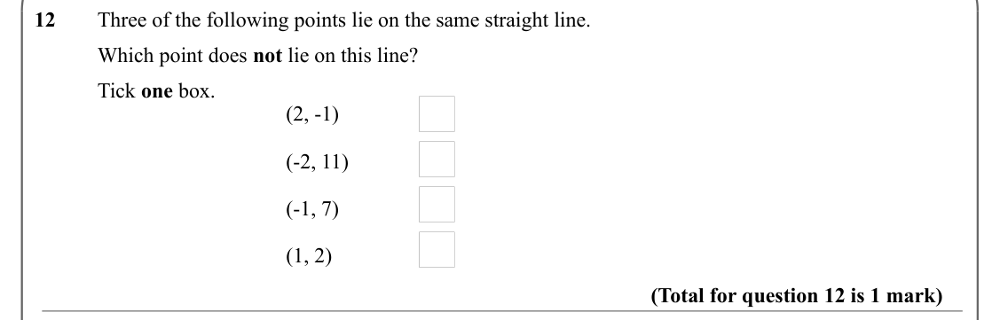

Text (lossy): 12       Three of the following points lie on the same straight line. / Which point does not lie on this line? / Tick one box. / (2, -1) / (-2, 11) / (-1, 7) / (1, 2) / (Total for question 12 is 1 mark)

## Q13 (5 marks · parts a, b)

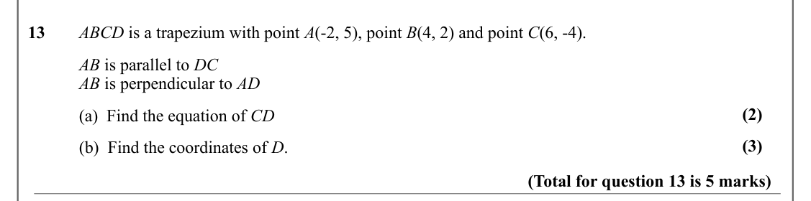

Text (lossy): 13       ABCD is a trapezium with point A(-2, 5), point B(4, 2) and point C(6, -4). / AB is parallel to DC / AB is perpendicular to AD  / (2) / (a)  Find the equation of CD / (3) / (b)  Find the coordinates of D. / (Total for question 13 is 5 marks)

## Q14 (3 marks)

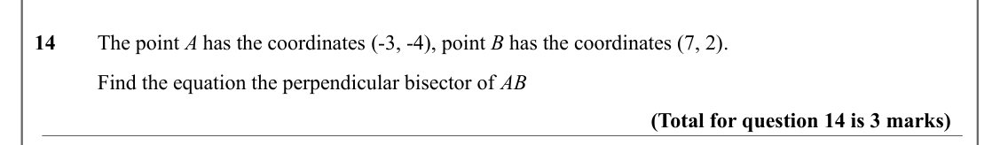

Text (lossy): 14       The point A has the coordinates (-3, -4), point B has the coordinates (7, 2). / Find the equation the perpendicular bisector of AB / (Total for question 14 is 3 marks)

## Q15 (4 marks)

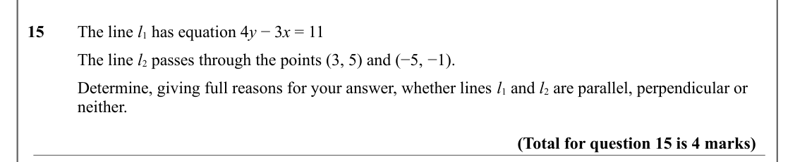

Text (lossy): 15       The line l 1 has equation 4 y − 3 x = 11 / The line l 2 passes through the points (3, 5) and (−5, −1). / Determine, giving full reasons for your answer, whether lines l 1 and l 2 are parallel, perpendicular or  / neither. / (Total for question 15 is 4 marks)

## Q16 (6 marks)

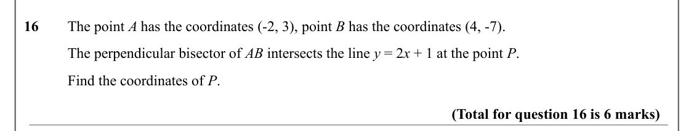

Text (lossy): 16       The point A has the coordinates (-2, 3), point B has the coordinates (4, -7). / The perpendicular bisector of AB intersects the line y = 2 x + 1 at the point P.  / Find the coordinates of P.  / (Total for question 16 is 6 marks)

## Q17 (6 marks · parts a, b)

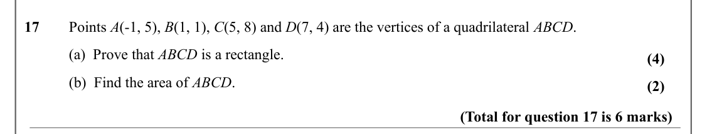

Text (lossy): 17       Points A(-1, 5), B(1, 1), C(5, 8) and D(7, 4) are the vertices of a quadrilateral ABCD. / (a)  Prove that ABCD is a rectangle. / (4) / (b)  Find the area of ABCD. / (2) / (Total for question 17 is 6 marks)

## Q18 (5 marks · parts a, b)

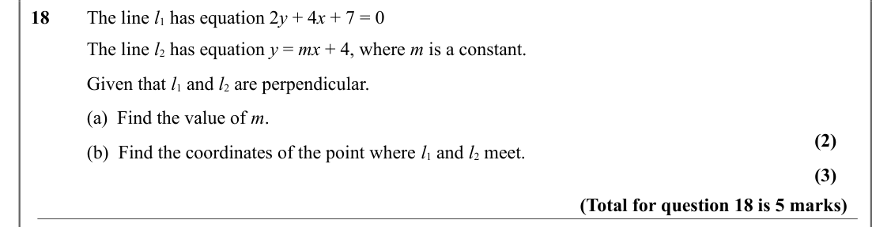

Text (lossy): 18       The line l 1 has equation 2 y + 4 x + 7 = 0 / The line l 2 has equation y = mx + 4, where m is a constant.  / Given that l 1 and l 2 are perpendicular.  / (a)  Find the value of m.  / (2) / (b)  Find the coordinates of the point where l 1 and l 2 meet.  / (3) / (Total for question 18 is 5 marks)

## Q19 (6 marks · parts a, b)

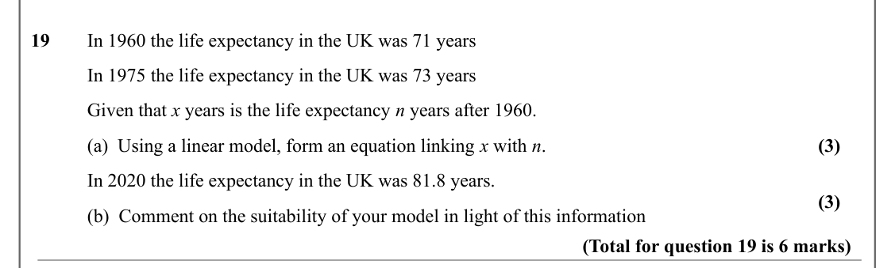

Text (lossy): 19       In 1960 the life expectancy in the UK was 71 years / In 1975 the life expectancy in the UK was 73 years   / Given that x years is the life expectancy n years after 1960.  / (a)  Using a linear model, form an equation linking x with n. / (3) / In 2020 the life expectancy in the UK was 81.8 years.  / (3) / (b)  Comment on the suitability of your model in light of this information / (Total f

## Q20 (6 marks · parts a, b)

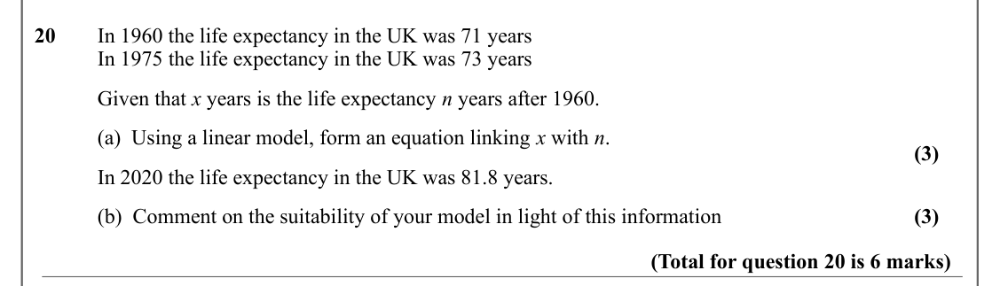

Text (lossy): 20       In 1960 the life expectancy in the UK was 71 years / In 1975 the life expectancy in the UK was 73 years   / Given that x years is the life expectancy n years after 1960.  / (a)  Using a linear model, form an equation linking x with n. / (3) / In 2020 the life expectancy in the UK was 81.8 years.  / (b)  Comment on the suitability of your model in light of this information / (3) / (Total f

## Q21 (6 marks · parts a, b)

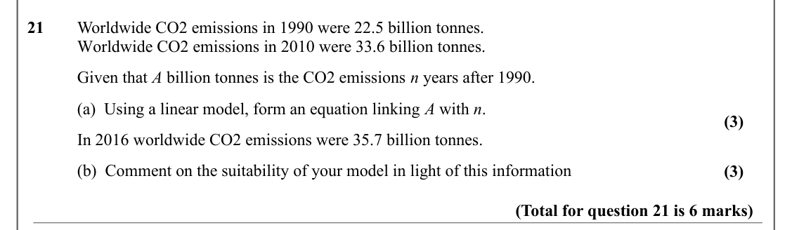

Text (lossy): 21       Worldwide CO2 emissions in 1990 were 22.5 billion tonnes.  / Worldwide CO2 emissions in 2010 were 33.6 billion tonnes.  / Given that A billion tonnes is the CO2 emissions n years after 1990.  / (a)  Using a linear model, form an equation linking A with n. / (3) / In 2016 worldwide CO2 emissions were 35.7 billion tonnes. / (b)  Comment on the suitability of your model in light of this info

## Q22 (5 marks)

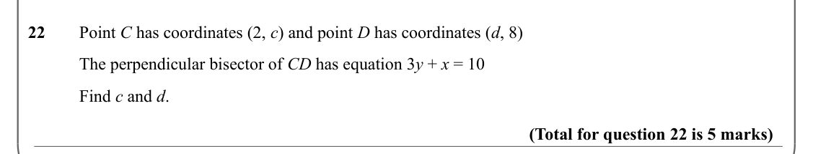

Text (lossy): 22       Point C has coordinates (2, c) and point D has coordinates (d, 8) / The perpendicular bisector of CD has equation 3 y + x = 10 / Find c and d.  / (Total for question 22 is 5 marks)

