# Circles — Question Set (A-Level Maths · Edexcel · Year 1 Pure Mathematics)

Chapter question set · `as-pure-mathematics-6-circles` · 28 questions · segmented by printed total lines

## Q1 (3 marks · parts i, ii)

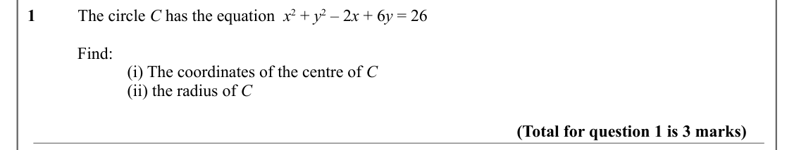

Text (lossy): 1          The circle C has the equation  x 2 + y 2 – 2 x + 6 y = 26 / Find: / (i) The coordinates of the centre of C / (ii) the radius of C / (Total for question 1 is 3 marks)

## Q2 (3 marks)

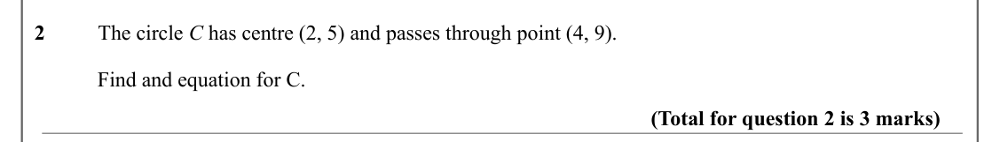

Text (lossy): 2          The circle C has centre (2, 5) and passes through point (4, 9).  / Find and equation for C. / (Total for question 2 is 3 marks)

## Q3 (10 marks · parts a, b, c)

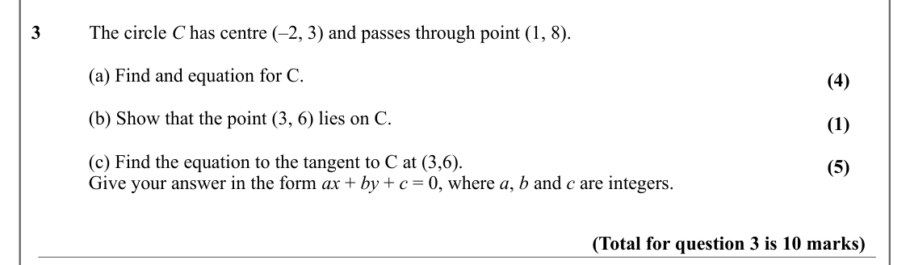

Text (lossy): 3          The circle C has centre (–2, 3) and passes through point (1, 8).  / (a) Find and equation for C. / (4) / (b) Show that the point (3, 6) lies on C.  / (1) / (c) Find the equation to the tangent to C at (3,6).  / (5) / Give your answer in the form ax + by + c = 0, where a, b and c are integers.  / (Total for question 3 is 10 marks)

## Q4 (8 marks · parts a, b)

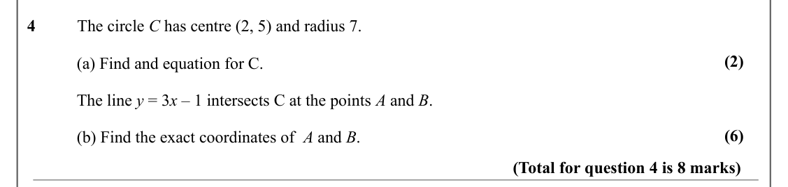

Text (lossy): 4          The circle C has centre (2, 5) and radius 7.  / (2) / (a) Find and equation for C. / The line y = 3 x – 1 intersects C at the points A and B. / (6) / (b) Find the exact coordinates of  A and B. / (Total for question 4 is 8 marks)

## Q5 (10 marks · parts a, b, c)

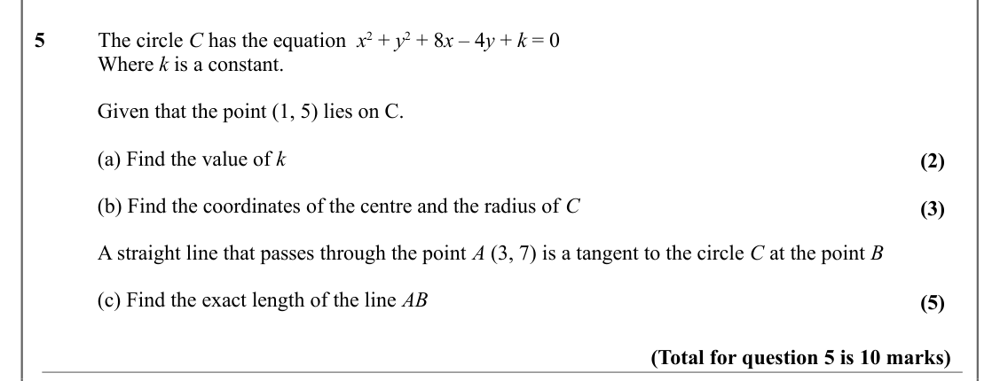

Text (lossy): 5          The circle C has the equation  x 2 + y 2 + 8 x – 4 y + k = 0 / Where k is a constant. / Given that the point (1, 5) lies on C.  / (a) Find the value of k / (2) / (b) Find the coordinates of the centre and the radius of C / (3) / A straight line that passes through the point A (3, 7) is a tangent to the circle C at the point B / (c) Find the exact length of the line AB  / (5) / (Total fo

## Q6 (10 marks · parts a, b, c)

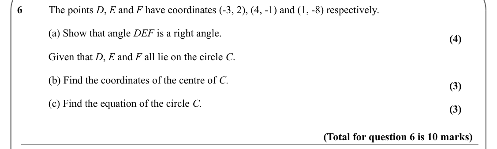

Text (lossy): 6          The points D, E and F have coordinates (-3, 2), (4, -1) and (1, -8) respectively.  / (a) Show that angle DEF is a right angle.  / (4) / Given that D, E and F all lie on the circle C.  / (b) Find the coordinates of the centre of C. / (3) / (c) Find the equation of the circle C. / (3) / (Total for question 6 is 10 marks)

## Q7 (6 marks · parts a, b)

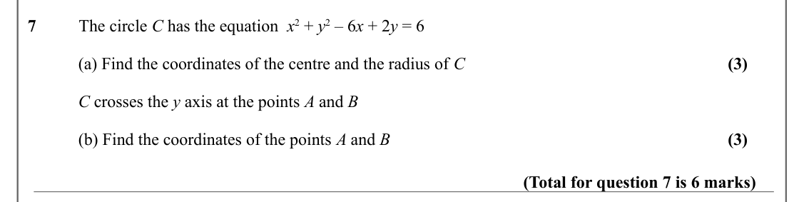

Text (lossy): 7          The circle C has the equation  x 2 + y 2 – 6 x + 2 y = 6 / (a) Find the coordinates of the centre and the radius of C / (3) / C crosses the y axis at the points A and B / (b) Find the coordinates of the points A and B / (3) / (Total for question 7 is 6 marks)

## Q8 (6 marks)

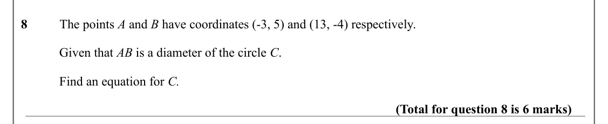

Text (lossy): 8          The points A and B have coordinates (-3, 5) and (13, -4) respectively. / Given that AB is a diameter of the circle C.  / Find an equation for C. / (Total for question 8 is 6 marks)

## Q9 (8 marks · parts a, b)

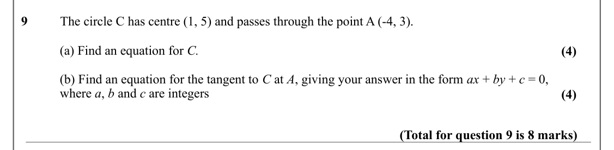

Text (lossy): 9          The circle C has centre (1, 5) and passes through the point A (-4, 3). / (a) Find an equation for C. / (4) / (b) Find an equation for the tangent to C at A, giving your answer in the form ax + by + c = 0,  / where a, b and c are integers  / (4) / (Total for question 9 is 8 marks)

## Q10 (5 marks)

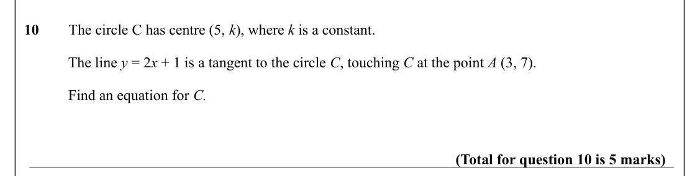

Text (lossy): 10        The circle C has centre (5, k), where k is a constant.  / The line y = 2 x + 1 is a tangent to the circle C, touching C at the point A (3, 7). / Find an equation for C. / (Total for question 10 is 5 marks)

## Q11 (9 marks · parts a, b, i, ii)

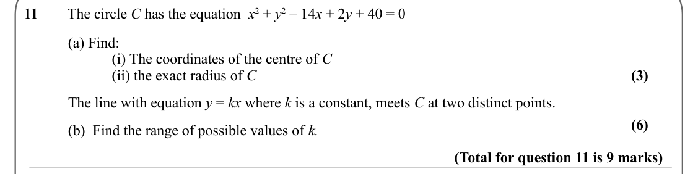

Text (lossy): 11        The circle C has the equation  x 2 + y 2 – 14 x + 2 y + 40 = 0 / (a) Find: / (i) The coordinates of the centre of C / (ii) the exact radius of C / (3) / The line with equation y = kx where k is a constant, meets C at two distinct points.   / (6) / (b)  Find the range of possible values of k.  / (Total for question 11 is 9 marks)

## Q12 (5 marks · parts a, b, i, ii)

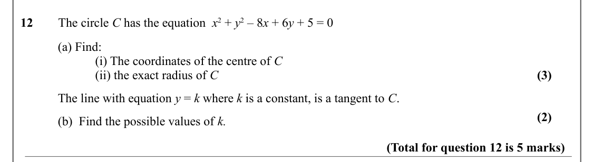

Text (lossy): 12        The circle C has the equation  x 2 + y 2 – 8 x + 6 y + 5 = 0 / (a) Find: / (i) The coordinates of the centre of C / (ii) the exact radius of C / (3) / The line with equation y = k where k is a constant, is a tangent to C. / (2) / (b)  Find the possible values of k.  / (Total for question 12 is 5 marks)

## Q13 (5 marks)

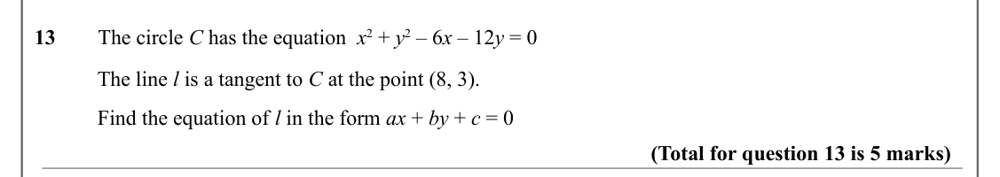

Text (lossy): 13        The circle C has the equation  x 2 + y 2 – 6 x – 12 y = 0 / The line l is a tangent to C at the point (8, 3).  / Find the equation of l in the form ax + by + c = 0  / (Total for question 13 is 5 marks)

## Q14 (4 marks)

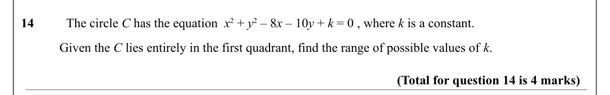

Text (lossy): 14          The circle C has the equation  x 2 + y 2 – 8 x – 10 y + k = 0 , where k is a constant.  / Given the C lies entirely in the first quadrant, find the range of possible values of k.   / (Total for question 14 is 4 marks)

## Q15 (7 marks)

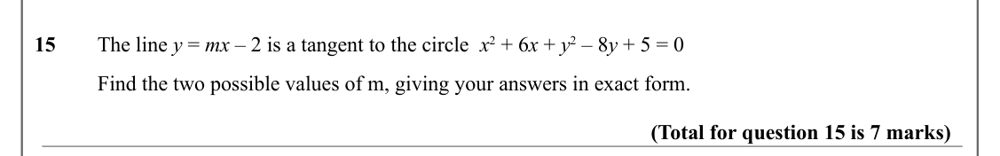

Text (lossy): 15    / The line y = mx – 2 is a tangent to the circle  x 2 + 6 x + y 2 – 8 y + 5 = 0 / Find the two possible values of m, giving your answers in exact form.  / (Total for question 15 is 7 marks)

## Q16 (7 marks)

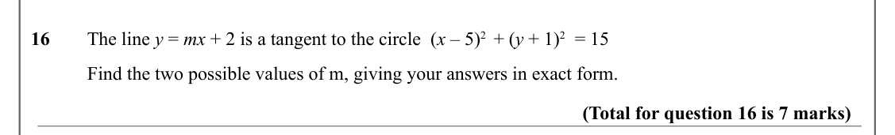

Text (lossy): 16    / The line y = mx + 2 is a tangent to the circle  (x – 5)2  + (y + 1)2  = 15 / Find the two possible values of m, giving your answers in exact form.  / (Total for question 16 is 7 marks)

## Q17 (6 marks · parts a, b)

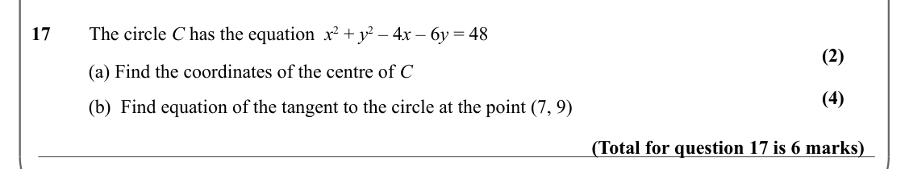

Text (lossy): 17        The circle C has the equation  x 2 + y 2 – 4 x – 6 y = 48 / (2) / (a) Find the coordinates of the centre of C / (4) / (b)  Find equation of the tangent to the circle at the point (7, 9) / (Total for question 17 is 6 marks)

## Q18 (10 marks · parts a, b, c)

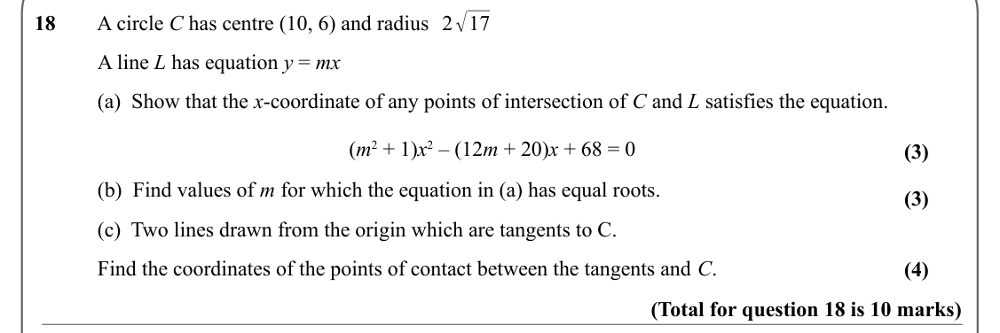

Text (lossy): 2√17 / 18        A circle C has centre (10, 6) and radius   / A line L has equation y = mx  / (a)  Show that the x-coordinate of any points of intersection of C and L satisfies the equation.  / (m 2 + 1)x 2 – (12 m + 20)x + 68 = 0 / (3) / (b)  Find values of m for which the equation in (a) has equal roots. / (3) / (c)  Two lines drawn from the origin which are tangents to C.  / Find the coordinate

## Q19 (6 marks)

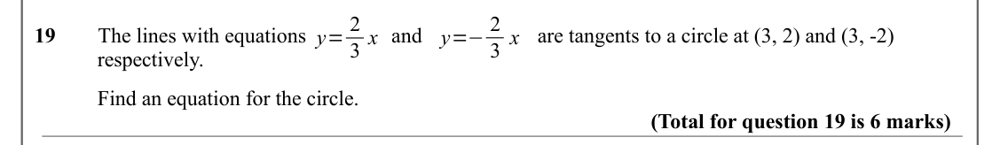

Text (lossy): y=−2 / y= 2 / 19        The lines with equations  /         and  / are tangents to a circle at (3, 2) and (3, -2)  / 3 x / 3 x / respectively.  / Find an equation for the circle.  / (Total for question 19 is 6 marks)

## Q20 (4 marks)

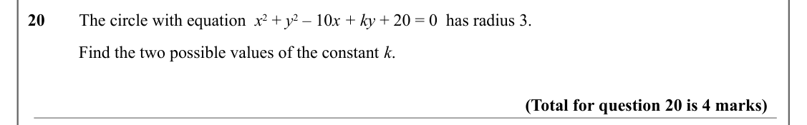

Text (lossy): 20        The circle with equation  x 2 + y 2 – 10 x + ky + 20 = 0  has radius 3. / Find the two possible values of the constant k.  / (Total for question 20 is 4 marks)

## Q21 (4 marks)

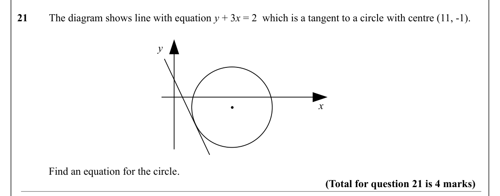

Text (lossy): 21        The diagram shows line with equation y + 3 x = 2  which is a tangent to a circle with centre (11, -1).  / y / x / Find an equation for the circle.  / (Total for question 21 is 4 marks)

## Q22 (1 marks)

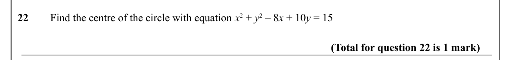

Text (lossy): 22        Find the centre of the circle with equation x 2 + y 2 – 8 x + 10 y = 15 / (Total for question 22 is 1 mark)

## Q23 (6 marks)

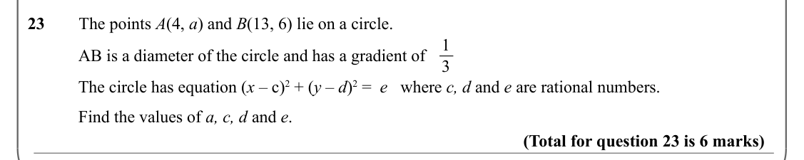

Text (lossy): 23        The points A(4, a) and B(13, 6) lie on a circle.  / 1 / AB is a diameter of the circle and has a gradient of  / 3 / The circle has equation (x – c)2 + (y – d)2 =  e   where c, d and e are rational numbers.  / Find the values of a, c, d and e.  / (Total for question 23 is 6 marks)

## Q24 (7 marks · parts a, b)

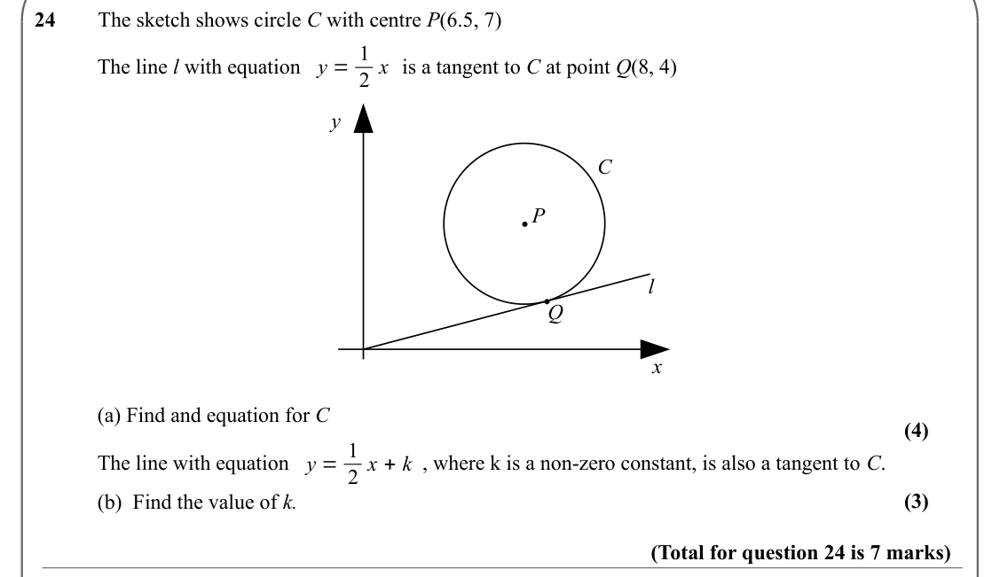

Text (lossy): 24        The sketch shows circle C with centre P(6.5, 7) / y = 1 / 2 x / The line l with equation /           is a tangent to C at point Q(8, 4) / y / C / P / l / Q / x / (a) Find and equation for C / (4) / y = 1 / The line with equation /   , where k is a non-zero constant, is also a tangent to C.    / 2 x + k / (3) / (b)  Find the value of k.  / (Total for question 24 is 7 marks)

## Q25 (2 marks)

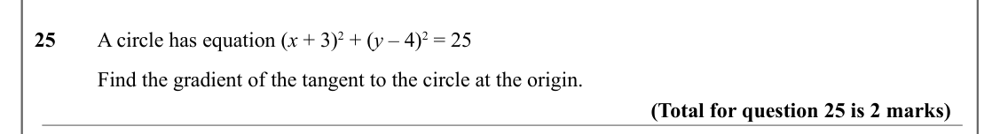

Text (lossy): 25        A circle has equation (x + 3)2 + (y – 4)2 = 25  / Find the gradient of the tangent to the circle at the origin.  / (Total for question 25 is 2 marks)

## Q26 (4 marks · parts a, b)

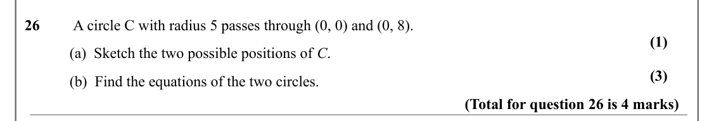

Text (lossy): 26         A circle C with radius 5 passes through (0, 0) and (0, 8).  / (1) / (a)  Sketch the two possible positions of C.  / (3) / (b)  Find the equations of the two circles.   / (Total for question 26 is 4 marks)

## Q27 (7 marks)

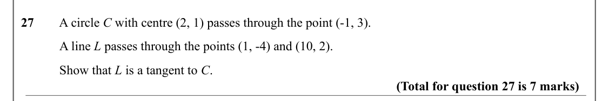

Text (lossy): 27        A circle C with centre (2, 1) passes through the point (-1, 3).  / A line L passes through the points (1, -4) and (10, 2).  / Show that L is a tangent to C.  / (Total for question 27 is 7 marks)

## Q28 (8 marks)

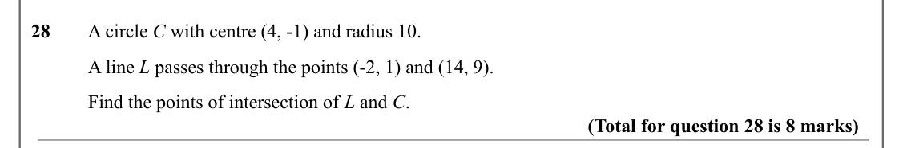

Text (lossy): 28        A circle C with centre (4, -1) and radius 10.  / A line L passes through the points (-2, 1) and (14, 9).  / Find the points of intersection of L and C.  / (Total for question 28 is 8 marks)

