# The Binomial Expansion — Question Set (A-Level Maths · Edexcel · Year 1 Pure Mathematics)

Chapter question set · `as-pure-mathematics-8-the-binomial-expansion` · 20 questions · segmented by printed total lines

## Q1 (6 marks · parts b)

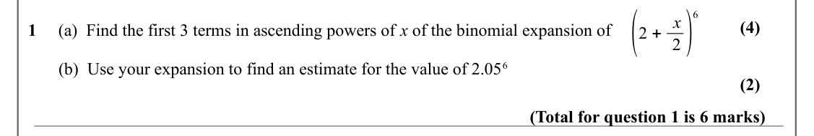

Text (lossy): (2 + x / 2) / 6 / (4) / 1     (a)  Find the first 3 terms in ascending powers of x of the binomial expansion of  /        (b)  Use your expansion to find an estimate for the value of 2.05 6 / (2) / (Total for question 1 is 6 marks)

## Q2 (8 marks · parts b)

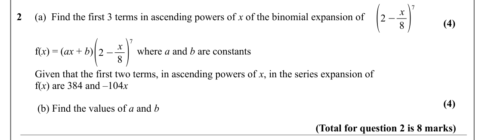

Text (lossy): (2 −x / 8) / 7 / 2     (a)  Find the first 3 terms in ascending powers of x of the binomial expansion of  / (4) / (2 −x / 8) / 7 /        f(x) = (ax + b)                 where a and b are constants /        Given that the first two terms, in ascending powers of x, in the series expansion of  /        f(x) are 384 and –104 x    / (4) /         (b) Find the values of a and b  / (Total for question 2

## Q3 (7 marks · parts b)

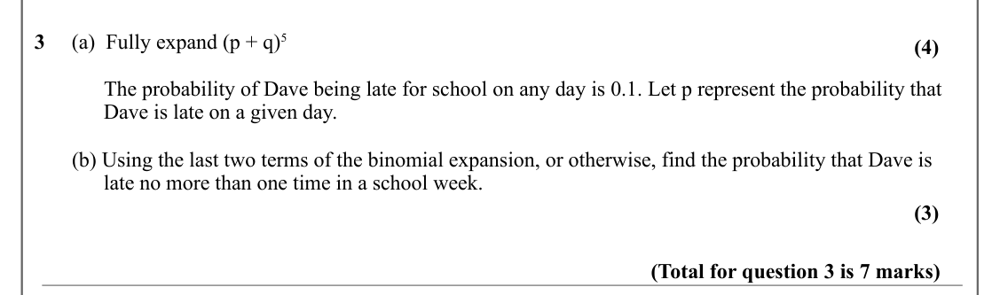

Text (lossy): 3     (a)  Fully expand (p + q)5  / (4) /              The probability of Dave being late for school on any day is 0.1. Let p represent the probability that      /              Dave is late on a given day.  /        (b) Using the last two terms of the binomial expansion, or otherwise, find the probability that Dave is       /              late no more than one time in a school week.  / (3) / (Tota

## Q4 (7 marks · parts b)

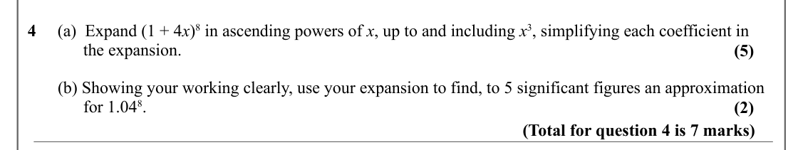

Text (lossy): 4     (a)  Expand (1 + 4 x)8 in ascending powers of x, up to and including x 3, simplifying each coefficient in       /              the expansion.   / (5) /        (b) Showing your working clearly, use your expansion to find, to 5 significant figures an approximation    /              for 1.04 8.  / (2) / (Total for question 4 is 7 marks)

## Q5 (7 marks · parts b)

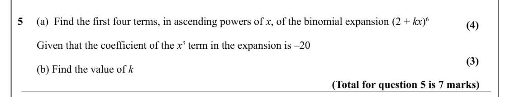

Text (lossy): 5     (a)  Find the first four terms, in ascending powers of x, of the binomial expansion (2 + kx)6   / (4) /        Given that the coefficient of the x 3 term in the expansion is –20  / (3) /        (b) Find the value of k / (Total for question 5 is 7 marks)

## Q6 (7 marks · parts b)

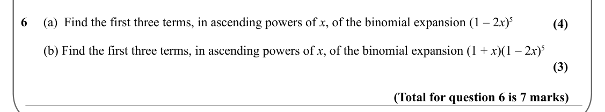

Text (lossy): 6     (a)  Find the first three terms, in ascending powers of x, of the binomial expansion (1 – 2 x)5   / (4) /        (b) Find the first three terms, in ascending powers of x, of the binomial expansion (1 + x)(1 – 2 x)5   / (3) / (Total for question 6 is 7 marks)

## Q7 (8 marks · parts b)

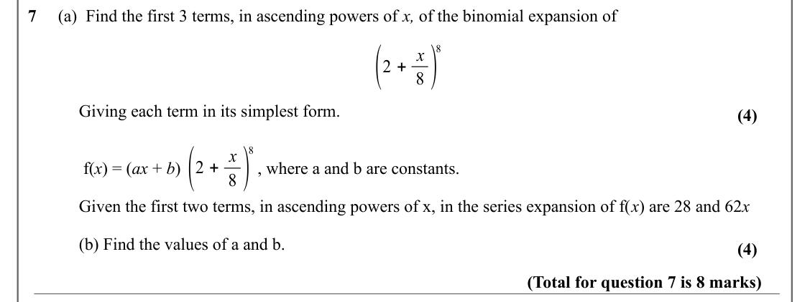

Text (lossy): 7     (a)  Find the first 3 terms, in ascending powers of x, of the binomial expansion of / (2 + x / 8 ) / 8 / Giving each term in its simplest form.  / (4) / (2 + x / 8 ) / 8 /  f(x) = (ax + b)     /       , where a and b are constants.  / Given the first two terms, in ascending powers of x, in the series expansion of f(x) are 28 and 62 x  / (b) Find the values of a and b. / (4) / (Total for ques

## Q8 (5 marks · parts b)

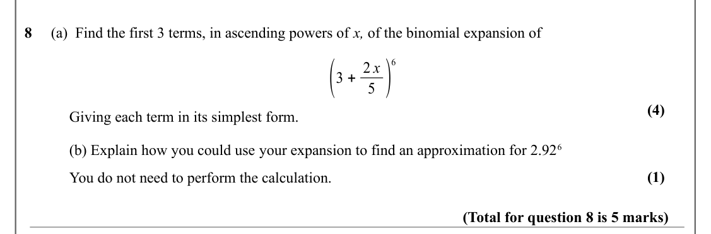

Text (lossy): 8     (a)  Find the first 3 terms, in ascending powers of x, of the binomial expansion of / (3 + 2 x / 5 ) / 6 / (4) / Giving each term in its simplest form.  / (b) Explain how you could use your expansion to find an approximation for 2.92 6 / (1) / You do not need to perform the calculation. / (Total for question 8 is 5 marks)

## Q9 (6 marks · parts b)

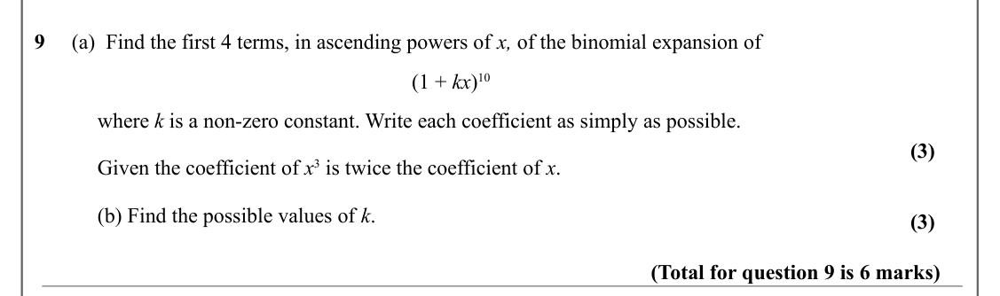

Text (lossy): 9     (a)  Find the first 4 terms, in ascending powers of x, of the binomial expansion of / (1 + kx)10 / where k is a non-zero constant. Write each coefficient as simply as possible. / (3) / Given the coefficient of x 3 is twice the coefficient of x.  / (b) Find the possible values of k.  / (3) / (Total for question 9 is 6 marks)

## Q10 (7 marks · parts a, b)

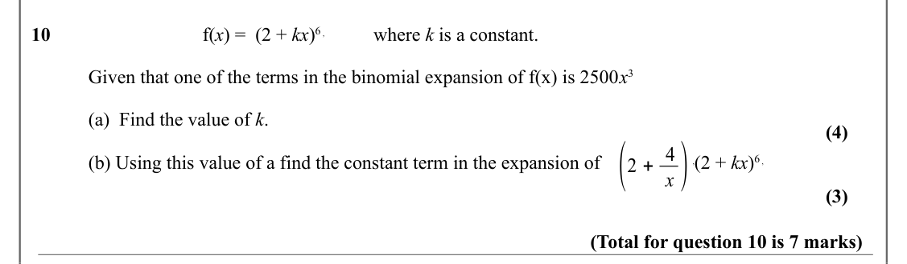

Text (lossy): 10      / f(x) =  (2 + kx)6 ,   / where k is a constant.  / Given that one of the terms in the binomial expansion of f(x) is 2500 x 3 / (a)  Find the value of k.  / (4) / (2 + 4 / x ) / (b) Using this value of a find the constant term in the expansion of   /        ,(2 + kx)6 , / (3) / (Total for question 10 is 7 marks)

## Q11 (5 marks · parts a, b)

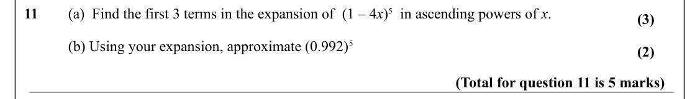

Text (lossy): 11 / (a)  Find the first 3 terms in the expansion of  (1 – 4 x)5  in ascending powers of x.  / (3) / (b) Using your expansion, approximate (0.992)5 / (2) / (Total for question 11 is 5 marks)

## Q12 (5 marks)

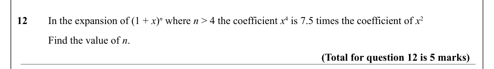

Text (lossy): 12 / In the expansion of (1 + x)n where n > 4 the coefficient x 4 is 7.5 times the coefficient of x 2 / Find the value of n.  / (Total for question 12 is 5 marks)

## Q13 (6 marks)

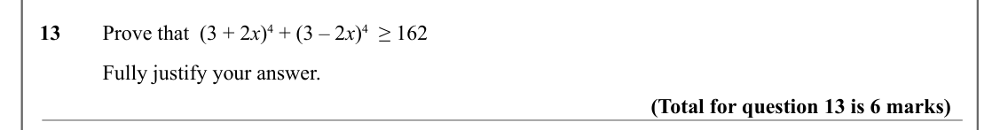

Text (lossy): 13 / Prove that  (3 + 2 x)4 + (3 – 2 x)4  ≥ 162  / Fully justify your answer.  / (Total for question 13 is 6 marks)

## Q14 (3 marks)

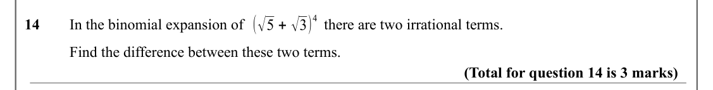

Text (lossy): (√5 + √3) / 4 / 14 / In the binomial expansion of  /         there are two irrational terms.  / Find the difference between these two terms.  / (Total for question 14 is 3 marks)

## Q15 (4 marks)

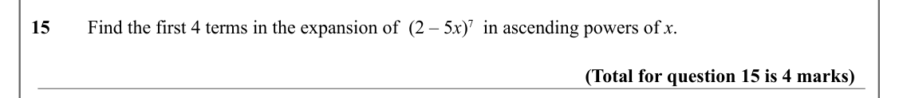

Text (lossy): 15 / Find the first 4 terms in the expansion of  (2 – 5 x)7  in ascending powers of x.  / (Total for question 15 is 4 marks)

## Q16 (2 marks)

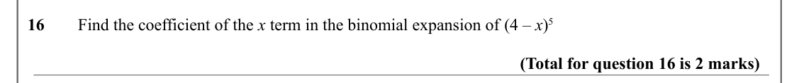

Text (lossy): 16 / Find the coefficient of the x term in the binomial expansion of (4 – x)5  / (Total for question 16 is 2 marks)

## Q17 (3 marks)

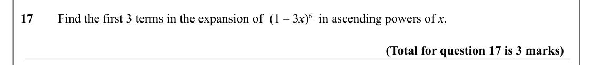

Text (lossy): 17 / Find the first 3 terms in the expansion of  (1 – 3 x)6  in ascending powers of x.  / (Total for question 17 is 3 marks)

## Q18 (6 marks · parts a, b)

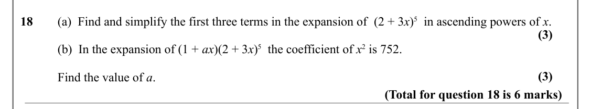

Text (lossy): 18 / (a)  Find and simplify the first three terms in the expansion of  (2 + 3 x)5  in ascending powers of x. / (3) / (b)  In the expansion of (1 + ax)(2 + 3 x)5  the coefficient of x 2 is 752.  / (3) / Find the value of a.  / (Total for question 18 is 6 marks)

## Q19 (5 marks · parts a, b)

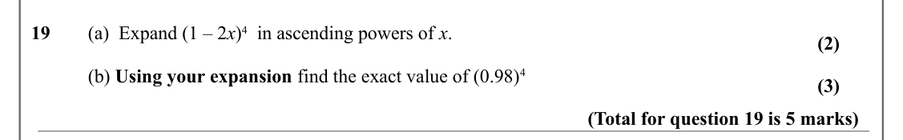

Text (lossy): 19 / (a)  Expand (1 – 2 x)4  in ascending powers of x.  / (2) / (b) Using your expansion find the exact value of (0.98)4  / (3) / (Total for question 19 is 5 marks)

## Q20 (3 marks)

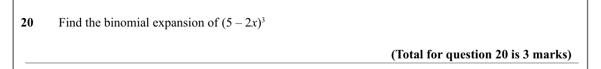

Text (lossy): 20 / Find the binomial expansion of (5 – 2 x)3   / (Total for question 20 is 3 marks)

