# Trigonometric Ratios — Question Set (A-Level Maths · Edexcel · Year 1 Pure Mathematics)

Chapter question set · `as-pure-mathematics-9-trigonometric-ratios` · 20 questions · segmented by printed total lines

## Q1 (5 marks · parts a, b)

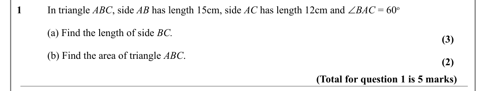

Text (lossy): In triangle ABC, side AB has length 15cm, side AC has length 12cm and ∠BAC = 60 o  / 1 / (a) Find the length of side BC. / (3) / (b) Find the area of triangle ABC.  / (2) / (Total for question 1 is 5 marks)

## Q2 (5 marks · parts a, b)

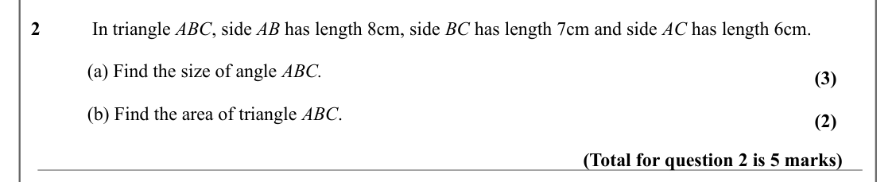

Text (lossy): 2 /  In triangle ABC, side AB has length 8cm, side BC has length 7cm and side AC has length 6cm.  / (a) Find the size of angle ABC. / (3) / (b) Find the area of triangle ABC.  / (2) / (Total for question 2 is 5 marks)

## Q3 (9 marks · parts a, b, c)

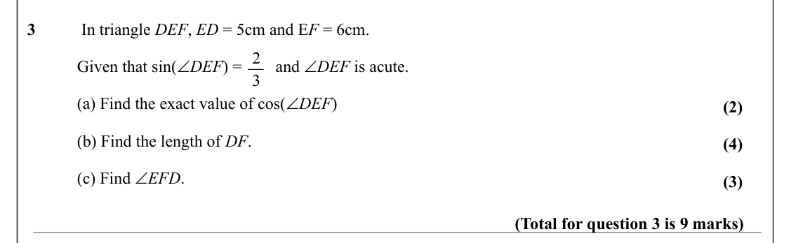

Text (lossy): 3 /  In triangle DEF, ED = 5cm and E F = 6cm. / 2 / Given that sin(∠DEF) =        and ∠DEF is acute.   / 3 / (a) Find the exact value of cos(∠DEF) / (2) / (b) Find the length of DF.  / (4) / (c) Find ∠EFD. / (3) / (Total for question 3 is 9 marks)

## Q4 (8 marks · parts a, b)

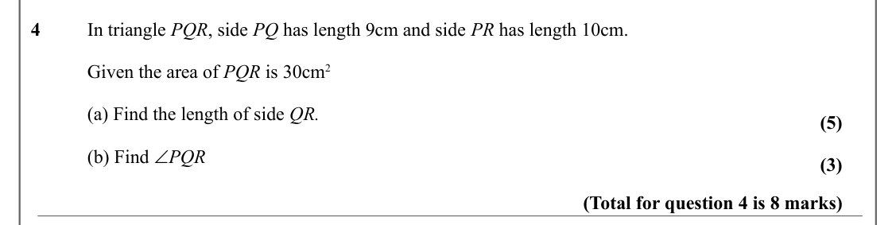

Text (lossy): 4 / In triangle PQR, side PQ has length 9cm and side PR has length 10cm. / Given the area of PQR is 30cm 2 / (a) Find the length of side QR. / (5) / (b) Find ∠PQR / (3) / (Total for question 4 is 8 marks)

## Q5 (6 marks)

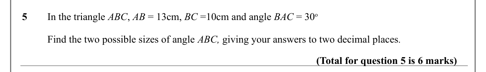

Text (lossy): 5  / In the triangle ABC, AB = 13cm, BC =10cm and angle BAC = 30 o / Find the two possible sizes of angle ABC, giving your answers to two decimal places. / (Total for question 5 is 6 marks)

## Q6 (5 marks)

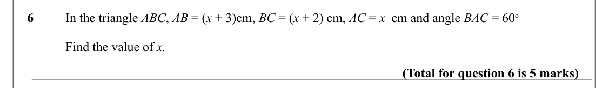

Text (lossy): 6  / In the triangle ABC, AB = (x + 3)cm, BC = (x + 2) cm, AC = x  cm and angle BAC = 60 o / Find the value of x. / (Total for question 6 is 5 marks)

## Q7 (6 marks · parts a, b)

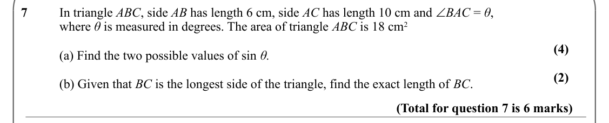

Text (lossy): In triangle ABC, side AB has length 6 cm, side AC has length 10 cm and ∠BAC = θ,  / 7 / where θ is measured in degrees. The area of triangle ABC is 18 cm 2 / (4) / (a) Find the two possible values of sin θ. / (2) / (b) Given that BC is the longest side of the triangle, find the exact length of BC.  / (Total for question 7 is 6 marks)

## Q8 (6 marks · parts a, b)

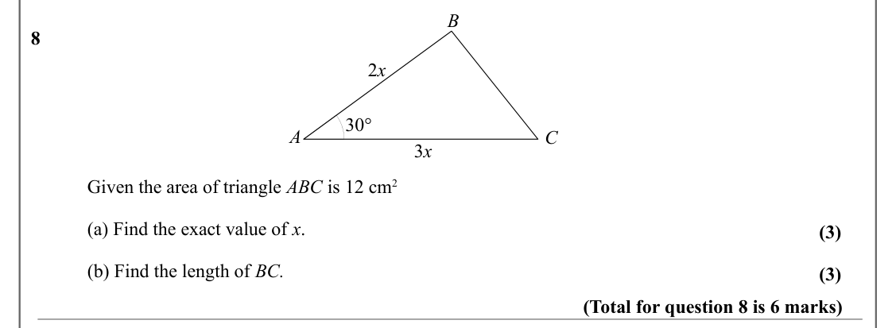

Text (lossy): B / 8 / 2 x / 30° / A / C / 3 x / Given the area of triangle ABC is 12 cm 2 / (a) Find the exact value of x.  / (3) / (b) Find the length of BC. / (3) / (Total for question 8 is 6 marks)

## Q9 (6 marks · parts a, b)

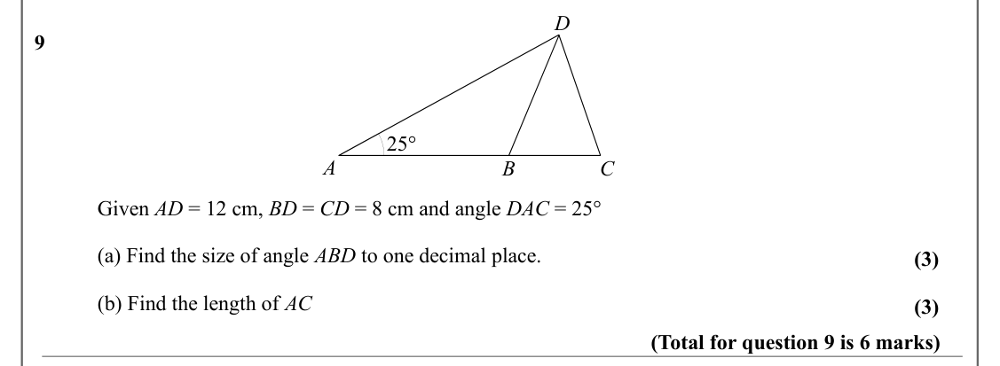

Text (lossy): D / 9 / 25° / A / B / C / Given AD = 12 cm, BD = CD = 8 cm and angle DAC = 25°  / (a) Find the size of angle ABD to one decimal place.  / (3) / (b) Find the length of AC / (3) / (Total for question 9 is 6 marks)

## Q10 (5 marks · parts a, b)

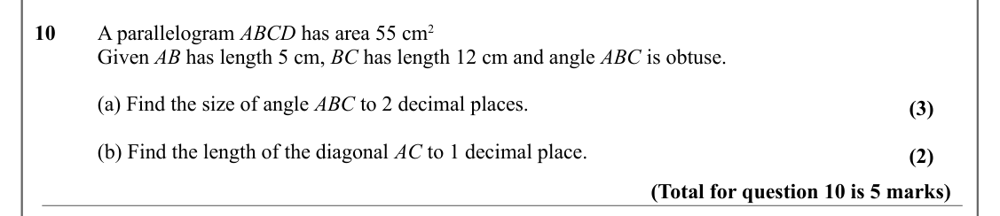

Text (lossy): 10 / A parallelogram ABCD has area 55 cm 2 / Given AB has length 5 cm, BC has length 12 cm and angle ABC is obtuse.  / (a) Find the size of angle ABC to 2 decimal places.  / (3) / (b) Find the length of the diagonal AC to 1 decimal place.   / (2) / (Total for question 10 is 5 marks)

## Q11 (6 marks · parts a, b)

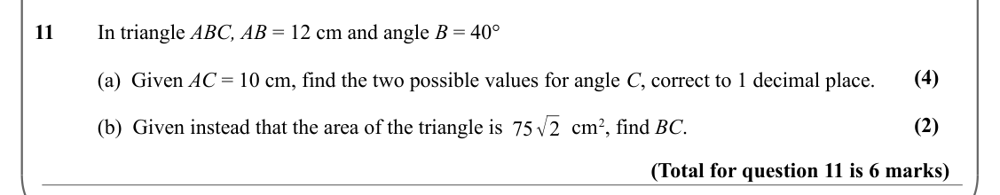

Text (lossy): 11 / In triangle ABC, AB = 12 cm and angle B = 40°  / (4) / (a)  Given AC = 10 cm, find the two possible values for angle C, correct to 1 decimal place.  / 75√2 / (2) / (b)  Given instead that the area of the triangle is             cm 2, find BC. / (Total for question 11 is 6 marks)

## Q12 (3 marks)

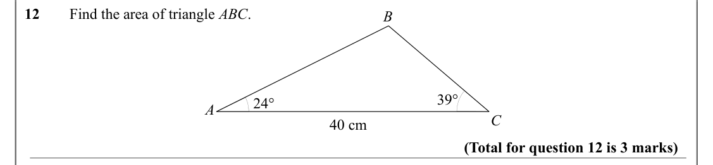

Text (lossy): 12 / Find the area of triangle ABC. / B / 39° / 24° / A / C / 40 cm / (Total for question 12 is 3 marks)

## Q13 (3 marks)

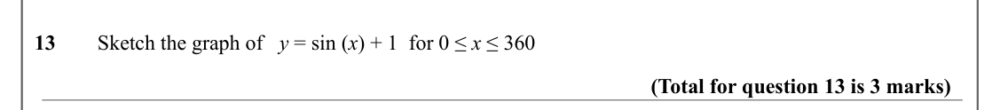

Text (lossy): 13 / Sketch the graph of   y = sin (x) + 1  for 0 ≤ x ≤ 360 / (Total for question 13 is 3 marks)

## Q14 (3 marks)

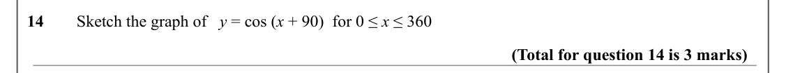

Text (lossy): 14 / Sketch the graph of   y = cos (x + 90)  for 0 ≤ x ≤ 360 / (Total for question 14 is 3 marks)

## Q15 (4 marks · parts a, b)

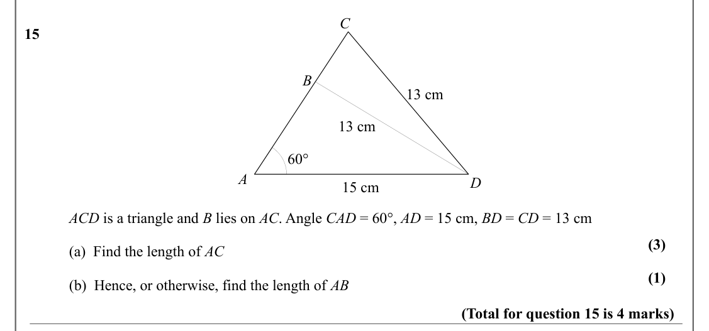

Text (lossy): C / 15 / B / 13 cm / 13 cm / 60° / A / D / 15 cm / ACD is a triangle and B lies on AC. Angle CAD = 60°, AD = 15 cm, BD = CD = 13 cm  / (3) / (a)  Find the length of AC / (1) / (b)  Hence, or otherwise, find the length of AB / (Total for question 15 is 4 marks)

## Q16 (4 marks)

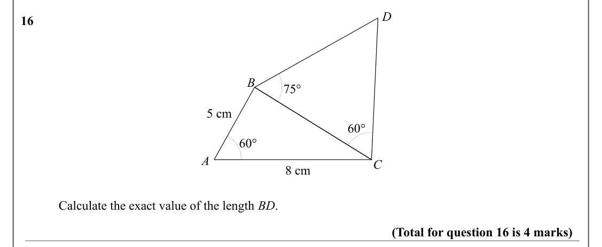

Text (lossy): D / 16 / B / 75° / 5 cm / 60° / 60° / A / C / 8 cm  / Calculate the exact value of the length BD.    / (Total for question 16 is 4 marks)

## Q17 (6 marks · parts a, b)

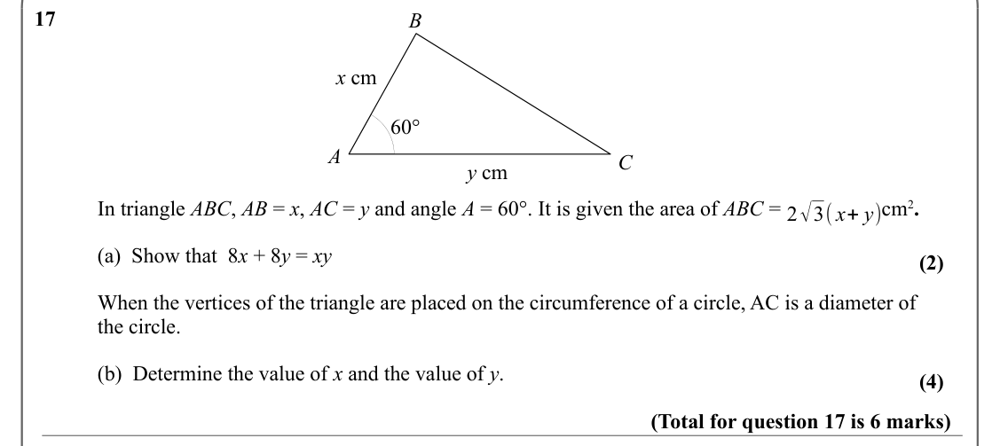

Text (lossy): 17 / B / x cm / 60° / A / C / y cm  / In triangle ABC, AB = x, AC = y and angle A = 60°. It is given the area of ABC =                   cm 2. / 2√3( x+ y) / (a)  Show that  8 x + 8 y = xy      / (2) / When the vertices of the triangle are placed on the circumference of a circle, AC is a diameter of / the circle. / (b)  Determine the value of x and the value of y.                                  

## Q18 (5 marks · parts a, b)

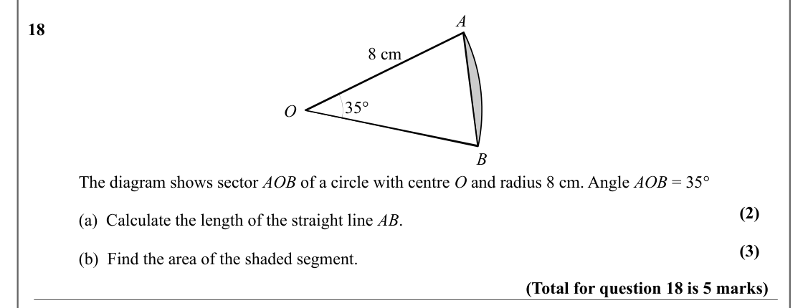

Text (lossy): A / 18 / 8 cm / 35° / O / B / The diagram shows sector AOB of a circle with centre O and radius 8 cm. Angle AOB = 35° / (2) / (a)  Calculate the length of the straight line AB.   / (3) / (b)  Find the area of the shaded segment.    / (Total for question 18 is 5 marks)

## Q19 (5 marks · parts a, b)

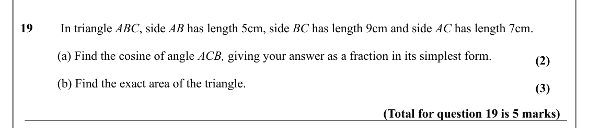

Text (lossy): 19 /  In triangle ABC, side AB has length 5cm, side BC has length 9cm and side AC has length 7cm.  / (a) Find the cosine of angle ACB, giving your answer as a fraction in its simplest form. / (2) / (b) Find the exact area of the triangle.  / (3) / (Total for question 19 is 5 marks)

## Q20 (2 marks)

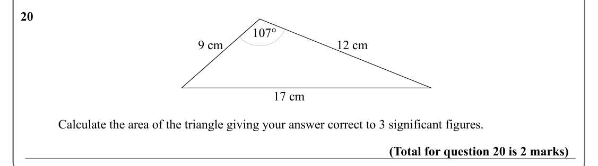

Text (lossy): 20 / 107° / 9 cm / 12 cm / 17 cm / Calculate the area of the triangle giving your answer correct to 3 significant figures.  / (Total for question 20 is 2 marks)

