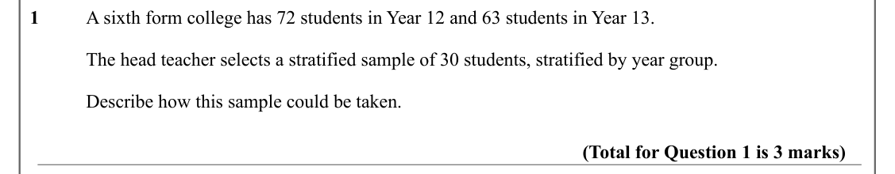
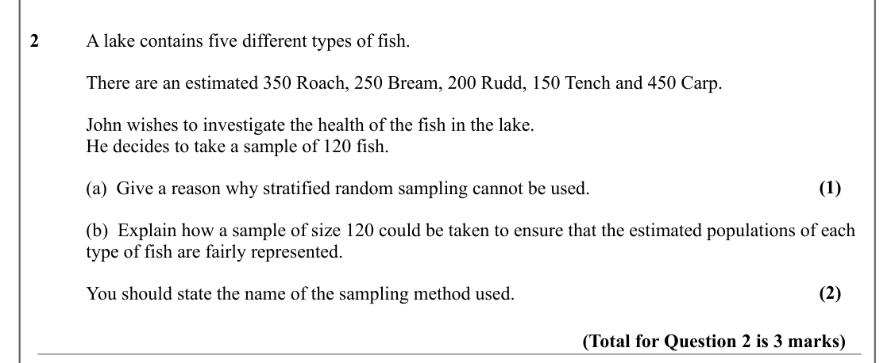
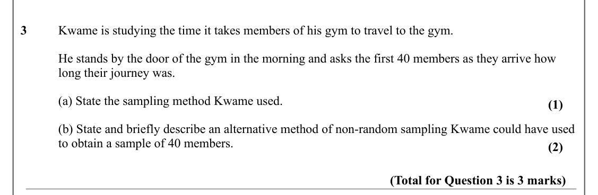
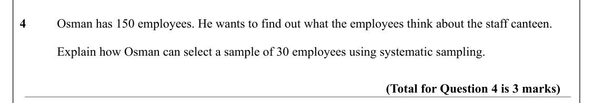

# Data Collection — Question Set (A-Level Maths · Edexcel · Year 1 Statistics)

Chapter question set · `as-statistics-1-data-collection` · 4 questions · segmented by printed total lines

## Q1 (3 marks)

Text (lossy): 1 / A sixth form college has 72 students in Year 12 and 63 students in Year 13. / The head teacher selects a stratified sample of 30 students, stratified by year group. / Describe how this sample could be taken. / (Total for Question 1 is 3 marks)

## Q2 (3 marks · parts a, b)

Text (lossy): 2 / A lake contains five different types of fish. / There are an estimated 350 Roach, 250 Bream, 200 Rudd, 150 Tench and 450 Carp. / John wishes to investigate the health of the fish in the lake. / He decides to take a sample of 120 fish. / (1) / (a)  Give a reason why stratified random sampling cannot be used. / (b)  Explain how a sample of size 120 could be taken to ensure that the estimated pop

## Q3 (3 marks · parts a, b)

Text (lossy): 3 / Kwame is studying the time it takes members of his gym to travel to the gym. / He stands by the door of the gym in the morning and asks the first 40 members as they arrive how  / long their journey was. / (a) State the sampling method Kwame used. / (1) / (b) State and briefly describe an alternative method of non-random sampling Kwame could have used  / to obtain a sample of 40 members. / (2) 

## Q4 (3 marks)

Text (lossy): 4 / Osman has 150 employees. He wants to find out what the employees think about the staff canteen.  / Explain how Osman can select a sample of 30 employees using systematic sampling.  / (Total for Question 4 is 3 marks)

