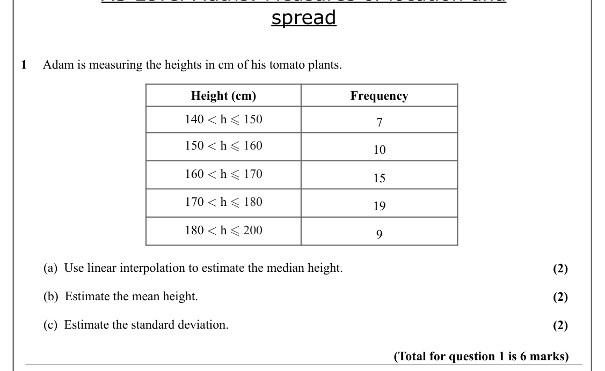
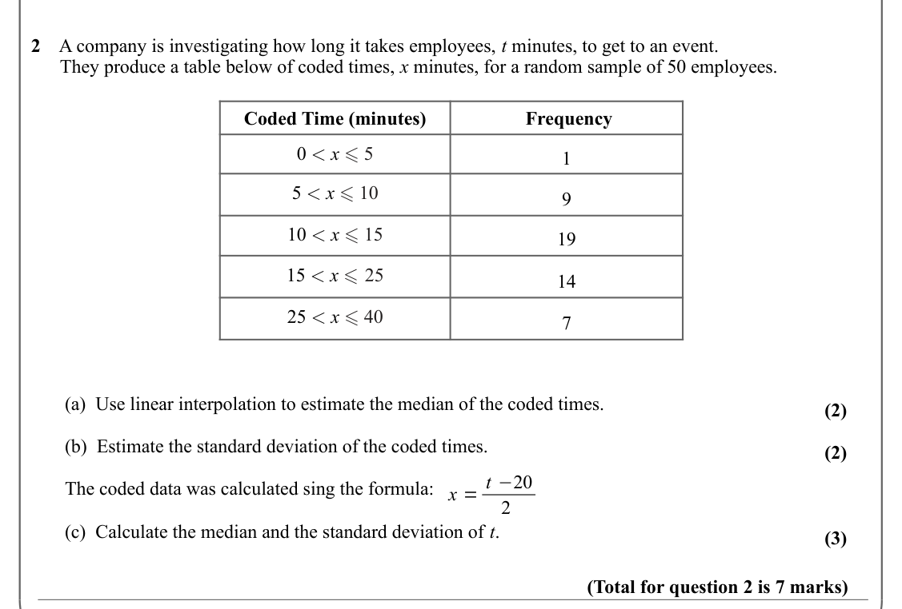
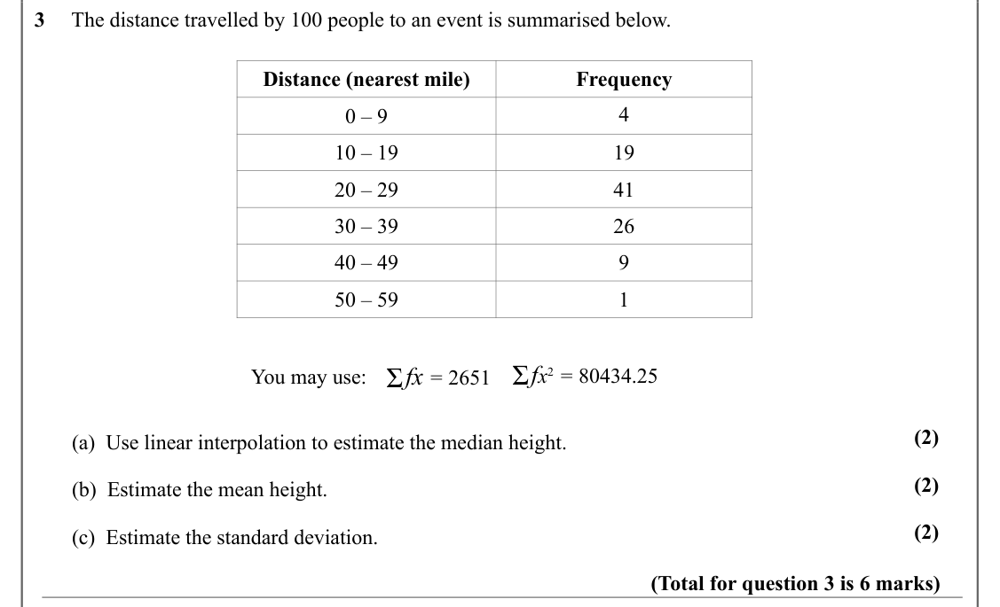
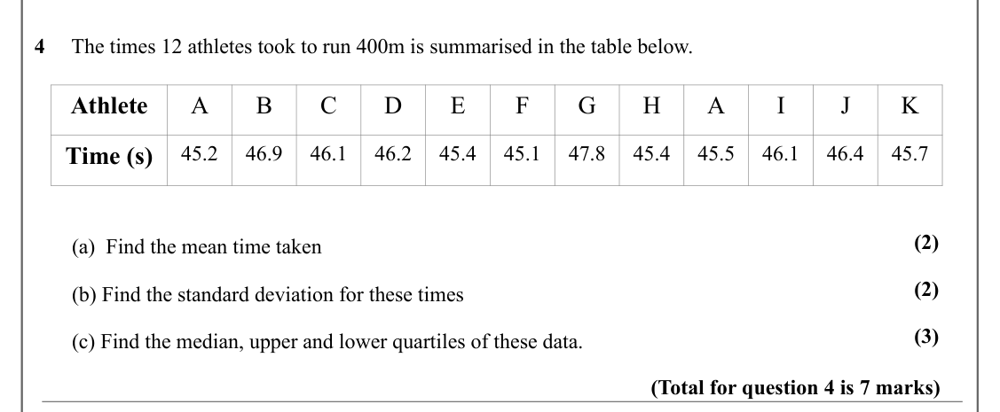
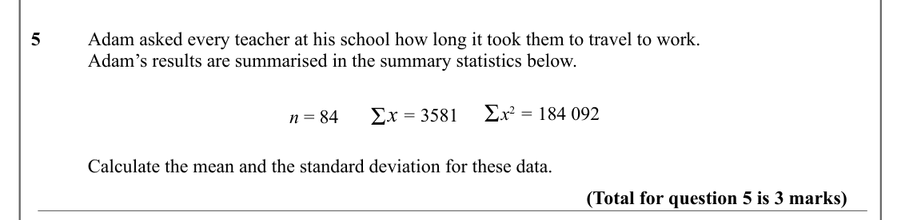
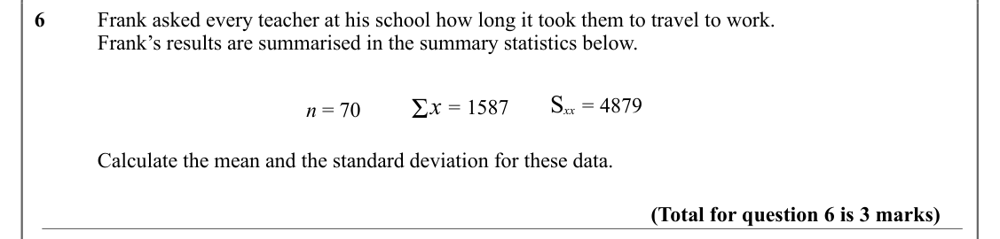
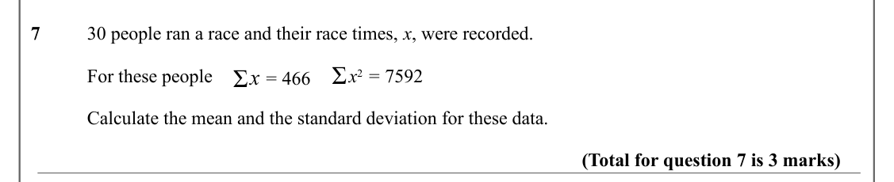

# Measures of Location and Spread — Question Set (A-Level Maths · Edexcel · Year 1 Statistics)

Chapter question set · `as-statistics-2-measures-of-location-and-spread` · 7 questions · segmented by printed total lines

## Q1 (6 marks · parts a, b, c)

Text (lossy): spread / 1     Adam is measuring the heights in cm of his tomato plants.   / Height (cm) / Frequency / 140 < h  150 / 7 / 150 < h  160 / 10 / 160 < h  170 / 15 / 170 < h  180 / 19 / 180 < h  200 / 9 /        (a)  Use linear interpolation to estimate the median height.  / (2) /        (b)  Estimate the mean height. / (2) /        (c)  Estimate the standard deviation. / (2) / (Total for questio

## Q2 (7 marks · parts a, b, c)

Text (lossy): 2    A company is investigating how long it takes employees, t minutes, to get to an event.  /       They produce a table below of coded times, x minutes, for a random sample of 50 employees.  / Coded Time (minutes) /  Frequency / 0 < x  5 / 1 / 5 < x  10 / 9 / 10 < x  15 / 19 / 15 < x  25 / 14 / 25 < x  40 / 7 /        (a)  Use linear interpolation to estimate the median of the coded times. 

## Q3 (6 marks · parts a, b, c)

Text (lossy): 3     The distance travelled by 100 people to an event is summarised below.  / Distance (nearest mile) / Frequency / 4 / 0 – 9 / 10 – 19 / 19 / 20 – 29 / 41 / 30 – 39 / 26 / 40 – 49 / 9 / 50 – 59 / 1 / Ʃ /  f x 2 = 80434.25 / Ʃ fx = 2651 / You may use: / (2) /        (a)  Use linear interpolation to estimate the median height.  / (2) /        (b)  Estimate the mean height. / (2) /        (c)  Esti

## Q4 (7 marks · parts a, b, c)

Text (lossy): 4     The times 12 athletes took to run 400m is summarised in the table below.   / Athlete / A / B / C / D / E / F / G / H / A / I / J / K / Time (s) / 45.2 / 46.9 / 46.1 / 46.2 / 45.4 / 45.1 / 47.8 / 45.4 / 45.5 / 46.1 / 46.4 / 45.7 / (2) /        (a)  Find the mean time taken / (2) /        (b) Find the standard deviation for these times / (3) /        (c) Find the median, upper and lower quarti

## Q5 (3 marks)

Text (lossy): 5     / Adam asked every teacher at his school how long it took them to travel to work.  / Adam’s results are summarised in the summary statistics below.  / Ʃ /  x 2 = 184 092 / Ʃ x = 3581 / n = 84 / Calculate the mean and the standard deviation for these data. / (Total for question 5 is 3 marks)

## Q6 (3 marks)

Text (lossy): 6      / Frank asked every teacher at his school how long it took them to travel to work.  / Frank’s results are summarised in the summary statistics below.  / S xx = 4879 / Ʃ x = 1587 / n = 70 / Calculate the mean and the standard deviation for these data. / (Total for question 6 is 3 marks)

## Q7 (3 marks)

Text (lossy): 7      / 30 people ran a race and their race times, x, were recorded.  / Ʃ /  x 2 = 7592 / Ʃ x = 466 / For these people  / Calculate the mean and the standard deviation for these data. / (Total for question 7 is 3 marks)

