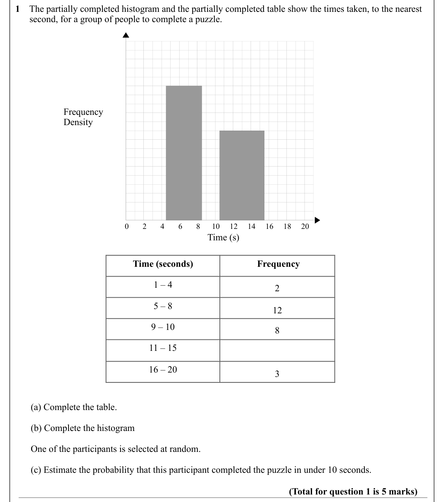
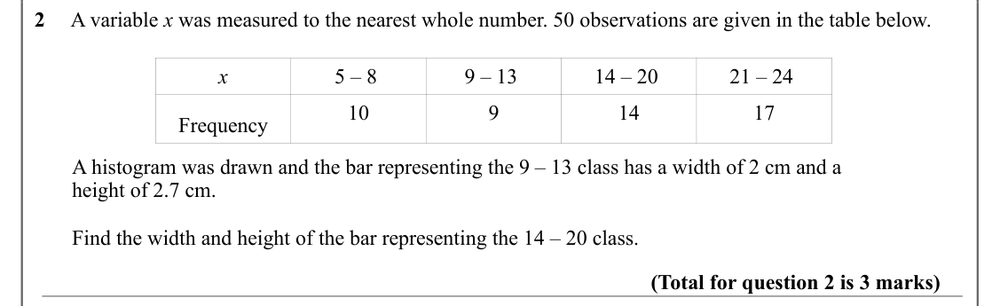
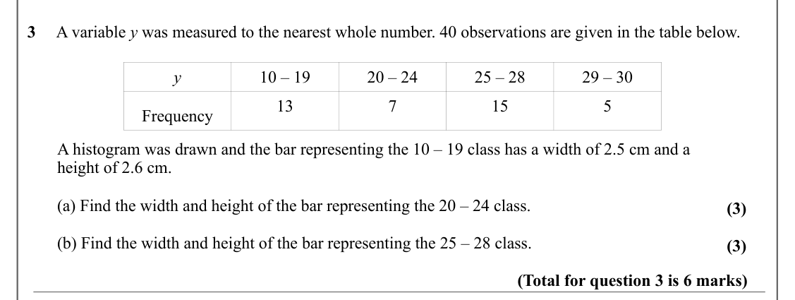
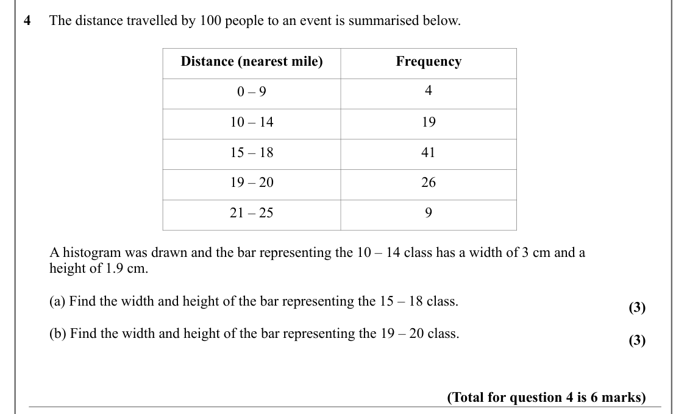
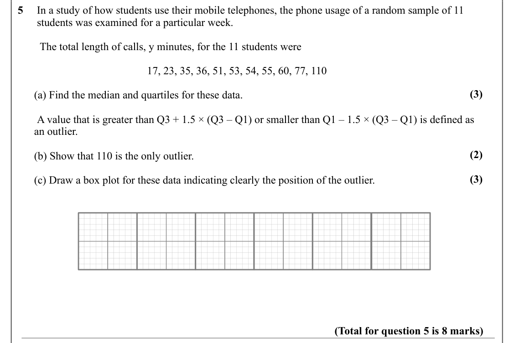
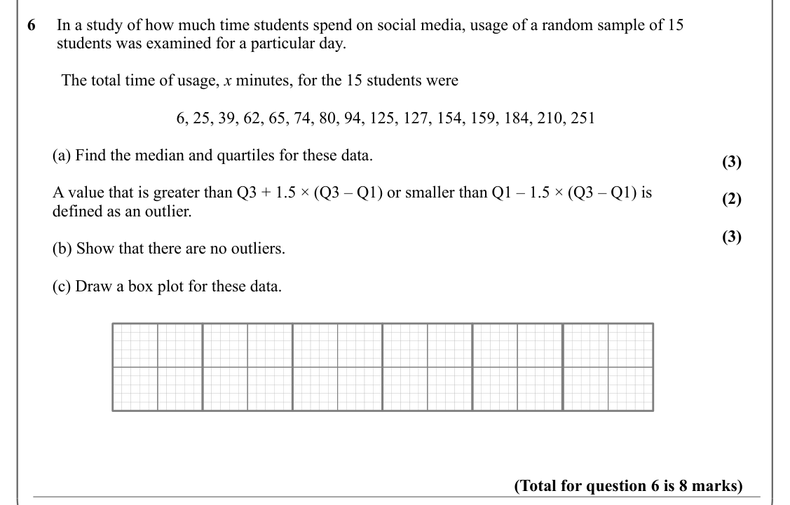
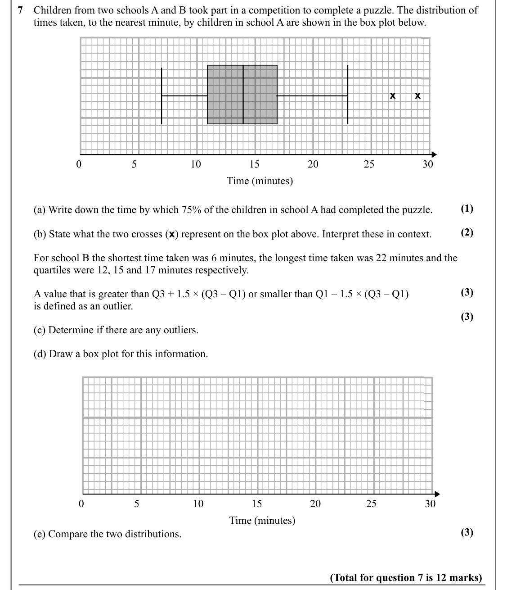
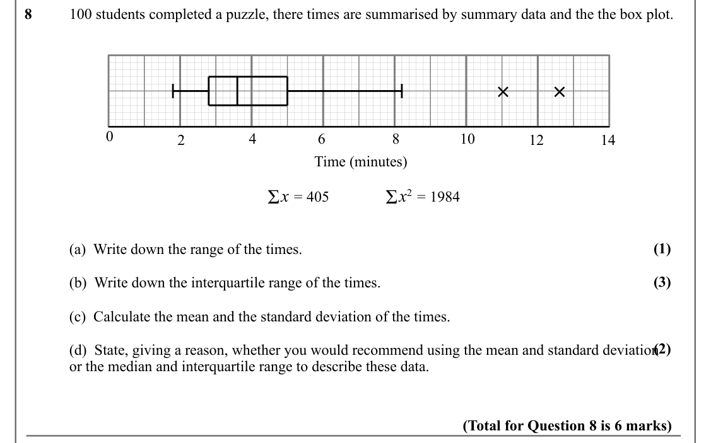
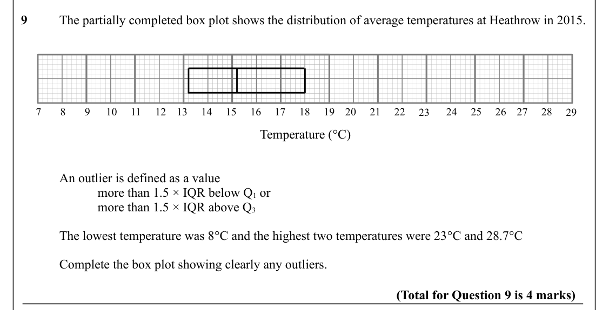
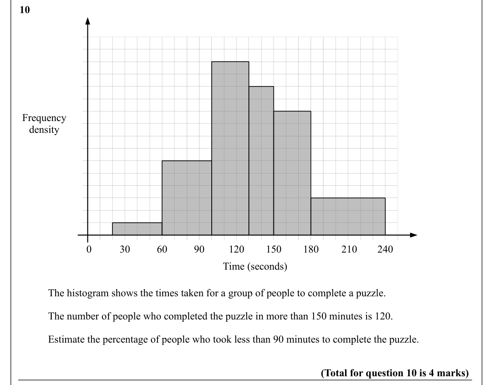

# Representations of Data — Question Set (A-Level Maths · Edexcel · Year 1 Statistics)

Chapter question set · `as-statistics-3-representations-of-data` · 10 questions · segmented by printed total lines

## Q1 (5 marks · parts a, b, c)

Text (lossy): 1    The partially completed histogram and the partially completed table show the times taken, to the nearest    /       second, for a group of people to complete a puzzle. / Frequency / Density / 10 / 8 / 12 / 6 / 14 / 4 / 16 / 2 / 18 / 0 / 20 / Time (s) / Time (seconds) /  Frequency / 1 – 4 / 2 / 5 – 8 / 12 / 9 – 10 / 8 / 11 – 15 / 16 – 20 / 3 /       (a) Complete the table.  /       (b) Complet

## Q2 (3 marks)

Text (lossy): 2     A variable x was measured to the nearest whole number. 50 observations are given in the table below.  / x / 5 – 8  / 9 – 13  / 14 – 20  / 21 – 24  / 10 / 9 / 14 / 17 / Frequency /        A histogram was drawn and the bar representing the 9 – 13 class has a width of 2 cm and a  /        height of 2.7 cm.  /        Find the width and height of the bar representing the 14 – 20 class.  / (Total 

## Q3 (6 marks · parts a, b)

Text (lossy): 3     A variable y was measured to the nearest whole number. 40 observations are given in the table below.  / y / 10 – 19 / 20 – 24 / 25 – 28 / 29 – 30 / 13 / 7 / 15 / 5 / Frequency /        A histogram was drawn and the bar representing the 10 – 19 class has a width of 2.5 cm and a  /        height of 2.6 cm.  /        (a) Find the width and height of the bar representing the 20 – 24 class.  / (3

## Q4 (6 marks · parts a, b)

Text (lossy): 4     The distance travelled by 100 people to an event is summarised below.  / Distance (nearest mile) / Frequency / 4 / 0 – 9 / 10 – 14 / 19 / 15 – 18 / 41 / 19 – 20 / 26 / 21 – 25 / 9 /        A histogram was drawn and the bar representing the 10 – 14 class has a width of 3 cm and a  /        height of 1.9 cm.  /        (a) Find the width and height of the bar representing the 15 – 18 class.  / 

## Q5 (8 marks · parts a, b, c)

Text (lossy): 5     In a study of how students use their mobile telephones, the phone usage of a random sample of 11 /        students was examined for a particular week. /         The total length of calls, y minutes, for the 11 students were / 17, 23, 35, 36, 51, 53, 54, 55, 60, 77, 110 / (3) /       (a) Find the median and quartiles for these data. /        A value that is greater than Q3 + 1.5 × (Q3 – Q1) o

## Q6 (8 marks · parts a, b, c)

Text (lossy): 6     In a study of how much time students spend on social media, usage of a random sample of 15 /        students was examined for a particular day. /         The total time of usage, x minutes, for the 15 students were / 6, 25, 39, 62, 65, 74, 80, 94, 125, 127, 154, 159, 184, 210, 251 /       (a) Find the median and quartiles for these data. / (3) /       A value that is greater than Q3 + 1.5 × 

## Q7 (12 marks · parts a, b, c, d, e)

Text (lossy): 7    Children from two schools A and B took part in a competition to complete a puzzle. The distribution of      /       times taken, to the nearest minute, by children in school A are shown in the box plot below.  / x / x / 0 / 5 / 10 / 15 / 20 / 25 / 30 / Time (minutes) / (1) /       (a) Write down the time by which 75% of the children in school A had completed the puzzle.  / (2) /       (b) Sta

## Q8 (6 marks · parts a, b, c, d)

Text (lossy): 8     / 100 students completed a puzzle, there times are summarised by summary data and the the box plot.  / × / × / 0 / 4 / 6 / 8 / 10 / 2 / 12 / 14 / Time (minutes) / Ʃ x = 405 / Ʃ x 2 = 1984 / (1) / (a)  Write down the range of the times. / (3) / (b)  Write down the interquartile range of the times. / (c)  Calculate the mean and the standard deviation of the times. / (2) / (d)  State, giving a 

## Q9 (4 marks)

Text (lossy): 9     / The partially completed box plot shows the distribution of average temperatures at Heathrow in 2015. / 10 / 9 / 11 / 17 / 8 / 12 / 18 / 24 / 7 / 13 / 19 / 25 / 14 / 20 / 26 / 15 / 21 / 27 / 16 / 22 / 28 / 23 / 29 / Temperature (°C) / An outlier is defined as a value / more than 1.5 × IQR below Q 1 or / more than 1.5 × IQR above Q 3 / The lowest temperature was 8°C and the highest two tempe

## Q10 (4 marks)

Text (lossy): 10 / Frequency / density / 0 / 30 / 60 / 90 / 120 / 150 / 180 / 210 / 240 / Time (seconds) / The histogram shows the times taken for a group of people to complete a puzzle. / The number of people who completed the puzzle in more than 150 minutes is 120. / Estimate the percentage of people who took less than 90 minutes to complete the puzzle. / (Total for question 10 is 4 marks)

