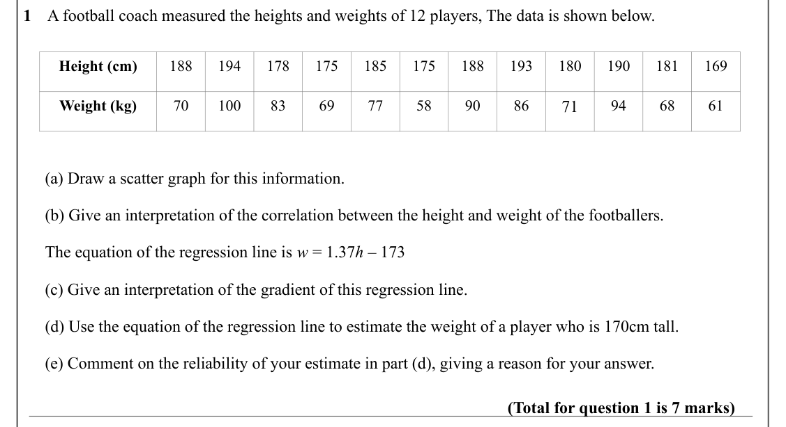
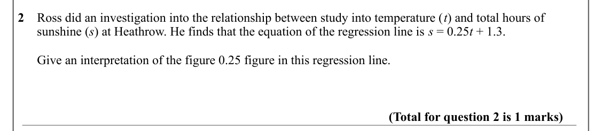
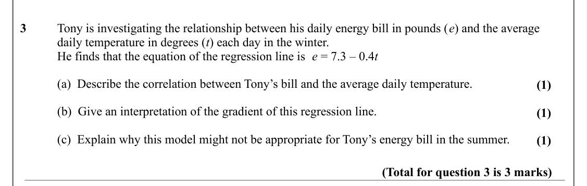

# Correlation — Question Set (A-Level Maths · Edexcel · Year 1 Statistics)

Chapter question set · `as-statistics-4-correlation` · 3 questions · segmented by printed total lines

## Q1 (7 marks · parts a, b, c, d, e)

Text (lossy): 1    A football coach measured the heights and weights of 12 players, The data is shown below.  / Height (cm) / 188 / 194 / 178 / 175 / 185 / 175 / 188 / 193 / 180 / 190 / 181 / 169 / 71 / Weight (kg) / 70 / 100 / 83 / 69 / 77 / 58 / 90 / 86 / 94 / 68 / 61 /      (a) Draw a scatter graph for this information. /      (b) Give an interpretation of the correlation between the height and weight of the

## Q2 (1 marks)

Text (lossy): 2    Ross did an investigation into the relationship between study into temperature (t) and total hours of            /       sunshine (s) at Heathrow. He finds that the equation of the regression line is s = 0.25 t + 1.3. /       Give an interpretation of the figure 0.25 figure in this regression line. / (Total for question 2 is 1 marks)

## Q3 (3 marks · parts a, b, c)

Text (lossy): 3     / Tony is investigating the relationship between his daily energy bill in pounds (e) and the average  / daily temperature in degrees (t) each day in the winter.   / He finds that the equation of the regression line is  e = 7.3 – 0.4 t / (a)  Describe the correlation between Tony’s bill and the average daily temperature. / (1) / (b)  Give an interpretation of the gradient of this regression l

