# Probability — Question Set (A-Level Maths · Edexcel · Year 1 Statistics)

Chapter question set · `as-statistics-5-probability` · 13 questions · segmented by printed total lines

## Q1 (6 marks · parts a, b)

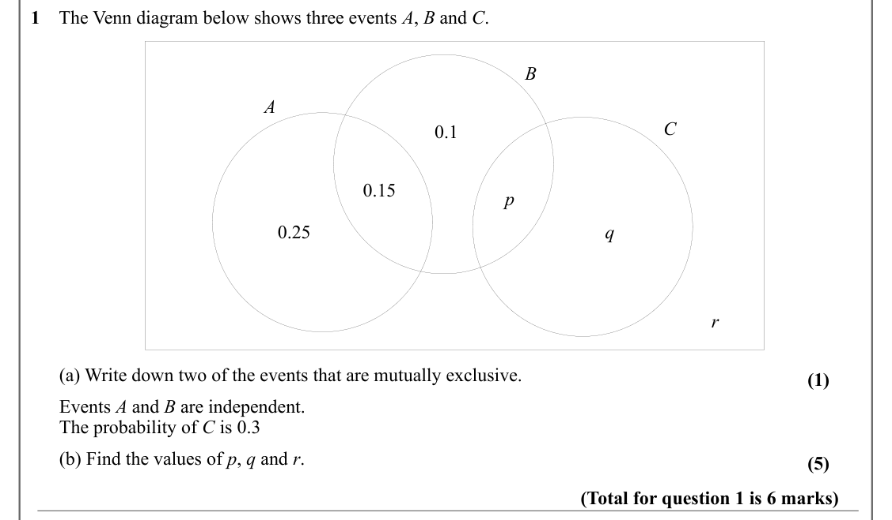

Text (lossy): 1    The Venn diagram below shows three events A, B and C.  / B / A / C / 0.1 / 0.15 / p / 0.25 / q / r /       (a) Write down two of the events that are mutually exclusive.   / (1) /       Events A and B are independent.    /       The probability of C is 0.3 /       (b) Find the values of p, q and r. / (5) / (Total for question 1 is 6 marks)

## Q2 (5 marks · parts a, b, c)

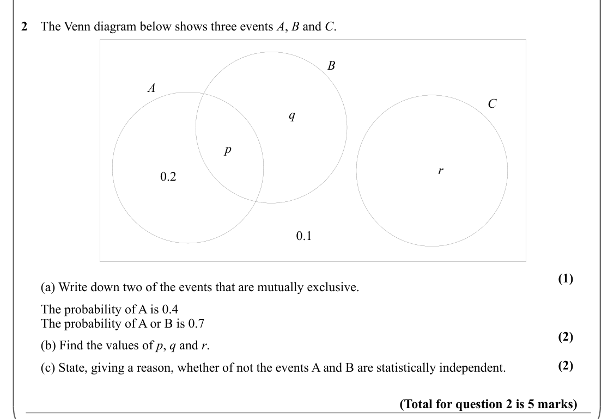

Text (lossy): 2    The Venn diagram below shows three events A, B and C.  / B / A / C / q / p / r / 0.2 / 0.1 / (1) /       (a) Write down two of the events that are mutually exclusive.   /       The probability of A is 0.4 /       The probability of A or B is 0.7 / (2) /       (b) Find the values of p, q and r. / (2) /       (c) State, giving a reason, whether of not the events A and B are statistically indepe

## Q3 (5 marks · parts a, b)

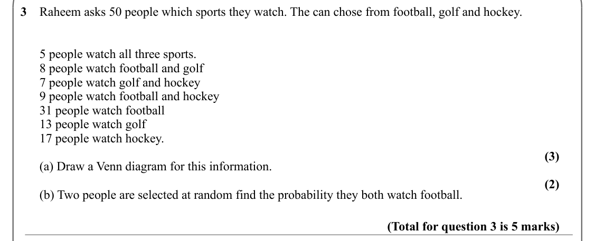

Text (lossy): 3    Raheem asks 50 people which sports they watch. The can chose from football, golf and hockey.  /       5 people watch all three sports.  /       8 people watch football and golf /       7 people watch golf and hockey /       9 people watch football and hockey  /       31 people watch football /       13 people watch golf /       17 people watch hockey.  / (3) /       (a) Draw a Venn diagram fo

## Q4 (6 marks · parts a, b, c)

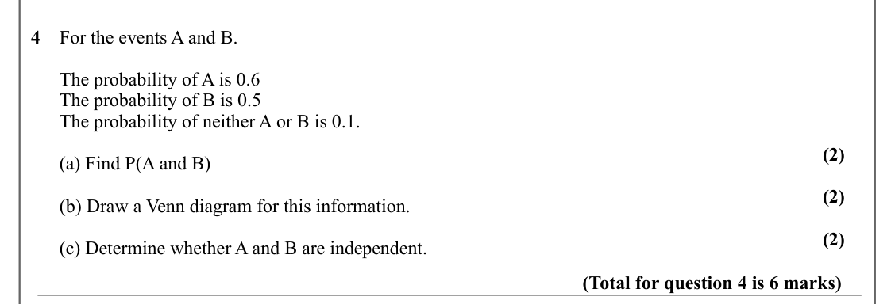

Text (lossy): 4    For the events A and B. /       The probability of A is 0.6 /       The probability of B is 0.5 /       The probability of neither A or B is 0.1.  / (2) /       (a) Find P(A and B) / (2) /       (b) Draw a Venn diagram for this information.   / (2) /       (c) Determine whether A and B are independent.  / (Total for question 4 is 6 marks)

## Q5 (5 marks · parts a, b)

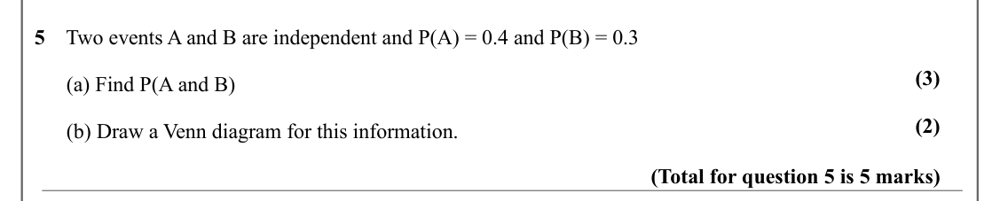

Text (lossy): 5    Two events A and B are independent and P(A) = 0.4 and P(B) = 0.3  / (3) /       (a) Find P(A and B) / (2) /       (b) Draw a Venn diagram for this information.   / (Total for question 5 is 5 marks)

## Q6 (4 marks · parts a, b)

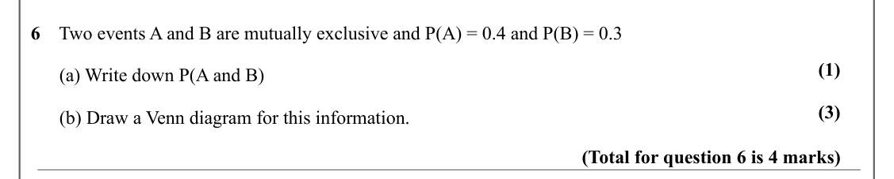

Text (lossy): 6    Two events A and B are mutually exclusive and P(A) = 0.4 and P(B) = 0.3  / (1) /       (a) Write down P(A and B) / (3) /       (b) Draw a Venn diagram for this information.   / (Total for question 6 is 4 marks)

## Q7 (3 marks)

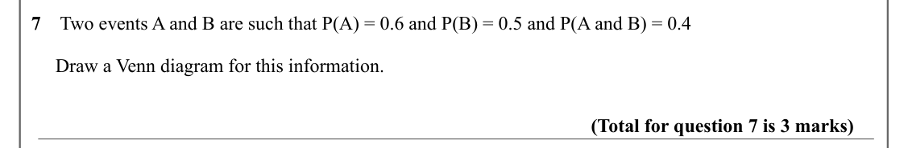

Text (lossy): 7    Two events A and B are such that P(A) = 0.6 and P(B) = 0.5 and P(A and B) = 0.4  /      Draw a Venn diagram for this information.   / (Total for question 7 is 3 marks)

## Q8 (4 marks · parts a, b)

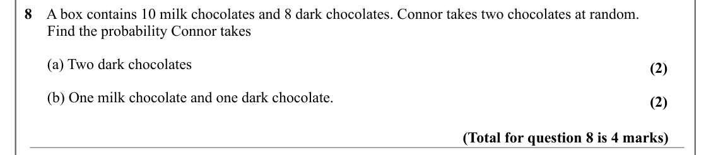

Text (lossy): 8    A box contains 10 milk chocolates and 8 dark chocolates. Connor takes two chocolates at random.  /       Find the probability Connor takes /       (a) Two dark chocolates / (2) /       (b) One milk chocolate and one dark chocolate.  / (2) / (Total for question 8 is 4 marks)

## Q9 (4 marks · parts a, b)

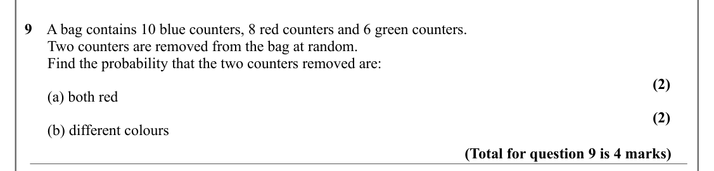

Text (lossy): 9    A bag contains 10 blue counters, 8 red counters and 6 green counters.    /       Two counters are removed from the bag at random.  /       Find the probability that the two counters removed are: / (2) /       (a) both red / (2) /       (b) different colours / (Total for question 9 is 4 marks)

## Q10 (5 marks · parts a, b)

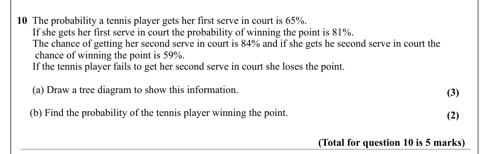

Text (lossy): 10  The probability a tennis player gets her first serve in court is 65%.  /       If she gets her first serve in court the probability of winning the point is 81%.  /       The chance of getting her second serve in court is 84% and if she gets he second serve in court the             /        chance of winning the point is 59%. /       If the tennis player fails to get her second serve in court s

## Q11 (7 marks · parts a, b, c)

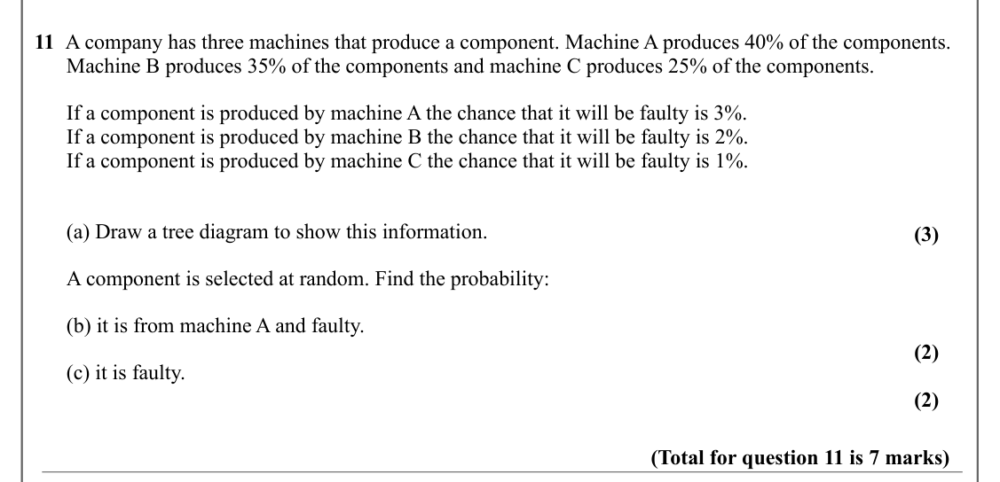

Text (lossy): 11  A company has three machines that produce a component. Machine A produces 40% of the components.    /       Machine B produces 35% of the components and machine C produces 25% of the components.  /       If a component is produced by machine A the chance that it will be faulty is 3%.  /       If a component is produced by machine B the chance that it will be faulty is 2%.  /       If a compone

## Q12 (3 marks)

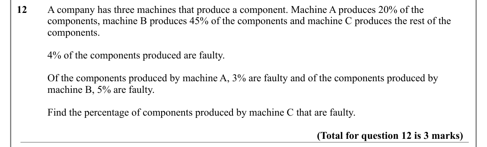

Text (lossy): 12     / A company has three machines that produce a component. Machine A produces 20% of the  / components, machine B produces 45% of the components and machine C produces the rest of the  / components. / 4% of the components produced are faulty.   / Of the components produced by machine A, 3% are faulty and of the components produced by  / machine B, 5% are faulty. / Find the percentage of compo

## Q13 (5 marks)

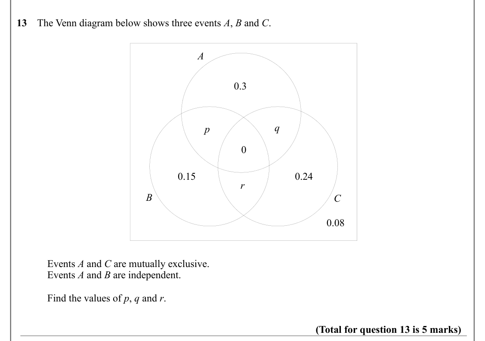

Text (lossy): 13    The Venn diagram below shows three events A, B and C.  / A / 0.3 / q / p / 0 / 0.15 / 0.24 / r / B / C / 0.08 / Events A and C are mutually exclusive.  / Events A and B are independent.  / Find the values of p, q and r. / (Total for question 13 is 5 marks)

