# Statistical Distributions — Question Set (A-Level Maths · Edexcel · Year 1 Statistics)

Chapter question set · `as-statistics-6-statistical-distributions` · 15 questions · segmented by printed total lines

## Q1 (4 marks · parts a, b, c)

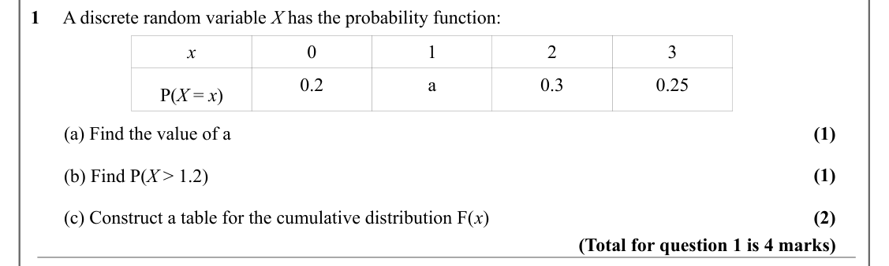

Text (lossy): 1     A discrete random variable X has the probability function: / x / 0 / 1 / 2 / 3 / 0.2 / a / 0.3 / 0.25 / P(X = x) / (1) /        (a) Find the value of a / (1) /        (b) Find P(X > 1.2) / (2) /        (c) Construct a table for the cumulative distribution F(x) / (Total for question 1 is 4 marks)

## Q2 (5 marks · parts a, b, c)

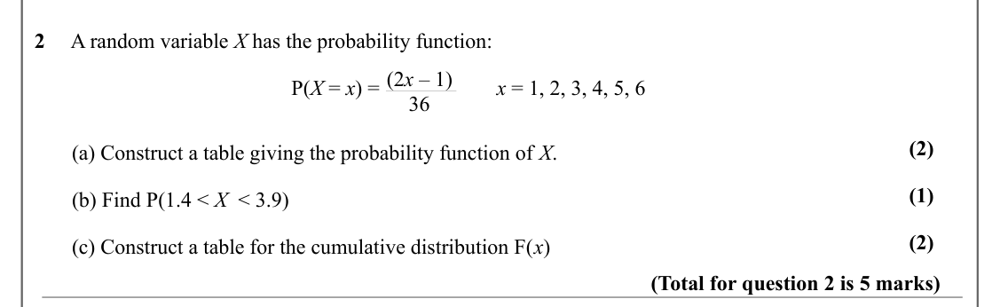

Text (lossy): 2     A random variable X has the probability function: / (2 x – 1)  /  P(X = x) =                      x = 1, 2, 3, 4, 5, 6 / 36 / (2) /        (a) Construct a table giving the probability function of X. / (1) /        (b) Find P(1.4 < X  < 3.9) / (2) /        (c) Construct a table for the cumulative distribution F(x) / (Total for question 2 is 5 marks)

## Q3 (3 marks · parts a, b)

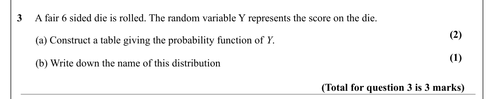

Text (lossy): 3     A fair 6 sided die is rolled. The random variable Y represents the score on the die. / (2) /        (a) Construct a table giving the probability function of Y. / (1) /        (b) Write down the name of this distribution / (Total for question 3 is 3 marks)

## Q4 (3 marks)

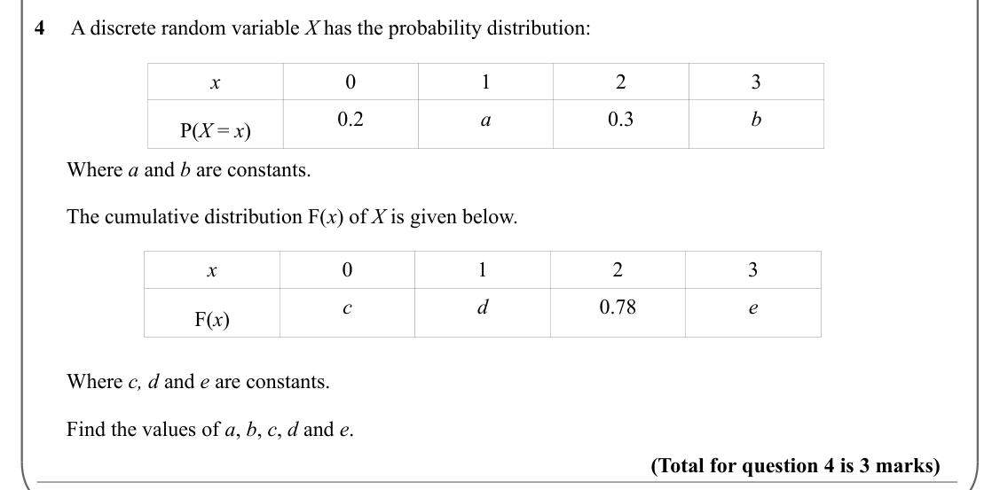

Text (lossy): 4     A discrete random variable X has the probability distribution: / x / 0 / 1 / 2 / 3 / 0.2 / a / 0.3 / b / P(X = x) /       Where a and b are constants. /       The cumulative distribution F(x) of X is given below.  / x / 0 / 1 / 2 / 3 / c / d / 0.78 / e / F(x) /       Where c, d and e are constants. /       Find the values of a, b, c, d and e.  / (Total for question 4 is 3 marks)

## Q5 (3 marks · parts a, b, c)

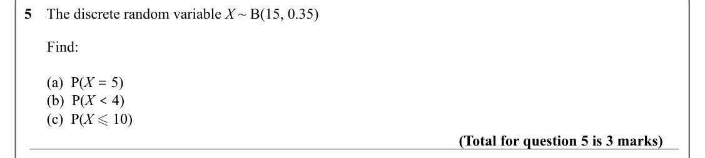

Text (lossy): 5    The discrete random variable X ~ B(15, 0.35) /       Find: /       (a)  P(X = 5) /       (b)  P(X < 4) /       (c)  P(X  10) / (Total for question 5 is 3 marks)

## Q6 (3 marks · parts a, b, c)

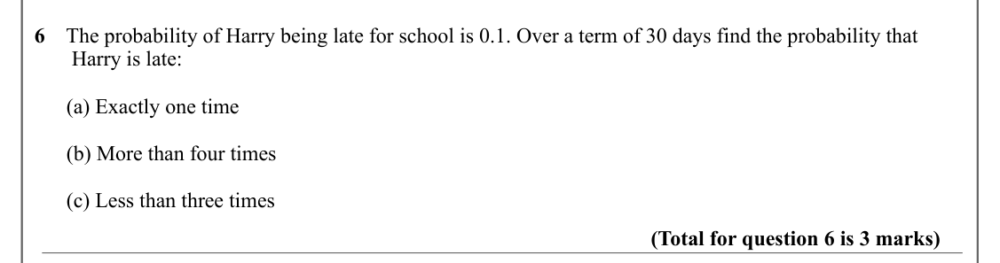

Text (lossy): 6    The probability of Harry being late for school is 0.1. Over a term of 30 days find the probability that          /        Harry is late: /       (a) Exactly one time /       (b) More than four times /       (c) Less than three times / (Total for question 6 is 3 marks)

## Q7 (8 marks · parts a, b, c)

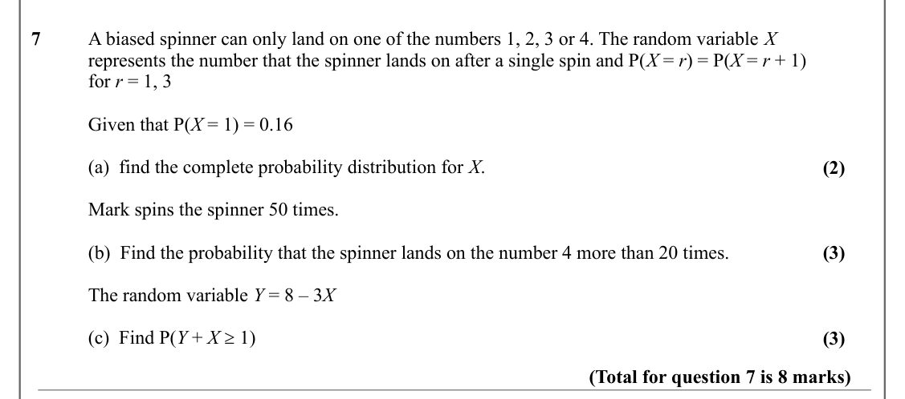

Text (lossy): 7   / A biased spinner can only land on one of the numbers 1, 2, 3 or 4. The random variable X / represents the number that the spinner lands on after a single spin and P(X = r) = P(X = r + 1) / for r = 1, 3 / Given that P(X = 1) = 0.16 / (a)  find the complete probability distribution for X. / (2) / Mark spins the spinner 50 times.  / (b)  Find the probability that the spinner lands on the number

## Q8 (6 marks · parts a, b, c)

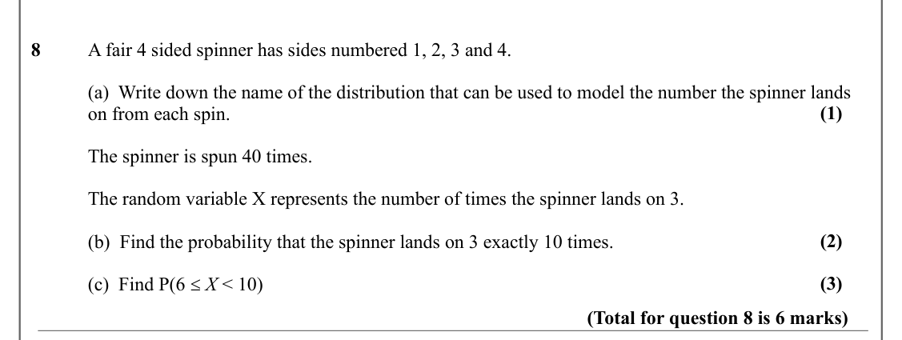

Text (lossy): 8   / A fair 4 sided spinner has sides numbered 1, 2, 3 and 4.  / (a)  Write down the name of the distribution that can be used to model the number the spinner lands  / (1) / on from each spin.  / The spinner is spun 40 times.  / The random variable X represents the number of times the spinner lands on 3.  / (2) / (b)  Find the probability that the spinner lands on 3 exactly 10 times.  / (3) / (c)

## Q9 (6 marks)

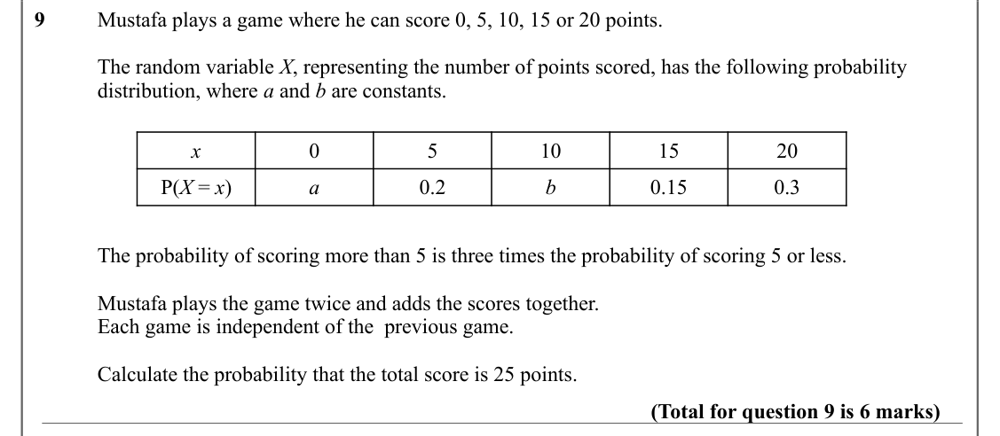

Text (lossy): 9     / Mustafa plays a game where he can score 0, 5, 10, 15 or 20 points.  / The random variable X, representing the number of points scored, has the following probability  / distribution, where a and b are constants. / x / 0 / 5 / 10 / 15 / 20 / P(X = x) / a / 0.2 / b / 0.15 / 0.3 / The probability of scoring more than 5 is three times the probability of scoring 5 or less.  / Mustafa plays the g

## Q10 (4 marks · parts a, b)

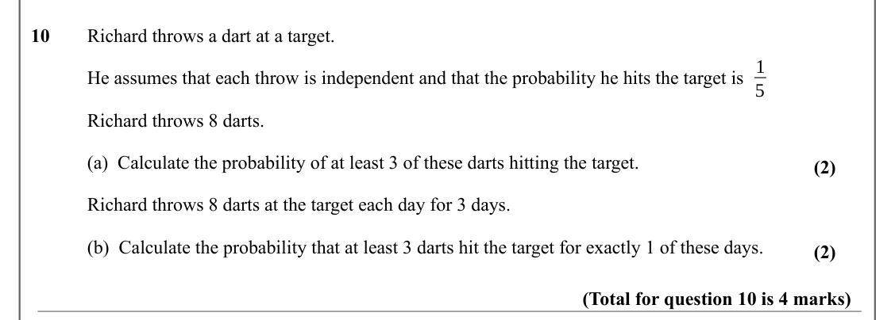

Text (lossy): 10     / Richard throws a dart at a target.  / 1 / He assumes that each throw is independent and that the probability he hits the target is  / 5 / Richard throws 8 darts. / (a)  Calculate the probability of at least 3 of these darts hitting the target.  / (2) / Richard throws 8 darts at the target each day for 3 days.  / (b)  Calculate the probability that at least 3 darts hit the target for exact

## Q11 (2 marks)

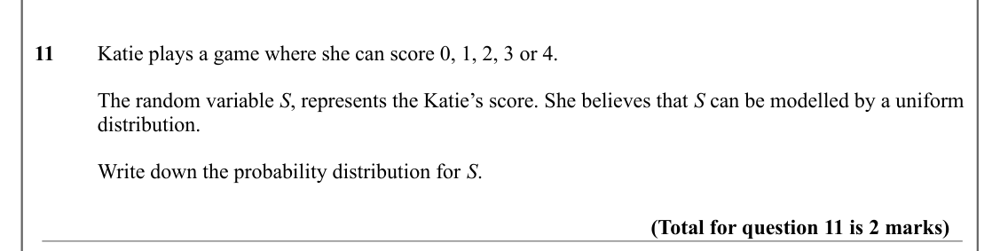

Text (lossy): 11     / Katie plays a game where she can score 0, 1, 2, 3 or 4.  / The random variable S, represents the Katie’s score. She believes that S can be modelled by a uniform  / distribution. / Write down the probability distribution for S. / (Total for question 11 is 2 marks)

## Q12 (5 marks · parts a, b, c)

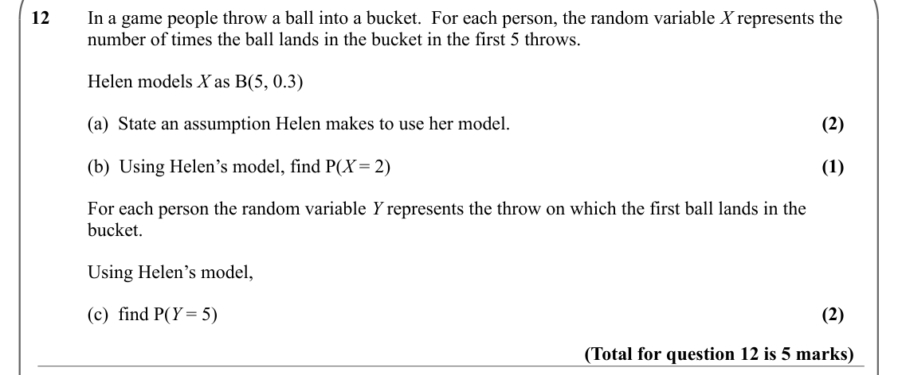

Text (lossy): 12     / In a game people throw a ball into a bucket.  For each person, the random variable X represents the  / number of times the ball lands in the bucket in the first 5 throws. / Helen models X as B(5, 0.3) / (2) / (a)  State an assumption Helen makes to use her model.  / (1) / (b)  Using Helen’s model, find P(X = 2) / For each person the random variable Y represents the throw on which the firs

## Q13 (5 marks)

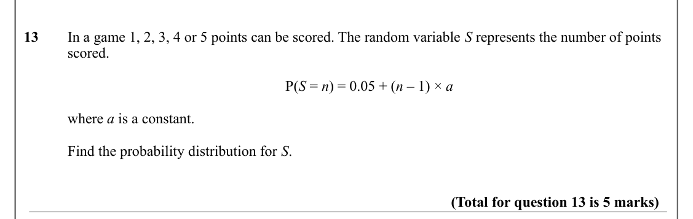

Text (lossy): 13     / In a game 1, 2, 3, 4 or 5 points can be scored. The random variable S represents the number of points  / scored.   / P(S = n) = 0.05 + (n – 1) × a / where a is a constant.  / Find the probability distribution for S.  / (Total for question 13 is 5 marks)

## Q14 (5 marks · parts a, b, c)

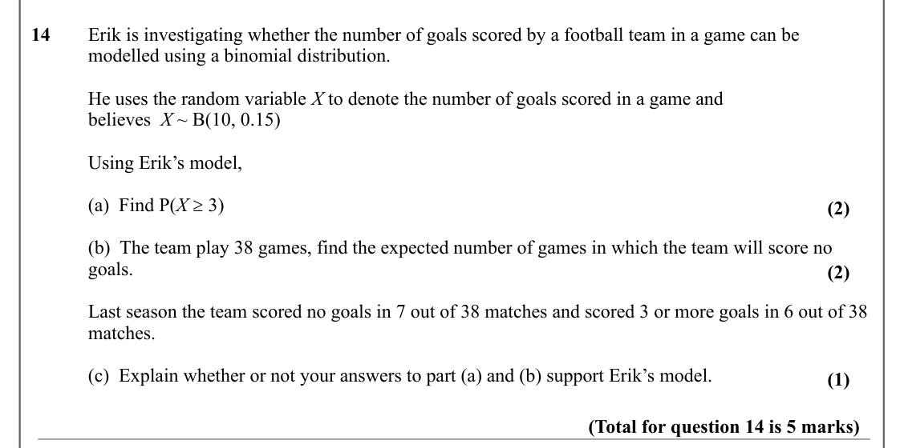

Text (lossy): 14    / Erik is investigating whether the number of goals scored by a football team in a game can be  / modelled using a binomial distribution.  / He uses the random variable X to denote the number of goals scored in a game and  / believes  X ~ B(10, 0.15) / Using Erik’s model, / (a)  Find P(X ≥ 3) / (2) / (b)  The team play 38 games, find the expected number of games in which the team will score 

## Q15 (6 marks · parts a, b)

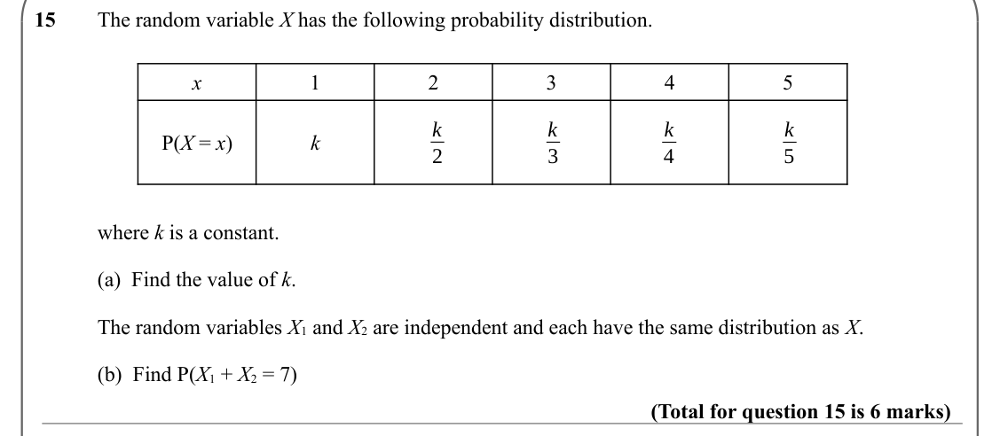

Text (lossy): 15     / The random variable X has the following probability distribution. / x / 1 / 2 / 3 / 4 / 5 / k / k / k / k / P(X = x) / k / 2 / 3 / 4 / 5 / where k is a constant.  / (a)  Find the value of k. / The random variables X 1 and X 2 are independent and each have the same distribution as X. / (b)  Find P(X 1 + X 2 = 7) / (Total for question 15 is 6 marks)

