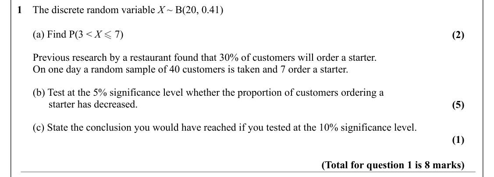
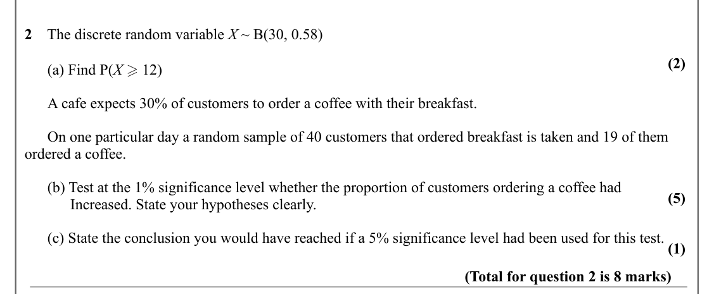
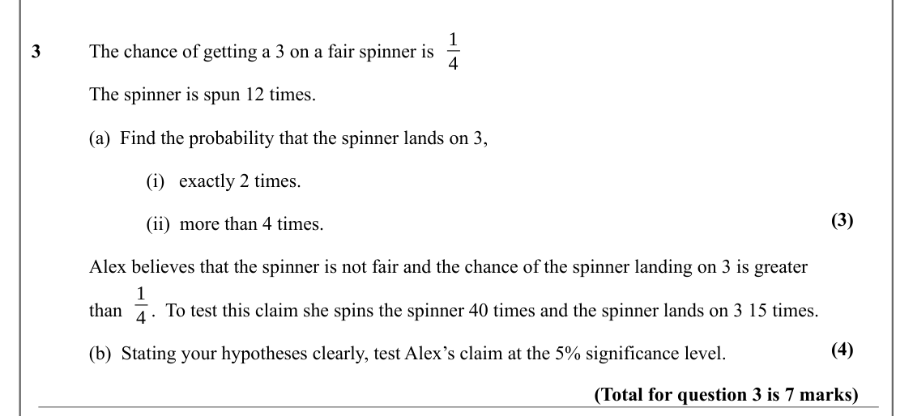
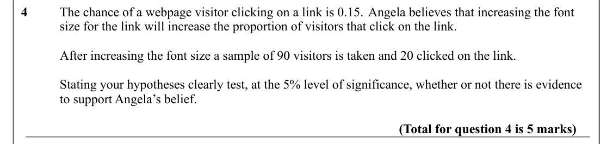
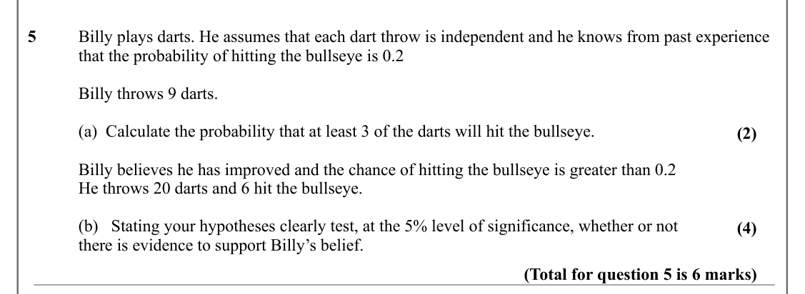
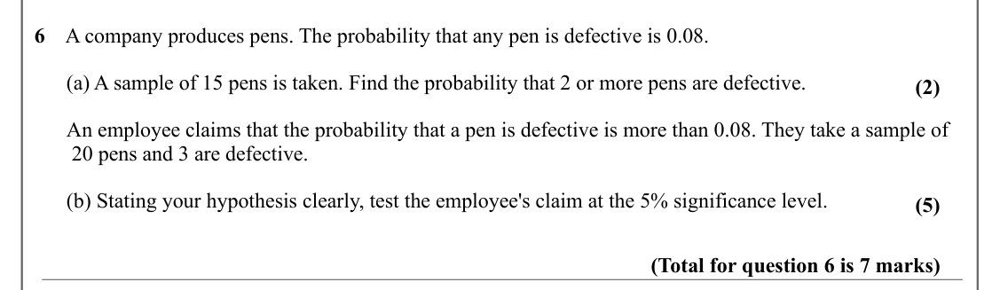
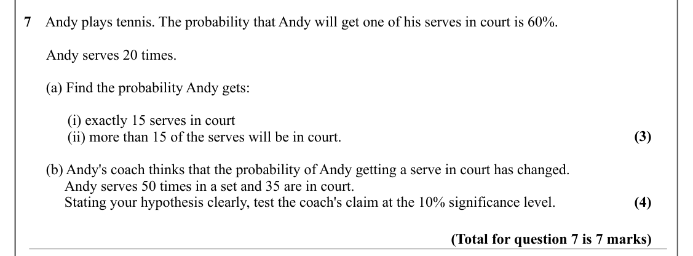
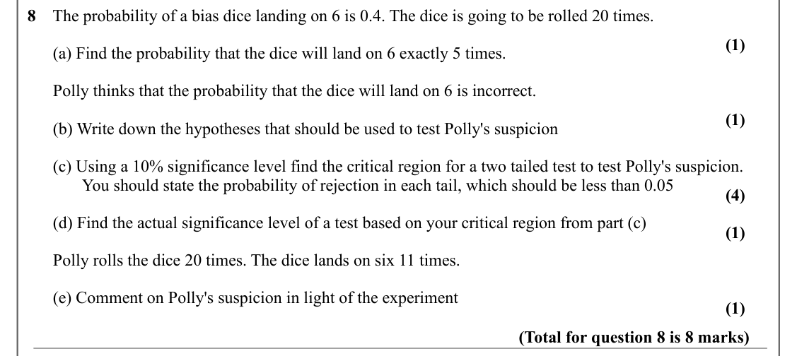

# Hypothesis Testing — Question Set (A-Level Maths · Edexcel · Year 1 Statistics)

Chapter question set · `as-statistics-7-hypothesis-testing` · 8 questions · segmented by printed total lines

## Q1 (8 marks · parts a, b, c)

Text (lossy): 1    The discrete random variable X ~ B(20, 0.41) /       (a) Find P(3 < X  7) / (2) /       Previous research by a restaurant found that 30% of customers will order a starter. /       On one day a random sample of 40 customers is taken and 7 order a starter.  /       (b) Test at the 5% significance level whether the proportion of customers ordering a  /             starter has decreased.  / (5) 

## Q2 (8 marks · parts a, b, c)

Text (lossy): 2    The discrete random variable X ~ B(30, 0.58) / (2) /       (a) Find P(X  12) /       A cafe expects 30% of customers to order a coffee with their breakfast.  /       On one particular day a random sample of 40 customers that ordered breakfast is taken and 19 of them  / ordered a coffee.  /       (b) Test at the 1% significance level whether the proportion of customers ordering a coffee had  

## Q3 (7 marks · parts a, b, i, ii)

Text (lossy): 1 / 3  / The chance of getting a 3 on a fair spinner is  / 4 / The spinner is spun 12 times.  / (a)  Find the probability that the spinner lands on 3, / (i)   exactly 2 times.  / (3) / (ii)  more than 4 times.  / Alex believes that the spinner is not fair and the chance of the spinner landing on 3 is greater  / 1 / than  /  .  To test this claim she spins the spinner 40 times and the spinner lands

## Q4 (5 marks)

Text (lossy): 4     / The chance of a webpage visitor clicking on a link is 0.15. Angela believes that increasing the font  / size for the link will increase the proportion of visitors that click on the link.  / After increasing the font size a sample of 90 visitors is taken and 20 clicked on the link. / Stating your hypotheses clearly test, at the 5% level of significance, whether or not there is evidence  / t

## Q5 (6 marks · parts a, b)

Text (lossy): 5     / Billy plays darts. He assumes that each dart throw is independent and he knows from past experience  / that the probability of hitting the bullseye is 0.2 / Billy throws 9 darts. / (a)  Calculate the probability that at least 3 of the darts will hit the bullseye.  / (2) / Billy believes he has improved and the chance of hitting the bullseye is greater than 0.2 / He throws 20 darts and 6 hi

## Q6 (7 marks · parts a, b)

Text (lossy): 6    A company produces pens. The probability that any pen is defective is 0.08.  /       (a) A sample of 15 pens is taken. Find the probability that 2 or more pens are defective.  / (2) /       An employee claims that the probability that a pen is defective is more than 0.08. They take a sample of    /        20 pens and 3 are defective.  /       (b) Stating your hypothesis clearly, test the empl

## Q7 (7 marks · parts a, b, i, ii)

Text (lossy): 7    Andy plays tennis. The probability that Andy will get one of his serves in court is 60%.  /       Andy serves 20 times.  /       (a) Find the probability Andy gets: / (i) exactly 15 serves in court / (3) / (ii) more than 15 of the serves will be in court.  /       (b) Andy's coach thinks that the probability of Andy getting a serve in court has changed.  /            Andy serves 50 times in a

## Q8 (8 marks · parts a, b, c, d, e)

Text (lossy): 8    The probability of a bias dice landing on 6 is 0.4. The dice is going to be rolled 20 times.  / (1) /       (a) Find the probability that the dice will land on 6 exactly 5 times.  /       Polly thinks that the probability that the dice will land on 6 is incorrect.  / (1) /       (b) Write down the hypotheses that should be used to test Polly's suspicion  /       (c) Using a 10% significance l

