# Factors and Multiples — Exam Questions (GCSE Maths · Edexcel · Grade 1)

Topic code `1.11` · slug `grade-1-1-11-factors-and-multiples` · source sheet sha256 `0a8ed22d94a8edd9…`

## Q1 (1 marks)

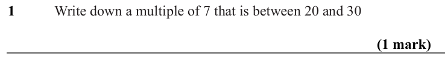

Text (lossy): 1     /  Write down a multiple of 7 that is between 20 and 30 / (1 mark)

## Q2 (1 marks)

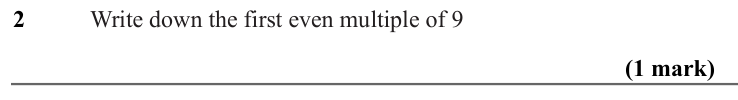

Text (lossy): 2     /  Write down the first even multiple of 9 / (1 mark)

## Q3 (1 marks)

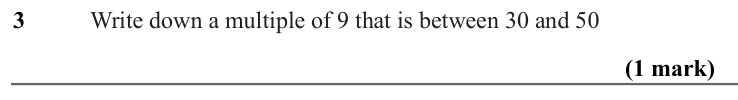

Text (lossy): 3     /  Write down a multiple of 9 that is between 30 and 50 / (1 mark)

## Q4 (1 marks)

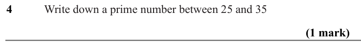

Text (lossy): 4     /  Write down a prime number between 25 and 35 / (1 mark)

## Q5 (2 marks)

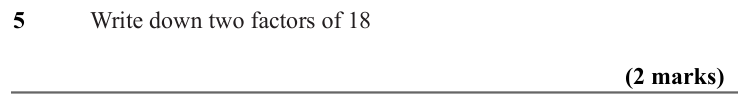

Text (lossy): 5     /  Write down two factors of 18 / (2 marks)

## Q6 (2 marks)

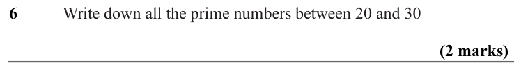

Text (lossy): 6     /  Write down all the prime numbers between 20 and 30 / (2 marks)

## Q7 (2 marks)

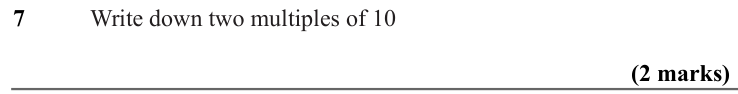

Text (lossy): 7     /  Write down two multiples of 10 / (2 marks)

## Q8 (2 marks · parts a, b)

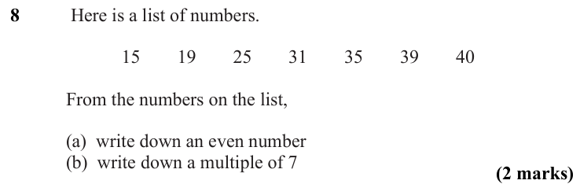

Text (lossy): 8     /  Here is a list of numbers.  / 15 / 19 / 25 / 31 / 35 / 39 / 40 / From the numbers on the list,  / (a)  write down an even number / (b)  write down a multiple of 7 / (2 marks)

## Q9 (2 marks)

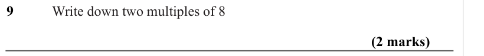

Text (lossy): 9     /  Write down two multiples of 8 / (2 marks)

## Q10 (2 marks)

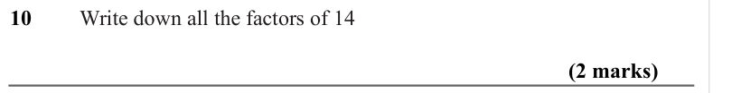

Text (lossy): 10     /  Write down all the factors of 14 / (2 marks)

## Q11 (2 marks)

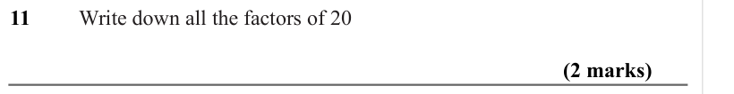

Text (lossy): 11     /  Write down all the factors of 20 / (2 marks)

## Q12 (3 marks · parts a, b, c)

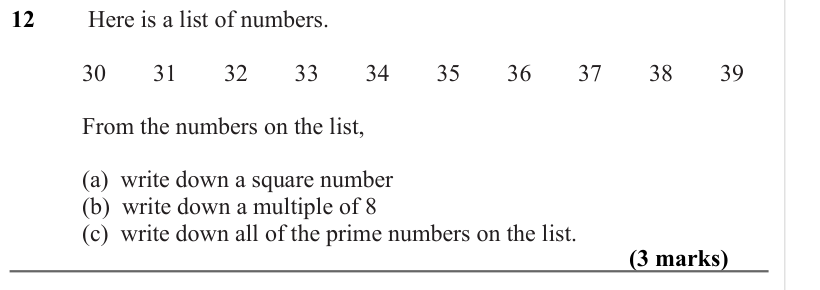

Text (lossy): 12     /  Here is a list of numbers.  / 30 / 31 / 32 / 33 / 34 / 35 / 36 / 37 / 38 / 39 / From the numbers on the list,  / (a)  write down a square number / (b)  write down a multiple of 8 / (c)  write down all of the prime numbers on the list. / (3 marks)

## Q13 (3 marks · parts a, b, c)

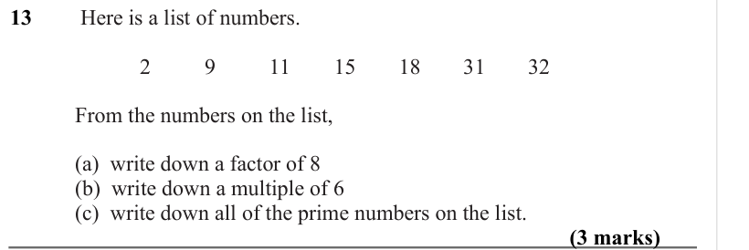

Text (lossy): 13     /  Here is a list of numbers.  / 2 / 9 / 11 / 15 / 18 / 31 / 32 / From the numbers on the list,  / (a)  write down a factor of 8 / (b)  write down a multiple of 6 / (c)  write down all of the prime numbers on the list. / (3 marks)

## Q14 (2 marks)

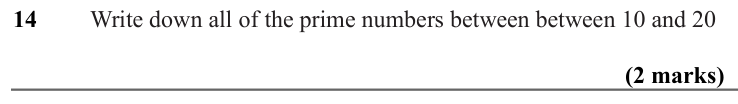

Text (lossy): 14     /  Write down all of the prime numbers between between 10 and 20 / (2 marks)

## Q15 (2 marks)

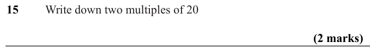

Text (lossy): 15     /  Write down two multiples of 20 / (2 marks)

## Q16 (2 marks)

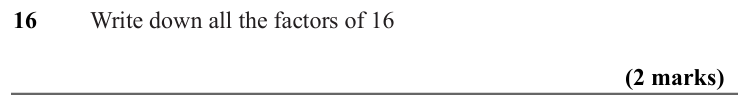

Text (lossy): 16     /  Write down all the factors of 16 / (2 marks)

## Q17 (1 marks)

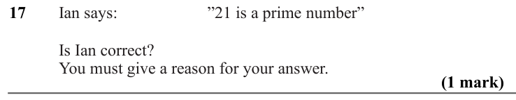

Text (lossy): 17     / Ian says: / ”21 is a prime number” / Is Ian correct? / You must give a reason for your answer.  / (1 mark)

## Q18 (3 marks · parts a, b, c)

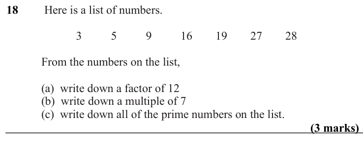

Text (lossy): 18     /  Here is a list of numbers.  / 3 / 5 / 9 / 16 / 19 / 27 / 28 / From the numbers on the list,  / (a)  write down a factor of 12 / (b)  write down a multiple of 7 / (c)  write down all of the prime numbers on the list. / (3 marks)

## Q19 (2 marks)

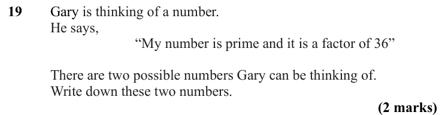

Text (lossy): 19     / Gary is thinking of a number. / He says, / “My number is prime and it is a factor of 36” /   / There are two possible numbers Gary can be thinking of. /   / Write down these two numbers. / (2 marks)

## Q20 (2 marks)

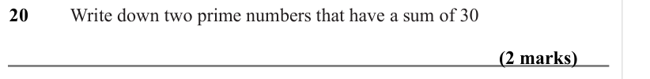

Text (lossy): 20     /  Write down two prime numbers that have a sum of 30 / (2 marks)

## Q21 (2 marks)

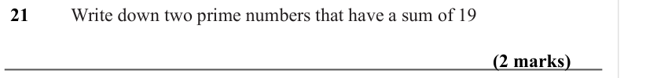

Text (lossy): 21     /  Write down two prime numbers that have a sum of 19 / (2 marks)

## Q22 (3 marks · parts a, b, c)

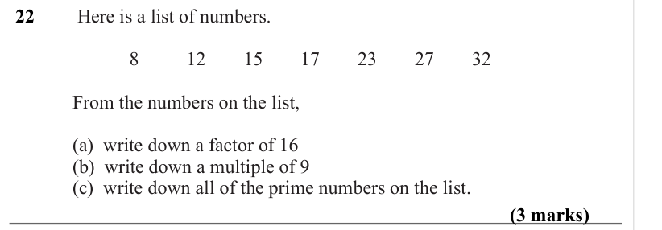

Text (lossy): 22     /  Here is a list of numbers.  / 8 / 12 / 15 / 17 / 23 / 27 / 32 / From the numbers on the list,  / (a)  write down a factor of 16 / (b)  write down a multiple of 9 / (c)  write down all of the prime numbers on the list. / (3 marks)

## Q23 (3 marks)

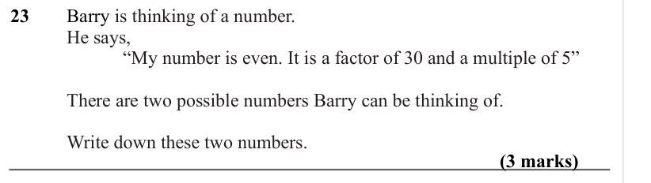

Text (lossy): 23     / Barry is thinking of a number. / He says, / “My number is even. It is a factor of 30 and a multiple of 5” /   / There are two possible numbers Barry can be thinking of. /   / Write down these two numbers. / (3 marks)

## Q24 (3 marks)

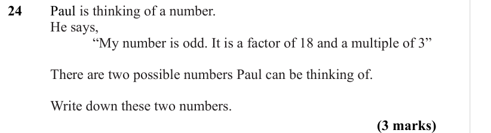

Text (lossy): 24     / Paul is thinking of a number. / He says, / “My number is odd. It is a factor of 18 and a multiple of 3” /   / There are two possible numbers Paul can be thinking of. /   / Write down these two numbers. / (3 marks)

