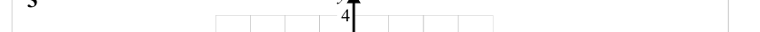
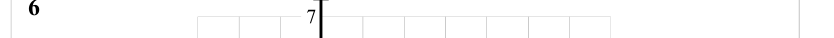

# Coordinates — Exam Questions (GCSE Maths · Edexcel · Grade 1)

Topic code `1.12` · slug `grade-1-1-12-coordinates` · source sheet sha256 `a9ba0fef6f9533af…`

## Q1 (marks not printed)

Text (lossy): 1

## Q2 (marks not printed)

Text (lossy): 2

## Q3 (marks not printed)

Text (lossy): 3

## Q4 (marks not printed)

Text (lossy): 4

## Q5 (marks not printed)

Text (lossy): y / 5

## Q6 (marks not printed)

Text (lossy): 6

## Q7 (marks not printed)

Text (lossy): 7

## Q8 (marks not printed)

Text (lossy): 8

## Q9 (marks not printed)

Text (lossy): 9

