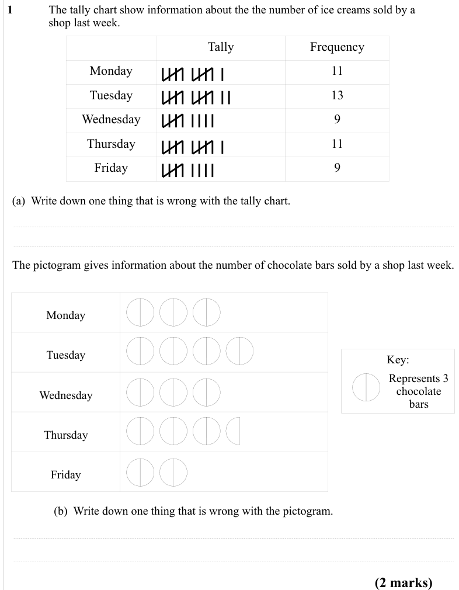
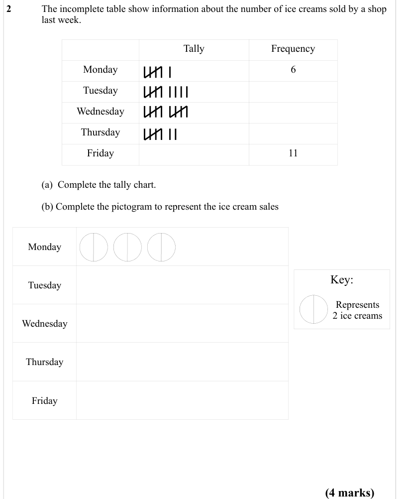
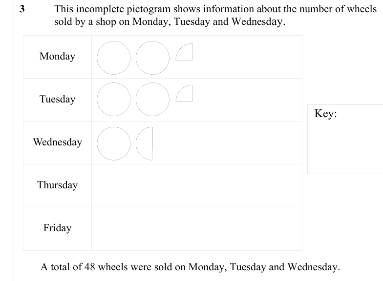
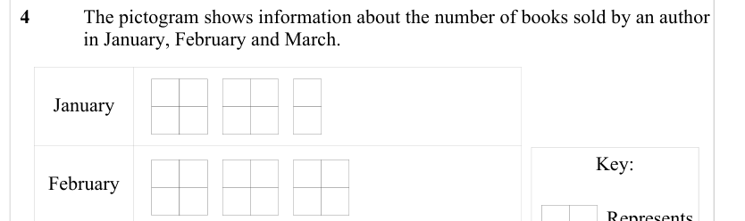
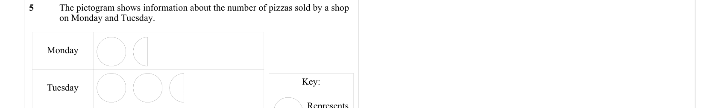

# Pictograms — Exam Questions (GCSE Maths · Edexcel · Grade 1)

Topic code `1.13` · slug `grade-1-1-13-pictograms` · source sheet sha256 `9b3c17f056e512bc…`

## Q1 (2 marks · parts a, b)

Text (lossy): 1  / The tally chart show information about the the number of ice creams sold by a  / shop last week.  / Tally / Frequency / Monday / 11 / Tuesday / 13 / Wednesday / 9 / Thursday / 11 / Friday / 9 / (a)  Write down one thing that is wrong with the tally chart.  / The pictogram gives information about the number of chocolate bars sold by a shop last week. / Monday / Tuesday / Key: / Represents 3  /

## Q2 (4 marks · parts a, b)

Text (lossy): 2  / The incomplete table show information about the number of ice creams sold by a shop / last week.  / Tally / Frequency / Monday / 6 / Tuesday / Wednesday / Thursday / Friday / 11 /   / (a)  Complete the tally chart.  / (b) Complete the pictogram to represent the ice cream sales / Monday / Key: / Tuesday / Represents  / 2 ice creams / Wednesday / Thursday / Friday / (4 marks)

## Q3 (marks not printed)

Text (lossy): 3  / This incomplete pictogram shows information about the number of wheels  / sold by a shop on Monday, Tuesday and Wednesd ay.  / Monday / Tuesday / Key: / Wednesday / Thursday / Friday /   / A total of 48 wheels were sold on Monday, Tuesday and Wednesday.

## Q4 (marks not printed)

Text (lossy): 4  / The pictogram shows information about the number of books sold by an author  / in January, February and March.  / January / Key: / February / Represents

## Q5 (marks not printed)

Text (lossy): 5  / The pictogram shows information about the number of pizzas sold by a shop  / on Monday and Tuesday.  / Monday / Key: / Tuesday / Represents

