# Multiplication and Division — Exam Questions (GCSE Maths · Edexcel · Grade 1)

Topic code `1.2` · slug `grade-1-1-2-multiplication-and-division` · source sheet sha256 `6df4464208356db1…`

## Q1 (2 marks)

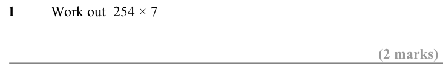

Text (lossy): 1  / Work out  254 × 7 / (2 marks)

## Q2 (2 marks)

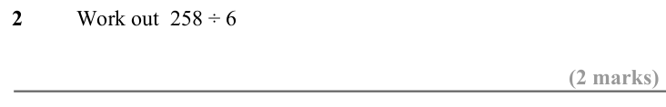

Text (lossy): 2  / Work out  258 ÷ 6 / (2 marks)

## Q3 (2 marks)

Text (lossy): 3  / Work out  1168 ÷ 8 / (2 marks)

## Q4 (2 marks)

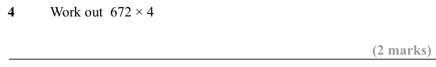

Text (lossy): 4  / Work out  672 × 4 / (2 marks)

## Q5 (2 marks)

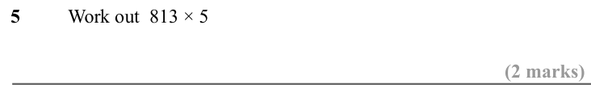

Text (lossy): 5  / Work out  813 × 5 / (2 marks)

## Q6 (2 marks)

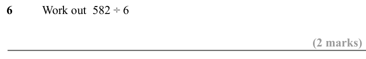

Text (lossy): 6  / Work out  582 ÷ 6 / (2 marks)

## Q7 (2 marks)

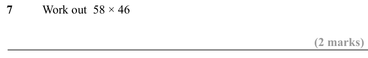

Text (lossy): 7  / Work out  58 × 46 / (2 marks)

## Q8 (2 marks)

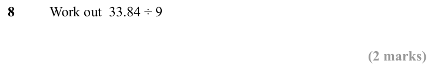

Text (lossy): 8  / Work out  33.84 ÷ 9 / (2 marks)

## Q9 (2 marks)

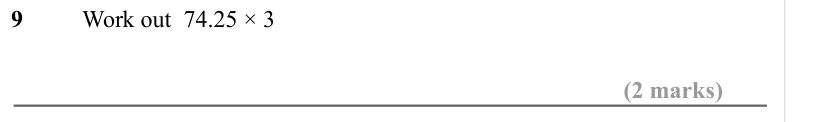

Text (lossy): 9  / Work out  74.25 × 3 / (2 marks)

## Q10 (2 marks)

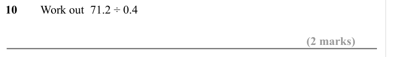

Text (lossy): 10  / Work out  71.2 ÷ 0.4 / (2 marks)

## Q11 (2 marks)

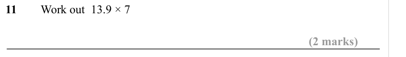

Text (lossy): 11  / Work out  13.9 × 7 / (2 marks)

## Q12 (2 marks)

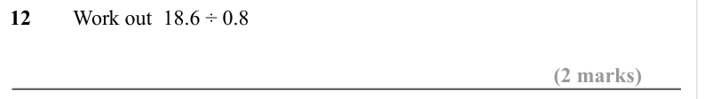

Text (lossy): 12  / Work out  18.6 ÷ 0.8 / (2 marks)

## Q13 (2 marks)

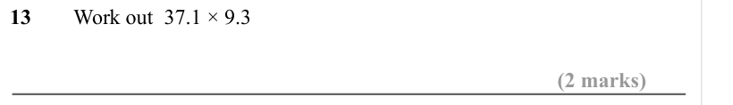

Text (lossy): 13  / Work out  37.1 × 9.3  / (2 marks)

## Q14 (2 marks)

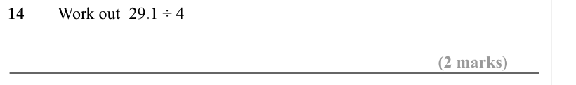

Text (lossy): 14  / Work out  29.1 ÷ 4 / (2 marks)

## Q15 (2 marks)

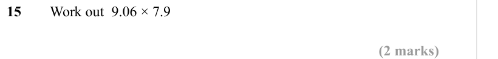

Text (lossy): 15  / Work out  9.06 × 7.9 / (2 marks)

