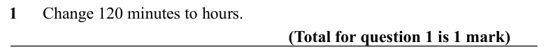
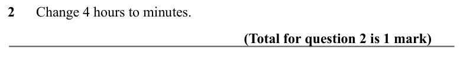
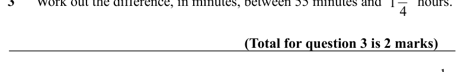
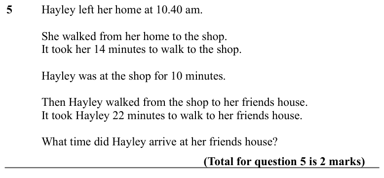
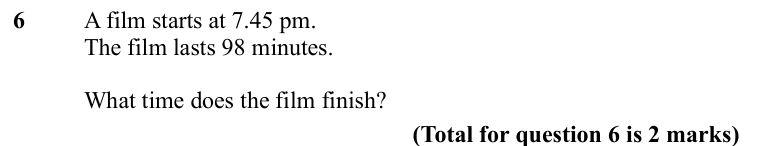
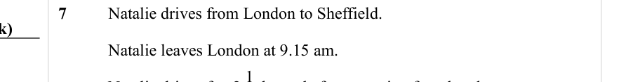
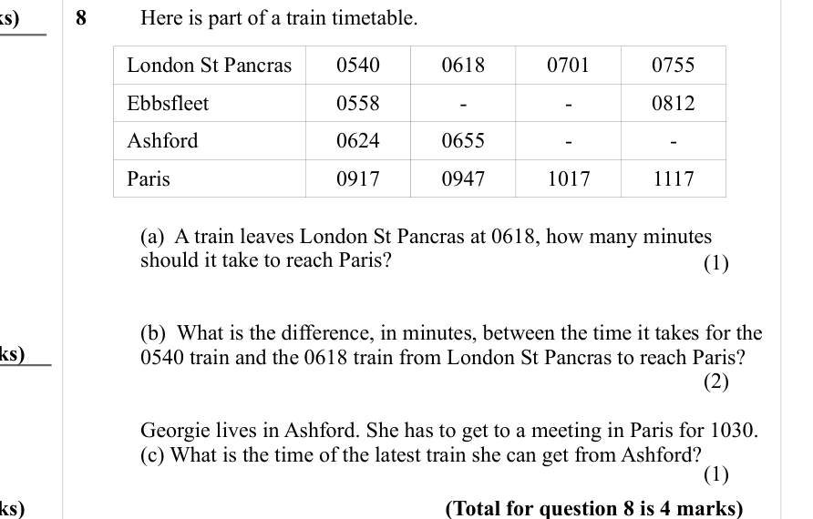
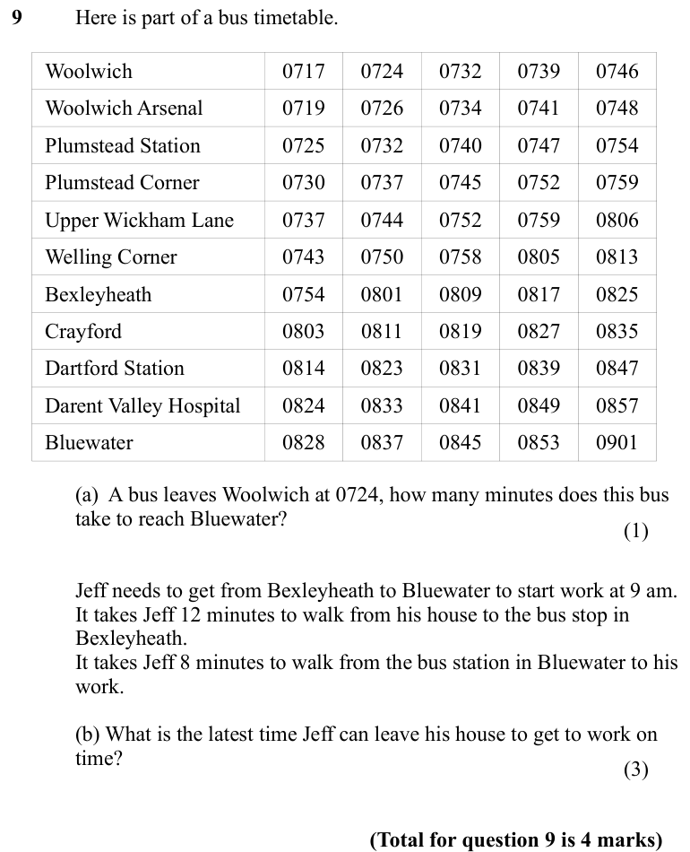
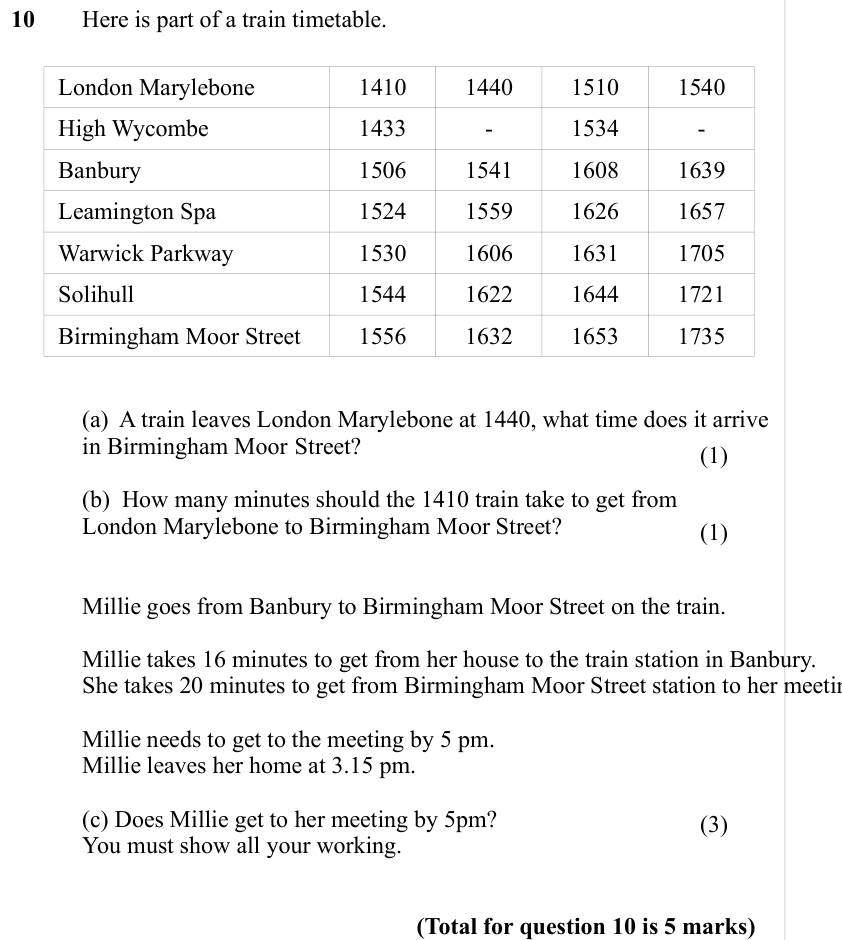

# Time — Exam Questions (GCSE Maths · Edexcel · Grade 1)

Topic code `1.3` · slug `grade-1-1-3-time` · source sheet sha256 `72450ae3026cb5f9…`

## Q1 (marks not printed)

Text (lossy): 1      Change 120 minutes to hours.  / (Total for question 1 is 1 mark)

## Q2 (marks not printed)

Text (lossy): 2      Change 4 hours to minutes. / (Total for question 2 is 1 mark) / 1 3

## Q3 (marks not printed)

Text (lossy): 3      Work out the difference, in minutes, between 55 minutes and          hours.

## Q4 (marks not printed)

Text (lossy): 4 / (Total for question 3 is 2 marks)

## Q5 (marks not printed)

Text (lossy): 5       / Hayley left her home at 10.40 am.  / She walked from her home to the shop.  / It took her 14 minutes to walk to the shop.  / Hayley was at the shop for 10 minutes.  / Then Hayley walked from the shop to her friends house.  / It took Hayley 22 minutes to walk to her friends house.  / What time did Hayley arrive at her friends house? / (Total for question 5 is 2 marks)

## Q6 (marks not printed)

Text (lossy): 6       / A film starts at 7.45 pm.  / The film lasts 98 minutes.  / What time does the film finish? / (Total for question 6 is 2 marks)

## Q7 (marks not printed)

Text (lossy): 7       / Natalie drives from London to Sheffield.  / Natalie leaves London at 9.15 am. / 2 1 / Natalie drives for /  hours before stopping for a break.

## Q8 (marks not printed · parts a, b, c)

Text (lossy): 8       / Here is part of a train timetable.  / London St Pancras / 0540 / 0618 / 0701 / 0755 / Ebbsfleet / 0558 / - / - / 0812 / Ashford / 0624 / 0655 / - / - / Paris / 0917 / 0947 / 1017 / 1117 / (a)  A train leaves London St Pancras at 0618, how many minutes  / should it take to reach Paris? / (1) / (b)  What is the difference, in minutes, between the time it takes for the  / 0540 train and the

## Q9 (marks not printed · parts a, b)

Text (lossy): 9       / Here is part of a bus timetable.  / Woolwich / 0717 / 0724 / 0732 / 0739 / 0746 / Woolwich Arsenal  / 0719 / 0726 / 0734 / 0741 / 0748 / Plumstead Station  / 0725 / 0732 / 0740 / 0747 / 0754 / Plumstead Corner / 0730 / 0737 / 0745 / 0752 / 0759 / Upper Wickham Lane / 0737 / 0744 / 0752 / 0759 / 0806 / Welling Corner / 0743 / 0750 / 0758 / 0805 / 0813 / Bexleyheath / 0754 / 0801 / 0809 / 

## Q10 (marks not printed · parts a, b, c)

Text (lossy): 10      Here is part of a train timetable.  / London Marylebone / 1410 / 1440 / 1510 / 1540 / High Wycombe / 1433 / - / 1534 / - / Banbury / 1506 / 1541 / 1608 / 1639 / Leamington Spa / 1524 / 1559 / 1626 / 1657 / Warwick Parkway / 1530 / 1606 / 1631 / 1705 / Solihull / 1544 / 1622 / 1644 / 1721 / Birmingham Moor Street / 1556 / 1632 / 1653 / 1735 / (a)  A train leaves London Marylebone at 1440, w

