# Metric Conversions — Exam Questions (GCSE Maths · Edexcel · Grade 1)

Topic code `1.4` · slug `grade-1-1-4-metric-conversions` · source sheet sha256 `71673b56c87ae606…`

## Q1 (marks not printed)

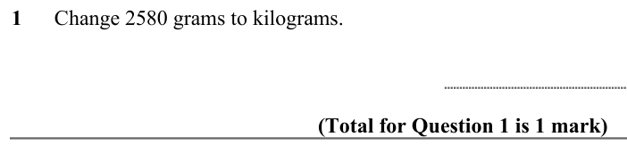

Text (lossy): 1      Change 2580 grams to kilograms. /                     / (Total for Question 1 is 1 mark)

## Q2 (marks not printed)

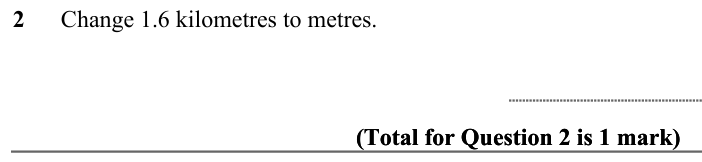

Text (lossy): 2      Change 1.6 kilometres to metres.  / (Total for Question 2 is 1 mark) / (Total for Question 2 is 1 mark)

## Q3 (marks not printed)

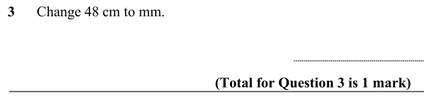

Text (lossy): 3      Change 48 cm to mm.  /                     / (Total for Question 3 is 1 mark)

## Q4 (marks not printed)

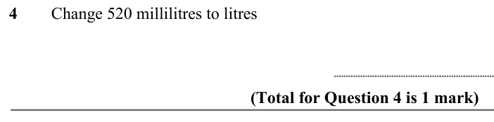

Text (lossy): 4        Change 520 millilitres to litres / (Total for Question 4 is 1 mark)

## Q5 (marks not printed)

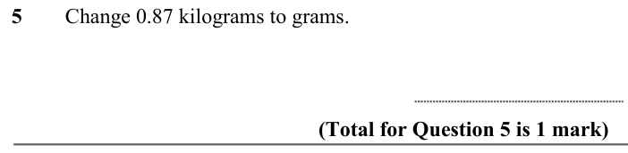

Text (lossy): 5        Change 0.87 kilograms to grams.  / (Total for Question 5 is 1 mark)

## Q6 (marks not printed)

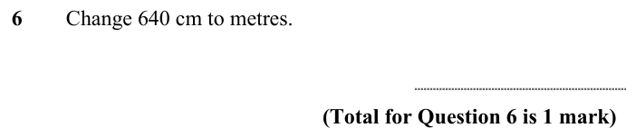

Text (lossy): 6        Change 640 cm to metres.  / (Total for Question 6 is 1 mark)

## Q7 (marks not printed)

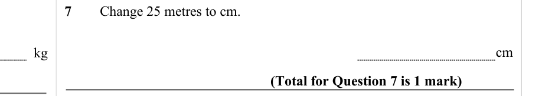

Text (lossy): 7        Change 25 metres to cm.  / cm / kg / (Total for Question 7 is 1 mark)

## Q8 (marks not printed)

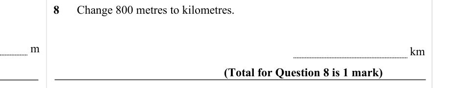

Text (lossy): 8      Change 800 metres to kilometres. / m / km / (Total for Question 8 is 1 mark)

## Q9 (marks not printed)

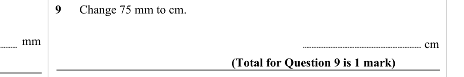

Text (lossy): 9      Change 75 mm to cm.  /                     / mm / cm / (Total for Question 9 is 1 mark)

## Q10 (marks not printed)

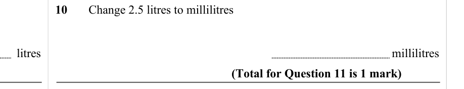

Text (lossy): 10       Change 2.5 litres to millilitres / millilitres / litres / (Total for Question 11 is 1 mark)

## Q11 (marks not printed)

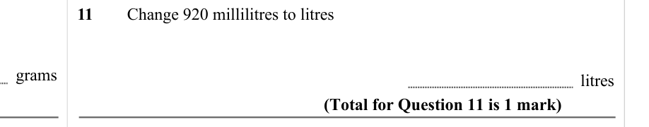

Text (lossy): 11        Change 920 millilitres to litres / grams / litres / (Total for Question 11 is 1 mark)

## Q12 (marks not printed)

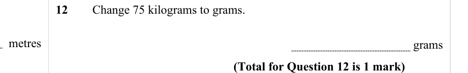

Text (lossy): 12        Change 75 kilograms to grams.  /  metres / grams / (Total for Question 12 is 1 mark)

