# Place Value — Exam Questions (GCSE Maths · Edexcel · Grade 1)

Topic code `1.6` · slug `grade-1-1-6-place-value` · source sheet sha256 `7fcfcad5cd7d2ef4…`

## Q1 (marks not printed)

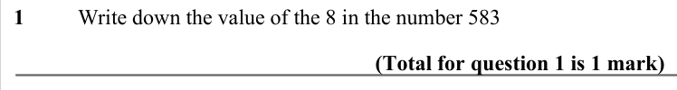

Text (lossy): 1  / Write down the value of the 8 in the number 583 / (Total for question 1 is 1 mark)

## Q2 (marks not printed)

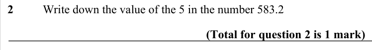

Text (lossy): 2  / Write down the value of the 5 in the number 583.2 / (Total for question 2 is 1 mark)

## Q3 (marks not printed)

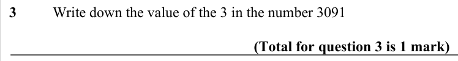

Text (lossy): 3  / Write down the value of the 3 in the number 3091 / (Total for question 3 is 1 mark)

## Q4 (marks not printed)

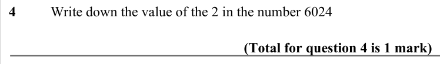

Text (lossy): 4  / Write down the value of the 2 in the number 6024 / (Total for question 4 is 1 mark)

## Q5 (marks not printed)

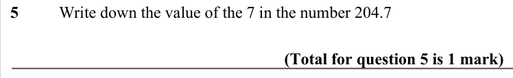

Text (lossy): 5  / Write down the value of the 7 in the number 204.7 / (Total for question 5 is 1 mark)

## Q6 (marks not printed)

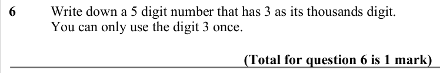

Text (lossy): 6  / Write down a 5 digit number that has 3 as its thousands digit. /   / You can only use the digit 3 once. / (Total for question 6 is 1 mark)

## Q7 (marks not printed)

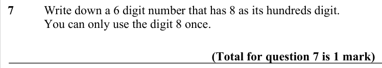

Text (lossy): 7  / Write down a 6 digit number that has 8 as its hundreds digit. /   / You can only use the digit 8 once. / (Total for question 7 is 1 mark)

## Q8 (marks not printed)

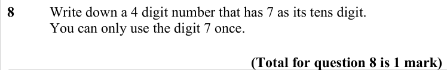

Text (lossy): 8  / Write down a 4 digit number that has 7 as its tens digit. /   / You can only use the digit 7 once. / (Total for question 8 is 1 mark)

## Q9 (marks not printed)

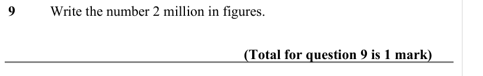

Text (lossy): 9  / Write the number 2 million in figures.  / (Total for question 9 is 1 mark)

## Q10 (marks not printed)

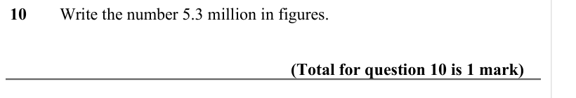

Text (lossy): 10  / Write the number 5.3 million in figures.  / (Total for question 10 is 1 mark)

## Q11 (marks not printed · parts a, b)

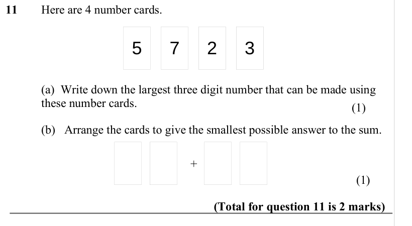

Text (lossy): 11  / Here are 4 number cards.  / 5 / 7 / 2 / 3 / (a)  Write down the largest three digit number that can be made using  / these number cards. / (1) / (b)   Arrange the cards to give the smallest possible answer to the sum.  / + / (1) / (Total for question 11 is 2 marks)

## Q12 (marks not printed)

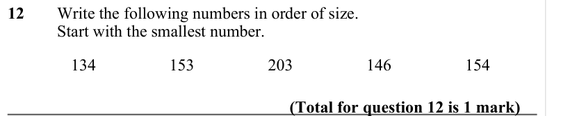

Text (lossy): 12  / Write the following numbers in order of size. /   / Start with the smallest number. / 134 / 153 / 203 / 146 / 154 / (Total for question 12 is 1 mark)

## Q13 (marks not printed · parts a, b)

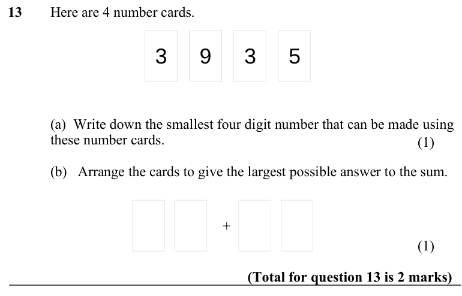

Text (lossy): 13  / Here are 4 number cards.  / 3 / 9 / 3 / 5 / (a)  Write down the smallest four digit number that can be made using  / these number cards. / (1) / (b)   Arrange the cards to give the largest possible answer to the sum.  / + / (1) / (Total for question 13 is 2 marks)

## Q14 (marks not printed)

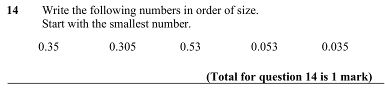

Text (lossy): 14  / Write the following numbers in order of size. /   / Start with the smallest number. / 0.35 / 0.305 / 0.53 / 0.053 / 0.035 / (Total for question 14 is 1 mark)

## Q15 (marks not printed)

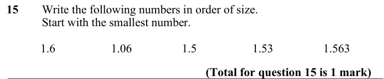

Text (lossy): 15  / Write the following numbers in order of size. /   / Start with the smallest number. / 1.6 / 1.06 / 1.5 / 1.53 / 1.563 / (Total for question 15 is 1 mark)

## Q16 (marks not printed)

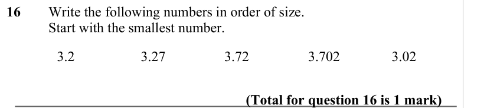

Text (lossy): 16  / Write the following numbers in order of size. /   / Start with the smallest number. / 3.2 / 3.27 / 3.72 / 3.702 / 3.02 / (Total for question 16 is 1 mark)

