# Negative Numbers — Exam Questions (GCSE Maths · Edexcel · Grade 1)

Topic code `1.8` · slug `grade-1-1-8-negative-numbers` · source sheet sha256 `324be4c696f2270c…`

## Q1 (1 marks)

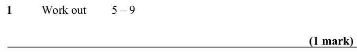

Text (lossy): 1  / Work out / 5 – 9  / (1 mark)

## Q2 (1 marks)

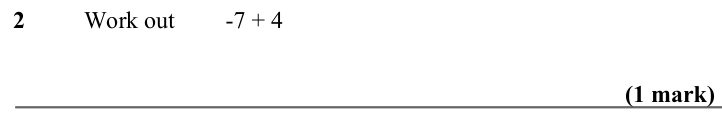

Text (lossy): 2  / Work out / -7 + 4 / (1 mark)

## Q3 (1 marks)

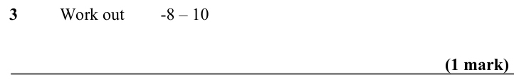

Text (lossy): 3  / Work out / -8 – 10 / (1 mark)

## Q4 (1 marks)

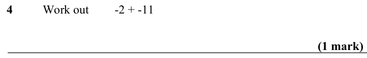

Text (lossy): 4  / Work out / -2 + -11 / (1 mark)

## Q5 (1 marks)

Text (lossy): 5  / Work out / 7 – -9 / (1 mark)

## Q6 (1 marks)

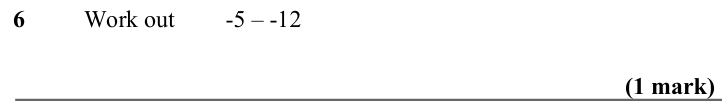

Text (lossy): 6  / Work out / -5 – -12  / (1 mark)

## Q7 (1 marks)

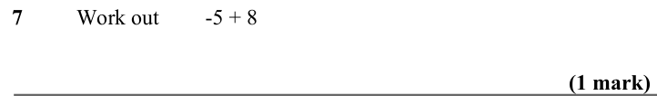

Text (lossy): 7  / Work out / -5 + 8 / (1 mark)

## Q8 (1 marks)

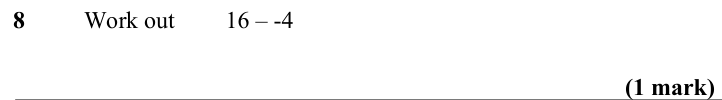

Text (lossy): 8  / Work out / 16 – -4 / (1 mark)

## Q9 (1 marks)

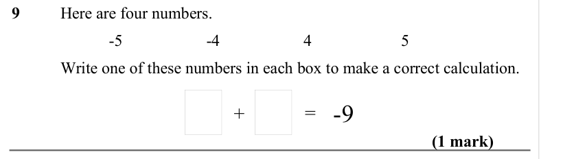

Text (lossy): 9  / Here are four numbers. / -5 / -4 / 4 / 5 / Write one of these numbers in each box to make a correct calculation.  / (1 mark) / + / = -9

## Q10 (1 marks)

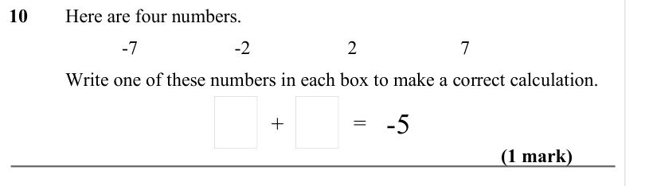

Text (lossy): 10  / Here are four numbers. / -7 / -2 / 2 / 7 / Write one of these numbers in each box to make a correct calculation.  / (1 mark) / + / = -5

## Q11 (1 marks)

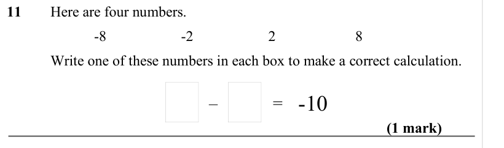

Text (lossy): 11  / Here are four numbers. / -8 / -2 / 2 / 8 / Write one of these numbers in each box to make a correct calculation.  / (1 mark) / = -10 / –

## Q12 (1 marks)

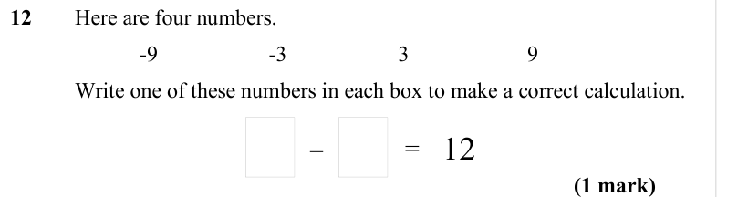

Text (lossy): 12  / Here are four numbers. / -9 / -3 / 3 / 9 / Write one of these numbers in each box to make a correct calculation.  / (1 mark) / = 12 / –

## Q13 (1 marks)

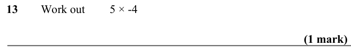

Text (lossy): 13  / Work out / 5 × -4 / (1 mark)

## Q14 (1 marks)

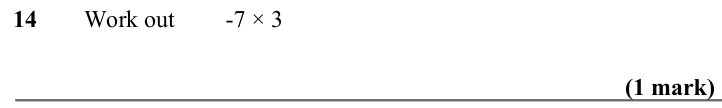

Text (lossy): 14  / Work out / -7 × 3 / (1 mark)

## Q15 (1 marks)

Text (lossy): 15  / Work out / -2 × -6 / (1 mark)

## Q16 (1 marks)

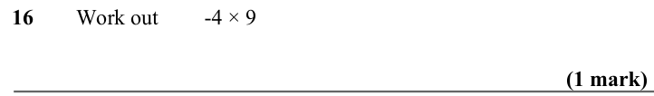

Text (lossy): 16  / Work out / -4 × 9 / (1 mark)

## Q17 (1 marks)

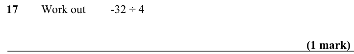

Text (lossy): 17  / Work out / -32 ÷ 4 / (1 mark)

## Q18 (1 marks)

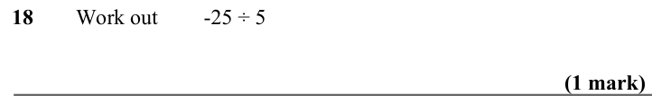

Text (lossy): 18  / Work out / -25 ÷ 5 / (1 mark)

## Q19 (1 marks)

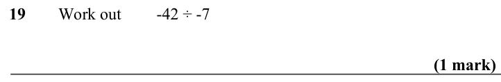

Text (lossy): 19  / Work out / -42 ÷ -7 / (1 mark)

## Q20 (1 marks)

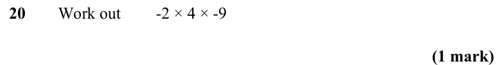

Text (lossy): 20  / Work out / -2 × 4 × -9 / (1 mark)

## Q21 (1 marks)

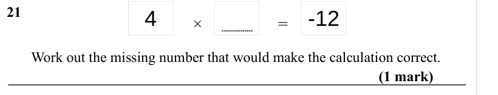

Text (lossy): 21  / 4 / × / = / -12 / (1 mark) / Work out the missing number that would make the calculation correct.

## Q22 (1 marks)

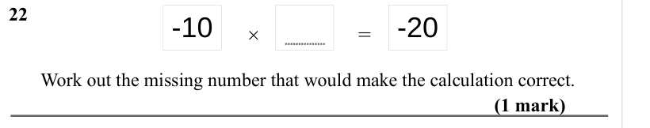

Text (lossy): 22  / -10 / × / = / -20 / (1 mark) / Work out the missing number that would make the calculation correct.

## Q23 (1 marks)

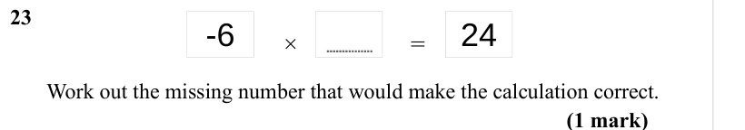

Text (lossy): 23  / -6 / × / = / 24 / (1 mark) / Work out the missing number that would make the calculation correct.

## Q24 (marks not printed)

Text (lossy): 24

## Q25 (2 marks)

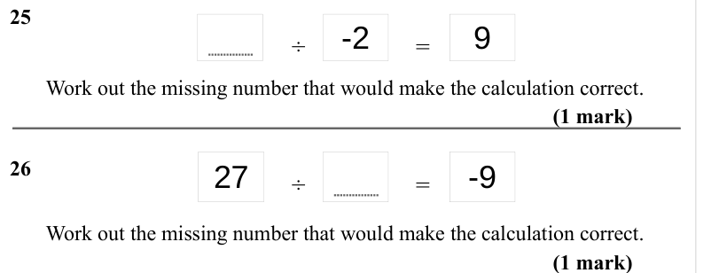

Text (lossy): 25  / -2 / ÷ / = / 9 / Work out the missing number that would make the calculation correct.  / (1 mark) / 26 / 27 / ÷ / = / -9 / Work out the missing number that would make the calculation correct.  / (1 mark)

