# Powers and Roots — Exam Questions (GCSE Maths · Edexcel · Grade 1)

Topic code `1.9` · slug `grade-1-1-9-powers-and-roots` · source sheet sha256 `38c0d01ceeaf2aed…`

## Q1 (1 marks)

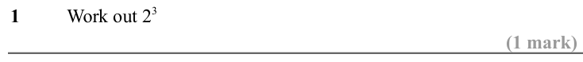

Text (lossy): 1  / Work out 2 3 / (1 mark)

## Q2 (1 marks)

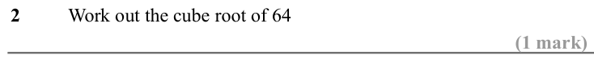

Text (lossy): 2  / Work out the cube root of 64 / (1 mark)

## Q3 (1 marks)

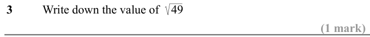

Text (lossy): 3  / Write down the value of    49 / (1 mark)

## Q4 (1 marks)

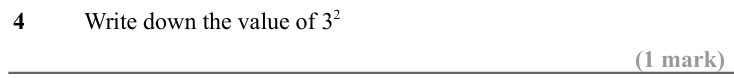

Text (lossy): 4  / Write down the value of 3 2 / (1 mark)

## Q5 (1 marks)

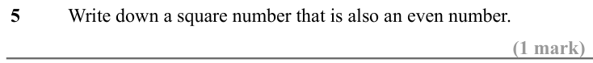

Text (lossy): 5  / Write down a square number that is also an even number. / (1 mark)

## Q6 (1 marks)

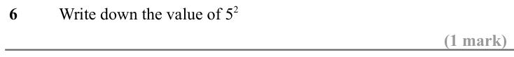

Text (lossy): 6  / Write down the value of 5 2 / (1 mark)

## Q7 (1 marks)

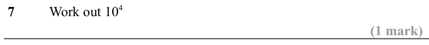

Text (lossy): 7  / Work out 10 4 / (1 mark)

## Q8 (1 marks)

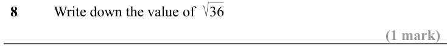

Text (lossy): 8  / Write down the value of    36 / (1 mark)

## Q9 (1 marks)

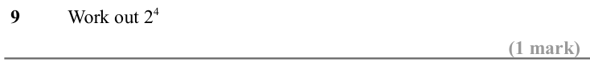

Text (lossy): 9  / Work out 2 4 / (1 mark)

## Q10 (1 marks)

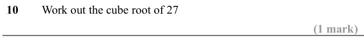

Text (lossy): 10  / Work out the cube root of 27 / (1 mark)

## Q11 (1 marks)

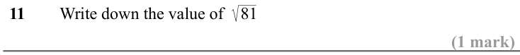

Text (lossy): 11  / Write down the value of    81 / (1 mark)

## Q12 (1 marks)

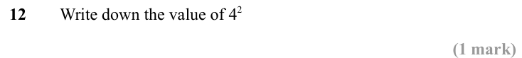

Text (lossy): 12 / Write down the value of 4 2 / (1 mark)

## Q13 (1 marks)

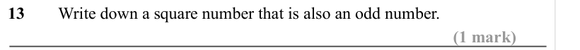

Text (lossy): 13  / Write down a square number that is also an odd number. / (1 mark)

## Q14 (1 marks)

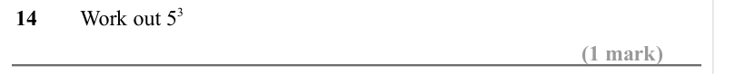

Text (lossy): 14  / Work out 5 3 / (1 mark)

## Q15 (1 marks)

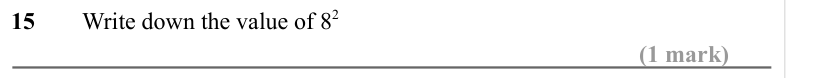

Text (lossy): 15  / Write down the value of 8 2 / (1 mark)

## Q16 (1 marks)

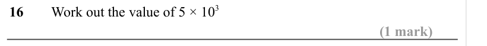

Text (lossy): 16  / Work out the value of 5 × 10 3 / (1 mark)

## Q17 (1 marks)

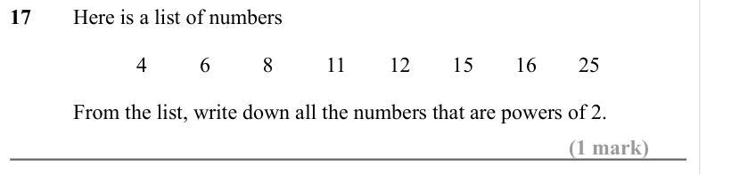

Text (lossy): 17  / Here is a list of numbers / 4 / 6 / 8 / 11 / 12 / 15 / 16 / 25 / From the list, write down all the numbers that are powers of 2.  / (1 mark)

## Q18 (1 marks)

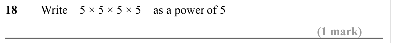

Text (lossy): 18  / Write    5 × 5 × 5 × 5    as a power of 5 / (1 mark)

## Q19 (1 marks)

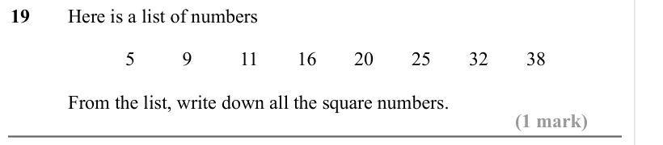

Text (lossy): 19  / Here is a list of numbers / 5 / 9 / 11 / 16 / 20 / 25 / 32 / 38 / From the list, write down all the square numbers.  / (1 mark)

## Q20 (1 marks)

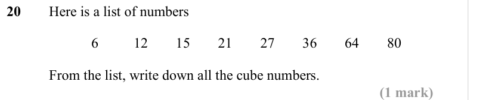

Text (lossy): 20  / Here is a list of numbers / 6 / 12 / 15 / 21 / 27 / 36 / 64 / 80 / From the list, write down all the cube numbers.  / (1 mark)

